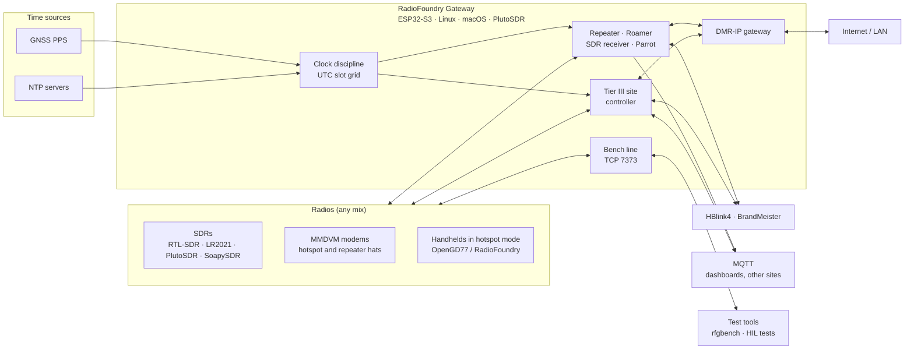

# RadioFoundry Gateway

**Open-source DMR infrastructure for the radios you already have.** A Tier III trunked site, a repeater or hotspot
controller, a multi-channel SDR monitor, a DMR-IP data gateway and a radio test bench, in any combination. It runs on
an ESP32-S3, a Raspberry Pi or another Linux / macOS box, and on a PlutoSDR's own ARM.


## Highlights

- 🗼 **A DMR Tier III trunked site** (ETSI TS 102 361-4): control channel, registration, group and individual calls,
  data, emergency, roaming between sites. As far as we know, the only open-source Tier III site controller.
- 🔌 **Use the hardware you have:** a stock MMDVM hotspot or repeater modem, a handheld in hotspot mode, an RTL-SDR,
  a PlutoSDR, the Meshnology W12's built-in LR2021, or any mix of them.
- 🔁 **Repeater and hotspot controller** for the modems already in hotspots and repeaters, with split duplex, SFR
  and dual capacity direct mode.
- 📏 **A radio test and measurement bench** on TCP port 7373: captures, triggers, decoded bursts, carrier tracking,
  PA ramps, and transmit and receive jobs in FM, AM, DMR, P25, NXDN, dPMR, M17 and D-STAR, several carriers at once.
- 📡 **Hear many channels at once:** up to 6 on an ESP32-S3, 10+ on a Raspberry Pi, 16 on a PlutoSDR clone with the
  FPGA channelizer.
- 🔗 **Networks:** HBlink4, BrandMeister (a hotspot, a repeater or a whole trunked site as one login), MQTT, and a
  site-to-site MQTT network, with rules for which calls go where.
- 🛰️ **UTC-disciplined timing:** GNSS PPS or NTP. DMR slots and SDR samples are locked to UTC, the groundwork for
  voting and simulcast.
- 🌐 **DMR-IP gateway:** radios' ARS, text, location and UDP apps reach the internet, no PC.
- 🧪 **Tested byte for byte** against golden fixtures on the host, with an ETSI conformance suite for Tier III and
  hardware-in-the-loop tests on boards.

## How it fits together



## A Tier III trunked site

The `tier3` app is a standard DMR Tier III trunked station ([tier3.md](docs/spec/fw/tier3.md)). Radios register on
a control channel (TSCC), ask for calls, and are sent to a free payload channel for each one.

| Area | What it does |
|---|---|
| Control channel | A dedicated TSCC, or a composite one that lends its slot to a call when every channel is busy; a hibernating TSCC; C_MOVE |
| Carriers | 1 to 4 out of one SDR, a carrier on a stock duplex MMDVM modem, or carriers on split radios |
| Registration | Open or by ID list, talkgroup subscription and lists, DGNA, MS authentication, power save |
| Calls | Group, individual (with the availability check), broadcast, all-call, full duplex; queueing by priority |
| Emergency | Emergency calls and alarms, pre-emption, transmit interrupt |
| Data | Status, UDT short data and polls, packet data at rate 1/2, 3/4 and 1, through the site's IP gateway |
| Services | Stun, revive, kill, ambient listening, call diversion, the radio check |
| Multi-site | Sites linked over the MQTT network: wide-area calls, data across sites, roaming by Vote_Now and site priority, a standby controller |
| BrandMeister | The whole site as one repeater login, talkgroups placed on its two slots as calls come |

It runs on a PlutoSDR (one SDR for every carrier) or on a Raspberry Pi with a duplex MMDVM_HS hat and an RTL-SDR.
Two sites have run on air together, with radios registering, calling, sending data and roaming between them, and a
site has run on the BrandMeister network. The radios tested run RadioFoundry's MS engine; no other maker's Tier III
radio has been tried yet. Templates: [config/examples/](config/examples/README.md) (`ham-tier3-*.json`).

## A test and measurement bench

Every gateway serves a bench line protocol on TCP port 7373 ([bench-api.md](docs/spec/bench-api.md) section 14). A
W12 board or a PlutoSDR becomes a networked instrument for testing radios, and `tools/bench/rfgbench.py` drives it
from the command line or from HIL tests.

- **Receive:** I/Q captures (with pre-trigger history), level triggers, decoded DMR bursts with BER and timing,
  a carrier's frequency over a keying (`track`), PA ramps per burst. FM receive decodes DTMF, timed tones and APRS.
- **Transmit:** FM and AM test programs (tones, sweeps, DTMF, AFSK, CTCSS, DCS); DMR voice, CSBK, data and raw bursts;
  4FSK frames built on the gateway for P25, DMR, NXDN, dPMR, M17 and D-STAR; your own I/Q. Several 4FSK carriers can
  go out in one keying, such as a P25 control channel and a voice channel together.
- **Repeater and responder jobs:** a DMR repeater on the bench, P25 and NXDN on an MMDVM modem, a timed
  confirmed-data responder for testing retries.
- **Numbers you can trust:** each frequency report says how far to trust it. The gateway corrects its own crystal
  against GNSS or NTP to a fraction of a ppm.
- **Shared safely:** sessions, claims, queues and transmit gates let several tools share one bench. Gateways are
  found by DNS-SD.

## Mix and match radios

Each board runs what its settings make ([config-v3.md](docs/spec/fw/config-v3.md)): up to **two roamers or repeaters
plus one SDR** on an ESP32-S3, more on a host.

| Radio | Connects by | Receive | Transmit | Duplex |
|---|---|:-:|:-:|---|
| RTL-SDR (R820T / R828D) | USB | ✅ multi-channel | — | — |
| LR2021 (Meshnology W12, on board) | SPI | ✅ multi-channel | ✅ | half |
| Handheld in hotspot mode ([OpenGD77](https://www.opengd77.com/), [RadioFoundry](https://github.com/RadioFoundry/RadioFoundry)) | USB or UART | ✅ | ✅ | half or full |
| MMDVM modem (MMDVM_HS hats, ZUMspot, a repeater's MMDVM board), stock firmware | UART or USB | ✅ | ✅ | half or full |
| Any SoapySDR device (Linux / macOS): RTL-SDR and PlutoSDR tested; LimeSDR, HackRF, USRP B200 and others ([list](docs/reference.md)) | `rdofsdr` | ✅ multi-channel | — | — |
| A SoapySDR device that transmits, or an AD9361 / AD9363 through libiio | `rdofradio` | ✅ | ✅ | half or full |
| PlutoSDR family (7010 / 7020, stock firmware), on its own ARM | `rdofradio --iio local:` | ✅ multi-channel | ✅ multi-carrier | half or full |
| PlutoSDR 7010 clone with the FPGA channelizer and upconverter (`tools/pluto/fpga/`) | `rdofradio --fpga-chz` | ✅ 16 channels | ✅ multi-carrier | half or full |

Some combinations:

| You have | You get |
|---|---|
| A Raspberry Pi with an MMDVM hat | A hotspot or repeater with a web page and the bench line, on BrandMeister, HBlink4 or MQTT |
| A duplex MMDVM hat + an RTL-SDR | A one-carrier Tier III site, or a repeater that also measures its own input |
| A PlutoSDR alone | A full duplex repeater, or a Tier III site with up to 4 carriers, on the stock firmware |
| A PlutoSDR 7010 clone | Up to 16 monitored channels and a bench instrument for transmit tests |
| ESP32-S3 + RTL-SDR | A 5-channel receive site feeding HBlink4 and MQTT |
| Meshnology W12 | A 6-channel monitor **and** a half-duplex roamer on one board, with GNSS time; a bench instrument |
| ESP32-S3 + two handhelds | A **split duplex** repeater: one radio receives, the other transmits |
| ESP32-S3 + HAT + RTL-SDR | A repeater plus a wide-area monitor, one box |

A powered USB hub runs two USB radios at once. An optional SSD1306 OLED shows the board's state.

## Features

**Repeater and roamer**

- Duplex repeater, per-slot network, RF priority, hang time, CW ID
- Split duplex: two radios act as one repeater
- Single-frequency repeater (SFR) and **dual capacity direct mode** (DCDM: two simplex calls on one frequency)
- Roaming transceiver: talkgroup routing, listen-before-talk, jitter buffer, scan
- Parrot (echo) on a talkgroup, with no network needed

**SDR receiver and transmitter**

- Channelizer, demodulator and AGC tuned for the S3's SIMD and FFT, and an FPGA channelizer on the PlutoSDR
- Learns the tuner's ppm error from its sample clock against a time reference
- The SDR can transmit too, as an emulated MMDVM modem; a PlutoSDR sends several carriers from one stream

**Network**

- HBlink4: a peer per radio and per SDR channel; DMRT / DMRK call routing; SCTP over UDP for the roamer
- BrandMeister: the homebrew login as a simplex hotspot, a repeater or a Tier III site, a login per path
- Rules: which talkgroups and calls each network may carry
- MQTT 5 (with 3.1.1 fallback): calls in MMDVMHost's JSON, raw bursts (57 bytes each on the wire), retained status,
  optional TLS
- The MQTT network (mqtt-net): calls between boxes and sites over a broker, no HBlink needed

**DMR-IP gateway**

- Rebuilds IPv4 datagrams from DMR packet data heard by any receiver
- Static routes by private call, talkgroup or source radio
- UDP and ping through NAT, with replies sent back over the air
- Firewall: private ranges denied by default, rate limits, flow and size caps

**Disciplined time**

- **Sources, best first:** GNSS PPS (the W12's L76K header), NTP (up to 6 servers), GNSS NMEA alone, the browser
- **NTP selection:** Marzullo's algorithm drops falsetickers and outliers
- **Crystal rate and temperature:** a least-squares fit learns the crystal's ppm error, and a rate-against-temperature
  table corrects drift. Both are kept across restarts
- **No jumps:** corrections are slewed in; it steps only when three references in a row are over 200 ms off
- **On the air:** DMR slots are laid on UTC, and SDR transmit steers to the grid one sample at a time. In the host
  tests a crystal 25 ppm fast stays within 97 µs of the grid

**Board and host**

- Web page and JSON API: live spectrum and waterfall, Last heard, settings, Wi-Fi, clock, OTA, crash dumps
- Wi-Fi with up to 8 networks and priorities; OTA updates, core dumps with backtraces, log ring, task list
- Core modules in Rust by default (`CONFIG_RDOF_RUST=n` / `-DRDOF_RUST=OFF` keeps their C; Tier III is Rust only)

## Hardware

| Profile | Board | Notes |
|---|---|---|
| `16mb` + `w12` | Meshnology W12 | LR2021, OLED, L76K GNSS header. Best at 902–928 MHz; at UHF its filter costs about 46 dB, so it hears only nearby transmitters |
| `16mb` | ESP32-S3 N16R8 | 16 MB flash, 8 MB PSRAM |
| `4mb` | ESP32-S3 SuperMini | 4 MB flash, 2 MB PSRAM |
| Linux / macOS | PC, Raspberry Pi | `rdofsdr` (SoapySDR or a recording), `rdofradio` (modems, SDRs, Tier III) |
| PlutoSDR | its Zynq's ARM | `rdofradio --iio`, built by `tools/pluto/build.sh`, installed to run at boot ([plutosdr.md](docs/plutosdr.md)) |

## Protocol additions

A few additions to the standard protocols, which we aim to upstream:

- **HBlink4:** DMRT / DMRK call routing, SCTP over UDP ([hblink.md](docs/spec/fw/hblink.md))
- **MMDVM modem protocol:** split duplex and DCDM ([radio.md](docs/spec/fw/radio.md))
- **MQTT network:** calls, Tier III registration and call setup between sites ([mqtt-net.md](docs/spec/fw/mqtt-net.md))

## Quick start

| You have | Start here |
|---|---|
| A Raspberry Pi with an MMDVM_HS hat | [docs/raspberry-pi.md](docs/raspberry-pi.md): a hotspot, a repeater, a Tier III site or a bench line, as a service |
| A PlutoSDR | [docs/plutosdr.md](docs/plutosdr.md): `rdofradio` on its own ARM, installed to start at boot |
| A Meshnology W12, an ESP32-S3 N16R8 or a SuperMini | [docs/esp32-boards.md](docs/esp32-boards.md): build, flash, Wi-Fi, updates |
| Linux or macOS with an SDR or a modem | [docs/linux-macos.md](docs/linux-macos.md): `rdofsdr`, `rdofradio`, the web page, the bench line |

Then the settings: [docs/settings.md](docs/settings.md), and complete files in [config/examples/](config/examples/README.md).

Host tests (CMake, a C compiler and cargo):

```sh
cmake -S host-tests -B build/host && cmake --build build/host && ctest --test-dir build/host
```

<details>
<summary>System tests and hardware-in-the-loop tests</summary>

The system tests need a [RadioFoundry](https://github.com/RadioFoundry/RadioFoundry) checkout at the commit in
`systest/radiofoundry.ref`; without it they're skipped.

```sh
git clone https://github.com/RadioFoundry/RadioFoundry ../RadioFoundry && git -C ../RadioFoundry checkout $(cat systest/radiofoundry.ref)
cmake -S . -B build/linux -DRADIOFOUNDRY_DIR=$PWD/../RadioFoundry && cmake --build build/linux && ctest --test-dir build/linux
```

Hardware-in-the-loop tests against a running board: `RDOF_BOARD=<board ip> python -m pytest -q hil-tests`.

</details>

## Status

Running on hardware:

- **Tier III:** two sites on air (a PlutoSDR and a duplex MMDVM hat) with radios, and a site on BrandMeister.
- **Repeaters and hotspots:** a duplex MMDVM_HS hat with an RTL-SDR, as a repeater and a bench line, run as a service.
- **SDR receive and transmit:** the SuperMini, N16R8 and W12. The W12 also transmits as a roamer and as a bench
  instrument.
- **PlutoSDR:** a 7010 clone with the FPGA channelizer and upconverter, as a Tier III site and a bench instrument,
  multi-carrier transmit included.

Host-tested, not yet run with radios: Tier III carriers on split radios, three or four carriers on one SDR,
full-duplex Tier III calls, the standby controller.

See [docs/reference.md](docs/reference.md) for what's been measured and what's left.

## Docs

[docs/README.md](docs/README.md) is the index. In short:

- Guides: [ESP32 boards](docs/esp32-boards.md), [Raspberry Pi](docs/raspberry-pi.md),
  [Linux and macOS](docs/linux-macos.md), [PlutoSDR](docs/plutosdr.md), [settings](docs/settings.md)
- [docs/reference.md](docs/reference.md): building and testing, the firmware, the SDR, the host tools and the PlutoSDR
- [docs/spec/](docs/spec/): how each part works, starting with [overview.md](docs/spec/fw/overview.md)
- [config/examples/](config/examples/README.md): complete settings files
- `components/*/README.md`: standalone ESP-IDF components (netclock, wifilist, tinysctp, lr2021, gnss)
- [rust/README.md](rust/README.md): the Rust modules
- [tools/pluto/bundle/README.md](tools/pluto/bundle/README.md): the PlutoSDR installer

## Contributing

See [CONTRIBUTING.md](CONTRIBUTING.md), [SECURITY.md](SECURITY.md) for reporting vulnerabilities, and
[CODE_OF_CONDUCT.md](CODE_OF_CONDUCT.md).

## License

MIT, see [LICENSE](LICENSE). Third-party code and its licenses are listed in [PROVENANCE.md](PROVENANCE.md)
and [LICENSES/](LICENSES/).

## Acknowledgements

- SAMS0N1TE, for [lr2021-sdr](https://github.com/SAMS0N1TE/lr2021-sdr): the first to find and document the
  LR2021's undocumented raw I/Q receive and transmit paths. Our LR2021 front end is written from the facts in its
  docs (no code taken). Without that discovery the W12 wouldn't be an SDR.
- Semtech, for the LR2021 datasheet the `lr2021` driver is written from.
- ETSI, for the DMR standards (TS 102 361), Tier III trunking (TS 102 361-4) included.
- Jonathan Naylor (G4KLX), for MMDVM and MMDVMHost: the modem protocol and the call JSON format we follow.
- The HBlink4 project, the network the gateway peers with.
- The OpenGD77 project, whose hotspot mode makes a handheld a gateway radio.
- RadioFoundry, for the DMR FEC, CACH, LC and CRC code (MIT).
- DSD and mbelib ([szechyjs/dsd](https://github.com/szechyjs/dsd), [szechyjs/mbelib](https://github.com/szechyjs/mbelib)):
  the AMBE+2 frame tables and decode (ISC).
- Mark Borgerding's [KISS FFT](https://github.com/mborgerding/kissfft): the structure of our FFT (BSD-3-Clause).
- Adafruit's [GFX library](https://github.com/adafruit/Adafruit-GFX-Library): the 5x7 OLED font (BSD-2-Clause).
- Howard Hinnant, for the published `days_from_civil` date algorithm.
- chrony (Miroslav Lichvar and contributors), whose documented behavior netclock's NTP client follows (no chrony
  code), and David L. Mills, for NTP (RFC 5905).
- Realtek's RTL2832U datasheet, Rafael Micro's R820T2 register description and Jacobo Tarrio's
  [webrtlsdr](https://github.com/jtarrio/webrtlsdr) (Apache-2.0), for the register facts our RTL-SDR driver is
  written from (docs/spec/rtlsdr.md).
- Meshtastic's and MeshCore's W12 support, for the board's pin and front-end details.
- Espressif, for ESP-IDF, esp-dsp and the USB host drivers.
