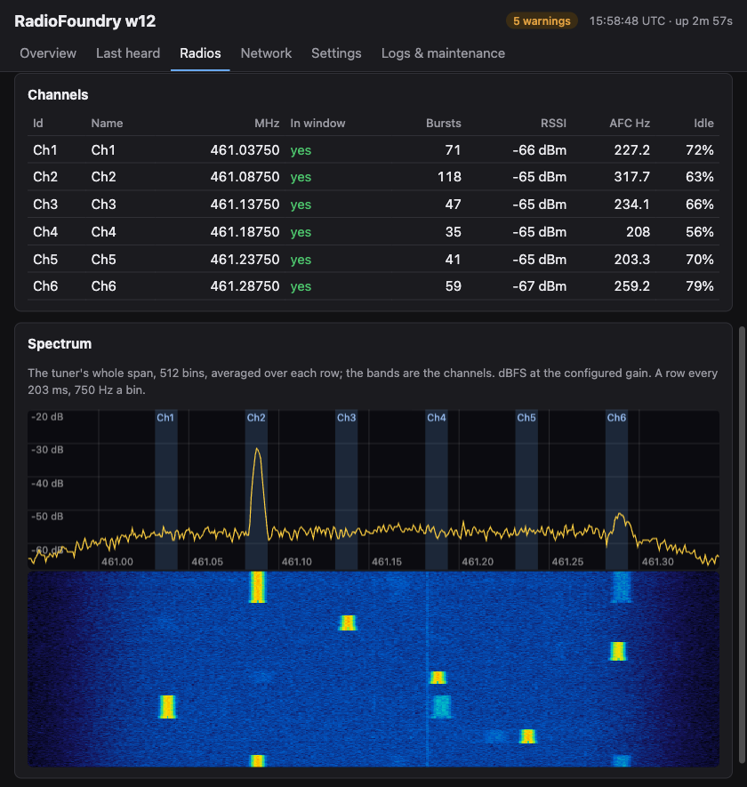

# RadioFoundry Gateway

A unified DMR repeater controller, DMR hotspot / network gateway, DMR-IP data gateway, and multi-frequency monitoring software for the ESP32-S3, Linux, and macOS, supporting a broad range of radio hardware.

- **What it runs:** whatever combination of radios its config names:
  - a roaming transceiver or a repeater, on radio(s) in hotspot mode
  - a multi-channel SDR receiver: RTL-SDR or LR2021 on ESP32, or any SoapySDR-compatible SDR on Linux
- **Where calls go:** to an HBlink4 network, and out over MQTT.
- **Who it's for:** DMR operators and event networks that want low-cost receive sites and hotspots. An ESP32-S3 board or Pi
  with an RTL-SDR or integrated LR2021 can watch several channels at once and feed them into a network.
- **Code:** a portable C11 core by default, with optional Rust core.



Status: in development. See [docs/reference.md](docs/reference.md) for what's been tested and what isn't done.

- Host tests pass.
- On boards, the SDR receiver runs.
- The W12 has transmitted as a roaming transceiver and answered a ping as the IP gateway.

## Features

- Multi-radio support, using any combination of physical or SDR-based radios
- HBlink4 peer per radio (UDP, or SCTP over UDP for the roamer): DMRC, DMRD both ways, DMRT / DMRK call routing
- MQTT: MMDVMHost-compatible call JSON, raw bursts, retained status per radio
- SDR receiver: up to 6 simultaneous channels on the ESP32-S3, 10+ tested on a Raspberry Pi 3, using RTL-SDR or LR2021
- Repeater: duplex, split duplex (two radios as one), and single-frequency-repeater
- IP gateway for DMR packet data (UDP/ICMP NAT, static routes, and configurable firewall rules)
- UTC slot timing from NTP, the browser or a GNSS receiver
- Web page and JSON API for Last heard, spectrum view, settings, status, Wi-Fi, the clock, OTA and core dumps
- Optional Rust build of the core modules (`CONFIG_RDOF_RUST`)
- Host tool `rdofsdr`: the SDR receiver on a PC, from a recording or live from any SoapySDR device

This project relies on a few additions to the standard HBlink4 and MMDVM protocols to enable advanced functionality,
with the goal of eventually having these protocol additions merged into their respective projects:

- HBlink4: DMRT / DMRK call routing and SCTP over UDP ([hblink.md](docs/spec/fw/hblink.md))
- MMDVM modem protocol: split duplex and dual capacity direct mode (DCDM) ([radio.md](docs/spec/fw/radio.md))

## Hardware

| Profile | Board |
|---|---|
| `4mb` | ESP32-S3 SuperMini (4 MB flash, 2 MB PSRAM) |
| `16mb` | ESP32-S3 N16R8 boards (16 MB flash, 8 MB PSRAM) |
| `16mb` + `w12` | Meshnology W12 (LR2021, L76K GNSS header). Receives/transmits well only in 902–928 MHz: at UHF its filter costs about 46 dB, so it hears only nearby transmitters |

Supports any combination of radios:

- an RTL-SDR (R820T / R828D) on USB [RX Only]
- SPI-connected LR2021 transceiver [TX/RX, half-duplex]
- OpenGD77 or [RadioFoundry](https://github.com/RadioFoundry/RadioFoundry) radio(s) in hotspot mode on USB or UART [TX/RX, half or full-duplex]
- an MMDVM_HS HAT on a UART [TX/RX, half or full-duplex]

A powered USB hub runs two at once. Optional I2C OLED (SSD1306 type).

## Build

Host tests (CMake, a C compiler; cargo for the Rust tests):

```sh
cmake -S host-tests -B build/host && cmake --build build/host && ctest --test-dir build/host
```

Everything from the top, with the system tests. They need a [RadioFoundry](https://github.com/RadioFoundry/RadioFoundry) checkout as
`RADIOFOUNDRY_DIR`, at the commit in `systest/radiofoundry.ref`; without it they're skipped:

```sh
git clone https://github.com/RadioFoundry/RadioFoundry ../RadioFoundry && git -C ../RadioFoundry checkout $(cat systest/radiofoundry.ref)
cmake -S . -B build/linux -DRADIOFOUNDRY_DIR=$PWD/../RadioFoundry && cmake --build build/linux && ctest --test-dir build/linux
```

Firmware, with ESP-IDF v5.5, from `esp_idf/`:

```sh
idf.py -B ../build/16mb -D SDKCONFIG=../build/16mb/sdkconfig -D SDKCONFIG_DEFAULTS="sdkconfig.defaults;sdkconfig.defaults.16mb" build
idf.py -B ../build/w12 -D SDKCONFIG=../build/w12/sdkconfig -D SDKCONFIG_DEFAULTS="sdkconfig.defaults;sdkconfig.defaults.16mb;sdkconfig.defaults.w12" build
idf.py -B ../build/4mb -D SDKCONFIG=../build/4mb/sdkconfig -D SDKCONFIG_DEFAULTS="sdkconfig.defaults;sdkconfig.defaults.4mb" build
```

More overlays: `.roamer` / `.sdr` (one role only), `.rust`, `.hub`, `.dspfast`.

## Flash

First time over USB: `idf.py -B ../build/<profile> -D SDKCONFIG=../build/<profile>/sdkconfig -p <port> flash`. After that, OTA from the web page, or:

```sh
curl -X POST --data-binary @build/<profile>/radiofoundry_gateway.bin http://<board>/api/ota
```

An OTA pauses the SDR receiver until the board restarts.

Hardware-in-the-loop tests against a running board: `RDOF_BOARD=<board ip> python -m pytest -q hil-tests`.

## Docs

- [docs/reference.md](docs/reference.md): layout, profiles, sizes, settings, front ends, CPU budgets, what's not done
- [docs/spec/](docs/spec/): how each part works, starting with [overview.md](docs/spec/fw/overview.md)
- `components/*/README.md`: the standalone ESP-IDF components (netclock, wifilist, tinysctp, lr2021, gnss)
- [rust/README.md](rust/README.md): the Rust modules

## Contributing

See [CONTRIBUTING.md](CONTRIBUTING.md), [SECURITY.md](SECURITY.md) for reporting vulnerabilities, and
[CODE_OF_CONDUCT.md](CODE_OF_CONDUCT.md).

## License

MIT, see [LICENSE](LICENSE). Third-party code and its licenses are listed in [PROVENANCE.md](PROVENANCE.md)
and [LICENSES/](LICENSES/).

## Acknowledgements

- SAMS0N1TE, for [lr2021-sdr](https://github.com/SAMS0N1TE/lr2021-sdr): the first to find and document the
  LR2021's undocumented raw I/Q receive and transmit paths. Our LR2021 front end is written from the facts in its
  docs (no code taken). Without that discovery the W12 wouldn't be an SDR.
- Semtech, for the LR2021 datasheet the `lr2021` driver is written from.
- ETSI, for the DMR standards (TS 102 361).
- Jonathan Naylor (G4KLX), for MMDVM and MMDVMHost: the modem protocol and the call JSON format we follow.
- The HBlink4 project, the network the gateway peers with.
- The OpenGD77 project, whose hotspot mode makes a handheld a gateway radio.
- RadioFoundry, for the DMR FEC, CACH, LC and CRC code (MIT).
- DSD and mbelib ([szechyjs/dsd](https://github.com/szechyjs/dsd), [szechyjs/mbelib](https://github.com/szechyjs/mbelib)):
  the AMBE+2 frame tables and decode (ISC).
- Mark Borgerding's [KISS FFT](https://github.com/mborgerding/kissfft): the structure of our FFT (BSD-3-Clause).
- Adafruit's [GFX library](https://github.com/adafruit/Adafruit-GFX-Library): the 5x7 OLED font (BSD-2-Clause).
- Howard Hinnant, for the published `days_from_civil` date algorithm.
- Realtek's RTL2832U datasheet, Rafael Micro's R820T2 register description and Jacobo Tarrio's
  [webrtlsdr](https://github.com/jtarrio/webrtlsdr) (Apache-2.0), for the register facts our RTL-SDR driver is
  written from (docs/spec/rtlsdr.md).
- Meshtastic's and MeshCore's W12 support, for the board's pin and front-end details.
- Espressif, for ESP-IDF, esp-dsp and the USB host drivers.
