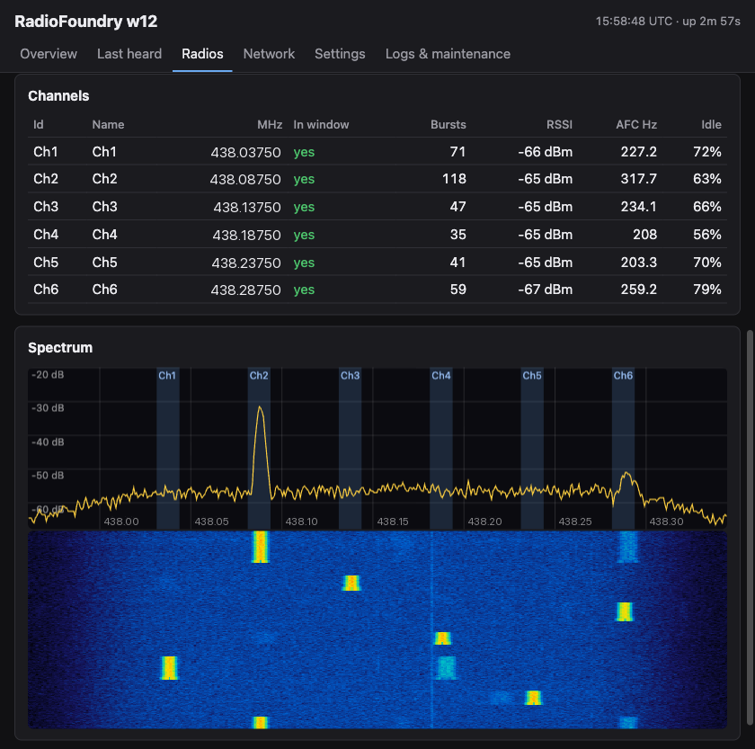
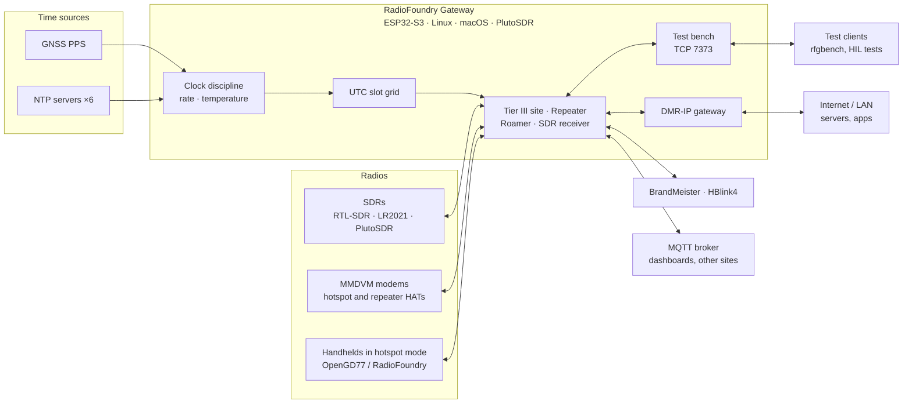

# RadioFoundry Gateway

Open-source DMR infrastructure software for existing radio hardware.



## What it does

| Function | Summary |
|---|---|
| Tier III trunked site | A DMR Tier III site controller (ETSI TS 102 361-4); to our knowledge, the only open-source implementation |
| Repeater and hotspot | Duplex, simplex and split duplex repeaters; single-frequency repeater (SFR); dual capacity direct mode |
| Multi-channel receiver | Up to 6 channels on an ESP32-S3, 10 or more on a Raspberry Pi, 16 on a Pluto+ with the FPGA channelizer |
| Test bench | Radio test and measurement instrument, controlled over TCP port 7373 |
| DMR-IP gateway | Connects radio data services (registration, text messages, location, UDP) to IP networks |
| Networking | BrandMeister, HBlink4, MQTT, and linking between sites |
| Timing | DMR slot timing locked to UTC from GNSS or NTP |

## Runs on

| Platform | Notes |
|---|---|
| Raspberry Pi, or any Linux or macOS computer | With an MMDVM modem, an RTL-SDR or a SoapySDR device |
| PlutoSDR or Pluto+ | On the Pluto's own ARM processor, with the stock firmware |
| Meshnology W12 | ESP32-S3 board with a built-in LR2021 transceiver and a GNSS connector |
| ESP32-S3 boards (N16R8, SuperMini) | With an RTL-SDR, an MMDVM modem or a handheld in hotspot mode |

## Architecture



## Supported radios

| Radio | Receive | Transmit | Duplex |
|---|---|---|---|
| MMDVM modem (MMDVM_HS HAT, ZUMspot, repeater board), stock firmware | One channel | One channel | Half or full |
| Handheld in hotspot mode ([OpenGD77](https://www.opengd77.com/), [RadioFoundry](https://github.com/RadioFoundry/RadioFoundry)) | One channel | One channel | Half or full |
| RTL-SDR (R820T / R828D) | Several channels | No | N/A |
| LR2021 (on the W12) | Several channels | One channel | Half |
| PlutoSDR or Pluto+ | Several channels | Several channels | Half or full |
| SoapySDR devices (LimeSDR, HackRF, USRP and others) | Several channels | Device-dependent | Device-dependent |

## Tier III

- **Control channel:** dedicated, composite (shared with traffic) or hibernating
- **Carriers:** 1 to 4 from one SDR, or one carrier on a duplex MMDVM modem
- **Registration:** open or by ID list, with talkgroup subscription and authentication
- **Calls:** group, individual, broadcast and all-call, with priority queueing
- **Emergency:** emergency calls and alarms, pre-emption, transmit interrupt
- **Data:** status messages, short data and packet data
- **Radio management:** stun, revive, kill, ambient listening and call diversion
- **Multiple sites:** linked sites with roaming and a standby controller
- **BrandMeister:** an entire site connects as a single login

Tested on air with two linked sites and on BrandMeister. All radios tested so far run RadioFoundry firmware; Tier III
radios from other manufacturers have not been tested yet. Specification: [tier3.md](docs/spec/fw/tier3.md).

## Test bench

- **Receive:** I/Q capture, level triggers, decoded DMR bursts with bit error rate and timing, frequency tracking,
  and transmitter power ramp measurement
- **Transmit:** FM, AM, DMR, P25, NXDN, dPMR, M17, D-STAR and raw I/Q, with several channels at once
- **Test services:** a DMR repeater, P25 and NXDN repeaters on an MMDVM modem, and a data responder
- **Accuracy:** the reference crystal is corrected from GNSS or NTP, and each reading reports its uncertainty
- **Shared access:** sessions, claims and queues let several clients use one instrument; discovery by DNS-SD

Command-line client: `tools/bench/rfgbench.py`. Protocol: [bench-api.md](docs/spec/bench-api.md), section 14.

## Getting started

| Hardware | Guide |
|---|---|
| Raspberry Pi with an MMDVM_HS HAT | [raspberry-pi.md](docs/raspberry-pi.md) |
| PlutoSDR or Pluto+ | [plutosdr.md](docs/plutosdr.md) |
| W12 or other ESP32-S3 board | [esp32-boards.md](docs/esp32-boards.md) |
| Linux or macOS | [linux-macos.md](docs/linux-macos.md) |

Configuration: [settings.md](docs/settings.md). Example configurations: [config/examples/](config/examples/README.md).

Host tests:

```sh
cmake -S host-tests -B build/host && cmake --build build/host && ctest --test-dir build/host
```

## Status

| Area | State |
|---|---|
| Tier III | On air with two linked sites, and with a site on BrandMeister |
| Repeater and hotspot | On air with a duplex MMDVM_HS HAT |
| SDR receive and transmit | On air with the W12, ESP32-S3 boards and the PlutoSDR |
| Test bench | In use on the W12, the PlutoSDR and an MMDVM modem |
| Tested on the host only | Tier III on split radios, three or four carriers on one SDR, full-duplex calls, the standby controller |

Measurements and open items: [reference.md](docs/reference.md).

## Documentation

- [docs/README.md](docs/README.md): documentation index
- [reference.md](docs/reference.md): build options, supported boards and measurements
- [docs/spec/](docs/spec/): design specifications, starting with [overview.md](docs/spec/fw/overview.md)

## Contributing

- [CONTRIBUTING.md](CONTRIBUTING.md): how to contribute
- [SECURITY.md](SECURITY.md): reporting vulnerabilities
- [CODE_OF_CONDUCT.md](CODE_OF_CONDUCT.md)

## License

MIT; see [LICENSE](LICENSE). Third-party code and its licenses are listed in [PROVENANCE.md](PROVENANCE.md) and
[LICENSES/](LICENSES/).

## Acknowledgements

- SAMS0N1TE, for [lr2021-sdr](https://github.com/SAMS0N1TE/lr2021-sdr): the first to find and document the
  LR2021's undocumented raw I/Q receive and transmit paths. Our LR2021 front end is written from the facts in its
  docs (no code taken). Without that discovery the W12 wouldn't be an SDR.
- Semtech, for the LR2021 datasheet the `lr2021` driver is written from.
- ETSI, for the DMR standards (TS 102 361), Tier III trunking (TS 102 361-4) included.
- Jonathan Naylor (G4KLX), for MMDVM and MMDVMHost: the modem protocol and the call JSON format we follow.
- The HBlink4 project, the network the gateway peers with.
- The OpenGD77 project, whose hotspot mode makes a handheld a gateway radio.
- RadioFoundry, for the DMR FEC, CACH, LC and CRC code (MIT).
- DSD and mbelib ([szechyjs/dsd](https://github.com/szechyjs/dsd), [szechyjs/mbelib](https://github.com/szechyjs/mbelib)):
  the AMBE+2 frame tables and decode (ISC).
- Mark Borgerding's [KISS FFT](https://github.com/mborgerding/kissfft): the structure of our FFT (BSD-3-Clause).
- Adafruit's [GFX library](https://github.com/adafruit/Adafruit-GFX-Library): the 5x7 OLED font (BSD-2-Clause).
- Howard Hinnant, for the published `days_from_civil` date algorithm.
- chrony (Miroslav Lichvar and contributors), whose documented behavior netclock's NTP client follows (no chrony
  code), and David L. Mills, for NTP (RFC 5905).
- Realtek's RTL2832U datasheet, Rafael Micro's R820T2 register description and Jacobo Tarrio's
  [webrtlsdr](https://github.com/jtarrio/webrtlsdr) (Apache-2.0), for the register facts our RTL-SDR driver is
  written from (docs/spec/rtlsdr.md).
- Meshtastic's and MeshCore's W12 support, for the board's pin and front-end details.
- Espressif, for ESP-IDF, esp-dsp and the USB host drivers.
