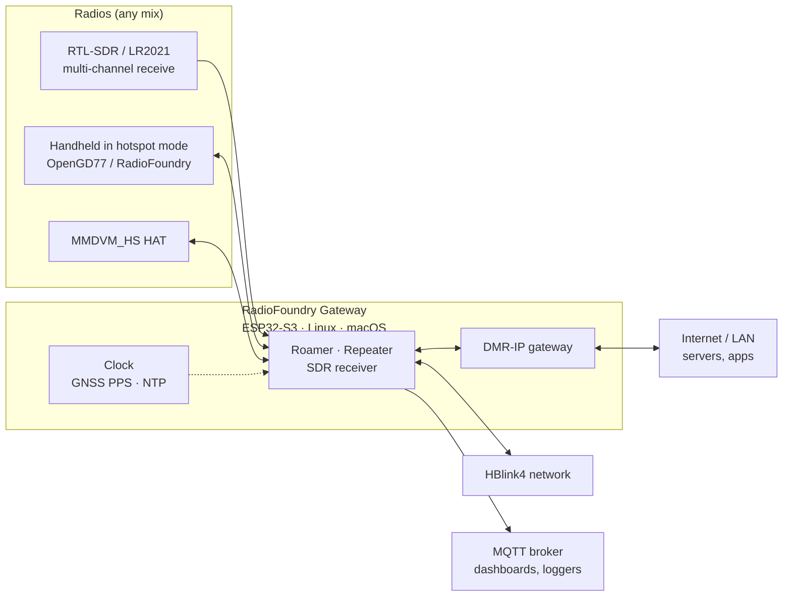

# RadioFoundry Gateway

**One firmware for a whole DMR site, on an ESP32-S3.** Repeater, hotspot, multi-channel SDR monitor and DMR-IP
data gateway, in any combination, from whatever radios you have. Also runs on Linux and macOS.


## Highlights

- 📡 **Hear up to 6 channels at once** on an ESP32-S3 (RTL-SDR or the W12's built-in LR2021), 10+ on a Raspberry Pi
- 🔁 **Repeater or roaming hotspot** from a hotspot-mode handheld, an MMDVM HAT, or the SDR itself
- 🌐 **HBlink4 peer** per radio and per SDR channel, over UDP or SCTP
- 📨 **MQTT** in MMDVMHost's call JSON, plus raw bursts for your own decoders
- 🛰️ **UTC-locked slot timing** from GNSS PPS, NTP or the browser: groundwork for voting and simulcast
- 🔌 **DMR-IP gateway** built in: radios' ARS, text, location and any UDP app reach the internet, no PC
- 🖥️ **Web page and JSON API**: live spectrum and waterfall, Last heard, settings, Wi-Fi, clock, OTA, crash dumps
- 🧪 **Tested byte for byte** against golden fixtures on the host, plus hardware-in-the-loop tests on boards

## How it fits together



## Mix and match radios

Each board runs whatever its config names: up to **two roamers or repeaters plus one SDR**, as roles of one app.

| Radio | Connects by | Receive | Transmit | Duplex |
|---|---|:-:|:-:|---|
| RTL-SDR (R820T / R828D) | USB | ✅ multi-channel | — | — |
| LR2021 (Meshnology W12, on board) | SPI | ✅ multi-channel | ✅ | half |
| Handheld in hotspot mode ([OpenGD77](https://www.opengd77.com/), [RadioFoundry](https://github.com/RadioFoundry/RadioFoundry)) | USB or UART | ✅ | ✅ | half or full |
| MMDVM_HS HAT | UART | ✅ | ✅ | half or full |
| Any SoapySDR device (Linux / macOS) | `rdofsdr` | ✅ multi-channel | — | — |

Some combinations:

| You have | You get |
|---|---|
| ESP32-S3 + RTL-SDR | A 5-channel receive site feeding HBlink4 and MQTT |
| Meshnology W12 | 6-channel monitor **and** a half-duplex roamer on one board, with GNSS time |
| ESP32-S3 + MMDVM HAT | A duplex repeater or hotspot |
| ESP32-S3 + two handhelds | A **split duplex** repeater: one radio receives, the other transmits |
| ESP32-S3 + HAT + RTL-SDR | A repeater plus a wide-area monitor, one box |
| Raspberry Pi + any SoapySDR | 10+ channels from one dongle |

A powered USB hub runs two USB radios at once. An optional SSD1306 OLED shows the board's state.

## Features

**Repeater and roamer**

- Duplex repeater, per-slot network, RF priority, hang time, CW ID
- Split duplex: two radios act as one repeater
- Single-frequency repeater (SFR) and **dual capacity direct mode** (DCDM: two simplex calls on one frequency)
- Roaming transceiver: talkgroup routing, listen-before-talk, jitter buffer, scan

**SDR receiver**

- Channelizer, demodulator and AGC tuned for the S3's SIMD and FFT
- Up to 6 channels on the S3 (LR2021 at 384 kS/s), 5 with an RTL-SDR at 288 kS/s
- Learns the tuner's ppm error from what it hears
- Built-in self-test with a recorded clip and expected output
- The LR2021 can transmit too: the SDR becomes an emulated MMDVM modem

**Network**

- HBlink4: a peer per radio and per SDR channel; DMRT / DMRK call routing; SCTP over UDP for the roamer
- MQTT 5 (with 3.1.1 fallback) and topic aliases: a burst is 57 bytes on the wire; TLS optional
- Retained status and Receiver messages per radio, last will on disconnect

**DMR-IP gateway**

- Rebuilds IPv4 datagrams from DMR packet data heard by any receiver
- Static routes by private call, talkgroup or source radio
- UDP and ping through NAT, with replies sent back over the air
- Firewall: private ranges denied by default, rate limits, flow and size caps

**Time**

- GNSS PPS (W12's L76K header), NTP (up to 6 servers, chrony-style), or the browser's clock
- Learns the crystal's rate and keeps it across restarts
- DMR slots laid on UTC, so every site agrees which slot is which

**Board**

- Wi-Fi with up to 8 networks and priorities
- OTA updates, core dumps with backtraces, log ring, task list
- Optional Rust build of the core modules (`CONFIG_RDOF_RUST`)

## Hardware

| Profile | Board | Notes |
|---|---|---|
| `4mb` | ESP32-S3 SuperMini | 4 MB flash, 2 MB PSRAM |
| `16mb` | ESP32-S3 N16R8 | 16 MB flash, 8 MB PSRAM |
| `16mb` + `w12` | Meshnology W12 | LR2021, OLED, L76K GNSS header. Best at 902–928 MHz; at UHF its filter costs about 46 dB, so it hears only nearby transmitters |
| Linux / macOS | PC, Raspberry Pi | `rdofsdr`, live from SoapySDR or from a recording |

## Protocol additions

A few additions to the standard protocols, which we aim to upstream:

- **HBlink4:** DMRT / DMRK call routing, SCTP over UDP ([hblink.md](docs/spec/fw/hblink.md))
- **MMDVM modem protocol:** split duplex and DCDM ([radio.md](docs/spec/fw/radio.md))

## Quick start

Host tests (CMake and a C compiler; cargo for the Rust tests):

```sh
cmake -S host-tests -B build/host && cmake --build build/host && ctest --test-dir build/host
```

Firmware (ESP-IDF v5.5, from `esp_idf/`), shown for the W12; use `16mb` or `4mb` for the others:

```sh
idf.py -B ../build/w12 -D SDKCONFIG=../build/w12/sdkconfig \
  -D SDKCONFIG_DEFAULTS="sdkconfig.defaults;sdkconfig.defaults.16mb;sdkconfig.defaults.w12" build
idf.py -B ../build/w12 -D SDKCONFIG=../build/w12/sdkconfig -p <port> flash   # first time
curl -X POST --data-binary @../build/w12/radiofoundry_gateway.bin http://<board>/api/ota   # after that
```

Overlays: `.roamer` / `.sdr` (one role only), `.rust`, `.hub`, `.dspfast`.

<details>
<summary>Linux / macOS build and system tests</summary>

The system tests need a [RadioFoundry](https://github.com/RadioFoundry/RadioFoundry) checkout at the commit in
`systest/radiofoundry.ref`; without it they're skipped.

```sh
git clone https://github.com/RadioFoundry/RadioFoundry ../RadioFoundry && git -C ../RadioFoundry checkout $(cat systest/radiofoundry.ref)
cmake -S . -B build/linux -DRADIOFOUNDRY_DIR=$PWD/../RadioFoundry && cmake --build build/linux && ctest --test-dir build/linux
```

Hardware-in-the-loop tests against a running board: `RDOF_BOARD=<board ip> python -m pytest -q hil-tests`.

</details>

## Status

Feature-complete and running on hardware: the SDR receiver on the SuperMini, N16R8 and W12; the W12 transmitting
as a roamer and answering pings as the IP gateway. A few paths (a split repeater, a USB hub with two radios) are
host-tested but not yet run on a board. See [docs/reference.md](docs/reference.md) for what's been measured and
what's left.

## Docs

- [docs/reference.md](docs/reference.md): profiles, sizes, settings, front ends, CPU budgets
- [docs/spec/](docs/spec/): how each part works, starting with [overview.md](docs/spec/fw/overview.md)
- `components/*/README.md`: standalone ESP-IDF components (netclock, wifilist, tinysctp, lr2021, gnss)
- [rust/README.md](rust/README.md): the Rust modules

## Contributing

See [CONTRIBUTING.md](CONTRIBUTING.md), [SECURITY.md](SECURITY.md) for reporting vulnerabilities, and
[CODE_OF_CONDUCT.md](CODE_OF_CONDUCT.md).

## License

MIT, see [LICENSE](LICENSE). Third-party code and its licenses are listed in [PROVENANCE.md](PROVENANCE.md)
and [LICENSES/](LICENSES/).

## Acknowledgements

- SAMS0N1TE, for [lr2021-sdr](https://github.com/SAMS0N1TE/lr2021-sdr): the first to find and document the
  LR2021's undocumented raw I/Q receive and transmit paths. Our LR2021 front end is written from the facts in its
  docs (no code taken). Without that discovery the W12 wouldn't be an SDR.
- Semtech, for the LR2021 datasheet the `lr2021` driver is written from.
- ETSI, for the DMR standards (TS 102 361).
- Jonathan Naylor (G4KLX), for MMDVM and MMDVMHost: the modem protocol and the call JSON format we follow.
- The HBlink4 project, the network the gateway peers with.
- The OpenGD77 project, whose hotspot mode makes a handheld a gateway radio.
- RadioFoundry, for the DMR FEC, CACH, LC and CRC code (MIT).
- DSD and mbelib ([szechyjs/dsd](https://github.com/szechyjs/dsd), [szechyjs/mbelib](https://github.com/szechyjs/mbelib)):
  the AMBE+2 frame tables and decode (ISC).
- Mark Borgerding's [KISS FFT](https://github.com/mborgerding/kissfft): the structure of our FFT (BSD-3-Clause).
- Adafruit's [GFX library](https://github.com/adafruit/Adafruit-GFX-Library): the 5x7 OLED font (BSD-2-Clause).
- Howard Hinnant, for the published `days_from_civil` date algorithm.
- Realtek's RTL2832U datasheet, Rafael Micro's R820T2 register description and Jacobo Tarrio's
  [webrtlsdr](https://github.com/jtarrio/webrtlsdr) (Apache-2.0), for the register facts our RTL-SDR driver is
  written from (docs/spec/rtlsdr.md).
- Meshtastic's and MeshCore's W12 support, for the board's pin and front-end details.
- Espressif, for ESP-IDF, esp-dsp and the USB host drivers.
