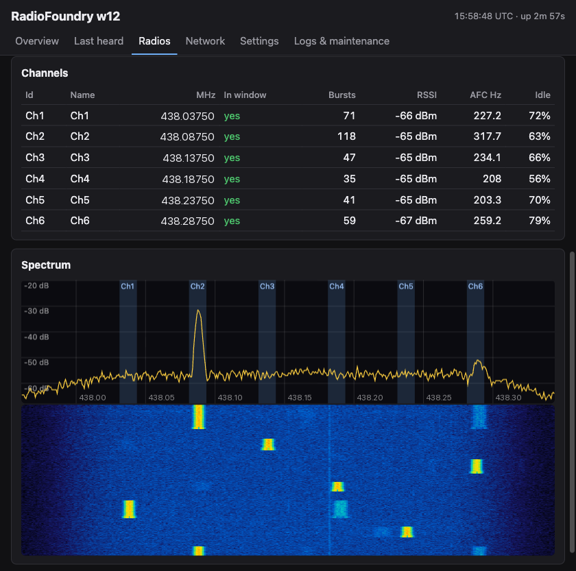
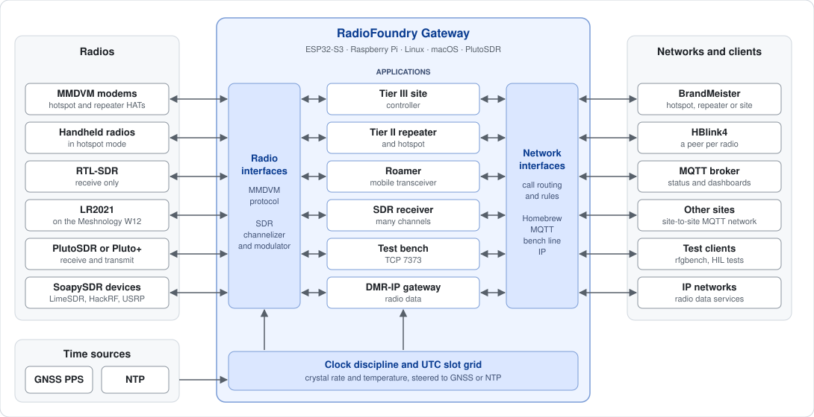

# RadioFoundry Gateway

[English](README.md) · **简体中文**

中文介绍与中文WEB界面贡献者:BG2LNY

**开源 DMR Tier II 与 Tier III 基础设施。**



## 功能

| 功能 | 说明 |
|---|---|
| **Tier III 集群站点** | 开源 DMR Tier III 站点控制器（ETSI TS 102 361-4） |
| **Tier II 中继台与热点** | 双工、单工、分频双工、同频中继 |
| **多信道接收机** | 最多同时 16 个信道 |
| **测试台** | 通过网络进行电台测试与测量 |
| **DMR-IP 网关** | 将电台数据接入 IP 网络 |
| **组网** | BrandMeister、HBlink4、MQTT，站点互联 |
| **授时** | 由 GNSS 或 NTP 锁定到 UTC |

## 运行平台

- Raspberry Pi、Linux 或 macOS
- PlutoSDR 或 Pluto+
- ESP32-S3 开发板，包括 Meshnology W12

## 架构



## 支持的电台

| 电台 | 接收 | 发射 |
|---|---|---|
| RadioFoundry 电台 | 每台 1 个信道 | 每台 1 个信道 |
| MMDVM 调制解调板（热点或中继） | 每块 1 个信道 | 每块 1 个信道 |
| OpenGD77 电台（热点模式） | 每台 1 个信道 | 每台 1 个信道 |
| RTL-SDR | 最多 16 个信道 | 不支持 |
| LR2021（W12） | 最多 6 个信道 | 1 个信道 |
| PlutoSDR 或 Pluto+ | 最多 15 个信道 | 最多 8 个信道 |
| SoapySDR 设备 | 最多 16 个信道 | 视设备而定 |

多台电台或调制解调板可与 SDR 并用，以增加信道（ESP32-S3 上最多 2 路，计算机上最多 16 路）。

## Tier III

- 专用或复合控制信道
- 最多 4 个载波
- 组呼、个呼、广播呼叫与紧急呼叫
- 状态、短数据与分组数据
- Stun、Revive、Kill 与环境监听
- 多站点漫游，带备用控制器
- 连接 BrandMeister

已在 RadioFoundry 电台上实空测试；其他厂商的电台未测试。[规范](docs/spec/fw/tier3.md)

## 测试台

- **接收：** I/Q 采集、解码突发、误码率、频率、功率爬升
- **发射：** FM、AM、DMR、P25、NXDN、dPMR、M17、D-STAR、I/Q
- **校准：** 以 GNSS 或 NTP 为参考

[协议](docs/spec/bench-api.md) · 客户端：`tools/bench/rfgbench.py`

## 快速开始

### 安装软件包

适用于 Raspberry Pi（任意型号，含 Pi Zero）、Pi-Star 4.x、Debian 10 或更新版本、Ubuntu 20.04 或更新版本，32 位 ARM、64 位 ARM 或 x86-64。以下命令会取该机器对应的最新发布包：

```sh
sudo apt install -y curl ca-certificates
URL=$(curl -fsSL https://api.github.com/repos/RadioFoundry/RadioFoundryGateway/releases/latest | grep -o "https://[^\"]*_$(dpkg --print-architecture)\.deb")
curl -fsSL -o /tmp/rdofradio.deb "$URL" && sudo apt install -y /tmp/rdofradio.deb
```

同样的命令也可用于升级到新版本。

安装后的配置为 MMDVM 热点板上的 BrandMeister 热点。填写 `/etc/rdofradio/config.json` 中标注 `SET` 的行（呼号、频率、BrandMeister 密码与热点 ID），然后启动：

```sh
sudo systemctl enable --now rdofradio
```

Web 页面在 8080 端口。在 Pi-Star 上需先运行 `rpi-rw`，并停止占用调制解调板的 MMDVMHost。

### 其他方式

| 硬件 | 指南 |
|---|---|
| 配 MMDVM HAT 的 Raspberry Pi | [raspberry-pi.md](docs/raspberry-pi.md) |
| PlutoSDR 或 Pluto+ | [plutosdr.md](docs/plutosdr.md) |
| ESP32-S3 开发板 | [esp32-boards.md](docs/esp32-boards.md) |
| Linux 或 macOS | [linux-macos.md](docs/linux-macos.md) |

配置：[settings.md](docs/settings.md) 与[示例](config/examples/README.md)。

## 状态

| 领域 | 状态 |
|---|---|
| Tier III | 已实空运行，两个互联站点与 BrandMeister |
| Tier II 中继台与热点 | 已实空运行 |
| SDR 收发 | 已实空运行 |
| 测试台 | 用于 RadioFoundry 的硬件在环测试套件 |

详情：[reference.md](docs/reference.md)。

## 文档

- [文档索引](docs/README.md)
- [参考](docs/reference.md)
- [规范](docs/spec/fw/overview.md)

## 参与贡献

[参与贡献](CONTRIBUTING.md) · [安全](SECURITY.md) · [行为准则](CODE_OF_CONDUCT.md)

## 许可证

[MIT](LICENSE)。第三方代码：[PROVENANCE.md](PROVENANCE.md)。

## 致谢

- ETSI：DMR 标准（TS 102 361）
- Semtech：LR2021 数据手册
- Jonathan Naylor（G4KLX）：MMDVM 及其调制解调协议
- HBlink4 与 OpenGD77 项目
- RadioFoundry：DMR FEC、CACH、LC 与 CRC 代码
- [DSD](https://github.com/szechyjs/dsd) 与 [mbelib](https://github.com/szechyjs/mbelib)：AMBE+2 表
- [KISS FFT](https://github.com/mborgerding/kissfft)、[Adafruit GFX](https://github.com/adafruit/Adafruit-GFX-Library) 字体
- Howard Hinnant：`days_from_civil`
- chrony 与 David L. Mills：NTP
- Realtek、Rafael Micro 与 [webrtlsdr](https://github.com/jtarrio/webrtlsdr)：RTL-SDR 寄存器细节
- Meshtastic 与 MeshCore：W12 板级细节
- Espressif：ESP-IDF 与 esp-dsp
- lr2021-sdr：最初发现 LR2021 的原始 I/Q 模式
