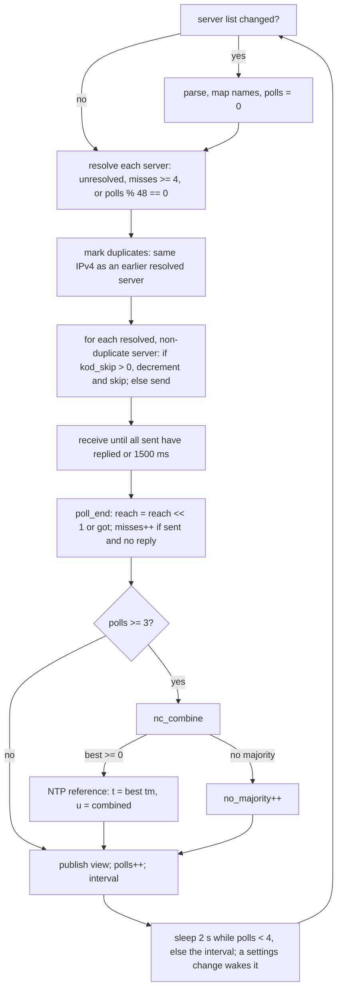
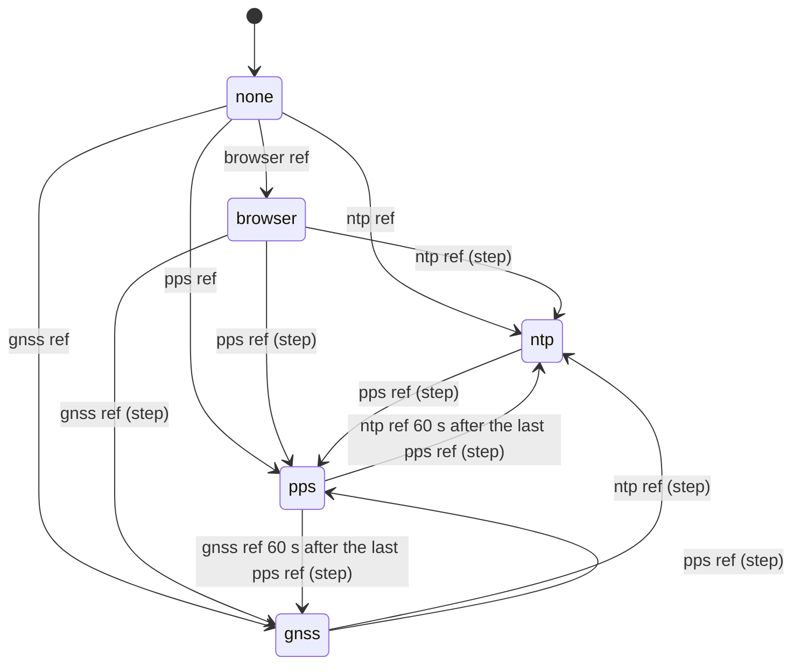

# netclock behavior spec

Rules a reimplementation must follow to behave like `src/`. Times: local `t` = monotonic µs (`esp_timer`); `u` =
UTC µs since 1970. Rate `r` = UTC µs per local µs minus 1 (+ = local clock slow). Integer arithmetic is `int64_t`;
`(int64_t)x` of a double truncates toward zero, `llround` rounds half away from zero. Use, API, storage, Kconfig,
HTTP and the status JSON are in [README.md](README.md).

## Constants

| `path:symbol` | Value | Rule |
|---|---|---|
| `include/netclock_model.h:NC_HIST` | 40 | model history (references of the current source) |
| `src/netclock_model.c:NC_STEP_US` | 200000 µs | error beyond this is an outlier... |
| `src/netclock_model.c:NC_STEP_CONFIRM` | 3 | ...unless the 3rd in a row: step |
| `src/netclock_model.c:NC_SLEW_BIG_US` | 100000 µs | a correction beyond this is taken whole and slewed fast |
| `src/netclock_model.c:NC_SLEW_FAST` | 500e-6 | fast slew, s/s |
| `src/netclock_model.c:NC_SLEW_FINE` | 2e-6 | fine slew, s/s (60 s absorbs ≤ 120 µs) |
| `src/netclock_model.c:NC_PHASE_GAIN` | 0.3 | fraction of the phase error corrected per reference |
| `src/netclock_model.c:NC_MIN_SPAN_S` | 600 s | history span before a rate fit |
| `src/netclock_model.c:NC_MAX_AGE_S` | 10800 s | history references older than this are dropped |
| `src/netclock_model.c:NC_MAX_RATE` | 500e-6 | a prior, fit or set rate with \|r\| ≥ this is refused |
| `src/netclock_model.c:NC_RESID_MIN_US` | 3000 µs | floor of the fit's rejection limit |
| `include/netclock_ntp.h:NC_NTP_HIST` | 8 | per-server delay and offset history |
| `include/netclock_ntp.h:NC_NTP_IBURST` | 4 | first polls 2 s apart |
| `include/netclock_ntp.h:NC_NTP_MAX_DELAY` | 500000 µs | round trip beyond this: unusable |
| `include/netclock_ntp.h:NC_NTP_KOD_SKIP` | 16 | polls skipped after a kiss-o'-death |
| `src/netclock_ntp.c:LAMBDA_MIN_US` | 500 µs | root distance floor |
| `src/netclock_ntp.c:DELAY_SLACK_US` | 10000 µs | delay filter slack, absolute... |
| `src/netclock_ntp.c:DELAY_SLACK_K` | 0.5 | ...or relative, whichever is more |
| `src/netclock_ntp.c:NTP_UNIX_DELTA` | 2208988800 s | 1900 → 1970 |
| `include/netclock_select.h:NC_SELECT_MAX` | 16 | candidates `nc_select` looks at |
| `include/netclock_status.h:NETCLOCK_MAX_SRC` | 6 | servers (overridable at compile time) |
| `include/netclock_status.h:NETCLOCK_LOG` | 32 | reference log entries |
| `include/netclock.h:NETCLOCK_SERVERS_LEN` | 128 | server list buffer (127 chars) |
| `include/netclock_pps.h:NC_PPS_EVERY` | 20 | good edges per reference (40 references span 13 min) |
| `include/netclock_pps.h:NC_PPS_LABEL_US` | 300000 µs | clock must put the edge within this of a whole second |
| `include/netclock_pps.h:NC_PPS_TOL` | 1000e-6 | edge spacing tolerance, per second |
| `include/netclock_pps.h:NC_PPS_HOLD_S` | 60 s | PPS leads until this long without a PPS reference |
| `include/netclock_core.h:NC_RATE_SAVE_MIN_N` | 8 | fit references to store a rate; also "settled" |
| `include/netclock_core.h:NC_RATE_SAVE_DIFF` | 0.3e-6 | store when the fit moved this far from the stored rate |
| `include/netclock_core.h:NC_RATE_SAVE_EVERY_S` | 3600 s | rate-only stores at most this often (flash wear) |
| `include/netclock_core.h:NC_TCAL_SKEW` | 0.3e-6 | fit skew ≤ this to enter the table |
| `include/netclock_core.h:NC_TCAL_DIE_C` | 2.0 C | die spread over the fit's references ≤ this |
| `include/netclock_core.h:NC_TCAL_MIN_REFS` | 4 | fit references with a die reading, at least |
| `include/netclock_core.h:NC_TCAL_AGAIN_S` | 7200 s | same bin again in one run at most this often |
| `include/netclock_tempcal.h:NC_TCAL_N` | 24 | table bins |
| `include/netclock_tempcal.h:NC_TCAL_BIN_C` | 2 C | bin width |
| `include/netclock_tempcal.h:NC_TCAL_WEIGHT` | 4 | a bin averages about this many learnings |
| `include/netclock_tempcal.h:NC_TCAL_VERSION` | 1 | blob version |
| `include/netclock_tempcal.h:NC_SETTLE_N` | 16 | settle tracker samples |
| `src/netclock.c:NTP_PORT` | 123 | UDP |
| `src/netclock.c:ROUND_WAIT_MS` | 1500 ms | reply window per poll |
| `src/netclock.c:IBURST_GAP_MS` | 2000 ms | gap between the first polls |
| `src/netclock.c:RESOLVE_EVERY` | 48 | re-resolve every this many polls |
| `src/netclock.c:TEMP_EVERY_US` | 30000000 µs | temperature tick |
| `src/netclock.c:ntp_task` (inline) | 4 misses; 100 ms `SO_RCVTIMEO`; 68 B receive buffer | re-resolve after 4 unanswered polls |
| `src/netclock_http.c:post_time` (inline) | 1.6e12 ms | lower bound on a browser's `utc_ms` |

## NTP

### Request (`nc_ntp_request`, 48 bytes, big endian)

| Offset | Size | Value |
|---|---|---|
| 0 | 1 | `0x23`: LI 0, VN 4, mode 3 (client) |
| 1 | 1 | 0 (stratum) |
| 2 | 1 | poll = ⌊log2(poll_s)⌋ of the current interval (e.g. 300 s → 8); 0 for poll_s ≤ 1 |
| 3..39 | 37 | 0 |
| 40 | 8 | transmit timestamp = a random 64-bit cookie (`esp_random` × 2), new per request |

Sent from one IPv4 UDP socket to `<ip>:123`; `t1 = esp_timer_get_time()` just before `sendto` (0 if the send fails).

### Reply (`nc_src_reply`)

Fields read: byte 0 (LI = bits 7..6, mode = bits 2..0), byte 1 stratum, 4..7 root delay and 8..11 root dispersion
(unsigned 16.16 s), 12..15 refid, 24..31 originate, 32..39 receive `T2`, 40..47 transmit `T3`. `t4` = local stamp
right after `recvfrom`. The version is not checked.

| Order | Condition | Result |
|---|---|---|
| 1 | length < 48, mode ≠ 4, originate ≠ cookie, no request outstanding (`t1 == 0`), or a reply already taken this poll | `IGNORED` (does not count for reach) |
| 2 | stratum 0 (any kiss code) | `KOD`: `kod = true`, skip the next 16 polls; counts for reach |
| 3 | LI = 3 or stratum > 15 | `UNUSABLE` (counts for reach) |
| 4 | `delay = max(0, (t4 − t1) − (T3 − T2))`; delay > 500000 µs or `T3 < T2` | `UNUSABLE` |
| 5 | iburst poll, a sample exists (`tm ≠ 0`) and its delay ≤ this one | `KEPT`: stratum, refid, `last_rx`, `misses = 0`, `kod = false` updated; the sample is not |
| 6 | otherwise | `SAMPLE`: `tm = t1 + (t4 − t1)/2`, `u = T2 + (T3 − T2)/2`, delay, root delay, root dispersion stored |

The task matches a datagram to the first resolved, non-duplicate server with the same IPv4 source address that has
no reply yet (port not checked). Timestamp conversion (`nc_ntp_to_us`): seconds field with bit 31 clear are era 1
(+2^32 s, after 2036); µs = sec·1e6 + ⌊frac·1e6 / 2^32⌋. `nc_us_to_ntp`: fraction = ⌈f·2^32 / 1e6⌉.

### Server list

`nc_parse_servers`: tokens split on space, `,`, `;`, tab; a token ending in `pool.ntp.org` and not starting with
a digit becomes `0.<tok>`, `1.<tok>`, `2.<tok>`; at most 6 entries. Each starts with mark `-`. The name map
(`netclock_set_name_map`) then rewrites names.

### Poll cycle (`src/netclock.c:ntp_task`)



- Resolution is IPv4 only (`getaddrinfo`, `AF_INET`). A changed address clears the server's offset history, not its
  delay history. A failed lookup leaves the server unresolved (`-`). Resolving resets `misses`.
- iburst: polls 1..3 pass `iburst = true` to `nc_src_reply` (poll 0 does not). The first combination is at poll 3,
  so the first NTP reference comes about 6 s after start.
- Interval: `slow = poll_s setting` (or `CONFIG_NETCLOCK_POLL_S`), `fast = min(CONFIG_NETCLOCK_POLL_FAST_S, slow)`;
  `slow` once the rate is settled (fit learned this run on ≥ 8 kept references), else `fast`.

### Combine (`nc_combine`)

Per server with a usable reply this poll (`got`, `t1 ≠ 0`, `last_rx ≥ t1`):

1. Delay filter: push `delay` into the 8-entry delay ring; `min_delay` = minimum over the ring (including this
   one). Spike (mark `~`, not used) if `delay > min_delay + max(10000, 0.5 × min_delay)`.
2. Offset vs the model (only once the model is valid): `off = u − model(tm)`, pushed into the 8-entry offset ring.
   `jitter` = sample standard deviation of the ring (0 with fewer than 2).
3. Root distance `λ = max(500, delay/2 + root_delay/2 + root_disp + jitter)` µs.
4. Candidate offset = `(u − tm) − (u₀ − tm₀)` of the first usable server (a common base; local clock is shared).

Then `nc_select` (below). Marks written back: `-` if unresolved or duplicate, `~` if a spike, else the select mark.
Reference: `t = tm_best`, `u = tm_best + base + llround(combined)`. `had_sample` = any candidate was usable.

### Selection (`nc_select`, Marzullo)

At most `NC_SELECT_MAX` candidates are looked at (`n` is cut to it; `nc_combine` passes at most 6).

1. Each usable candidate i gives `[off_i − λ_i, off_i + λ_i]`. None usable → -1.
2. Sort edges by value, starts before ends on ties (touching intervals overlap). Sweep; the first point where the
   count reaches its maximum `best` gives `[lo, hi]` = that start edge to the next edge.
3. Majority = `2·best > n_usable`.
   - No majority and n_usable ≥ 3: all usable marked `x`, return -1 (poll skipped, `no_majority++`).
   - No majority and n_usable ≤ 2: `[lo, hi]` = the interval of the candidate with the smallest λ.
4. Survivors: usable intervals intersecting `[lo, hi]` (mark `+`); others `x`. Best = smallest λ among survivors
   (mark `*`). Combined offset = Σ(off/λ²) / Σ(1/λ²) over survivors.

## Clock model (`src/netclock_model.c`)

State: anchor `(t0, u0)`, rate `r`, pending slew `S`, history ring of ≤ 40 `(t, u)`.

```
model(t) = u0 + (t − t0) + llround((t − t0)·r) + applied(t)
applied(t) = 0 if t ≤ t0 or S = 0
           = S if |S| ≤ L, else sign(S)·L,   L = (int64)((t − t0) · (|S| > 100000 ? 500e-6 : 2e-6))
```

`nc_model_add(t, u, new_source)`:

```mermaid
stateDiagram-v2
  [*] --> Empty
  Empty --> Tracking: any reference / STEP (anchor = t,u; history = [t,u]; rate kept)
  Tracking --> Tracking: new_source / STEP (history cleared)
  Tracking --> Tracking: |err| <= 200 ms / SLEW (big_run = 0)
  Tracking --> Tracking: |err| > 200 ms, big_run < 3 / OUTLIER (outliers++)
  Tracking --> Tracking: |err| > 200 ms, 3rd in a row / STEP (history cleared)
```



`err = u − model(t)` (stored as `last_err`). On SLEW:

1. Push `(t, u)`; drop history entries older than 10800 s while more than 2 remain; ring keeps 40.
2. Fit the rate (below). Phase target `to` = (fitted offset at t) + t − model(t) if the fit succeeded, else `err`.
3. Correction `c = to` if `|to| > 100000`, else `llround(0.3·to)`.
4. `t0 = t`, `u0 = model(t)` (continuous), `S = c` (any unapplied slew is dropped; `u0` includes the applied part).

`nc_model_set_rate(t, r')` (temperature compensation): refused if `|r'| ≥ 500e-6` or NaN; if valid, `u0 = model(t)`,
`S −= applied(t)`, `t0 = t`; then `r = r'`.

### Rate fit (`fit_rate`)

Runs on each SLEW when history has ≥ 3 references and `t − t_oldest ≥ 600 s`.

1. `x_j = (t_j − t)/1e6` s, `y_j = (u_j − t_j) − y0` µs with `y0` = the newest reference's offset (keeps doubles
   exact). Least squares `y = a + b·x` (`b` in µs/s = ppm). Degenerate (k < 2 or Σ spread 0) → no fit.
2. With ≥ 5 references: residuals `res_j`; limit = `max(3000, 3 × 1.4826 × median|res|)` µs; keep `|res_j| ≤ limit`;
   refit on the kept ones if 3 ≤ kept < n (otherwise the first fit stands, kept flags as computed).
3. Refuse if `|b|·1e-6 ≥ 500e-6`.
4. Set: `r = fit_rate = b·1e-6`; `fit_off = y0 + llround(a)` at `fit_t = t`; `rate_n` = kept count;
   `skew = sqrt(SS/(k−2)/Sxx) · 1e-6` (k > 2, `Sxx = Σx² − (Σx)²/k` over kept; else 0); `resid_rms = sqrt(SS/k)`;
   `span = t − t_oldest`; `rate_learned = true`.

A prior (`nc_model_init(rate)`) with `|rate| ≥ 500e-6` is replaced by 0.

## Sources (`src/netclock_core.c`)

Rank: PPS 4 > NTP 3 > GNSS 2 > browser 1 > none 0. `nc_clock_takes(src, t)`:

- `rank(src) ≥ rank(current)` → take.
- Current PPS, src NTP or GNSS, `t − last_sync > 60 s` → take.
- Otherwise ignore (not logged, not passed to the model). A browser never displaces NTP, GNSS or PPS, and GNSS never
  displaces NTP, even when they stop.

`nc_clock_add` passes `new_source = (src ≠ current)` to the model, so every source change steps the clock (and
clears the history, keeping the rate). Every taken reference (outliers too) goes into the 32-entry log; non-outliers
set `ref_utc` and `last_sync`. With `CONFIG_NETCLOCK_SET_SYSTEM_TIME`, every STEP calls `settimeofday(u)`.



### PPS (`nc_pps_edge`)

The ISR (`GPIO_INTR_POSEDGE`, or `NEGEDGE` with `NETCLOCK_PPS_FALLING`; pull-down; `ESP_INTR_FLAG_IRAM` service,
reused if the app installed it) stamps `esp_timer_get_time()` into a 4-deep queue; a task (4096 B) reads the
model's UTC at the stamp and calls `nc_pps_edge`.

1. `edges++`. A receiver's label (`nc_pps_hint(edge_t, sec)`, from `netclock_gnss_time`) within 30 s
   (`NC_PPS_HINT_S`) before the edge, the edge whole seconds after it (`k = round((t − edge_t)/1e6)`,
   `|t − edge_t − k·1e6| ≤ 300000`) → `sec = hint_sec + k`, `by_hint++`, go to 3; the label wins over the clock.
   Else clock not set → `unlabeled++`, reset (`last_t = 0`, `good = 0`).
2. `sec = (clock_u + 500000) / 1000000`; `|clock_u − sec·1e6| > 300000` → `unlabeled++`, reset.
3. With a previous good edge: `n = sec − last_sec`, `dt = t − last_t`; `n < 1` or `|dt − n·1e6| > n·1e6·1000e-6` →
   `bad++`, `good = 0` (this edge still becomes the new last).
4. `last = (t, sec)`; `good++`; at 20: `good = 0`, reference `(t, sec·1e6)` with source PPS.

Missed pulses are fine when the labels agree (`n > 1`). Numbering needs the receiver's label (its NMEA, through
`netclock_gnss_time`) or the clock within 300 ms (NTP or a browser).

### GNSS NMEA time (`netclock_gnss_time(start_us, utc_s)`)

The app gives each second's time from the receiver: `start_us`, the local time the burst of sentences carrying it
began, and `utc_s`, its whole UTC second (only from a receiver with a fix; `components/gnss` does this).

- With `NETCLOCK_PPS_GPIO` and an edge `e` with `0 < start_us − e < 1 s`: the burst follows the pulse that began
  its second, so `nc_pps_hint(e, utc_s)` goes to the PPS task (applied before its next edge), and the lag
  `start_us − e` is averaged (1/16 a step) into `gnss_lag_ms`. Nothing else: the pulse makes the references.
- Otherwise (no pulse within the second): every `NETCLOCK_GNSS_EVERY`-th call (16; the first one too) is a
  reference with source GNSS at `start_us − lag` (the measured lag, or `NETCLOCK_GNSS_LAG_MS` when no pulse was
  ever seen), UTC `utc_s·1e6`. Good to the burst's timing: some ms with the lag measured.

Status: `pps_by_gnss` (edges numbered by labels), `gnss_times`, `gnss_refs`, `gnss_lag_ms` (null until measured),
`gnss_last_s` (−1 never).

### Storing the rate

After `nc_clock_add`, store (`rate_ppb` = `fit_rate`, plus `tcal` if it changed) when

`(rate_learned ∧ rate_n ≥ 8 ∧ |fit_rate − stored| > 0.3e-6 ∧ (never stored ∨ t − last_store > 3600 s)) ∨ table_changed`

### Temperature table (`src/netclock_tempcal.c`, `nc_clock_*` in `src/netclock_core.c`)

Learning, on each new fit: over the log entries since the model's oldest history reference, not outliers, with a die
reading (at most the last 32): if ≥ 4, `mean` and `spread`. `base_rate = fit_rate`; `base_die = mean` if
`spread ≤ 2 C`, else unknown. Put `(mean, fit_rate in ppm)` into the table when `base_die` is known, `rate_n ≥ 8`,
`skew ≤ 0.3e-6`, and not the same bin as the last put of this run within 7200 s.

Compensation (`nc_clock_temp`, on every reference after learning and every 30 s from a timer when the die reads):
`comp = T(die_now) − T(base_die)` (ppm·1e-6) if `base_die` is known and the table answers both, else 0; target
`r = base_rate + comp`; applied with `nc_model_set_rate` if it differs from the current rate by more than 1e-10.
The timer skips a tick while a reference is being added.

Boot prior (`nc_clock_set_tcal`, before any reference): if the stored table is valid and answers for the die now,
the prior is the table's value there, `base_die` = the die now, `rate_src = stored`. Else the stored `rate_ppb`.

Table rules:

- Bin of `T`: `lrint(T/2)·2` (round half to even, so 31 → 32, 33 → 32); bins outside -128..127 are ignored.
- Put `(T, v)`: existing bin → `w = min(n+1, 4)`, `v_bin += (v − v_bin)/w`, `n = min(n+1, 255)`; new bin → inserted in
  order with `n = 1`; when 24 bins are full, the one with the smallest `stamp` (least recently learned) is removed
  first. Every put increments the table's `stamp` and sets the bin's `stamp` to it.
- Get `T`: empty or NaN → none; at or below the coldest bin → its value; at or above the warmest → its value; else
  linear between the bins on either side.
- Valid: `version == 1`, `count ≤ 24`, all `v` finite, centers strictly ascending.

Blob layout (`nc_tcal_t`, little endian, 296 bytes):

| Offset | Type | Field |
|---|---|---|
| 0 | u8 | `version` (1) |
| 1 | u8 | `count` |
| 2 | u16 | pad (0) |
| 4 | u32 | `stamp`: learnings in all |
| 8 + 12·i | i8 | `e[i].temp_c`: bin center, C |
| 9 + 12·i | u8 | `e[i].n`: learnings, saturates at 255 |
| 10 + 12·i | u16 | pad |
| 12 + 12·i | f32 | `e[i].v`: rate, ppm (+ = local slow) |
| 16 + 12·i | u32 | `e[i].stamp`: table stamp when last learned |

Entries `count..23` are unused (zero after `nc_tcal_init`).

### Settle tracker (`nc_settle_t`)

`nc_settle_init(every_s, window_s, tol)`; `window_s` must fit 16 samples `every_s` apart. `add(t, v)`: NaN clears the
history; a sample within `every_s` of the last kept one is dropped; ring of 16. `range(t)`: NaN if empty or the
oldest sample is later than `t − window_s + every_s`; else max − min over samples at or after `t − window_s`.
`ok(t)`: range known and ≤ `tol`. netclock itself does not use it; `esp_idf` does (die and dongle rate).

## Portable API

Not thread safe; the ESP-IDF glue locks.

| Header | Call | Behavior |
|---|---|---|
| `netclock_model.h` | `void nc_model_init(nc_model_t*, double rate)` | empty model, prior `rate` (0 if \|rate\| ≥ 500e-6) |
| | `nc_result_t nc_model_add(nc_model_t*, int64_t t, int64_t u, bool new_source)` | `NC_STEP` 0, `NC_SLEW` 1, `NC_OUTLIER` 2 (rules above) |
| | `int64_t nc_model_utc(const nc_model_t*, int64_t t)` | `model(t)`; meaningful once `valid` |
| | `void nc_model_set_rate(nc_model_t*, int64_t t, double r)` | rebase at t, new rate |
| | `int64_t nc_model_slew_left(const nc_model_t*, int64_t t)` | `S − applied(t)` |
| | `bool nc_model_fit_resid(const nc_model_t*, int64_t t, int64_t u, double *res)` | `(u − t − fit_off) − fit_rate·(t − fit_t)`; false before a fit |
| | `bool nc_model_in_fit(const nc_model_t*, int64_t t)` | the history reference at `t` was kept by the last fit |
| `netclock_select.h` | `int nc_select(const nc_cand_t*, int n, char *mark, double *off)` | index of the best survivor or -1; `mark[i]` for each of `min(n,16)` |
| `netclock_ntp.h` | `int64_t nc_ntp_to_us(uint64_t)`, `uint64_t nc_us_to_ntp(int64_t)` | timestamp conversion |
| | `int nc_parse_servers(const char*, nc_src_t *out, int max)` | count parsed |
| | `void nc_ntp_request(uint8_t pkt[48], uint64_t cookie, uint32_t poll_s)` | request bytes |
| | `nc_reply_t nc_src_reply(nc_src_t*, const uint8_t*, int len, int64_t t4, bool iburst)` | `IGNORED` 0, `KOD` 1, `UNUSABLE` 2, `SAMPLE` 3, `KEPT` 4; caller sets `cookie`, `t1`, `got = false` before sending |
| | `void nc_src_poll_end(nc_src_t*)` | reach and misses |
| | `int nc_combine(nc_src_t*, int n, nc_offset_fn, void *ctx, int64_t *t, int64_t *u, bool *had)` | one poll's reference; best index or -1. `nc_offset_fn(ctx, t, u, &off)` returns `u − model(t)`, false before the model is set |
| | `void nc_src_view(const nc_src_t*, int64_t now, netclock_src_view_t*)` | a status row |
| `netclock_core.h` | `void nc_clock_init(nc_clock_t*, double stored, bool have)` | |
| | `void nc_clock_set_tcal(nc_clock_t*, const nc_tcal_t*, float die)` | boot prior from the table |
| | `void nc_clock_temp(nc_clock_t*, int64_t t, float die)` | compensation tick |
| | `nc_result_t nc_clock_add(nc_clock_t*, netclock_source_t, int64_t t, int64_t u, const char *peer, float die, bool *store)` | reference into the model and log; `*store`: persist now, then call `nc_clock_stored` |
| | `bool nc_clock_quality(const nc_clock_t*, int64_t now_us, double *err_us)` | error bound now: rms residual + \|slew left\| + (rate skew, or 1e-6) × time since the last reference; false before any |
| | `void nc_clock_stored(nc_clock_t*, double rate, int64_t t)` | record a store; clears `tcal_changed` |
| | `bool nc_clock_takes(const nc_clock_t*, netclock_source_t, int64_t t)` | source rules |
| | `bool nc_clock_utc(…, int64_t t, int64_t *u)`, `bool nc_clock_offset(…, int64_t t, int64_t u, double *off)` | false before any reference |
| | `bool nc_clock_rate_settled(const nc_clock_t*)` | learned ∧ `rate_n ≥ 8` |
| | `bool nc_clock_rate(const nc_clock_t*, double *r, double *skew, bool *learned)` | as `netclock_rate`, in s/s |
| | `void nc_clock_status(const nc_clock_t*, int64_t now, netclock_status_t*)` | tracking fields and log (not NTP, PPS or die fields) |
| `netclock_pps.h` | `void nc_pps_init(nc_pps_t*)`, `bool nc_pps_edge(nc_pps_t*, int64_t t, bool clock_ok, int64_t clock_u, int64_t *ref_u)` | edge rules |
| `netclock_tempcal.h` | `nc_settle_init/add/range/ok`, `nc_tcal_init/valid/bin/put/get/find` | table and tracker rules |
| `netclock_status.h` | `netclock_source_name`, `netclock_status_json` | README |
