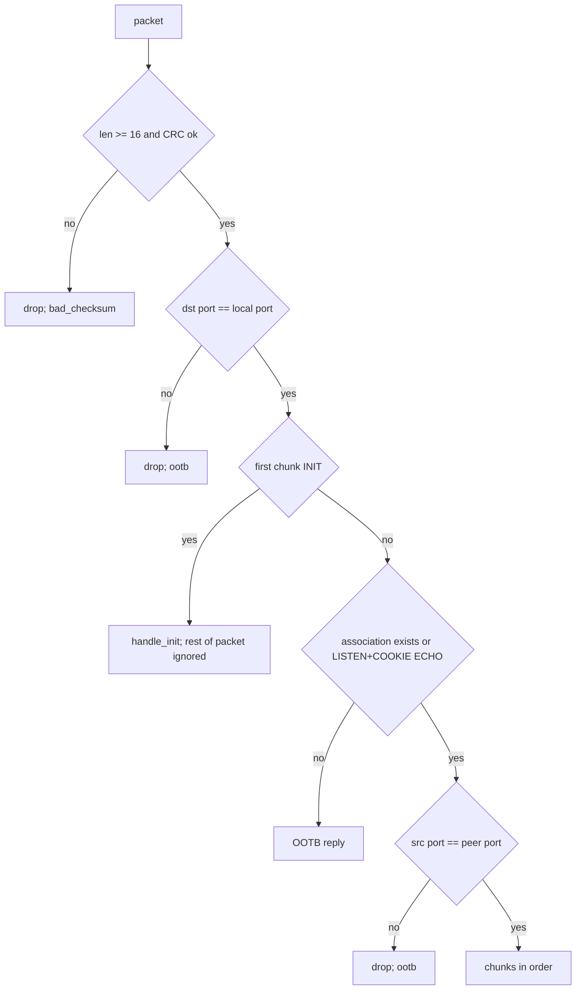
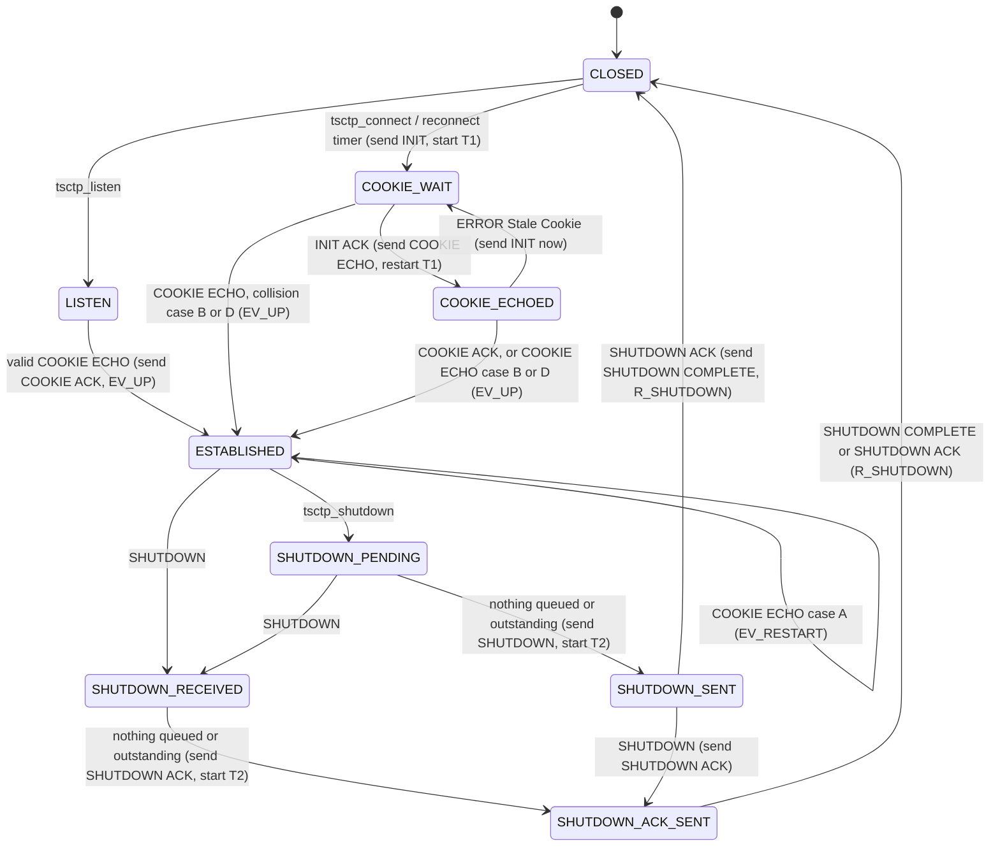

# tinysctp: protocol spec

What `src/sctp.c` puts on the wire and how it behaves, precisely enough to reimplement it compatibly. API,
Kconfig and tests are in [README.md](README.md). Symbols are `src/sctp.c` unless named otherwise. All
multi-byte fields are big-endian except the checksum. Sequence numbers compare with serial arithmetic
(RFC 1982: `lt32`, `le32`, `lt16`).

## Encapsulation (RFC 6951)

| Rule | Value |
|---|---|
| Transport | The SCTP packet (common header + chunks) is the whole UDP payload, unchanged |
| Peer's UDP port | `tsctp_esp_config_t.encap_port`, default 9899 (`src/esp.c`) |
| Local UDP port | `local_udp_port`, 0: ephemeral. A listener needs a fixed one |
| Peer address | Connecting end: resolved once at open. Listening end: the source of each datagram until ESTABLISHED, then fixed (`src/udp.c: learn_peer`); the source UDP port is not tracked per packet after that |
| Address parameters | None sent; received IPv4 / IPv6 / host name parameters ignored. One path |
| Packet size | `mtu` (default 1200) is the SCTP packet size; IP and UDP headers are on top. COOKIE ECHO may exceed it (up to the 1500-byte TX buffer) |
| Receive buffer | 1500 bytes (`tsctp_udp_t.buf`) |

## Common header and checksum

| Off | Size | Field |
|---|---|---|
| 0 | 2 | Source port |
| 2 | 2 | Destination port |
| 4 | 4 | Verification tag |
| 8 | 4 | CRC32c |

CRC32c (reflected polynomial 0x82F63B78, init and final XOR 0xFFFFFFFF; `src/crc32c.c`) over the whole packet
with bytes 8..11 zero, stored least significant byte first (`pk_flush`). Chunks are `type`(1), `flags`(1),
`length`(2, without padding), body, padded to 4 bytes with zeros.

## Inbound packet processing (`tsctp_input`)

"Association exists" (`has_tcb`) = state ≥ COOKIE-WAIT. Per chunk, in order:

| Chunk | Tag check |
|---|---|
| COOKIE ECHO | The cookie's MAC and contents (below), not the header tag. Invalid: stop |
| ABORT, SHUTDOWN COMPLETE | T bit clear: tag == our tag. T bit set: tag == peer's tag and nonzero. Fail: stop, `bad_vtag`. Then stop after acting |
| SHUTDOWN ACK before ESTABLISHED | Treated as OOTB (SHUTDOWN COMPLETE, T bit); stop |
| Anything else | Once per packet: tag == our tag, else stop, `bad_vtag` |

Processing stops after a chunk that closed or restarted the association. After the chunks: deliver complete
messages, reclaim slots, decide on a SACK, then `transmit` (bundled reply), then the shutdown check.

OOTB replies (`ootb`, RFC 9260 8.4): no reply to ABORT, SHUTDOWN COMPLETE, COOKIE ACK, ERROR; SHUTDOWN ACK gets
SHUTDOWN COMPLETE; anything else gets ABORT. Both with the T bit and the received packet's tag, ports swapped.
An INIT while CLOSED (not listening) gets ABORT with tag = the INIT's initiate tag, T bit clear.

Unknown chunk types (RFC 9260 3.2): bit 0x40 set → ERROR, cause 6 (Unrecognized Chunk) with the chunk (up to
240 bytes); bit 0x80 clear → stop processing the packet (chunks before it stand); set → skip.

## Chunks

Types (`CT_*`): DATA 0, INIT 1, INIT ACK 2, SACK 3, HEARTBEAT 4, HEARTBEAT ACK 5, ABORT 6, SHUTDOWN 7,
SHUTDOWN ACK 8, ERROR 9, COOKIE ECHO 10, COOKIE ACK 11, SHUTDOWN COMPLETE 14, FORWARD TSN 192. Not supported
(handled by the unknown-type rule): ECNE 12, CWR 13, AUTH 15, I-DATA 64, ASCONF / ASCONF ACK, RE-CONFIG 130,
PAD 132, I-FORWARD TSN 194, NR-SACK.

### DATA (0)

Flags: E 0x01 (last fragment), B 0x02 (first), U 0x04 (unordered). Others sent 0, ignored.

| Off (body) | Size | Field |
|---|---|---|
| 0 | 4 | TSN |
| 4 | 2 | Stream id |
| 6 | 2 | Stream sequence number (SSN); 0 for unordered |
| 8 | 4 | PPID (opaque, passed through) |
| 12 | n | User data, n ≥ 1 |

Sent: fragment size `(mtu - 12 - 16) & ~3` (1172 at MTU 1200; `tsctp_send`). All fragments of a message share
SSN; TSNs are assigned when a chunk first goes out, consecutive within a bundle. Received with n = 0: ignored.

### INIT (1) / INIT ACK (2)

| Off (body) | Size | Field | Sent |
|---|---|---|---|
| 0 | 4 | Initiate tag | Random, nonzero (`rnd_tag`) |
| 4 | 4 | a_rwnd | `rcvbuf` − bytes held |
| 8 | 2 | Outbound streams | `streams_out` (clamped to `TSCTP_MAX_STREAMS`) |
| 10 | 2 | Max inbound streams | min(`streams_in`, `TSCTP_MAX_STREAMS`) |
| 12 | 4 | Initial TSN | Random |
| 16 | - | Parameters | below |

INIT parameters (`put_pr_params`, 12 bytes): Forward-TSN-Supported (0xC000, length 4), Supported Extensions
(0x8008, length 5: one byte 0xC0, padded to 8). INIT chunk length 32, packet 44, header tag 0.

INIT ACK parameters: State Cookie (7, length 64, the 60-byte cookie), then the same 12 bytes. Chunk length 96.
Header tag = the INIT's initiate tag; ports swapped from the INIT.

Received INIT / INIT ACK: rejected (silently) if shorter than 20 / 16 bytes, if initiate tag, OS or MIS is 0,
or (INIT) if the header tag isn't 0. PR-SCTP is on if parameter 0xC000 is present, or 0x8008 lists 0xC0
(`parse_params`). All other parameters are ignored whatever their high bits (no Unrecognized Parameter
report). Negotiated streams: out = min(`streams_out`, peer's MIS, `TSCTP_MAX_STREAMS`); in = min(`streams_in`,
peer's OS, `TSCTP_MAX_STREAMS`) (`tcb_init`). INIT ACK without a cookie, or with one that wouldn't fit the TX
buffer: ignored (T1 resends INIT).

### State cookie (60 bytes, `COOKIE_LEN`)

Opaque to the peer; only its echo matters for interop. Layout as built by `handle_init`:

| Off | Size | Field |
|---|---|---|
| 0 | 4 | "TSC1" |
| 4 | 4 | Our tag |
| 8 | 4 | Peer's tag (its initiate tag) |
| 12 | 4 | Local tie-tag |
| 16 | 4 | Peer tie-tag |
| 20 | 4 | Our initial TSN |
| 24 | 4 | Peer's initial TSN |
| 28 | 4 | Peer's a_rwnd |
| 32 | 2 | Peer's OS |
| 34 | 2 | Peer's MIS |
| 36 | 1 | Peer supports PR-SCTP |
| 37 | 3 | 0 |
| 40 | 2 | Peer's SCTP port |
| 42 | 2 | Our SCTP port |
| 44 | 8 | Creation time (caller's ms) |
| 52 | 8 | SipHash-2-4 of bytes 0..51, key = 16 random bytes drawn at `tsctp_new` |

Valid when: length 60, magic, MAC, our tag == the packet's header tag, ports match. Stale when `now < made` or
`now − made > cookie_life_ms`: reply ERROR, cause 3 (Stale Cookie), 4-byte staleness in µs
(`(now − made − life) × 1000`, saturated), and discard.

Tie-tags: zero from LISTEN and COOKIE-WAIT; our current tags from COOKIE-ECHOED (collision) and from
ESTABLISHED or later (possible restart; a new tag and TSN are drawn).

### SACK (3)

| Off (body) | Size | Field |
|---|---|---|
| 0 | 4 | Cumulative TSN ack |
| 4 | 4 | a_rwnd |
| 8 | 2 | Number of gap blocks G |
| 10 | 2 | Number of duplicate TSNs D |
| 12 | 4G | Gap blocks: start, end (offsets from the cumulative TSN) |
| 12+4G | 4D | Duplicate TSNs |

Sent: at most `MAX_GAPS` 16 gap blocks and `MAX_DUPS` 8 duplicates (more duplicates are only counted).
Received: ignored if shorter than 12 + 4(G + D), if cum < our cum ack (old), or if cum ≥ next TSN to send.

### HEARTBEAT (4) / HEARTBEAT ACK (5)

Sent body: one Heartbeat Info parameter (type 1, length 20): 8-byte send time (ms), 4-byte nonce (random),
4 zero bytes. Chunk length 24. Received HEARTBEAT: the body echoed back in a HEARTBEAT ACK (any length that
fits the control buffer, `CTL_MAX` 256). Received ACK: accepted only with a heartbeat outstanding and a
matching nonce; RTT = now − send time.

### ABORT (6), SHUTDOWN ACK (8), COOKIE ACK (11), SHUTDOWN COMPLETE (14)

No body. ABORT is sent without error causes. The T bit (0x01) is set only on OOTB replies.

### SHUTDOWN (7)

Body: 4-byte cumulative TSN ack. Received: processed as a SACK with that cum TSN, no gaps, window unchanged.

### ERROR (9)

Sent causes: 1 Invalid Stream Identifier (stream id, 2 reserved bytes), 3 Stale Cookie (above),
6 Unrecognized Chunk Type (the chunk). Received: only Stale Cookie in COOKIE-ECHOED is acted on (below);
everything else is ignored.

### FORWARD TSN (192, RFC 3758)

| Off (body) | Size | Field |
|---|---|---|
| 0 | 4 | New cumulative TSN |
| 4 | 4N | (stream id, SSN) pairs |

Sent only if the peer advertised PR-SCTP: new cum TSN = the Advanced.Peer.Ack.Point; one pair per stream with
abandoned ordered chunks at or below it, carrying the highest such SSN, at most `TSCTP_MAX_STREAMS` pairs.
Received (always honored, advertised or not): see "Receiving".

## Association state machine

Every "→ CLOSED" goes to LISTEN instead on a listening instance. From any state with an association:

| Event | Result |
|---|---|
| ABORT received (tag rules above) | Closed, `R_ABORTED` |
| `tsctp_abort` | ABORT sent, closed, `R_LOCAL_ABORT`, listening off |
| Error counter > `max_retrans` | ABORT sent, closed, `R_PEER_LOST` |
| T1 retries > `max_init_retrans` | Closed, `R_INIT_TIMEOUT` (no ABORT) |

A close (`go_closed`) drops every queue, the cookie and all timers, zeroes both tags, emits `EV_DOWN`, and on
the connecting end (if not closed locally, reconnect enabled, reason not `LOCAL_ABORT`) arms the reconnect
timer at `reconnect_ms`, then doubles `reconnect_ms` up to max(`reconnect_max_ms`, `reconnect_min_ms`).
`reconnect_ms` returns to `reconnect_min_ms` on ESTABLISHED. A graceful close started by the peer, or an
ABORT, therefore reconnects; `tsctp_shutdown` and `tsctp_abort` don't.

### INIT and COOKIE ECHO handling (RFC 9260 5.2)

INIT, by state (`handle_init`; nothing is stored, the answer is always an INIT ACK):

| State | INIT from another source port | Our tag / ITSN in the INIT ACK | Tie-tags |
|---|---|---|---|
| CLOSED | - | (ABORT instead) | - |
| LISTEN | accepted | new | 0 |
| COOKIE-WAIT | ignored | current | 0 |
| COOKIE-ECHOED | ignored | current | current tags |
| ESTABLISHED and later | ignored (one association) | new | current tags |

COOKIE ECHO on an existing association (`handle_cookie_echo`), with lm = cookie's our-tag == ours, pm =
cookie's peer-tag == peer's:

| Case | Condition | Action |
|---|---|---|
| A (peer restart) | !lm, !pm, tie-tags == current tags | Drop queues, reset path, new TCB, stop T2, `EV_RESTART` |
| B (collision) | lm, !pm | Before ESTABLISHED: new TCB, `EV_UP`. Else: take the new peer tag |
| D | lm, pm | Before ESTABLISHED: `EV_UP` |
| C / other | - | Discard, stop processing |

Accepted COOKIE ECHO → COOKIE ACK queued, bundled with whatever follows (DATA in the same packet is taken).
Stale Cookie error in COOKIE-ECHOED counts against `max_init_retrans`, then INIT is sent at once with fresh
COOKIE-WAIT (no Cookie Preservative).

## Timers

All absolute ms, `NEVER` = `UINT64_MAX`; `tsctp_poll` returns the earliest, plus the next PR-SCTP expiry when
ESTABLISHED or later.

| Timer | Started | Duration | On expiry |
|---|---|---|---|
| T1-init / T1-cookie (`t1`) | INIT or COOKIE ECHO sent | RTO | `init_tries`+1; > `max_init_retrans`: `R_INIT_TIMEOUT`. Else RTO backoff, resend INIT or COOKIE ECHO, restart. `init_tries` resets on INIT ACK |
| T3-rtx (`t3`) | DATA sent with T3 stopped; any retransmission; SACK moving cum ack | RTO | See "Retransmission" |
| T2-shutdown (`t2`) | SHUTDOWN or SHUTDOWN ACK sent; DATA received in SHUTDOWN-SENT | RTO | Error counter +1 (may close `R_PEER_LOST`), RTO backoff, resend, restart |
| Delayed SACK (`tsack`) | First DATA packet not acknowledged at once | `sack_delay_ms` | SACK |
| Heartbeat (`thb`) | ESTABLISHED; after any DATA sent (unless a heartbeat is out) | `hb_interval_ms` + RTO + j, j uniform in [−⌊RTO/2⌋, RTO − ⌊RTO/2⌋] | ESTABLISHED and none outstanding: send HEARTBEAT. Re-arm |
| Heartbeat timeout (`thb_timeout`) | HEARTBEAT sent | RTO | Error counter +1; if still alive, RTO backoff |
| Reconnect (`treconnect`) | Close on the connecting end | `reconnect_ms` | In CLOSED: new INIT |

Heartbeats stop in SHUTDOWN-SENT, SHUTDOWN-RECEIVED and SHUTDOWN-ACK-SENT. No T5 shutdown guard, no
autoclose.

## Path: RTT, RTO, errors

| Rule | Formula / value |
|---|---|
| Initial | RTO = `rto_initial_ms`, clamped; SRTT, RTTVAR unset (`path_reset`) |
| First sample R | SRTT = R, RTTVAR = R/2 |
| Later samples | RTTVAR = (3·RTTVAR + \|SRTT − R\|)/4, then SRTT = (7·SRTT + R)/8 (integer ms) |
| RTO | SRTT + max(4·RTTVAR, 1), clamped to [`rto_min_ms`, `rto_max_ms`] (`rtt_sample`) |
| Backoff | RTO = 2·RTO, at most `rto_max_ms` (`rto_backoff`) |
| Samples | One DATA chunk timed at a time (the first new one sent when none is timed); taken when it's acked (cum or gap) and was sent once (Karn). Cancelled by fast retransmit and T3. Every matching HEARTBEAT ACK is a sample too |
| Error counter | +1 per T3 expiry, T2 expiry, heartbeat timeout; > `max_retrans` → peer lost. Reset to 0 by a SACK that newly acks DATA and by a HEARTBEAT ACK. One counter (association = path) |

## Sending

Bundling order in each packet (`transmit`): queued control chunks (COOKIE ACK, HEARTBEAT ACK, ERROR; up to
256 bytes, excess dropped), SACK (if due, or if a delayed SACK is pending and DATA goes out: piggybacked),
FORWARD TSN (in a packet of its own if the current one lacks room for a full one), retransmissions, new DATA.
DATA is sent only in ESTABLISHED, SHUTDOWN-PENDING and SHUTDOWN-RECEIVED; retransmissions and control chunks in
any state from ESTABLISHED.

### Congestion control (RFC 9260 7.2, one path)

| Quantity | Rule |
|---|---|
| MTU | `mtu` |
| Initial cwnd | min(4·MTU, max(2·MTU, 4380)) (`initial_cwnd`; 4380 at MTU 1200) |
| Initial ssthresh | Peer's a_rwnd |
| flight | Bytes (data + 16-byte header per chunk) of chunks in flight not marked for retransmission; acked and abandoned chunks excluded |
| Send gate | A chunk may go while flight < cwnd. When a retransmission is forced (fast retransmit or T3), the first packet goes regardless |
| Receiver window | New DATA waits while peer_rwnd < chunk size and flight > 0 (one chunk is a zero-window probe). peer_rwnd −= chunk size per new chunk; on SACK, peer_rwnd = a_rwnd − flight (floor 0) |
| Slow start (cwnd ≤ ssthresh) | On a SACK that moves the cum ack, outside fast recovery, and flight before it + MTU ≥ cwnd: cwnd += min(bytes newly acked, MTU) |
| Congestion avoidance | Same conditions: partial_bytes_acked += acked; when ≥ cwnd, −= cwnd and cwnd += MTU. Reset to 0 when flight is 0 |
| Idle decay | flight 0 and more than RTO since the last DATA: cwnd = max(min(cwnd, max(cwnd/2, 4·MTU)), initial cwnd) |
| Fast retransmit entry | ssthresh = max(cwnd/2, 4·MTU), cwnd = ssthresh, pba 0, recovery until the cum ack reaches the highest TSN sent at entry. Once per recovery |
| T3 expiry | ssthresh = max(cwnd/2, 4·MTU), cwnd = MTU, pba 0, recovery ends |

### Retransmission

| Trigger | Rule |
|---|---|
| Miss indication (RFC 9260 7.2.4, HTNA) | On a SACK with ≥ 1 gap block that newly acks something: each in-flight chunk below the highest newly acked TSN, not marked and not yet fast retransmitted, gets miss +1 |
| Fast retransmit | miss reaches 3: marked, sent at the next `transmit` regardless of cwnd for the first packet; each chunk at most once |
| T3 expiry | Error counter +1, RTO backoff, congestion as above, every in-flight chunk marked (miss reset), PR-SCTP expiry run, forced send, T3 restarted if anything is outstanding |
| Reneging | A gap-acked chunk absent from a later SACK's gaps is marked for retransmission at once |
| Ack | Chunks ≤ cum ack are freed; gap-acked chunks are kept (marked acked) until the cum ack passes them |

### PR-SCTP (RFC 3758, timed reliability only)

| Rule | Detail |
|---|---|
| Lifetime | `lifetime_ms` from `tsctp_send`; 0: reliable |
| Never sent | When a message's first fragment is still queued past its lifetime, the whole message is removed (`abandoned_unsent`); no TSN was used. Applies whether or not the peer supports PR-SCTP |
| Partly or fully sent | Only if the peer supports PR-SCTP: when any in-flight chunk is past its lifetime, every chunk of that message is abandoned (sent and queued; `abandoned_msgs`). Without peer support it is retransmitted until acked |
| When checked | Each `transmit` and T3 expiry; `tsctp_poll` returns the next expiry as a deadline |
| Advanced.Peer.Ack.Point | Moves up from the cum ack over consecutive abandoned TSNs (`advance_adv`, rule C1); when above the cum ack a FORWARD TSN is pending and goes out with the next packet. Re-sent after each SACK that leaves it above the cum ack |

## Receiving

| Rule | Detail |
|---|---|
| Accepted states | DATA in ESTABLISHED, SHUTDOWN-PENDING, SHUTDOWN-SENT; ignored otherwise |
| Window | A ring of `TSCTP_RX_WINDOW` slots indexed TSN mod W, from rx_floor (the oldest TSN still held). A chunk is dropped unacked (`chunks_dropped_window`) if TSN − rx_floor ≥ W, if bytes held + its length > `rcvbuf`, if its length > `max_message`, or on allocation failure |
| Duplicates | TSN ≤ cum TSN or already held: counted, reported in the next SACK (first 8) |
| Bad stream | Stream ≥ negotiated inbound: ERROR cause 1, the TSN is acked and the data dropped |
| Cum TSN | Advances over consecutive held TSNs |
| Delivery | A message is complete when B through E fragments are held with consecutive TSNs. Delivered when unordered, or at or below the cum TSN, or ordered with SSN == next expected on its stream (then next = SSN + 1). Repeats until nothing more goes. Order is per stream; a gap holds only its stream back |
| Oversized | A reassembled message over `max_message` is discarded silently (its TSNs stay acked) |
| Too many fragments | A message needs a slot per fragment, and a TSN `TSCTP_RX_WINDOW` or more past the oldest held is refused (not acked). A message of more fragments than the window (64 by default: about 74 KB at MTU 1200, less at a smaller peer MTU) is never completed: its fragments hold the window, the next one is refused, and the sender retransmits it while heartbeats keep the association up. Keep messages under `(RX_WINDOW - 1) * fragment size` |
| a_rwnd | `rcvbuf` − bytes held |
| SACK timing | At once if a gap exists (highest TSN > cum TSN), a duplicate arrived, or this is the 2nd unacked DATA packet; else after `sack_delay_ms`. In SHUTDOWN-SENT, DATA is answered by a SACK and a repeated SHUTDOWN, T2 restarted |
| FORWARD TSN received | Ignored unless its TSN > cum TSN. Then cum TSN = it, complete messages delivered, held fragments ≤ it freed, each (stream, SSN) with SSN ≥ next expected sets next = SSN + 1 (`skipped_msgs`), SACK at once |

## Shutdown

| Step | Rule |
|---|---|
| `tsctp_shutdown` | SHUTDOWN-PENDING; new sends rejected (`ERR_STATE`); queued data still goes out |
| All acked | SHUTDOWN (cum TSN) → SHUTDOWN-SENT, T2 |
| SHUTDOWN received | Acts as a SACK; ESTABLISHED / SHUTDOWN-PENDING → SHUTDOWN-RECEIVED (data already queued still goes out); SHUTDOWN-SENT / -ACK-SENT → SHUTDOWN ACK, SHUTDOWN-ACK-SENT, T2 |
| SHUTDOWN-RECEIVED, all acked | SHUTDOWN ACK → SHUTDOWN-ACK-SENT, T2 |
| SHUTDOWN ACK received in SHUTDOWN-SENT / -ACK-SENT | SHUTDOWN COMPLETE, closed `R_SHUTDOWN` |
| SHUTDOWN COMPLETE received in SHUTDOWN-ACK-SENT | Closed `R_SHUTDOWN` |
| T2 exhausted | ABORT, closed `R_PEER_LOST` |

## Status JSON (`tsctp_status_json`)

One object, fields in this order; integers unsigned decimal:

| Key | Source (`tsctp_stats_t`) |
|---|---|
| `state` | `tsctp_state_name` |
| `srtt_ms`, `rto_ms`, `cwnd`, `flight`, `peer_rwnd` | same names |
| `queued` | `queued_msgs` |
| `outstanding` | `outstanding_chunks` |
| `errors` | `error_count` |
| `prsctp` | `peer_prsctp` (true / false) |
| `streams` | `[streams_out, streams_in]` |
| `pkts_in`, `pkts_out`, `msgs_sent`, `msgs_received` | same names |
| `retransmits` | `retransmits_t3` |
| `fast_retransmits` | `retransmits_fast` |
| `t3_expiries` | same |
| `abandoned` | `abandoned_msgs` |
| `dropped_unsent` | `abandoned_unsent` |
| `fwd_tsn_sent`, `fwd_tsn_received` | same |
| `dups` | `dup_chunks` |
| `bad_checksum`, `hb_sent`, `hb_acked`, `established`, `restarts`, `failures` | same |
| `aborts` | `aborts_received` |
| `send_rejected` | same |

## RFC coverage

| Covered | Notes |
|---|---|
| RFC 9260 3 (formats), 5.1 (setup, cookie), 5.2.1–5.2.4 (collisions, restart, tie-tags), 5.3 (stale cookie) | Single address |
| RFC 9260 6 (DATA, SACK, fragmentation, ordered / unordered, duplicates, delayed SACK), 6.3 (RTO), 7 (congestion control) | One path |
| RFC 9260 8.1–8.3 (error counter, heartbeat), 8.4 (OOTB), 8.5 / 8.5.1 (tags, T bit) | One counter for association and path |
| RFC 9260 9 (ABORT, graceful shutdown, T2) | |
| RFC 3758 (FORWARD TSN, Forward-TSN-Supported, timed reliability) | Receiving honored without negotiation |
| RFC 6951 (UDP encapsulation) | Port learning only before ESTABLISHED on a listener |

Left out: multihoming and address parameters, ASCONF (RFC 5061), one-to-many sockets, AUTH (RFC 4895), ECN,
I-DATA / interleaving (RFC 8260), stream reconfiguration (RFC 6525), NR-SACK, PMTU discovery, PR-SCTP
policies other than timed (RFC 7496), Cookie Preservative, Adaptation Layer Indication, Zero Checksum,
Unrecognized Parameter reporting (INIT / INIT ACK parameters are ignored regardless of their high bits),
error causes in ABORT, the T5 shutdown guard timer, cookie key rotation, and the RFC 6951 "UDP Encapsulation
Port" cause / per-packet port tracking. An INIT bundled with other chunks is processed alone.
