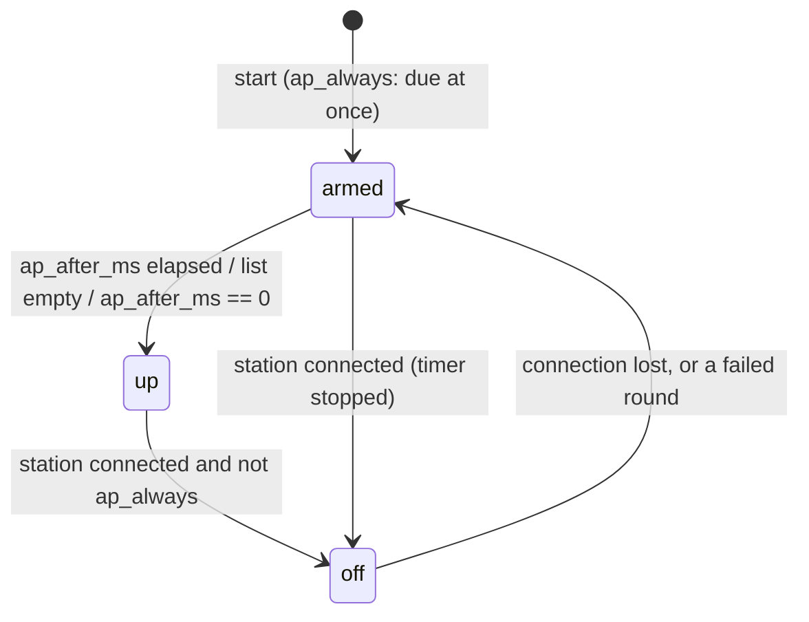

# wifilist

A Wi-Fi station for ESP-IDF v5.x with a prioritized list of networks, a setup access point for when none
connects, and a JSON API plus page section to edit the list. Passwords never leave the board through it.

Files: `include/wifilist.h` (ESP-IDF API), `include/wifilist_core.h` + `src/wifilist_core.c` (portable C11:
ranking, checks, edits, JSON writers, the backoff, the AP password check, the NVS blob codec), `src/wifilist.c` (station task, AP, NVS), `src/wifilist_settings.c`
(JSON edits, cJSON), `src/wifilist_http.c` + `web/wifilist.js` (HTTP and page), `test/test_wifilist.c`.

## Use

```c
nvs_flash_init();
wifilist_config_t c = WIFILIST_CONFIG_DEFAULT();
c.hostname = "mybox";
c.ap_ssid = "mybox-%s";          // first "%s" -> last 2 bytes of the AP MAC, 4 uppercase hex digits
c.ap_password = "setup123";      // NULL or "": open AP
wifilist_migrate(old_ssid, old_password);  // optional, before or after start
wifilist_start(&c);
wifilist_http_register(httpd);   // optional (CONFIG_WIFILIST_HTTP)
```

`wifilist_start` calls `esp_netif_init`, `esp_event_loop_create_default` (both tolerate `ESP_ERR_INVALID_STATE`),
creates the default STA netif (and the AP netif when `ap_ssid` is set), `esp_wifi_init`, sets
`WIFI_STORAGE_RAM` and `WIFI_MODE_STA`, starts Wi-Fi and the station task. The app must not create those itself;
it may still register its own `WIFI_EVENT` / `IP_EVENT` handlers.

Reuse: copy the directory into `components/` or add its parent to `EXTRA_COMPONENT_DIRS`. Requires `esp_netif`,
`esp_http_server`; private `esp_wifi`, `esp_event`, `esp_timer`, `nvs_flash`, `json`. Without `ESP_PLATFORM`,
`CMakeLists.txt` builds only `wifilist_portable` (static, from `wifilist_core.c`) and, standalone, the test:
`cmake -S . -B build && cmake --build build && ctest --test-dir build`.

## API

### Types (`include/wifilist_core.h`, `include/wifilist.h`)

| Type | Fields |
|---|---|
| `wifilist_net_t` | `char ssid[33]`, `char password[65]` (`""` = open), `int8_t priority`, `bool hidden` |
| `wifilist_ap_t` | a scan record: `char ssid[33]`, `uint8_t bssid[6]`, `int8_t rssi`, `uint8_t channel`, `bool open` (authmode `WIFI_AUTH_OPEN`) |
| `wifilist_cand_t` | `int net` (index into the list), `int ap` (index into the scan, -1 = hidden, by name only) |
| `wifilist_edit_t` | `wifilist_net_t net`, `bool has_password`, `char was[33]` (previous name) |
| `wifilist_fail_t` | `uint32_t t_s` (s since boot), `char ssid[33]`, `uint8_t reason`, `int8_t rssi`, `bool lost` (true: was connected; false: a try failed) |
| `wifilist_status_t` | see [Status JSON](#get-basewifi-status-json); `nets[].rssi` = -128 when not in the last scan |
| `wifilist_config_t` | below |

`wifilist_config_t` and `WIFILIST_CONFIG_DEFAULT()`:

| Field | Default | Meaning |
|---|---|---|
| `hostname` | `NULL` | DHCP hostname (copied, truncated to 32 bytes); `NULL`/`""`: IDF default |
| `power_save` | `false` | `false`: `esp_wifi_set_ps(WIFI_PS_NONE)`; `true`: IDF default modem sleep |
| `ap_ssid` | `NULL` | setup AP name; `NULL`: no AP. The first `%s` becomes `%02X%02X` of AP MAC bytes 4 and 5. Result truncated to 32 bytes |
| `ap_password` | `NULL` | `NULL`/`""`: `WIFI_AUTH_OPEN`; else `WIFI_AUTH_WPA2_PSK`. With an `ap_ssid`, anything but 8 to 63 characters (`wifilist_ap_password_ok`) is logged and leaves the setup AP off; the station side runs as usual; a refusal by `esp_wifi_set_config` is logged and the AP stays down |
| `ap_after_ms` | 20000 | no connection for this long raises the AP; 0: at once |
| `ap_always` | `false` | keep the AP up while connected |
| `ap_channel` | 6 | AP channel while the station isn't connected (0 = 6) |
| `ap_max_conn` | 2 | AP client limit (0 = 2) |

### Functions

Portable (`wifilist_core.h`; pure functions, reentrant, no allocation):

| Signature | Behavior | Errors |
|---|---|---|
| `int wifilist_rank(const wifilist_net_t *nets, int n, const wifilist_ap_t *aps, int na, wifilist_cand_t *out, int max)` | candidates in try order ([Selection](#selection)); returns the count (≤ `max`, ≤ `WIFILIST_MAX`) | none |
| `void wifilist_sort(wifilist_net_t *nets, int n)` | stable sort, priority descending | none |
| `bool wifilist_check(const wifilist_net_t *nets, int n, char *err, size_t cap)` | [list rules](#the-list); `err` may be `NULL` | false + first failing rule in `err` |
| `int wifilist_merge(const wifilist_net_t *old, int n_old, const wifilist_edit_t *in, int n_in, wifilist_net_t *out, char *err, size_t cap)` | applies [edits](#edits), checks, sorts; returns the count | -1 + `err` |
| `const char *wifilist_reason(uint8_t reason)` | [reason text](#disconnect-reasons) | `"other"` |
| `size_t wifilist_status_json(const wifilist_status_t *st, char *buf, size_t cap)` | status JSON, NUL-terminated | 0 and `buf[0]=0` if it doesn't fit |
| `size_t wifilist_networks_json(const wifilist_net_t *nets, int n, char *buf, size_t cap)` | export JSON, no passwords | 0 if it doesn't fit |

ESP-IDF (`wifilist.h`). All but `wifilist_start` may be called from any task. The list and status are guarded by
one mutex, created lazily by the first call (make that first call from one task). Functions marked "pre" work
before `wifilist_start` (they load NVS on first use).

| Signature | Pre | Behavior | Errors |
|---|---|---|---|
| `esp_err_t wifilist_start(const wifilist_config_t *cfg)` | | once; copies `cfg` and its strings | `ESP_ERR_INVALID_STATE` if already started; netif / event loop / `esp_wifi_init` / `esp_wifi_start` errors; `ESP_ERR_NO_MEM` if the task can't be created |
| `int wifilist_get(wifilist_net_t *out, int max)` | yes | copy of the list (stored order: priority descending), with passwords. For the app only | none |
| `esp_err_t wifilist_set(const wifilist_net_t *nets, int n, char *err, size_t cap)` | yes | check, sort, store in NVS, then replace in RAM and signal the task ([Edits while connected](#behavior)) | `ESP_ERR_INVALID_ARG` (check), `ESP_ERR_NO_MEM`, NVS errors (`err` = `"NVS: <name>"`; RAM list unchanged) |
| `bool wifilist_stored(void)` | yes | a valid blob was loaded (a damaged one does not count) or a list was stored | none |
| `esp_err_t wifilist_migrate(const char *ssid, const char *password)` | yes | if nothing stored: stores `[{ssid, password, 0, false}]` (ssid `NULL`/`""`: empty list). Strings truncated to 32 / 64 bytes. No-op `ESP_OK` if stored | as `wifilist_set` |
| `esp_err_t wifilist_update_json(const char *json, size_t len, char *err, size_t cap)` | yes | parse [edit JSON](#edits), merge with the current list, `wifilist_set` | `ESP_ERR_INVALID_ARG` + `err`, `ESP_ERR_NO_MEM` |
| `size_t wifilist_export_json(char *buf, size_t cap)` | yes | `wifilist_networks_json` of the list | 0 |
| `void wifilist_status(wifilist_status_t *out)` | yes | snapshot; RSSI and channel live from `esp_wifi_sta_get_ap_info` when connected, else as at connect | none |
| `bool wifilist_connected(void)` | yes | connected with an address (read under the lock) | none |
| `void wifilist_scan(void)` | no-op | ask the task to scan (status only; never changes network) | none |
| `void wifilist_reconnect(void)` | no-op | drop the connection (or abort a try) and choose again | none |
| `esp_netif_t *wifilist_sta_netif(void)` | `NULL` | the STA netif | none |
| `esp_err_t wifilist_http_register(httpd_handle_t server)` (`wifilist_http.h`) | | registers 4 URI handlers | first `httpd_register_uri_handler` error |

## The list

| Rule (`wifilist_check`, order checked) | Error text |
|---|---|
| 0 ≤ n ≤ `WIFILIST_MAX` | `at most %d networks` |
| `ssid` 1 to 32 bytes (any bytes, no NUL) | `network %d: a name of 1 to 32 bytes` (1-based) |
| `password`: empty (open), 8 to 63 bytes, or exactly 64 hex digits (raw PSK, either case) | `%s: a password of 8 to 63 characters (or none: open)` / `%s: a 64 character password must be hex (a PSK)` |
| `priority` in [`WIFILIST_PRIORITY_MIN`, `WIFILIST_PRIORITY_MAX`] = [-100, 100] | `%s: priority -100 to 100` |
| `ssid` unique (byte compare) | `%s is in the list twice` |

Stored sorted by priority descending; equal priorities keep their given order (`wifilist_sort`, insertion sort).

### NVS storage

Namespace `CONFIG_WIFILIST_NVS_NAMESPACE` (default `wifilist`), key `nets` (`src/wifilist.c:NVS_KEY`), one blob,
written with `nvs_set_blob` + `nvs_commit`:

| Offset | Size | Field |
|---|---|---|
| 0 | 1 | version = 1 (`include/wifilist_core.h:WIFILIST_BLOB_VERSION`) |
| 1 | 1 | n |
| 2 + 100·i | 33 | `ssid`, NUL-terminated, zero padded |
| +33 | 65 | `password`, NUL-terminated, zero padded (plain text) |
| +98 | 1 | `priority`, int8 |
| +99 | 1 | flags: bit 0 = hidden |

Records are 100 bytes (`WIFILIST_BLOB_REC`), written by `wifilist_blob_encode` and read by `wifilist_blob_decode`. Load (once, lazily): a blob shorter than 2 bytes or with another version
counts as nothing stored, and so does `n > WIFILIST_MAX` or `len < 2 + 100·n` (`wifilist_blob_decode` returns -1):
the damaged list is ignored and `wifilist_migrate` can store a new one. Loaded records are not re-checked or re-sorted. Wi-Fi's own config is kept in RAM (`WIFI_STORAGE_RAM`), so
the list is the only persistent Wi-Fi state.

### Edits

`wifilist_update_json` (and `POST <base>/wifi/networks`) take the whole new list:

```json
{"networks": [
  {"ssid": "EventNet", "priority": 50},
  {"ssid": "Home5G", "priority": 10, "was": "Home"},
  {"ssid": "New", "priority": 0, "password": "secret123", "hidden": true}
]}
```

| Key | Type | Rule |
|---|---|---|
| `ssid` | string ≤ 32 bytes | required (missing = `""`, fails the check) |
| `password` | string ≤ 64 bytes | present (even `""`): sets it. Absent: copies the stored password of the network named `was` (or of `ssid` when `was` is absent/empty); no such network: open |
| `was` | string ≤ 32 bytes | the entry's previous name |
| `priority` | number in [-100, 100] | absent: 0; fractional values truncate toward zero |
| `hidden` | bool | only JSON `true` sets it |

Other keys are ignored. `{"ssid": "x", "password": "y"}` (no `networks` key) is a list of one with priority 0;
`"ssid": ""` there gives an empty list. Parse errors: `wifi: an object {networks: [...]} or {ssid, password}`,
`wifi.networks: a list`, `wifi.networks: objects {ssid, priority, hidden, password}`, `<key>: a string of at
most N bytes`, `at most N networks`, plus the check errors. An export (`{"networks":[{"ssid","priority"[,"hidden":true]}]}`)
re-imported on the same board keeps the passwords; on another board protected networks become open (and are then
never matched against protected APs, see [Selection](#selection)).

## Selection

`wifilist_rank`, per scan. For each listed network in stored order (at most `WIFILIST_MAX`):

1. Match scan records with equal SSID (byte compare) **and** `ap.open == (password == "")`. A protected entry
   never matches an open AP and an open entry never matches a protected one (WEP, WPA*, OWE, enterprise are all
   "protected").
2. Keep the strongest matching record (first wins on equal RSSI). No match: skip, unless `hidden`, then it is a
   candidate with `ap = -1` and RSSI -128.
3. Order candidates by priority descending, then RSSI descending, then stored order.

A hidden AP usually reports an empty SSID in a scan, so hidden entries are normally tried by name.

Connect parameters per try (`try_connect`): `threshold.authmode` = `WIFI_AUTH_WPA2_PSK` with a password (rejects
WEP and WPA1) else `WIFI_AUTH_OPEN`; `pmf_cfg.capable = true`; `sae_pwe_h2e = WPA3_SAE_PWE_BOTH` (WPA2, WPA2/WPA3,
WPA3-only); `scan_method = WIFI_ALL_CHANNEL_SCAN`; `sort_method = WIFI_CONNECT_AP_BY_SIGNAL`; with a scan
record also `bssid_set` and `channel` (pinned to that AP).

## Behavior

```mermaid
stateDiagram-v2
    [*] --> starting
    starting --> no_networks: list empty
    starting --> scanning: list not empty
    no_networks --> no_networks: scan request (scan, status only)
    no_networks --> scanning: list changed / reconnect
    scanning --> connecting: rank, next candidate
    connecting --> connected: IP within CONNECT_TIMEOUT_S
    connecting --> connecting: disconnect or timeout (fail logged), next candidate
    connecting --> scanning: list changed / reconnect (abort, no fail logged)
    connecting --> waiting: no candidate left
    waiting --> scanning: backoff elapsed / list changed / scan request / reconnect
    connected --> connected: scan request (scan); list changed, still listed with same password
    connected --> scanning: disconnect (fail, lost) / reconnect / list changed and gone or password changed
```



Status `state` strings: `starting`, `no networks`, `scanning`, `connecting`, `connected`, `waiting`. A scan sets
`scanning` and restores the previous state after.

Rules (`src/wifilist.c:sta_task`):

- **Round:** scan (async, all channels, `show_hidden`), rank, try each candidate in order until one gets an IP.
  Every list change re-reads the list at the top of the loop.
- **Try outcome:** `IP_EVENT_STA_GOT_IP` = connected; `WIFI_EVENT_STA_DISCONNECTED` = fail with its reason;
  no IP within `CONFIG_WIFILIST_CONNECT_TIMEOUT_S` = disconnect, fail with reason 0; `esp_wifi_connect()` error =
  fail with reason 205. A list change or reconnect request during a try aborts it without a fail record.
- **Backoff** after a round with no connection: wait `min(5·2^r, RESCAN_MAX_S)` s (`wifilist_backoff_s`), r = failed rounds since
  the last connection (5, 10, 20, 40, 80, 160, ... before the cap; default cap 30 gives 5, 10, 20, 30, 30, ...). While the
  AP is up the wait is always `RESCAN_MAX_S` (a scan takes the radio off the AP's channel). The wait ends early on
  a list change, scan request or reconnect request. r resets only on a connection.
- **Connected:** stays until a disconnect event (fail with `lost = true`, then an immediate new round), a
  reconnect request, or a list change after which no entry has the same SSID **and** password. It never roams to
  a higher priority network on its own; a priority edit alone does not drop the connection.
- **Edits:** `wifilist_set` stores first, then signals the task (`BIT_LIST`).
- **Failures:** ring of `WIFILIST_FAILS` = 8, oldest dropped, `t_s` = seconds since boot, `rssi` = the
  disconnect event's RSSI, or the scanned AP's RSSI (0 for a hidden try) on a timeout.

### Setup access point (`CONFIG_WIFILIST_SOFTAP`, `ap_ssid` set)



- One-shot timer `wifilist_ap`; arming does not restart a running timer. Armed at start, after a failed round and
  after a lost connection. With an empty list the AP is due at once.
- Raising it switches to `WIFI_MODE_APSTA`; it is raised only between scans (a due AP waits for the scan to end).
  Channel: the station's channel if connected (only with `ap_always`), else `ap_channel`. Address: the IDF AP
  netif default, `http://192.168.4.1/`.
- Off: `WIFI_MODE_STA`, on connection, unless `ap_always`.

### Constants

| Value | `path:symbol` | Meaning |
|---|---|---|
| 8 (Kconfig) | `include/wifilist_core.h:WIFILIST_MAX` | list size, set from `CONFIG_WIFILIST_MAX_NETWORKS` |
| 16 | `include/wifilist_core.h:WIFILIST_SEEN` | APs kept for the status: unique non-empty SSIDs, strongest first |
| 8 | `include/wifilist_core.h:WIFILIST_FAILS` | failures kept |
| -100, 100 | `include/wifilist_core.h:WIFILIST_PRIORITY_MIN`, `_MAX` | priority range |
| 24 | `src/wifilist.c:SCAN_MAX` | scan records read per scan (ranking sees only these) |
| 10 s | `src/wifilist.c:do_scan` | scan timeout (`esp_wifi_scan_stop`, result empty) |
| 2 s | `src/wifilist.c:quiet_disconnect` | wait for the disconnect event after `esp_wifi_disconnect` |
| 5 s, ×2 | `src/wifilist_core.c:wifilist_backoff_s` | backoff base, doubling each failed round up to `WIFILIST_RESCAN_MAX_S` |
| 4096 B | `src/wifilist.c:wifilist_start` | station task stack |
| 4096 B | `src/wifilist_http.c:MAX_BODY` | largest `POST .../networks` body |
| 6144 B | `src/wifilist_http.c:get_wifi` | status JSON buffer (PSRAM preferred) |

### Disconnect reasons

`wifilist_reason` (802.11 / ESP-IDF `wifi_err_reason_t`): 0 timed out (own timeout), 1 unspecified,
2 authentication expired, 3 deauthenticated (AP leaving), 4 disassociated (inactive), 5 AP full, 6 not
authenticated, 7 not associated, 8 disassociated (leaving), 14 MIC failure, 15 4-way handshake timeout (wrong
password?), 16 group key timeout, 23 802.1X authentication failed, 200 beacon timeout, 201 no AP found,
202 authentication failed, 203 association failed, 204 handshake timeout (wrong password?), 205 connection
failed, 206 AP TSF reset, 207 roaming, 208 association comeback too long, 209 SA query timeout, 210 no AP with
compatible security, 211 no AP within the auth threshold, 212 no AP within the RSSI threshold; others "other".

## HTTP (`CONFIG_WIFILIST_HTTP`)

`wifilist_http_register` adds 4 handlers (count them in `max_uri_handlers`). `<base>` = `CONFIG_WIFILIST_HTTP_BASE`.

| Request | Response |
|---|---|
| `GET <base>/wifi` | 200 `application/json`, `Cache-Control: no-store`: status JSON; 500 `too big` / `no memory` |
| `POST <base>/wifi/networks` | body 1 to 4096 bytes of [edit JSON](#edits) (else 400). 200: status JSON; 400 `text/plain`: the error text; 500 `read failed` / `no memory` |
| `POST <base>/wifi/scan` | 200 `{"scanning":true}`; the result shows in `GET <base>/wifi` a few seconds later |
| `GET /wifilist.js` | 200 `text/javascript`, `Content-Encoding: gzip`, `Cache-Control: no-cache`: `web/wifilist.js`, gzip level 9, mtime 0, embedded at build |

No authentication: protect the server if it needs it.

### GET <base>/wifi: status JSON

Key order is fixed. Strings escape `"` `\` and bytes < 0x20 (`\u00XX`); well-formed UTF-8 passes through; each byte that is
not (an SSID is any 32 bytes) becomes `\ufffd`. MACs are `aa:bb:cc:dd:ee:ff`, lowercase.

| Key | Type | Meaning |
|---|---|---|
| `state` | string | see [Behavior](#behavior) |
| `connected` | bool | |
| `ssid` | string | network connected to; `""` when not |
| `bssid`, `rssi`, `channel`, `connected_s` | string, int dBm, int, int s | only when connected |
| `ip` | string | dotted IPv4, `""` when none |
| `ap_up` | bool | setup AP up |
| `ap_ssid` | string | `""` when the AP is down |
| `scans`, `connects` | int | counters since boot |
| `uptime_s` | int | seconds since boot (the clock of `fails[].t_s`) |
| `networks[]` | `{ssid, priority, hidden, password_set[, rssi]}` | the list, stored order; `rssi` from `seen[]` when present |
| `seen[]` | `{ssid, bssid, rssi, channel, open}` | last scan, ≤ 16, unique non-empty SSIDs, strongest first |
| `fails[]` | `{t_s, ssid, reason, why, rssi, lost}` | ≤ 8, oldest first; `why` = `wifilist_reason(reason)` |

## Page section (`web/wifilist.js`)

`<div data-wifilist data-base="/api" data-refresh="5"></div><script src="/wifilist.js" defer></script>`.
Mounts on every `[data-wifilist]` (also `window.wifilist.mount(el)`), polls `GET <base>/wifi` every
`data-refresh` s (default 5) while visible. Every change POSTs the whole list, each existing entry with
`was` = its current name and no `password`, so passwords stay on the board. Up/down swaps two entries and
renumbers all priorities `10·(N−k)` for position k = 0..N−1 (top = 10·N, bottom = 10). Add sends `password`
(`""` for open); edit sends it only when typed. Colors use the page's `--mute`, `--line`, `--ok`, `--bad`,
`--accent` when defined.

## Kconfig (`Kconfig`, menu "wifilist (prioritized Wi-Fi networks)")

| Option | Type, range | Default | Meaning |
|---|---|---|---|
| `WIFILIST_MAX_NETWORKS` | int 1 to 32 | 8 | list size (`WIFILIST_MAX`, a public compile definition) |
| `WIFILIST_CONNECT_TIMEOUT_S` | int 5 to 120 | 15 | association + DHCP per try |
| `WIFILIST_RESCAN_MAX_S` | int 5 to 600 | 30 | cap on the backoff wait; the wait while the AP is up |
| `WIFILIST_SOFTAP` | bool | y | setup AP support |
| `WIFILIST_HTTP` | bool | y | build `wifilist_http.c` and embed the page |
| `WIFILIST_HTTP_BASE` | string | `/api` | prefix of the JSON API |
| `WIFILIST_NVS_NAMESPACE` | string | `wifilist` | NVS namespace |
| `WIFILIST_TASK_PRIORITY` | int 1 to 24 | 5 | station task priority |

## Tests (`test/test_wifilist.c`)

Portable code only; built standalone or by `host-tests` (`ctest -R wifilist`).

| Test | Pins |
|---|---|
| `ranking` | priority first, strongest AP per network (channel chosen), hidden-unseen as weakest of its priority, fallback when the top network is out of range, only hidden with an empty scan, open/protected mismatch excluded, list order on equal priority and RSSI |
| `checking` | valid: open, 8-char, 64-hex PSK, priorities ±100; invalid: empty SSID, short password, 64 chars non-hex, priority 101, duplicates (`twice`), `WIFILIST_MAX + 1`; sort is stable |
| `merging` | password kept by own name and by `was` (rename), new without password = open, explicit password kept, result sorted, short password refused (`8 to 63`), empty list allowed |
| `backoff` | 5 s doubling to the cap, for caps of 30, 600, 5 and below 5; the AP up: always the cap; no overflow with an enormous cap |
| `ap_password` | none, 7, 8, 63 and 64 characters |
| `blob` | encode / decode round trip (layout of a record, negative priority, hidden flag, zero padding, nothing written past the end); trailing bytes ignored; `max`; not a list (NULL, under 2 bytes, short of its records, another version, more networks than the list holds): -1; unterminated strings get a NUL |
| `utf8` | 2, 3 and 4 byte sequences kept; invalid bytes, overlong forms, surrogates, past U+10FFFF, a sequence cut short: `\ufffd`; control characters; the export too |
| `json_shapes` | idle status with a NULL state; the SSID hidden while disconnected; counters up to 32 bits; a full status (every list at its limit); exact-fit and one-byte-short buffers, every smaller buffer refused; the export, full, empty and short |
| `reasons` | every disconnect reason text, and "other" |
| `edges` | rank with `max` below the count and a list longer than `WIFILIST_MAX`, the strongest protected twin, hidden networks seen and unseen, an unnamed AP; check: each refusal's text, no error buffer, 63 characters, 64 hex in either case; merge: too many edits, a name the old list lacks, `was`, a stored password that no longer passes |
| `json` | status JSON head and key order, `password_set` and omitted `rssi` (-128), quote escaping, `why` text, too-small buffer returns 0 and empties it; export exact string, `hidden` only when true, no passwords; reason 0 and 201 |

Not covered by host tests: the station task, the AP, the NVS calls, HTTP, cJSON parsing and the page (they need the radio and ESP-IDF); `wifilist_core.c` holds everything that can be decided without them and is covered line for line.

## Provenance

Original code. Depends on ESP-IDF (Apache-2.0) and its `json` component, cJSON (MIT). Nothing
copied from other projects.
