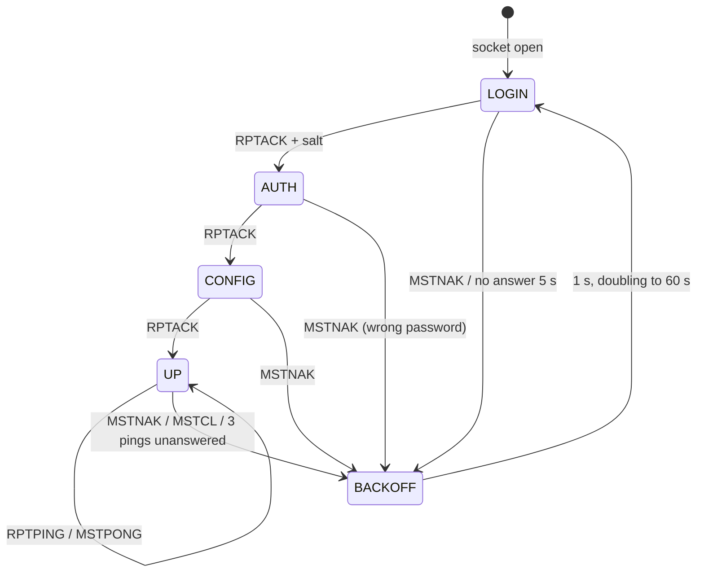

# BrandMeister network

What: connect the gateway's talk paths to BrandMeister as a network type of its own, beside `hblink` and `mqtt`. A
simplex frequency or a repeater (a duplex pair) logs in to a BrandMeister master as a hotspot or a repeater; one
box can hold several logins at once, one per path, as `identity: per_path` does for HBlink4.
Status (2026-11-06): built and host tested against a simulated master (`fakebm`); not yet run against BrandMeister.
The settings are config-v3 §7.3.
Related: [hblink.md](hblink.md) (the DMRC peer this builds on), [config-v3.md](config-v3.md) §7, [ipgw.md](ipgw.md),
[roamer.md](roamer.md), [../repeater.md](../repeater.md).

## 1. Which protocol

BrandMeister takes devices in three ways:

| Way | Who may use it | Fit |
|---|---|---|
| Homebrew repeater protocol: the box logs in as a hotspot or repeater | anyone with a registered DMR ID and a hotspot security password (BrandMeister's SelfCare) | chosen: one login per path, no approval needed |
| OpenBridge (server to server) | by ticket, granted by BrandMeister's admins | for a network, not a frequency; later, with the MQTT network |
| SEA (the Rewind protocol, an application) | per application, granted by BrandMeister | for apps; later, if ever |

So the gateway becomes a Homebrew client: the same `DMRD` bursts it sends HBlink4 today, behind a login.

## 2. How BrandMeister differs from HBlink4

| Item | HBlink4 today ([hblink.md](hblink.md)) | BrandMeister |
|---|---|---|
| Login | none: `DMRC`, answered by `DMRP` | `RPTL` → `RPTACK` + salt → `RPTK` (SHA-256 of salt + password) → `RPTACK` → `RPTC` (302-byte config) → `RPTACK` |
| Keepalive | a `DMRC` every 5 or 10 s | `RPTPING` → `MSTPONG` |
| Refusal, close | `MSTNAK`, `MSTCL` | the same, plus `RPTCL` from us on shutdown; `MSTNAK` during login says which step failed |
| Config | `DMRC` with location and idle tails | `RPTC` once per login; a change (a retune) needs a new login |
| Roaming (`DMRT` / `DMRK`) | yes | no: a transceiver on BrandMeister stays on its path's frequency |
| Transport | UDP or SCTP | UDP only |
| Peer ID | any ID the master's patterns allow | a registered ID. Hotspot: the owner's 7-digit DMR ID plus a 2-digit suffix 01..99 (9 digits, more than 24 bits). Repeater: a 6-digit ID registered with BrandMeister, with its own device password |
| Same ID twice | allowed | one login per ID: a second login with that ID replaces the first. Several paths need several IDs |
| Talkgroups | the master's routing rules | dynamic: keying a TG subscribes the slot for a while. Static: set in SelfCare or through BrandMeister's API. TG 4000 drops the dynamic ones |
| Simplex | slots `'4'` in `DMRC` | a simplex hotspot is "slot 0" for statics; check on the first login which slot its `DMRD` carry |
| Services | the master's | 9990 parrot (private call), 262993 SMS / APRS gateway, 4000 unlink |
| Source IDs | anything | registered DMR IDs expected (check what happens to others) |

## 3. The protocol (client side)

All integers are big endian. IDs are 4-byte binary in this dialect.

| Packet | Direction | Layout |
|---|---|---|
| `RPTL` | us → master | `RPTL` + ID (8) |
| `RPTACK` | master → us | `RPTACK` + 4-byte salt (to `RPTL`), else `RPTACK` + ID |
| `RPTK` | us → master | `RPTK` + ID + SHA-256(salt ‖ password) (40). The salt is the 4 bytes as received. The 2015 spec's own example hashes the salt as 8 hex characters instead, which contradicts its text; BrandMeister and HBlink take the bytes |
| `RPTC` | us → master | 302 bytes, below |
| `RPTPING` | us → master | `RPTPING` + ID (11) |
| `MSTPONG` | master → us | `MSTPONG` + ID (11) |
| `MSTNAK` | master → us | `MSTNAK` + ID: refused; start over from `RPTL` |
| `MSTCL` / `RPTCL` | either | `MSTCL` / `RPTCL` + ID: closing |
| `DMRD` | both | as [hblink.md](hblink.md) §2.2 (53 bytes, or 55 with BER and RSSI) |
| `RPTO` | us → master | `RPTO` + ID + options text. Other masters use it for TG selection; BrandMeister takes TGs from SelfCare. Not sent |
| `RPTSBKN` | master → us | asks for a beacon. Answer it on a repeater that has CW ID or beacons; else ignore |

`RPTC` (fixed-width ASCII, space padded, numbers zero padded):

| Offset | Size | Field |
|---|---|---|
| 0 | 4 | `RPTC` |
| 4 | 4 | ID (binary) |
| 8 | 8 | callsign |
| 16 | 9 | RX frequency, Hz |
| 25 | 9 | TX frequency, Hz |
| 34 | 2 | TX power, dBm at the antenna, `00`-`99` (the spec's unit; not the DMRC's RF level). From the transmitter's power map (rdof/txpower.h); `00` without a map |
| 36 | 2 | color code, `01`-`15` |
| 38 | 8 | latitude, North positive, unsigned `%08f` cut to 8 (`33.61980`, `0.000000`), as BrandMeister's wiki example writes it; the 2015 spec shows a sign and 4 decimals (`+33.6198`) |
| 46 | 9 | longitude, East positive, `%09f` cut to 9 (`-86.60890`, `00.000000`) |
| 55 | 3 | antenna height, m |
| 58 | 20 | location |
| 78 | 19 | description (20 in the 2015 spec; the hotspot dialect gives its last byte to the slots) |
| 97 | 1 | slots: `'1'`, `'2'`, `'3'` both, `'4'` simplex |
| 98 | 124 | URL |
| 222 | 40 | software ID, with its version: ours (`RadioFoundry Gateway hotspot`) |
| 262 | 40 | package ID: `MMDVM`. BrandMeister refused the RPTC (MSTNAK at this step) with `RFG` and with `radiofoundry_gateway simplex` here, everything else the same, and took it with `MMDVM` (2026-11-06) |

The source is the 2015-07-26 "IPSC Protocol Specs for homebrew DMR repeater" (DL5DI, G4KLX, DG1HT), which
BrandMeister's wiki hosts, plus the hotspot dialect it doesn't describe (`RPTACK` for `MSTACK`, `RPTPING` / `MSTPONG`,
the slots byte). The free text fields are ASCII only: no URLs, HTML or advertising. Checked against a working
hotspot's login on the bench, byte for byte: our RPTC differs only in the ID, frequencies, slots and software ID.

Login state machine (per login):



- Ping every 5 s while up; down after 3 unanswered (15 s).
- `MSTNAK` at `AUTH` means a wrong password: report it as such (status `bad_password`) and back off to the 60 s
  ceiling at once, so a wrong password doesn't hammer the master.
- `DMRD` is sent only while up. `DMRD` received while not up is ignored.

## 4. Settings (config-v3 §7.3)

A network of type `brandmeister` is an HBlink network whose peers log in, one login per simplex frequency or
repeater, always. Its keys are `host`, `port`, `password`, `peer_ids` (a registered ID for each path) and the `RPTC`
texts `location`, `description` and `url`. No `id` or `identity`, no `roaming`, no SCTP. A device that transmits on
one of its frequencies transmits there only: no roaming transceiver, since the master can't move a login. The box
holds one `hblink` or one `brandmeister` network, not both. The top-level `id` isn't needed with it; the top-level
`callsign` is required and goes in every login's `RPTC` (BrandMeister checks it against the ID; an HBlink4 per_path
peer puts its path's name there instead).

A path on the network gives `RPTC` its frequencies (simplex: both the same, slots `'4'`; a repeater: its `in` and
`out`, slots `'3'`), its color code, its transmitter's power in dBm, and the box's location.

Two simplex frequencies and a repeater, each its own login:

```jsonc
"networks": [
  {"type": "brandmeister", "name": "bm", "host": "3102.master.brandmeister.network",
   "password": "…",
   "peer_ids": {"438.5": 310012301, "438.6": 310012302, "R1": 310012303}}
]
```

Later (§6.9): `api_key`, to set a path's static TGs from its `tg` policy.

## 5. What is already in place

- `DMRD` packing and parsing, stream ids per call and per data header, BER / RSSI bytes (`hblink.c`).
- The router sends each path's calls to its `net` (`router.c:rdof_router_net`, `rdof_router_rf`). Networks are
  indexed, so a third type needs no change in routing. The site holds `RDOF_SITE_MAX_NETS` (4) networks.
- Peers per path with `identity: per_path` (`siteroute.c`, `rdof_path_t.peer_id`).
- Policies on paths: `tg` and `ptt` decide what goes up and what comes down, which is what BrandMeister's
  pass-all traffic needs.

## 6. Work, in order

Steps 1-7 and 10-11 are done (commits from 2026-11-06); 8 has one open item, 9 is for later.

1. **The login.** Done, in the shared peer state (`hbpeer.c`: `rdof_hb_peer_set_login`, `rdof_hb_peer_packet`), so
   the roamer, the repeater, the SDR channel peers and rdofradio all get it. A refused step or silence for 5 s backs
   off 1 s, doubling to 60 s; a refused password goes to 60 s at once; three lost pongs take the login down; a changed
   `RPTC` logs in again. Host tests against an in-process master (`test_bm.c`).
2. **SHA-256.** Done: our own, from FIPS 180-4 (`sha256.c`).
3. **`RPTC`.** Done: `rdof_rptc_from_dmrc`, from the `DMRC` the callers already build, with the units of §3.
4. **Settings.** Done (`site.c`, the schema, the Rust mirror, the fixtures). `GET /api/config` shows the password,
   as it does MQTT's.
5. **Peers on the board.** Done: `roam_hblink.c` and `sdr_hblink.c`.
6. **rdofradio.** Done: `rdofradio_net.c`.
7. **Slots.** Done: a simplex login (slots `'4'`) sends its `DMRD` up on slot 2 (`rdof_hb_peer_up`), as a simplex
   hotspot does, and transmits what comes down on its own channel whatever the slot. A repeater maps slot to slot.
   Check on the first real login that BrandMeister sends down on slot 2.
8. **Data.** BrandMeister answers confirmed data itself (§7). The gaps found against the capture (2026-11-06), and
   where they stand:
   - Done: a rate 3/4 block the trellis corrected counted as bad (`fec_ok` was `errors == 0`); CRC-9 and CRC-32
     decide now.
   - Done: a roamer relaying data down held the call `RDOF_TXVR_STREAM_TIMEOUT_S` (1.5 s) after the last burst, deaf
     while the radio's ACK came about 1 s after the packet. The call ends at the last block its header announced
     (`txvr.c`, `data_left`), as the SDR modem does ([ipgw.md](ipgw.md) §11).
   - Done: the IP gateway's duplicate window was 5 s, under the radio's 6 s retry; it's 30 s, and a message that
     didn't go up for a passing reason is forgotten so its retry tries again.
   - Not needed: one stream from the first preamble through the data. A hotspot starts a new stream id at every CSBK
     and every data header too, and BrandMeister takes that.
   - Left as is: confirmed copies with bit errors go up as heard (`tracker.c`, `duplex.c`). A hotspot does the same;
     BrandMeister answers a CRC-32 failure with a NACK and the radio sends again.
   - Not needed for BrandMeister: the answer window's 5 s cap matters to a scanning roamer only, and a BrandMeister
     path doesn't roam.
   - Open: on a duplex repeater, key up on a radio's `BS_Dwn_Act` CSBK, which some radios send before data.
9. **Static TGs (later).** With `api_key`, set the path's static TGs on BrandMeister from its `tg` policy, so one
   setting covers both directions.
10. **Status.** Done: `/api/status` `brandmeister` {`state`, `logins`, `refusals`, `refused_at`, `went_quiet`,
    `backoff_s`, `refusal`: the last MSTNAK or MSTCL as received, hex} on the board and in rdofradio, and a
    BrandMeister row on the web page that warns while the login isn't up.
11. **Docs.** Done: config-v3 §7.3, reference.md, the README.

Tests:

- **Host tests and HIL tests run against a simulated BrandMeister master**, never the real network: a small fake
  master (UDP, the login of §3 with a known salt and password, `MSTPONG`, `MSTNAK` on demand, `DMRD` echo and
  scripted calls, confirmed-data ACKs and TMS ACKs as §7 recorded them). It relays a group call to every other login
  that keyed the same TG in the last 15 minutes, as BrandMeister's dynamic talkgroups do: to a repeater on the slot it
  keyed it on, to a simplex hotspot on slot 2. As BrandMeister (§7), it ignores data whose header came after fewer
  than 12 preamble CSBKs (`--min-preambles`), a radio's ACK excepted, and a radio's link ACK counts as not received
  when another transmission of the radio's starts within 1 s of it; `fakemodem` sends 16 before a text
  (`--preambles` to change it). The gateway passes a radio's preambles up as it hears them. The C host tests drive it in process; the
  HIL tests point a board or rdofradio at it on the LAN. No automated or recurring test reaches BrandMeister.
- **No RF, on one host:** `fakemodem` (sdr/cli) is a simplex MMDVM_HS hotspot on a pty, answering as the host
  tests' fake radio. It plays a radio's calls and texts into `rdofradio --allow-tx --mmdvm <pty> --config ...`
  (`--call 9990:private:3`, `--call 91:group:2`, `--text 262993:hi`) and logs every burst rdofradio has it send,
  decoded (slot, kind, LC or header addresses, the embedded LC). With `fakebm` on 127.0.0.1 this checks the login,
  calls up on slot 2, the parrot's echo and the TMS ACK and answer back on RF. A group call goes up only when the
  path carries the TG (`tg` or `ptt`; none by default; a repeater's slots don't take `defaults`, so each slot needs
  its own). `fakemodem --kind mmdvm` is a duplex modem, and `--slot 1|2` sets the slot of the calls and texts after
  it: a repeater on it checks both slots.
- **Duplex, no RF (2026-11-06):** rdofradio as a repeater (438.75 in, 438.25 out) on `fakemodem --kind mmdvm`, and
  a simplex hotspot beside it, both logged in to `fakebm`. The repeater's `RPTC`: RX 438750000, TX 438250000, slots
  `3`, package MMDVM. A private call to 9990 on each slot went up on that slot and came back on it; a text to 262993
  on slot 2 got its TMS ACK and answer back on slot 2. TG 91 keyed on slot 1 and TG 92 on slot 2 went up on their
  slots and reached the hotspot; the hotspot's calls to them came down to the repeater on slot 1 and slot 2 and went
  out on those slots.
- **Against real BrandMeister: one-off, by hand**, once per change that needs it, on the owner's registered IDs,
  with the results written here. For the first build, in order: rdofradio as one simplex hotspot (a spare 9-digit
  hotspot ID) with the bench's radios (parrot 9990, a TG, a private call, an SMS to 262993); then two simplex
  logins at once; then a W12; then a repeater (a duplex login: slots `3`, its RX and TX).

## 7. Observed: a radio's text message through a BrandMeister hotspot (2026-11-06)

A commercial portable sent a text to 262993 (BrandMeister's SMS / APRS service) through a duplex MMDVM hotspot on
BrandMeister. Capture between the hotspot and the master, decoded (rate 3/4 trellis, CRC-9, CRC-32):

| 16:mm:ss UTC | From | What |
|---|---|---|
| (before 08:21) | radio | 1st try, CSBK preambles first. No answer from BrandMeister (the hotspot's log; before the capture) |
| 08:21.2 | radio | 2nd try: a confirmed data header (A = 1, SAP 4 IP, rate 3/4, 4 blocks, N(S) 2), then the blocks. IPv4 radio 12.x.y.z → 12.4.3.81 (262993), UDP 4007 → 4007: TMS text |
| 08:21.9 | BM | response header: ACK (class 0, type 1), status 2 = the packet's N(S) |
| 08:27.1 | BM | a confirmed packet of its own: UDP 4007, the TMS ACK `00 03 BF 00 0A` |
| 08:29.0 | radio | ACK. The radio shows "sent" now: it waits for both the link ACK and the TMS ACK |
| 09:02.7 | BM | the answer text, 13 blocks, confirmed |
| 09:05.2 | radio | ACK, then 0.5 s later its own TMS ACK `00 04 BF 00 9E 60`: CRC good, no answer from BrandMeister |
| 09:18.2 | radio | the TMS ACK again, bit errors on the hotspot's receive: BrandMeister answered class 1 type 1 (NACK) |
| 09:30.9 | BM | the answer text again (no TMS ACK reached it), new TMS sequence |
| 09:33.4 | radio | ACK, then its TMS ACK (bit errors: no answer), again at 09:44.9 (good: ACK) |

What the gateway takes from it:

- **Two levels of acknowledgment.** The link level (the ETSI response header, status = N(S)) and the TMS level (a
  UDP 4007 datagram back from the destination: `BF`, address length 0, the sequence). The radio retries its
  link level about every 6 s (12-20 preamble CSBKs before each retry; one retry never reached the hotspot) and
  shows "sent" only once both have come. BrandMeister sends both for messages to its services. A gateway that is
  itself the destination (an `ipgw` route that ends in the box) must send both, or the radio retries and then
  reports failure. The IP gateway sends only the link level today.
- **TMS layout.** Payload: 2-byte length (of what follows), then a header byte: 0x80 a sequence octet follows,
  0x40 ACK requested, 0x20 set in every TMS packet seen both ways, the low 5 bits the type (0 text, 0x1F ACK). So
  text with an ACK asked is `E0`, an ACK is `BF`. Then the address length (`00`), the sequence octet (bit 7 another
  octet follows, bits 4-0 the sequence's low bits), and for text an extension octet (bits 6-5 the sequence's bits
  5-6, the low bits the encoding: 4 = UTF-16LE). The text starts with CR LF. An ACK echoes the sequence, with the
  extension octet only when the sequence is 32 or more: `BF 00 0A` for 10, `BF 00 9E 60` for 0x7E. One rule both
  sides follow.
- **BrandMeister's own packets.** Confirmed, A = 1, rate 3/4, N(S) always 0, one preamble CSBK before each, link
  ACKs included. It answers a good packet in about 0.5 s; a CRC-32 failure gets a NACK (class 1, type 1). With no TMS
  ACK it sends the text again after about 28 s, with a new TMS sequence.
- **Rate 3/4 confirmed.** The radio sends text as confirmed rate 3/4 data, not rate 1/2. The hotspot forwarded
  copies with bit errors as they were (no CRC check). The gateway checks CRC-9 per block and CRC-32: it should drop
  a bad copy rather than forward it (§6.8).
- **Packets back to back.** BrandMeister answered neither TMS ACK the radio sent 0.5 s after its link ACK with one
  preamble (one good, one with bit errors), and answered both retries, sent with 12-17 preambles. Confirmed on
  2026-11-06 at 23:48 UTC: the same radio sent the same text twice through the same hotspot, the same bytes and N(S),
  both CRC good. The copy with 1 preamble CSBK got no answer; the copy with 16 got the link ACK 0.7 s later, then the
  TMS ACK and the answer. Another radio's confirmed and unconfirmed packets, rate 1/2 and 3/4, intact, each with 1
  or 2 preambles, got no answer either (ten sends). **BrandMeister answers data only after a long preamble: send
  about 15 preamble CSBKs before a data header going up.** Its own packets down have one.
- **A link ACK with something right behind it is missed.** 2026-11-07, 00:26-00:27 UTC: a radio's link ACK to
  BrandMeister's answer text, intact, followed 0.3 s later by the preambles of its TMS ACK, got the text sent again
  3 s later; each time the link ACK had nothing behind it for a second, BrandMeister took it. A radio's TMS ACK sent
  0.5 s after its link ACK wasn't answered either. Leave about 1.5 s after a link ACK before the next packet.
- **A TMS ACK has to be confirmed.** 2026-11-07, 00:48 UTC: a radio's link ACK to the answer text, with nothing
  behind it for 1.7 s, was taken; its TMS ACK after it, unconfirmed rate 1/2 with 16 preamble CSBKs and intact
  (`BF 00 91 40`, sequence 81), wasn't: 36 s later BrandMeister sent the text again with a new sequence (89). A radio
  whose TMS ACKs BrandMeister takes sends them confirmed, with 16 preambles, about 1.4 s after its link ACK.
- **Selective retry.** 2026-11-07, 01:17 UTC: the last block (DBSN 8) of a 9-block rate 3/4 answer was lost on the
  way to the hotspot. The radio's SACK (class 2, one rate 1/2 block: flag map `ff fe ff ff ff ff ff ff`, block n
  = octet n/8, bit n%8 from the LSB, 0 = resend) got that block alone 0.6 s later: 1 preamble CSBK, the header with
  F=0 and 1 block to follow but the whole message's pad (12), S, N(S) and FSN, then block DBSN 8 with its CRC-32.
  After a NACK (class 1, type 1: CRC-32 failure) BrandMeister resent the whole packet.
- **A TMS ACK to the second answer isn't link-ACKed.** BrandMeister's echo service sends its answer twice, 23-40 s
  apart, each with its own sequence. A radio's confirmed TMS ACK to the first was link-ACKed every time (2 of 2);
  one to the second never was (2 of 2, first tries and retries intact), and the second answer wasn't sent again.
- **The first try is often missed.** BrandMeister answered the second copy of the first message, not the first. The
  hotspot logged both. Not explained yet; compare with the gateway once it logs in.
- **IDs.** The radio uses its 7-digit DMR ID; BrandMeister routes the answer to the hotspot (9-digit ID) where it was
  last heard.

## 8. Open questions

- Which slot a simplex hotspot's `DMRD` use, both ways.
- Which other package IDs BrandMeister takes (`MMDVM` works; two of ours were refused), and what it checks in the
  software ID: software `20261028` with package `MMDVM` was taken; `RadioFoundry Gateway hotspot` with `MMDVM`, power
  21 and our own location and description was refused (2026-11-06), so one of those four is checked too.
- Whether BrandMeister takes `DMRD` talker alias or GPS in its own packets (`DMRA`, `DMRG`) from a hotspot, or only
  in-band.
- How long a dynamic TG holds on BrandMeister now, so `ptt_hold_s` can match it.
- Why the first copy of a confirmed packet goes unanswered (§7).
