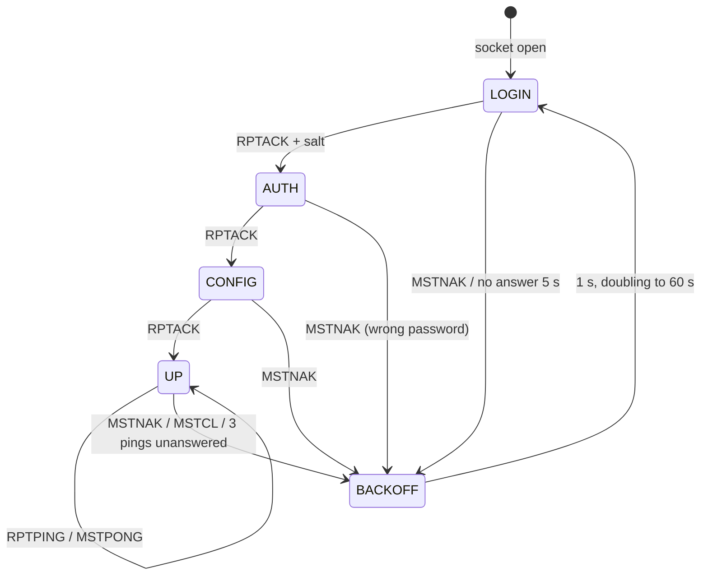

# BrandMeister network (plan)

What: connect the gateway's talk paths to BrandMeister as a network type of its own, beside `hblink` and `mqtt`. A
simplex frequency or a repeater (a duplex pair) logs in to a BrandMeister master as a hotspot or a repeater; one
box can hold several logins at once, one per path, as `identity: per_path` does for HBlink4.
Status (2026-11-06): not built. This file is the plan and the facts found so far.
Related: [hblink.md](hblink.md) (the DMRC peer this builds on), [config-v3.md](config-v3.md) §7, [ipgw.md](ipgw.md),
[roamer.md](roamer.md), [../repeater.md](../repeater.md).

## 1. Which protocol

BrandMeister takes devices in three ways:

| Way | Who may use it | Fit |
|---|---|---|
| Homebrew repeater protocol: the box logs in as a hotspot or repeater | anyone with a registered DMR ID and a hotspot security password (BrandMeister's SelfCare) | chosen: one login per path, no approval needed |
| OpenBridge (server to server) | by ticket, granted by BrandMeister's admins | for a network, not a frequency; later, with the MQTT network |
| SEA (the Rewind protocol, an application) | per application, granted by BrandMeister | for apps; later, if ever |

So the gateway becomes a Homebrew client: the same `DMRD` bursts it sends HBlink4 today, behind a login.

## 2. How BrandMeister differs from HBlink4

| Item | HBlink4 today ([hblink.md](hblink.md)) | BrandMeister |
|---|---|---|
| Login | none: `DMRC`, answered by `DMRP` | `RPTL` → `RPTACK` + salt → `RPTK` (SHA-256 of salt + password) → `RPTACK` → `RPTC` (302-byte config) → `RPTACK` |
| Keepalive | a `DMRC` every 5 or 10 s | `RPTPING` → `MSTPONG` |
| Refusal, close | `MSTNAK`, `MSTCL` | the same, plus `RPTCL` from us on shutdown; `MSTNAK` during login says which step failed |
| Config | `DMRC` with location and idle tails | `RPTC` once per login; a change (a retune) needs a new login |
| Roaming (`DMRT` / `DMRK`) | yes | no: a transceiver on BrandMeister stays on its path's frequency |
| Transport | UDP or SCTP | UDP only |
| Peer ID | any ID the master's patterns allow | a registered ID. Hotspot: the owner's 7-digit DMR ID plus a 2-digit suffix 01..99 (9 digits, more than 24 bits). Repeater: a 6-digit ID registered with BrandMeister, with its own device password |
| Same ID twice | allowed | one login per ID: a second login with that ID replaces the first. Several paths need several IDs |
| Talkgroups | the master's routing rules | dynamic: keying a TG subscribes the slot for a while. Static: set in SelfCare or through BrandMeister's API. TG 4000 drops the dynamic ones |
| Simplex | slots `'4'` in `DMRC` | a simplex hotspot is "slot 0" for statics; check on the first login which slot its `DMRD` carry |
| Services | the master's | 9990 parrot (private call), 262993 SMS / APRS gateway, 4000 unlink |
| Source IDs | anything | registered DMR IDs expected (check what happens to others) |

## 3. The protocol (client side)

All integers are big endian. IDs are 4-byte binary in this dialect.

| Packet | Direction | Layout |
|---|---|---|
| `RPTL` | us → master | `RPTL` + ID (8) |
| `RPTACK` | master → us | `RPTACK` + 4-byte salt (to `RPTL`), else `RPTACK` + ID |
| `RPTK` | us → master | `RPTK` + ID + SHA-256(salt ‖ password) (40) |
| `RPTC` | us → master | 302 bytes, below |
| `RPTPING` | us → master | `RPTPING` + ID (11) |
| `MSTPONG` | master → us | `MSTPONG` + ID (11) |
| `MSTNAK` | master → us | `MSTNAK` + ID: refused; start over from `RPTL` |
| `MSTCL` / `RPTCL` | either | `MSTCL` / `RPTCL` + ID: closing |
| `DMRD` | both | as [hblink.md](hblink.md) §2.2 (53 bytes, or 55 with BER and RSSI) |
| `RPTO` | us → master | `RPTO` + ID + options text. Other masters use it for TG selection; BrandMeister takes TGs from SelfCare. Not sent |
| `RPTSBKN` | master → us | asks for a beacon. Answer it on a repeater that has CW ID or beacons; else ignore |

`RPTC` (fixed-width ASCII, space padded, numbers zero padded):

| Offset | Size | Field |
|---|---|---|
| 0 | 4 | `RPTC` |
| 4 | 4 | ID (binary) |
| 8 | 8 | callsign |
| 16 | 9 | RX frequency, Hz |
| 25 | 9 | TX frequency, Hz |
| 34 | 2 | TX power |
| 36 | 2 | color code |
| 38 | 8 | latitude |
| 46 | 9 | longitude |
| 55 | 3 | antenna height, m |
| 58 | 20 | location |
| 78 | 19 | description |
| 97 | 1 | slots: `'1'`, `'2'`, `'3'` both, `'4'` simplex |
| 98 | 124 | URL |
| 222 | 40 | software ID |
| 262 | 40 | package ID |

The first login is verified against a capture of a working hotspot's login on the bench, byte for byte, before
anything ships.

Login state machine (per login):



- Ping every 5 s while up; down after 3 unanswered (15 s).
- `MSTNAK` at `AUTH` means a wrong password: report it as such (status `bad_password`) and back off to the 60 s
  ceiling at once, so a wrong password doesn't hammer the master.
- `DMRD` is sent only while up. `DMRD` received while not up is ignored.

## 4. Settings (config-v3 §7.3, proposed)

A network of type `brandmeister`. Several may be listed, each a login or a set of logins; a path picks one with
`net`, as today.

| Key | Type | Default | Meaning |
|---|---|---|---|
| `host` | str | | required: the master (`3102.master.brandmeister.network`) |
| `port` | int | 62031 | |
| `password` | str | | required: the hotspot security password (or a repeater's device password). Never shown by `GET /api/config`; a POST without it keeps the stored one |
| `id` | int, 1..4294967295 | | the login's ID, when the network serves one path or the whole box (`identity: single`) |
| `identity` | `single` \| `per_path` | `single` | as `hblink`: `per_path` makes each frequency or repeater its own login |
| `ids` | object | | with `per_path`: `{"<frequency or repeater>": id}`. Required for each path on the network: BrandMeister IDs are registered, so they aren't derived |
| `callsign` | str | the top-level `callsign` | `RPTC` callsign |
| `description`, `url` | str | `""` | `RPTC` fields |
| `api_key` | str | none | later (§6.9): set static TGs from the path's `tg` policy |

The top-level `id` stays the HBlink peer ID (24-bit); BrandMeister IDs are their own 32-bit keys. A path on a
`brandmeister` network gives `RPTC` its frequencies (a simplex path: both the same, slots `'4'`; a repeater: its
`in` and `out`, slots `'3'`, or `'1'` / `'2'` from `active_slots`), its color code and power, and the box's location.

Two simplex frequencies and a repeater, each its own BrandMeister login:

```jsonc
"networks": [
  {"type": "brandmeister", "name": "bm", "host": "3102.master.brandmeister.network",
   "password": "…", "identity": "per_path",
   "ids": {"438.5": 310012301, "438.6": 310012302, "R1": 310012303}}
]
```

## 5. What is already in place

- `DMRD` packing and parsing, stream ids per call and per data header, BER / RSSI bytes (`hblink.c`).
- The router sends each path's calls to its `net` (`router.c:rdof_router_net`, `rdof_router_rf`). Networks are
  indexed, so a third type needs no change in routing. The site holds `RDOF_SITE_MAX_NETS` (4) networks.
- Peers per path with `identity: per_path` (`siteroute.c`, `rdof_path_t.peer_id`).
- Policies on paths: `tg` and `ptt` decide what goes up and what comes down, which is what BrandMeister's
  pass-all traffic needs.

## 6. Work, in order

1. **The login (portable).** `common/src/hbauth.c`, `rdof/hbauth.h`: the state machine of §3, driven like
   `hbpeer.c` (feed received packets and a clock in, get packets to send and events out). It's the same shape
   as `rdof_hb_peer_*`, plus the login states. Host tests against a fake master: salt and hash, wrong password,
   `MSTNAK` at each step, lost pongs, `MSTCL`, reconnect with back-off.
2. **SHA-256.** ESP-IDF has it (mbedTLS, Apache-2.0, part of the IDF). The host build needs one too: mbedTLS where
   installed, or a small permissively licensed implementation in PROVENANCE.md and LICENSES/.
3. **`RPTC`** (`rdof_rptc_packet`) from a path and its unit, tested against the bench capture (§3).
4. **Settings.** `site.c`: `RDOF_NET_BM`, the keys of §4, 32-bit IDs, the password kept out of `GET /api/config`.
   Lift "one network of each type" for `brandmeister`. Refuse a path on a `brandmeister` network with
   `per_path` and no `ids` entry, two paths with one ID, and a transceiver that roams (BrandMeister can't tune
   it). `config/rdof-config.schema.json`, `tools/config_check.py` fixtures, `test_site.c`, `test_plan.c`.
5. **Peers on the board.** `roam_hblink.c` and `sdr_hblink.c` hold one socket per peer and speak `DMRC`. Give the
   peer a kind (`dmrc` or `login`) and run `hbauth` for the second: `RPTC` in place of `DMRC`, `RPTPING` in place
   of the keepalive `DMRC`, no `DMRT`. Each login is a UDP socket: lwIP's 28 sockets are shared with the web
   server, MQTT, HBlink4 and the IP gateway (8), so cap logins at 4 on an ESP32 (`CONFIG_RDOF_BM_MAX_LOGINS`).
6. **rdofradio.** `sdr/cli/rdofradio_net.c` the same, with up to 8 logins (one per split repeater).
7. **Slots.** A simplex path transmits on its `ts` whatever slot BrandMeister uses, and sends what it hears up on
   the slot BrandMeister expects for a simplex hotspot (check on the first login, §2). A repeater maps slot to
   slot.
8. **Data.** BrandMeister answers confirmed data itself (§7). Today's gaps, from checking the capture against
   the code (2026-11-06):
   - A rate 3/4 block counts as bad when the trellis corrected any bit (`pdu.c:151`, `fec_ok = errors == 0`), so
     the IP gateway drops messages whose CRC-9s and CRC-32 pass. For confirmed blocks, let CRC-9 decide.
   - The tracker forwards a data header with a good CRC-16 and its blocks as heard (`tracker.c`), and a repeater
     resends rate 3/4 blocks uncorrected (`duplex.c`): bit errors go up as they came. Check CRC-9 per block and
     CRC-32 before sending a confirmed packet up; drop a bad one (the radio sends it again).
   - Every CSBK, each preamble too, starts a stream (`tracker.c`, `hblink.c`): a Motorola packet with 20 preambles
     goes up as 20 one-burst streams, then the data. Keep one stream from the first preamble through the header and
     its blocks.
   - A roamer that relays a data packet down holds the call until `RDOF_TXVR_STREAM_TIMEOUT_S` (1.5 s) after the
     last burst (`txvr.c`: data has no terminator), deaf meanwhile, and the radio's ACK comes about 1 s after the
     packet. End a relayed data call at its last announced block, as the SDR modem does ([ipgw.md](ipgw.md) §11),
     and open the answer window there.
   - The answer window's cap (5 s) is under the radio's link retry (about 6 s): raise it when the reply was asked
     by confirmed data.
   - The IP gateway's duplicate window, `RDOF_IPGW_DEDUP_S` 5 s, is also under the 6 s retry, so a retry is relayed
     again. Make it about 30 s, keyed by source, N(S) and CRC-32.
   - On a duplex repeater, key up on a radio's `BS_Dwn_Act` CSBK, which a Motorola radio sends before data.
9. **Static TGs (later).** With `api_key`, set the path's static TGs on BrandMeister from its `tg` policy, so one
   setting covers both directions.
10. **Status.** Per login: state (`login`, `auth`, `config`, `up`, `backoff`), the last refusal and its step,
    pings missed, in `/api/status`, MQTT status and the web page.
11. **Docs.** This file becomes the spec: config-v3 §7.3, reference.md (networks, sizes), the README's network
    list.

Tests:

- **Host tests and HIL tests run against a simulated BrandMeister master**, never the real network: a small fake
  master (UDP, the login of §3 with a known salt and password, `MSTPONG`, `MSTNAK` on demand, `DMRD` echo and
  scripted calls, confirmed-data ACKs and TMS ACKs as §7 recorded them). The C host tests drive it in process; the
  HIL tests point a board or rdofradio at it on the LAN. No automated or recurring test reaches BrandMeister.
- **Against real BrandMeister: one-off, by hand**, once per change that needs it, on the owner's registered IDs,
  with the results written here. For the first build, in order: rdofradio as one simplex hotspot (a spare 9-digit
  hotspot ID) with the bench's radios (parrot 9990, a TG, a private call, an SMS to 262993); then two simplex
  logins at once; then a W12; then a repeater.

## 7. Observed: a Motorola SMS through a BrandMeister hotspot (2026-11-06)

A MOTOTRBO portable sent a text to 262993 (BrandMeister's SMS / APRS service) through a duplex MMDVM hotspot on
BrandMeister. Capture between the hotspot and the master, decoded (rate 3/4 trellis, CRC-9, CRC-32):

| 16:mm:ss UTC | From | What |
|---|---|---|
| (before 08:21) | radio | 1st try, CSBK preambles first. No answer from BrandMeister (the hotspot's log; before the capture) |
| 08:21.2 | radio | 2nd try: a confirmed data header (A = 1, SAP 4 IP, rate 3/4, 4 blocks, N(S) 2), then the blocks. IPv4 radio 12.x.y.z → 12.4.3.81 (262993), UDP 4007 → 4007: TMS text |
| 08:21.9 | BM | response header: ACK (class 0, type 1), status 2 = the packet's N(S) |
| 08:27.1 | BM | a confirmed packet of its own: UDP 4007, the TMS ACK `00 03 BF 00 0A` |
| 08:29.0 | radio | ACK. The radio shows "sent" now: it waits for both the link ACK and the TMS ACK |
| 09:02.7 | BM | the answer text, 13 blocks, confirmed |
| 09:05.2 | radio | ACK, then 0.5 s later its own TMS ACK `00 04 BF 00 9E 60`: CRC good, no answer from BrandMeister |
| 09:18.2 | radio | the TMS ACK again, bit errors on the hotspot's receive: BrandMeister answered class 1 type 1 (NACK) |
| 09:30.9 | BM | the answer text again (no TMS ACK reached it), new TMS sequence |
| 09:33.4 | radio | ACK, then its TMS ACK (bit errors: no answer), again at 09:44.9 (good: ACK) |

What the gateway takes from it:

- **Two levels of acknowledgment.** The link level (the ETSI response header, status = N(S)) and the TMS level (a
  UDP 4007 datagram back from the destination: `BF`, address length 0, the sequence). A MOTOTRBO radio retries its
  link level about every 6 s (12-20 preamble CSBKs before each retry; one retry never reached the hotspot) and
  shows "sent" only once both have come. BrandMeister sends both for messages to its services. A gateway that is
  itself the destination (an `ipgw` route that ends in the box) must send both, or the radio retries and then
  reports failure. The IP gateway sends only the link level today.
- **TMS layout.** Payload: 2-byte length (of what follows), then a header byte: 0x80 a sequence octet follows,
  0x40 ACK requested, 0x20 set in every TMS packet seen both ways, the low 5 bits the type (0 text, 0x1F ACK). So
  text with an ACK asked is `E0`, an ACK is `BF`. Then the address length (`00`), the sequence octet (bit 7 another
  octet follows, bits 4-0 the sequence's low bits), and for text an extension octet (bits 6-5 the sequence's bits
  5-6, the low bits the encoding: 4 = UTF-16LE). The text starts with CR LF. An ACK echoes the sequence, with the
  extension octet only when the sequence is 32 or more: `BF 00 0A` for 10, `BF 00 9E 60` for 0x7E. One rule both
  sides follow.
- **BrandMeister's own packets.** Confirmed, A = 1, rate 3/4, N(S) always 0, one preamble CSBK before each, link
  ACKs included. It answers a good packet in about 0.5 s; a CRC-32 failure gets a NACK (class 1, type 1). With no TMS
  ACK it sends the text again after about 28 s, with a new TMS sequence.
- **Rate 3/4 confirmed.** The radio sends text as confirmed rate 3/4 data, not rate 1/2. The hotspot forwarded
  copies with bit errors as they were (no CRC check). The gateway checks CRC-9 per block and CRC-32: it should drop
  a bad copy rather than forward it (§6.8).
- **Packets back to back.** BrandMeister answered neither TMS ACK the radio sent 0.5 s after its link ACK with one
  preamble (one good, one with bit errors), and answered both retries, sent with 12-17 preambles. One sample of
  each, so a guess: the short lead-in, or one stream for both. The next capture records the stream ids.
- **The first try is often missed.** BrandMeister answered the second copy of the first message, not the first. The
  hotspot logged both. Not explained yet; compare with the gateway once it logs in.
- **IDs.** The radio uses its 7-digit DMR ID; BrandMeister routes the answer to the hotspot (9-digit ID) where it was
  last heard.

## 8. Open questions

- Which slot a simplex hotspot's `DMRD` use, both ways.
- Whether BrandMeister checks the `RPTC` software and package IDs.
- Whether BrandMeister takes `DMRD` talker alias or GPS in its own packets (`DMRA`, `DMRG`) from a hotspot, or only
  in-band.
- How long a dynamic TG holds on BrandMeister now, so `ptt_hold_s` can match it.
- Why the first copy of a confirmed packet goes unanswered (§7).
