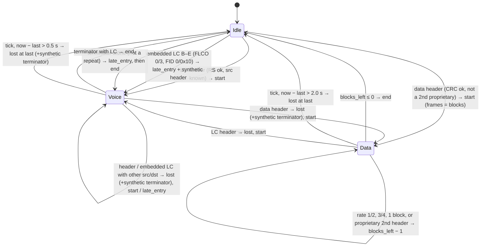

# DMR core (common)

**Covers:** the DMR layer the firmware decodes and builds: burst layout, sync, slot type, EMB, CACH, FEC and CRCs, full LC, CSBK, data headers and blocks, AMBE+2 channel frames, the call tracker, network-call reporting and the binary raw burst.
**Sources:** `common/src/{bits,fec,layer2,pdu,ambe,tracker,netcalls,rawburst}.c`, `common/src/mmdvm.c` (control byte, transmit builders), `common/src/radiofoundry/` (RadioFoundry FEC, MIT). Standard: ETSI TS 102 361-1 (`-1`), -2 (`-2`).
**Related:** [radio.md](radio.md) (MMDVM protocol, the control byte's source), [sdr.md](sdr.md) (the demodulator that produces bursts), [hblink.md](hblink.md) (frames → DMRD), [mqtt.md](mqtt.md) (topics for the JSON and raw bursts), [roamer.md](roamer.md) (listen-before-talk on `on_call`), [device.md](device.md) (self-test), [../repeater.md](../repeater.md) and [../slot-timing.md](../slot-timing.md) (duplex bursts, short LC, UTC slot timing).

---

## 1. Conventions

| Item | Rule | Source |
|---|---|---|
| Burst | 33 bytes, 264 bits, MSB of byte 0 is bit 0 (first on air) | `fec.h:RDOF_BURST_BYTES` = 33 |
| Bit arrays | one `uint8_t` per bit, value 0/1 | `bits.h` |
| Field reads | `rdof_get_field(bytes, start, n)`: n ≤ 64 bits from bit `start`, MSB first | `bits.c:rdof_get_field` |
| Multi-byte ids | big endian in PDUs (`rdof_be24`), little endian in the raw-burst record | `bits.c`, `rawburst.c` |
| Not present | `RDOF_NONE` = -1 | `pdu.h:RDOF_NONE` |
| Dibit ↔ symbol | 01 → +3, 00 → +1, 10 → −1, 11 → −3 | `sdr/src/mod.c`, `sdr/src/demod.c` |

Feature switches (default on; Kconfig `CONFIG_RDOF_FEATURE_*`, `common/Kconfig`):

| Switch | Gates |
|---|---|
| `RDOF_FEATURE_TX` | `rdof_regenerate`, `rdof_silence_burst`, `rdof_csbk_preambles` (§10) |
| `RDOF_FEATURE_DATA_BLOCKS` | trellis 3/4, rate 1, CRC-9, CRC-32, `rdof_decode_data_block`, `rdof_split_confirmed` |
| `RDOF_FEATURE_TRACKER` | `rdof_tracker_init/add_sink/feed/tick` and the HBlink sink |
| `RDOF_FEATURE_REPEATER` | `duplex.c` (short LC, idle, regen); requires TX |

## 2. Burst layout (`-1` 4.2.2, 6.1, 6.2, figures 6.2–6.5)

```
bit:  0           98   108                   156  166          263
      |  info 98  | ST |  SYNC or EMB+ES 48  | ST |  info 98   |      data / control burst
      |  voice 108     |  SYNC or EMB+ES 48  |  voice 108      |      voice burst
```

| Field | Bits | C accessor |
|---|---|---|
| Info, first half | 0–97 | `rdof_info_bits` (bits 0–97 then 166–263 → 196) |
| Slot type, first 10 | 98–107 | `rdof_slot_type_raw`, `rdof_decode_slot_type` |
| Middle field (sync / EMB) | 108–155 | `layer2.c:rdof_middle_field` |
| EMB, first 8 | 108–115 | `rdof_emb_raw`, `rdof_decode_emb` |
| Embedded signalling | 116–147 (32) | `fec.c:rdof_embedded_signalling` |
| EMB, last 8 | 148–155 | |
| Slot type, last 10 | 156–165 | |
| Info, second half | 166–263 | |
| Voice bits | 0–107 + 156–263 (216) | `layer2.c:rdof_voice_burst`, `fec.c:rdof_ambe_frames` |

Builders: `fec.c:rdof_build_burst(info196, middle48, slot_type20)` (NULL = zeros), `layer2.c:rdof_voice_burst(voice216, middle48)`, `rdof_voice_middle(cc, lcss, frag32, pi)` = EMB[0..7] ‖ frag32 ‖ EMB[8..15].

A CACH (BS outbound only, 24 bits) precedes each burst on air; bursts handed to and from the firmware never include it. CACH handling: §4.4.

## 3. Sync (`-1` 9.1.1, table 9.2)

| Name | Voice sync (48 bit) | `layer2.h` symbol | Slot implied |
|---|---|---|---|
| BS sourced | `0x755FD7DF75F7` | `RDOF_BS_VOICE` | from CACH |
| MS sourced | `0x7F7D5DD57DFD` | `RDOF_MS_VOICE` | none |
| TDMA direct TS1 | `0x5D577F7757FF` | `RDOF_TS1_VOICE` | 1 |
| TDMA direct TS2 | `0x7DFFD5F55D5F` | `RDOF_TS2_VOICE` | 2 |

Data sync = voice sync XOR `RDOF_DATA_XOR` = `0xAAAAAAAAAAAA` (every ±3 symbol inverted), `layer2.h:rdof_data_sync`.

Families: `rdof_family_t` `RDOF_FAMILY_BS`=0, `MS`=1, `TS1`=2, `TS2`=3; names `bs ms ts1 ts2` (`layer2.c:rdof_family_name`).

`rdof_detect_sync(burst, max_errors, &family, &data, &errors)`: Hamming distance of the middle field to all 8 patterns; the minimum wins; ties go to the first in BS, MS, TS1, TS2 order, voice before data. Returns false if the minimum exceeds `max_errors`; `errors` is always the minimum. Callers: `benchtx.c` with `max_errors` = 4. The SDR demodulator does its own symbol-domain sync search ([sdr.md](sdr.md)).

`rdof_sync_errors(burst, pattern)` = popcount(middle XOR pattern).

## 4. Layer 2 PDUs in the burst

### 4.1 Data type (`-1` 9.3.6, table 9.22) and internal codes

| DT | Name (`pdu.h`) | Raw `type` (`rawburst.c:rdof_raw_type_name`) | FEC of the info |
|---|---|---|---|
| 0 | `RDOF_DT_PI_HEADER` | `voice_pi_header` | BPTC(196,96), CRC mask `0x6969` |
| 1 | `RDOF_DT_VOICE_LC_HEADER` | `voice_lc_header` | BPTC + RS(12,9) mask `0x969696` |
| 2 | `RDOF_DT_TERMINATOR_WITH_LC` | `terminator` | BPTC + RS(12,9) mask `0x999999` |
| 3 | `RDOF_DT_CSBK` | `csbk` | BPTC, CRC mask `0xA5A5` |
| 4 | `RDOF_DT_MBC_HEADER` | `mbc_header` | BPTC, CRC mask `0xAAAA` |
| 5 | `RDOF_DT_MBC_CONTINUATION` | `mbc_continuation` | BPTC |
| 6 | `RDOF_DT_DATA_HEADER` | `data_header` | BPTC, CRC mask `0xCCCC` |
| 7 | `RDOF_DT_RATE_12` | `rate_1_2` | BPTC |
| 8 | `RDOF_DT_RATE_34` | `rate_3_4` | trellis 3/4 |
| 9 | `RDOF_DT_IDLE` | (never emitted) | BPTC |
| 10 | `RDOF_DT_RATE_1` | `rate_1` | none |
| 11 | `RDOF_DT_USBD` | `usbd` | BPTC, CRC mask `0x3333` |
| 0xF0 | `RDOF_DT_VOICE_SYNC` (internal: voice burst A) | `voice_sync` | AMBE |
| 0xF1 | `RDOF_DT_VOICE` (internal: voice bursts B–F) | `voice` | AMBE |
| other | | the decimal number | |

### 4.2 Slot type (`-1` 9.1.3, table 9.4; B.3.1)

20 bits at 98–107 ‖ 156–165. Data byte = `CC(4) << 4 | DT(4)`, Golay(20,8) coded (§5.3). `layer2.c:rdof_decode_slot_type` → (cc, dt, bits corrected), false beyond 3 errors. `rdof_slot_type_bits(cc, dt)` encodes.

### 4.3 EMB (`-1` 9.1.2, table 9.3; B.3.2)

16 bits at 108–115 ‖ 148–155. Data (7 bits) = `CC(4) << 3 | PI(1) << 2 | LCSS(2)`, QR(16,7,6) coded (§5.3). `rdof_decode_emb` → (cc, pi, lcss, bits corrected), false beyond 2 errors (pi, lcss then 0). `rdof_emb_bits(cc, lcss, pi)` encodes.

LCSS (`-1` 9.3.3, table 9.20): 0 single fragment, 1 first, 2 last, 3 continuation. A voice superframe's embedded LC uses B=1, C=3, D=3, E=2; F carries a single fragment (null / RC) = 0 (`mmdvm.c:rdof_regenerate` `lcss_by_n` = {0,1,3,3,2,0}).

### 4.4 CACH and TACT (`-1` 4.5, 6.3, 9.1.4, B.3.5, B.4.1 figure B.9)

24 bits; TX(23) is the first on air. TACT 7 bits = AT(1) TC(1) LCSS(2) + Hamming(7,4,3) parity (generator x³+x+1, `0x0B`). Placement:

| | Positions in TX(23..0) |
|---|---|
| TACT bits AT, TC, LS1, LS0, H2, H1, H0 | 23, 19, 15, 11, 9, 5, 1 |
| Payload P16 … P0 | 22, 21, 20, 18, 17, 16, 14, 13, 12, 10, 8, 7, 6, 4, 3, 2, 0 |

| Function | Behavior |
|---|---|
| `rdof_decode_cach_slot(cach24)` | de-interleave, Hamming(7,4) decode (always yields a value), slot = TC ? 2 : 1. The header comment says "0 if unreadable" but the code never returns 0 |
| `rdof_encode_cach(slot, at, lcss)` | TC = slot − 1, payload 0 |
| `rdof_encode_cach_lc(slot, at, lcss, payload17)` | with a 17-bit short-LC row |
| `rdof_decode_cach_payload(cach24, &lcss)` | payload and LCSS |
| `rdof_hamming74_encode/decode` | 4-bit value `AT<<3 | TC<<2 | LCSS`; decode errors 0/1, never −1 |

Short LC (`-1` 7.1.4, 9.1.7, B.2.3, B.3.3, B.3.7; `-2` 7.1.3): 28 bits (SLCO(4) + 3 octets) + CRC-8 (x⁸+x²+x+1, init 0, no inversion), three Hamming(17,12,3) rows (generator x⁵+x²+1) and a column-parity row, read out by columns into four 17-bit CACH payloads. Implemented in `duplex.c:rdof_short_lc / rdof_decode_short_lc / rdof_short_lc_rows / rdof_short_lc_join / rdof_activity_lc` over `radiofoundry/dmrCach.c`; owned by the repeater spec ([../repeater.md](../repeater.md)).

## 5. FEC

All codes but AMBE's are RadioFoundry's C (`common/src/radiofoundry/`: `dmrFec.c`, `dmrCach.c`, `dmr_lc.c`, `dmrTrellis.c`, `dmrDataCrc.c`) wrapped by `fec.c` / `layer2.c`.

### 5.1 Hamming (`-1` B.3.4, B.3.5)

Codeword: data bits first (first sent in the MSB), 4 parity bits last. Each data bit's parity-check column (bit 3 of a column = parity bit 0):

| Code | Columns, data bit 0 first | Use |
|---|---|---|
| (15,11,3) | `9 D F E 7 A 5 B C 6 3` | BPTC rows; embedded LC rows |
| (13,9,3) | `F E 7 A 5 B C 6 3` | BPTC columns |
| (16,11,4) | (15,11,3) + even parity over the first 15 | embedded LC rows |
| (7,4,3) | generator x³+x+1 | CACH TACT |
| (17,12,3) | generator x⁵+x²+1 | short LC |

`fec.c`: `rdof_hamming_encode`, `rdof_hamming_decode(h, w, &corrected)` (corrects one bit in place; (16,11,4): even weight + syndrome = two errors → false; odd weight + no syndrome = the parity bit flipped), `rdof_hamming_syndrome` (4 bits; (16,11,4): 5 bits, bit 4 = overall parity). Handles `RDOF_H_15_11`, `RDOF_H_13_9`, `RDOF_H_16_11`.

### 5.2 BPTC(196,96) (`-1` B.1.1, figure B.1, tables B.2, B.3)

| Step | Rule |
|---|---|
| Matrix | 196 cells. Index 0 = R(3) (reserved, 0). Row r (0–12) = indices 1+15r … 15+15r |
| Payload bit n (0–95) | n < 8 → row 0, column n+3 (columns 0–2 of row 0 are R(2..0) = 0); else row 1+(n−8)/11, column (n−8) mod 11 |
| Rows 0–8 | 11 data + 4 Hamming(15,11,3) parity |
| Rows 9–12 | Hamming(13,9,3) parity of each of the 15 columns |
| Interleave | matrix index k → info bit (k·181) mod 196 |
| Info → burst | info bit i → burst bit i (i < 98) or i + 68 |
| Decode | up to 4 passes; each pass corrects every column (13,9) then all 13 rows (15,11). Clean = a pass with no failure and no change. Not clean after 4 passes → failure |

`fec.c:rdof_bptc196_decode(burst, out12)` → true when clean (the payload is the best guess either way). `rdof_bptc196_encode(payload12, info196)`. The correction count is not returned.

### 5.3 Golay(20,8) and QR(16,7,6) (`-1` B.3.1, B.3.2)

| Code | Construction | Codeword bits | d_min | Corrects |
|---|---|---|---|---|
| Golay(20,8) | cyclic Golay(23,12), generator x¹¹+x¹⁰+x⁶+x⁵+x⁴+x²+1 (`0xC75`), shortened to 8 data bits, + overall even parity | data(8) ‖ parity(11) ‖ even(1) | 8 | 3 |
| QR(16,7,6) | cyclic QR(17,9,5), generator x⁸+x⁵+x⁴+x³+1 (`0x139`), shortened to 7 data bits, + overall even parity | data(7) ‖ parity(8) ‖ even(1) | 6 | 2 |

Decode (`layer2.c:rdof_golay2087_decode`, `rdof_qr1676_decode`): tables of all 256 / 128 codewords built once (`cw_init`); if `word >> 12` (`>> 9`) indexes a codeword equal to the word, errors = 0; else the first codeword within the radius (3 / 2), unique by distance. Beyond: value −1, errors = radius + 1.

### 5.4 Embedded LC, VBPTC(128,72) (`-1` 7.1.3, B.2.1, figures B.2/B.3, B.3.11)

| Step | Rule |
|---|---|
| Matrix | 8 rows × 16 columns, cell (r,c) = index 16r + c |
| Rows 0–1 | LC bits: 11 each in columns 0–10 |
| Rows 2–6 | 10 LC bits in columns 0–9, checksum bit in column 10 (checksum MSB in row 2) |
| Columns 11–15, rows 0–6 | Hamming(16,11,4): (15,11,3) parity then the overall parity |
| Row 7 | even parity of each column over rows 0–6 |
| 5-bit checksum (B.3.11) | sum of the 9 LC octets mod 31 (`rdof_five_bit_checksum`) |
| Air order | air bit k = matrix index (16k) mod 127 for k < 127; air bit 127 = index 127 |
| Fragments | 4 × 32 bits, the embedded signalling of bursts B, C, D, E in that order |
| Decode | per row 0–6: odd weight + syndrome → correct one; odd weight, no syndrome → parity bit only; even weight + syndrome → fail. Then column parity: > 1 failing column → fail. Then checksum must match |

`rdof_embedded_lc_decode(raw128, lc9)` / `rdof_embedded_lc_encode(lc9, raw128)`.

### 5.5 Rate 3/4 trellis (`-1` B.2.4, tables B.7–B.9)

| Item | Value |
|---|---|
| Payload | 18 bytes = 144 bits = 48 tribits, + a 49th tribit = 0 (flush) |
| States | 8; next state = the tribit |
| Constellation point | `ENCODE[state·8 + tribit]` (table B.8) |
| Point → 2 dibits (B.9) | `2 A 7 F E 6 B 3 D 5 8 0 1 9 4 C` (first dibit high) |
| Dibits | 98; interleave (B.7): dibit i sent at position `INTERLEAVE[i]` |
| Info bits | 196 = 98 dibits |
| Decode | hard-decision Viterbi, branch metric = Hamming distance of the 4 bits, path must end in state 0 |

B.7 interleave: `0 1 8 9 16 17 24 25 32 33 40 41 48 49 56 57 64 65 72 73 80 81 88 89 96 97 2 3 10 11 18 19 26 27 34 35 42 43 50 51 58 59 66 67 74 75 82 83 90 91 4 5 12 13 20 21 28 29 36 37 44 45 52 53 60 61 68 69 76 77 84 85 92 93 6 7 14 15 22 23 30 31 38 39 46 47 54 55 62 63 70 71 78 79 86 87 94 95`.

B.8 (row = state): `0 8 4 12 2 10 6 14 | 4 12 2 10 6 14 0 8 | 1 9 5 13 3 11 7 15 | 5 13 3 11 7 15 1 9 | 3 11 7 15 1 9 5 13 | 7 15 1 9 5 13 3 11 | 2 10 6 14 0 8 4 12 | 6 14 0 8 4 12 2 10`.

`fec.c:rdof_trellis34_decode(burst, out18)` returns the best path metric (0 = clean); `rdof_trellis34_encode(payload18, info196)`.

### 5.6 Rate 1 (`-1` B.2.5, table B.10)

Payload = info bits 0–95 ‖ 100–195 (24 bytes); info bits 96–99 reserved (0). `rdof_rate1_payload`.

### 5.7 Reed-Solomon (12,9) (`-1` B.3.6)

GF(2⁸), primitive polynomial x⁸+x⁴+x³+x²+1 (`0x11D`); g(x) = (x+α)(x+α²)(x+α³) = x³ + `0x0E`x² + `0x38`x + `0x40`. Parity = 3 octets, highest power first, then XOR the 24-bit mask (§5.8). `rdof_rs129_parity(msg9, out3)`; `rdof_check_rs129(lc12, mask)` is an exact check, no correction.

### 5.8 CRCs and masks (`-1` B.3.7–B.3.10, B.3.12 table B.21)

| CRC | Polynomial | Init | Final XOR | Order / storage | C |
|---|---|---|---|---|---|
| CRC-CCITT (B.3.8) | x¹⁶+x¹²+x⁵+1 (`0x1021`) | 0 | `0xFFFF` | MSB first; bytes 10–11 of a 12-byte block, big endian, XOR mask | `rdof_crc16_ccitt`, `rdof_check_crc16(block12, mask)` |
| CRC-32 (B.3.9) | `0x04C11DB7` | 0 | none | octets in pairs, second of each pair first, MSB first; odd length: zero second octet; last 4 packet bytes, little endian | `rdof_crc32_dmr`, `rdof_check_crc32` |
| CRC-9 (B.3.10) | x⁹+x⁶+x⁴+x³+1 (low bits `0x059`) | 0 | `0x1FF` | data octets MSB first, then the 7-bit DBSN; XOR rate mask; stored value taken in either bit order | `rdof_crc9_dmr`, `rdof_check_crc9` |
| CRC-8 (B.3.7) | x⁸+x²+x+1 (`0x07`) | 0 | none | short LC (28 bits) | `radiofoundry/dmrCach.c` |
| 5-bit checksum (B.3.11) | sum of 9 octets mod 31 | | | embedded LC | `rdof_five_bit_checksum` |

| Mask | Value | `fec.h` |
|---|---|---|
| Voice LC header (RS) | `0x969696` | `RDOF_MASK_VOICE_LC_HEADER` |
| Terminator with LC (RS) | `0x999999` | `RDOF_MASK_TERMINATOR_LC` |
| PI header | `0x6969` | `RDOF_MASK_PI_HEADER` |
| CSBK | `0xA5A5` | `RDOF_MASK_CSBK` |
| Data header | `0xCCCC` | `RDOF_MASK_DATA_HEADER` |
| MBC header | `0xAAAA` | `RDOF_MASK_MBC_HEADER` |
| USBD | `0x3333` | `RDOF_MASK_USBD` |
| CRC-9 rate 1/2 | `0x0F0` | `RDOF_MASK_CRC9_RATE12` |
| CRC-9 rate 3/4 | `0x1FF` | `RDOF_MASK_CRC9_RATE34` |
| CRC-9 rate 1 | `0x10F` | `RDOF_MASK_CRC9_RATE1` |

`rdof_crc16_ccitt` falls back to a bit-serial loop for len > 255 (RadioFoundry's API takes a `uint8_t` length). `rdof_crc9_dmr` uses RadioFoundry's octets+DBSN form when `nbits − 7` is a multiple of 8 and ≤ 512, else a bit-serial loop.

## 6. PDUs

### 6.1 Full LC (`-1` 7.1, 9.1.6 table 9.7; `-2` 7.1.1)

9 octets (12 with RS parity in an LC header / terminator, BPTC coded).

| Bits | Field |
|---|---|
| 0 | PF |
| 1 | reserved |
| 2–7 | FLCO |
| 8–15 | FID |
| 16–23 | service options (FLCO 0 / 3); bit 7 `0x80` = emergency (`RDOF_SO_EMERGENCY`) |
| 24–47 | destination id (group or individual) |
| 48–71 | source id |

FLCO values (`pdu.h`): `RDOF_FLCO_GROUP` 0x00, `RDOF_FLCO_PRIVATE` 0x03, `RDOF_FLCO_TA_HEADER` 0x04, `RDOF_FLCO_TA_BLOCK1..3` 0x05–0x07, `RDOF_FLCO_GPS_INFO` 0x08.

`pdu.c:rdof_parse_full_lc` fills `rdof_full_lc_t`:

| Case | Fields |
|---|---|
| FLCO 0 / 3 (any FID) | `service_options`, `dst_id`, `src_id`, `group` = (FLCO == 0) |
| FID 0, FLCO 8 (GPS) | `position_error` bits 20–22; `lon` = signed 25 bits 23–47 × 360 / 2²⁵; `lat` = signed 24 bits 48–71 × 180 / 2²⁴ |
| FID 0, FLCO 4 (TA header) | `ta_format` bits 16–17, `ta_length` bits 18–22, `ta_bits` 23–71 (49) |
| FID 0, FLCO 5–7 (TA blocks) | `ta_bits` 16–71 (56) |

Talker alias text is not decoded; the raw `ta_bits` are left to a subscriber.

`rdof_decode_voice_lc(burst, dt, &lc)`: BPTC decode (its success flag is ignored), then the RS(12,9) check with the header or terminator mask; false on RS failure.

`layer2.c` builders: `rdof_group_lc(src, dst, group, so)` = `[group ? 0x00 : 0x03, 0x00, so, dst(3), src(3)]`; `rdof_voice_lc12(lc9, dt)` appends masked RS parity (mask = header if `dt == 1`, else terminator); `rdof_lc_burst(lc9, dt, cc, sync48)`; `rdof_data_burst(payload12, dt, cc, sync48)`; `rdof_info_burst(info196, dt, cc, sync48)`.

### 6.2 CSBK (`-1` 7.2, 9.1.8 table 9.9; `-2` 7.1.2)

| Octet | Field |
|---|---|
| 0 | LB(1) PF(1) CSBKO(6) |
| 1 | FID |
| 2–9 | data |
| 10–11 | CRC-CCITT XOR `0xA5A5` |

`pdu.c:rdof_decode_csbk`: opcode, fid, last_block, pf, `crc_ok`. For FID 0 and an "addressed" opcode (`0x04 0x05 0x1F 0x20 0x21 0x24 0x38 0x3D`): `dst_id` = octets 4–6, `src_id` = octets 7–9. For FID 0 opcode `0x3D` (preamble, `RDOF_CSBK_PREAMBLE`): `data_follows` = octet 2 bit 7, `group` = octet 2 bit 6, `blocks_to_follow` = octet 3.

### 6.3 Data header (`-1` 9.2.1, 9.2.4, 9.2.6, 9.2.9–9.2.13; 9.3.17 DPF)

12 octets after BPTC; CRC-CCITT XOR `0xCCCC` in octets 10–11. Common fields: G/I bit 0, A (response requested) bit 1, DPF bits 4–7, SAP bits 8–11, destination bits 16–39, source bits 40–63.

| DPF | Name (`pdu.h`) | Extra fields (bit positions) |
|---|---|---|
| 0 | `RDOF_DPF_UDT` | `udt_format` 12–15, `pad_nibbles` 64–68, `blocks` = bits 70–71 + 1, `udt_opcode` 74–79 |
| 1 | `RDOF_DPF_RESPONSE` | `blocks` 65–71, `response_class` 72–73, `response_type` 74–76, `response_status` 77–79 |
| 2 | `RDOF_DPF_UNCONFIRMED` | `pad_octets` = bit 3 ‖ bits 12–15, `full_message` 64, `blocks` 65–71, `fsn` 76–79 |
| 3 | `RDOF_DPF_CONFIRMED` | as 2, plus `ns` 73–75 |
| 13 | `RDOF_DPF_SHORT_DATA_DEFINED` | `blocks` = bits 2–3 ‖ 12–15, `dd_format` 64–69, `full_message` 71, `bit_padding` 72–79 |
| 14 | `RDOF_DPF_SHORT_DATA_RAW` | `blocks` = bits 2–3 ‖ 12–15 |
| 15 | `RDOF_DPF_PROPRIETARY` | `mfid` = octet 1; `src_id` = `dst_id` = 0 |

`rdof_parse_data_header(data12, &h)`, `rdof_decode_data_header(burst, &h)` (BPTC success ignored; the CRC decides).

### 6.4 Data blocks (`-1` 9.2.2–9.2.3, 9.2.5, 9.2.7–9.2.8, 9.2.14–9.2.16)

`rdof_decode_data_block(burst, dt, &b)` (`RDOF_FEATURE_DATA_BLOCKS`):

| DT | Payload | `fec_ok` |
|---|---|---|
| 7 rate 1/2 | 12 bytes, BPTC | BPTC clean |
| 8 rate 3/4 | 18 bytes, trellis | metric == 0 (`errors` = metric) |
| 10 rate 1 | 24 bytes | always true |

Confirmed blocks (`rdof_split_confirmed`): DBSN = payload bits 0–6, CRC-9 = bits 7–15, body = payload[2..len−1]; CRC-9 checked with the rate's mask (§5.8). The last block of a packet ends with the CRC-32 (little endian) over all user data and pad octets.

Packet reassembly (block gaps, a proprietary second header, UDT CRC-16, pad stripping) is not done here: it is left to a subscriber of the raw bursts. The firmware only counts blocks (§8). The data-block decoders are used by the host tests only.

## 7. AMBE+2 channel frames (DVSI AMBE+2 3600×2450; not in ETSI)

A voice burst carries three 72-bit channel frames (`fec.c:rdof_ambe_frames`):

| Frame | Burst bits |
|---|---|
| 0 | 0–71 |
| 1 | 72–107 ‖ 156–191 |
| 2 | 192–263 |

Frame decode (`ambe.c:rdof_ambe_decode_frame(frame72, params49)`; tables from DSD `dmr_const.h`, decode from mbelib):

| Step | Rule |
|---|---|
| De-interleave | for dibit i (0–35): bit 2i → `fr[RW[i]][RX[i]]`, bit 2i+1 → `fr[RY[i]][RZ[i]]` (`ambe.c:RW RX RY RZ`) |
| Rows | fr[0] 24 bits (Golay(24,12) = Golay(23,12) + `fr[0][0]` extra parity, not checked), fr[1] 23, fr[2] 11, fr[3] 14 |
| C0 | Golay(23,12) decode of fr[0][23..1] |
| C1 | fr[1][22..0] XOR PRNG(C0), then Golay(23,12) decode |
| PRNG | pr = 16·C0; 23 times: pr = (173·pr + 13849) & 0xFFFF, next mask bit = pr >> 15 (MSB first) |
| Parameters (49) | C0 (12) ‖ C1 (12) ‖ fr[2][10..0] ‖ fr[3][13..0] |
| Return | data bits corrected in C0 + C1 (parity-bit corrections not counted, as mbelib) |

Golay(23,12): generator `0xC75` (`ambe.c:GOLAY_POLY`), data in the top 12 bits. Decode: the code is perfect; the C searches 1-, 2-, 3-bit patterns by XOR of single-bit syndromes (no table). `rdof_ambe_encode_frame` inverts the decode (sets `fr[0][0]` = parity of the 23-bit word).

The tracker uses only the error count (BER, §8.5); 141 bits per burst (`tracker.c:on_voice`, `call->bits += 141`) = 3 × (23 + 24) protected bits.

## 8. Call tracker (`tracker.c`)

One `rdof_tracker_t` per channel (the roamer's receiver, each SDR channel). It turns bursts into MMDVMHost-style JSON events, raw-burst records and network frames. JSON is compact (no spaces), keys in the order below, checked byte for byte by the host golden tests.

### 8.1 Input

`rdof_burst_t` (`tracker.h`): `burst[33]`, `dt` (0–11, `0xF0`, `0xF1`), `n` (voice index A=0…F=5), `slot` (1/2), `family`, `cc` (−1 unknown), `sync_errors`, `power_dbfs` (NaN = not measured).

From an MMDVM modem (`tracker.c:rdof_modem_burst`): `rdof_control_to_dt(control)` (`mmdvm.c`):

| Control byte | dt | n |
|---|---|---|
| bit `RDOF_SYNC_DATA` (0x40) set | control & 0x0F | 0 |
| else bit `RDOF_SYNC_AUDIO` (0x20) set | `RDOF_DT_VOICE_SYNC` | 0 |
| else | `RDOF_DT_VOICE` | control & 0x0F |

and `family` = MS, `sync_errors` = 0, `power_dbfs` = the modem's RSSI in dBm, `cc` and `slot` from the caller (`rx_path.c`; simplex slot 2). From the SDR: [sdr.md](sdr.md).

Feeding: `rdof_tracker_feed(tr, b, t)`, `t` = Unix seconds (netclock). Idle bursts (dt 9) and slots outside 1–2 are dropped. Ticking: `rdof_tracker_tick(tr, t)`: the roamer's receive task at least every 100 ms (`rx_path.c`, queue wait `pdMS_TO_TICKS(100)`); the SDR after each chunk (`sdr/src/receiver.c`).

### 8.2 Constants

| Constant | Value | `tracker.h` |
|---|---|---|
| Voice call lost after no voice-call burst for | 0.5 s | `RDOF_VOICE_LOST_SECONDS` |
| Data call lost after no block for | 2.0 s | `RDOF_DATA_LOST_SECONDS` |
| Mode `idle` after no activity for | 3.0 s | `RDOF_IDLE_HANG_SECONDS` |
| BER / RSSI update interval in a voice call | 1.0 s | `RDOF_METRIC_SECONDS` |
| Preamble CSBK repeats folded into one event within | 1.0 s | `RDOF_PREAMBLE_REPEAT_SECONDS` |
| Terminators after the one that ended a call ignored within | 1.0 s | `RDOF_REPEAT_TERMINATOR_SECONDS` |
| Max JSON message | 640 bytes | `RDOF_JSON_MAX` |
| Max sinks | 4 | `RDOF_TRACKER_MAX_SINKS` |
| Late-entry FIDs | 0x00 (ETSI), 0x10 (Motorola) | `tracker.c:late_entry_fid` |
| CSBK event FIDs | 0x00, 0x10 | `tracker.c:on_csbk` |
| BS_Dwn_Act opcode (dropped, FID 0) | 0x38 | `tracker.c:CSBK_BSDWNACT` |

### 8.3 State

Per slot (`rdof_slot_state_t`): at most one call (`rdof_call_t`: kind voice/data, src, dst, group, start, last, cc, family, bits/errs, RSSI min/max/sum/n, blocks_left, metrics_at, m_bits/m_errs, the call's own 9-byte LC, emergency), embedded-LC fragments `frags[1..4]` with bitmask `have_frag`, last preamble (src, dst, at), last terminator-ended call (src, dst, at). Per channel: `mode` 0 none / 1 DMR / 2 idle, `last_activity`, `freq_hz` (0 unknown), `rssi_offset`.

### 8.4 Rules



| Burst | Handling (`tracker.c`) |
|---|---|
| Voice LC header (`on_lc`) | Decode LC. Undecodable or no src → raw only. If no voice call with the same (src, dst): open (closing any current call as `lost`), `emergency` = SO bit 7, JSON `start`. Clear fragments, store the LC, update `last`. Raw + frame (`new_stream` = it opened a call) |
| Terminator with LC (`on_lc`) | No call, LC decodes, src known, and (src, dst) = the last call ended by a terminator or by its last data block within 1.0 s → raw only (MMDVMHost sends 3 terminators; a RadioFoundry data chain ends with one). No call and LC decodes with src → open, JSON `late_entry`. Raw; if a call: frame, close `end` (no synthetic terminator), remember (src, dst, t) |
| Voice A (`n` = 0) | clear fragments |
| Voice B–E (`n` 1–4) | store the burst's embedded signalling in `frags[n]`; at n = 4 with all of 1–4 (`have_frag` = `0x1E`): decode the embedded LC, clear. If it decodes with FLCO 0/3 and FID 0x00/0x10 and there is no voice call or it has a different (src, dst): open, store the LC, JSON `late_entry`, emit a synthetic voice LC header frame (`rdof_lc_burst`, the burst's family data sync, the call's CC; `new_stream`, `synthetic`) |
| Voice, any `n` with a voice call | `last` = t; BER: +141 bits, + the three frames' errors; RSSI sample if measured; every ≥ 1.0 s since `metrics_at`: `BER` JSON (and `RSSI` JSON if this burst was measured), reset the interval counters |
| Voice, always | raw (addressed if a voice call) + frame with `n` |
| CSBK (`on_csbk`) | Drop if CRC fails or FID 0 opcode 0x38. Addressing below. Raw (unaddressed) + frame (addressed, `new_stream`). Event only for FID 0x00/0x10 with a known opcode. Preamble: suppressed if same (src, dst) within 1.0 s of the previous one (the timestamp slides) |
| Data header (`on_data_header`) | CRC fails → raw only. DPF 15 with a data call open → counts as a block. Else open a data call (one still open, a block of it lost, closes `lost`; each packet of a chain is a call of its own), `blocks_left` = header's blocks, JSON `start` with `frames`, raw + frame (`new_stream`); 0 blocks → close `end` at once, remember (src, dst, t) |
| Rate 1/2, 3/4, 1 (`on_data_block`) | raw + frame (addressed if a data call); with a data call: `last` = t, `blocks_left` − 1, ≤ 0 → `end`, remember (src, dst, t) |
| PI header, MBC, USBD | pass through: raw + frame with the current call's addressing |
| Any non-idle burst | activity: `last_activity` = t; if mode ≠ DMR → mode DMR, `MMDVM` JSON |
| Tick | each slot: voice call with t − last > 0.5 s, or data call with t − last > 2.0 s → `lost` with timestamp = `last`. Then if mode is DMR, t − last_activity > 3.0 s and no call open → mode idle, `MMDVM` JSON |

Closing a voice call any way but a terminator (`lost`, or replaced by a new call) emits a synthetic terminator frame: the call's own LC (or `rdof_group_lc(src, dst, group, 0)` if none), `RDOF_DT_TERMINATOR_WITH_LC`, the call's CC, the data sync of the call's family; `synthetic` set. Encrypted calls pass through as heard; the synthetic header / terminator carry the call's own LC (FID, privacy options) so a receiver can decrypt.

CSBK addressing (`tracker.c:on_csbk`), `a` = octets 4–6, `z` = octets 7–9:

| Opcode | src | dst | group |
|---|---|---|---|
| 0x3D preamble | z | a | octet 2 bit 6 |
| 0x26 NACK, or 0x24 with octet 3 ≠ 0x80 | a | z | no |
| other | z | a | opcode == 0x27 |

CSBK descriptions (`tracker.c:csbk_desc`): 0x04 `Unit to Unit Voice Service Request`, 0x05 `Unit to Unit Voice Answer Response`, 0x26 `Negative Acknowledgment Response`, 0x3D `Preamble`, 0x1F `Call Alert`, 0x20 `Call Alert Ack`, 0x24 `Radio Check` (octet 3 = 0x80) or `Radio Check Ack`, 0x27 `Call Emergency`.

### 8.5 Outputs

Sinks (`rdof_sink_t`, up to 4): `on_json(ctx, channel, json)`, `on_raw(ctx, channel, json)`, `on_frame(ctx, channel, frame)`, `on_call(ctx, channel, action, src, dst)`, `on_raw_burst(ctx, channel, rawburst)`; any may be NULL. Raw JSON is only built when some sink has `on_raw` (host tests, self-test); the board publishes `on_raw_burst` as binary (§9). Topics: [mqtt.md](mqtt.md). Frames → DMRD: [hblink.md](hblink.md). `on_call` fires on every start / late_entry / end / lost JSON (listen-before-talk, [roamer.md](roamer.md)).

JSON messages (key order as written):

| Message | Body |
|---|---|
| Call start | `{"DMR":{"timestamp","source":"rf","action":"start"\|"late_entry","slot","src_id","dst_id","group":"yes"\|"no","src_info":"<src>"[, "frequency":"MHz %.5f","colorCode"][, "frames"][, "emergency":true]}}`; `frequency`/`colorCode` only when `freq_hz` ≠ 0; `frames` for a data call (header's block count); `emergency` is an addition to MMDVMHost's format |
| Call end | `{"DMR":{"timestamp","action":"end"\|"lost","slot"[, "duration","ber"[, "rssi":{"min","max","ave"}]]}}`; voice only: `duration` = max(t − start, 0), `ber` = 100·errs/bits (0.0 if no bits), `rssi` if any burst was measured, `ave` = round(mean) |
| CSBK | `{"DMR":{"timestamp","source":"rf","action":"csbk","slot","src_id","dst_id","group","src_info","csbk_desc"}}` |
| BER | `{"BER":{"timestamp","mode":"DMR","slot","value"}}`, value = 100·m_errs/max(m_bits,1) |
| RSSI | `{"RSSI":{"timestamp","mode":"DMR","slot","value"}}`, value = this burst's dBm |
| Mode | `{"MMDVM":{"timestamp","mode":"DMR"\|"idle"}}` |

Number formats: integers plain; `duration`, `ber`, BER `value` via `json.c:rdof_format_float3` (`%.3f`, trailing zeros stripped to at least one decimal). RSSI dBm = round(`power_dbfs` + `rssi_offset`), 0 when not measured.

Timestamp (`tracker.c:rdof_iso_time`): `YYYY-MM-DDTHH:MM:SS.mmmZ` UTC. Seconds from the time rounded to whole microseconds (half-even, so a time within 0.5 µs of the next second rounds up); milliseconds = `int(t·1000) mod 1000`, truncated (`rdof_time_ms`). So the text can be up to 1 s ahead at a second boundary.

Frame (`rdof_frame_t`): `slot`, `dt`, `n`, `burst[33]`, `has_addr`, `src`, `dst`, `group` (true when unaddressed), `new_stream`, `synthetic`, `errors` (= `sync_errors`), `rssi` (dBm or 0).

## 9. Raw burst record (`rawburst.c`)

Binary, little endian, version 1, `RDOF_RAWBURST_BYTES` = 49:

| Offset | Size | Field |
|---|---|---|
| 0 | 1 | version `RDOF_RAWBURST_VERSION` = 0x01 (never `{`) |
| 1 | 1 | flags: bit 0 `RDOF_RAWBURST_SLOT2` (0x01), bit 1 `RDOF_RAWBURST_NETWORK` (0x02), bit 2 `RDOF_RAWBURST_ADDRESSED` (0x04), bit 3 `RDOF_RAWBURST_GROUP` (0x08, only with addressed); bits 4–7 zero |
| 2 | 1 | dt (§4.1, incl. 0xF0 / 0xF1) |
| 3 | 1 | n |
| 4 | 6 | UTC ms since the epoch, u48 (0 = unknown; negative written as 0) |
| 10 | 3 | source id, u24 (0 unless addressed) |
| 13 | 3 | destination id, u24 (0 unless addressed) |
| 16 | 33 | the burst |

Version 2 (`RDOF_RAWBURST_VERSION_UTC`, `RDOF_RAWBURST_BYTES_UTC` = 62: + `utc_us` i64 at 49, + UTC grid slot n u40 at 57) when the burst has a UTC slot (`rdof_rawburst_t.utc`, from `rdof_burst_t.utc`: the SDR receiver stamps BS and MS bursts with `slot_timing` utc on the grid; see [../slot-timing.md](../slot-timing.md)). The receiver's stamp (`receiver.c:stamp`): start = t0 + round half up((position − i0) × 1e9 / rate), n from `rdof_grid_outbound` (BS) or `rdof_grid_inbound` (MS, which also takes its slot from the grid), `utc_us` = start floor-divided by 1000.

JSON form (`rdof_rawburst_json`, MMDVMHost `MQTTRaw`): `{"DMR":{"timestamp","slot","source":"rf"|"network","type","dt","n","data":"<base64>"[, "src_id","dst_id","group":bool][, "utc_slot","utc_us"]}}`.

## 10. Network calls and transmit builders

### 10.1 Network calls (`netcalls.c`)

What a roamer or repeater transmits, reported as `source: network`. Input `rdof_tx_call_info_t`: stream_id, src, dst, group, freq (Hz), cc, slot (1/2; anything else → 2), `has_csbk` + `csbk[33]` (a lone CSBK, e.g. radio check), `frames` (data block count, −1 voice).

| Function | Output |
|---|---|
| `rdof_netcalls_event(n, "start"\|"end", call, duration, t)` | Lone CSBK: on `start` only, `{"DMR":{"timestamp","source":"network","action":"csbk","slot","src_id","dst_id","group","src_info","csbk_desc","frequency","colorCode"}}`; nothing on end. Else start: `{"DMR":{"timestamp","source":"network","action":"start","slot","src_id","dst_id","group","src_info","frequency","colorCode"[, "frames"]}}` and forgets the slot's last burst; end: `{..."action":"end","slot","duration"}` |
| `rdof_netcalls_burst_raw(n, call, control, burst, t)` | a rawburst record, addressed, `network` set; none for a lone CSBK, nor for a data-sync burst equal (control and bytes) to the slot's previous one (repeated headers / terminators reported once) |
| `rdof_tx_json(action, call, duration, t)` | `{"TX":{"timestamp","action","slot","src_id","dst_id","group","frequency","colorCode"[, "duration" on end]}}` |
| `rdof_csbk_desc(burst)` | as §8.4 but for any FID; unknown → `CSBK 0xNN` |

### 10.2 Transmit-side bursts (`mmdvm.c`, `RDOF_FEATURE_TX`)

| Function | Behavior |
|---|---|
| `rdof_regenerate(control, burst, cc, bs, out)` | Rewrite with our CC and sync family (BS if `bs`, else MS): data sync → new slot type (dt = control & 0x0F) + data sync; voice A → voice sync; voice B–F → EMB re-encoded keeping PI and LCSS (if the EMB doesn't decode: PI 0, LCSS by position {0,1,3,3,2,0}) |
| `rdof_silence_burst(n, cc, bs, embedded32, out)` | three AMBE+2 silence frames `B9 E8 81 52 61 73 00 2A 6B` (`AMBE_SILENCE`); n = 0 → voice sync, returns `RDOF_SYNC_AUDIO`; else EMB (LCSS by position) + `embedded32` (or zeros), returns n |
| `rdof_csbk_preambles(src, dst, group, n, cc, out)` | n preamble CSBKs: octet 0 = 0x80 \| 0x3D, octet 1 = 0, octet 2 = group ? 0x40 : 0 (data-follows 0 = CSBK follows), octet 3 = n − i (blocks to follow), dst, src, CRC ^ `0xA5A5`; MS data sync |

## 11. Limits

| Area | Behavior |
|---|---|
| Slot range | `rdof_tracker_feed` drops slots other than 1/2 |
| Repeat terminator check | requires `lc.src_id` known |
| BPTC decode | the correction count is dropped |
| `decode_emb` in voice | not called |
| Data packet assembly, TA text, GPS/LRRP | not done; left to a subscriber of the raw bursts |
