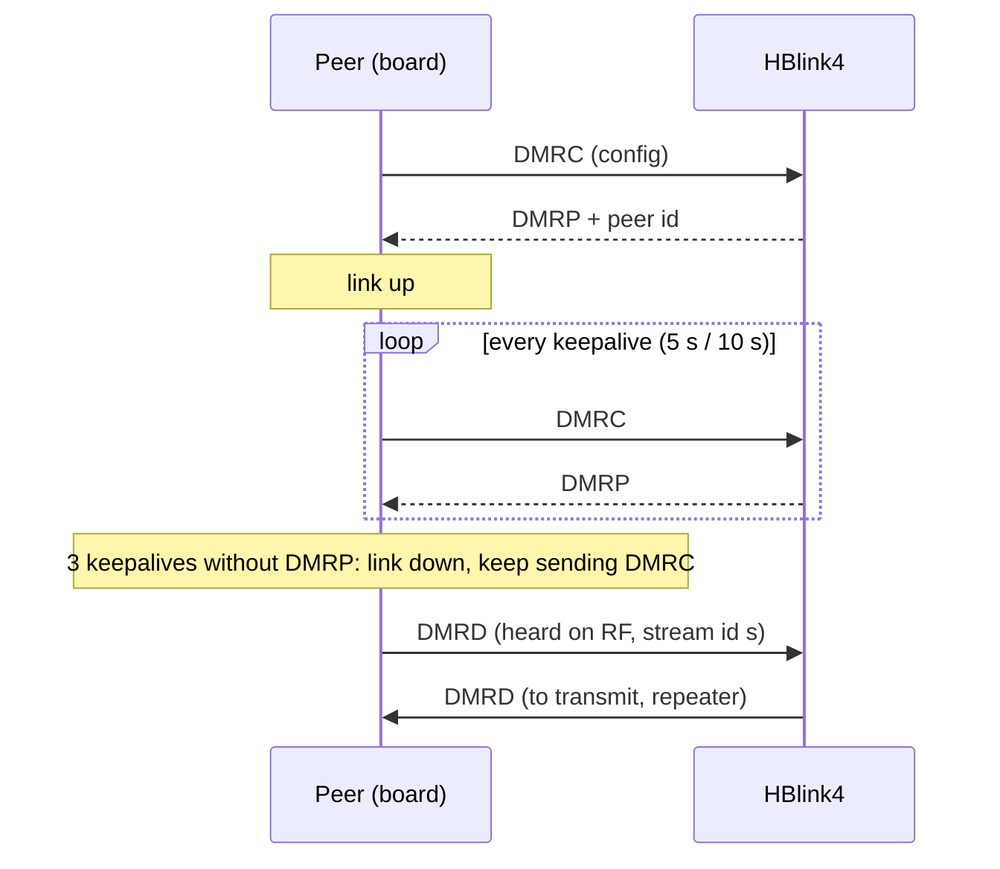
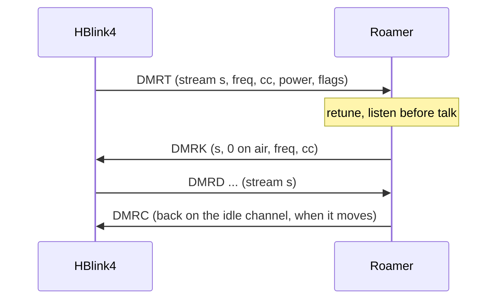

# esp_idf HBlink4 peer protocol

Covers: how the board's roamer, repeater and SDR channels talk to HBlink4: the MMDVMHost DMRC protocol (no login) with HBlink4's DMRC tails and its DMRT / DMRK roaming packets, the packet byte layouts, keepalive, stream ids and reconnects, over UDP or SCTP.
Sources: `common/src/hblink.c`, `common/include/rdof/hblink.h`, `esp_idf/main/roam_hblink.c`, `sdr_hblink.c`; HBlink4's DMRC handler (`_handle_dmrc`) and its `docs/protocol.md` ("Roaming Transceivers", "DMRC location tail").
Related: [mqtt.md](mqtt.md), [interfaces-http.md](interfaces-http.md), [tinysctp README](../../../components/tinysctp/README.md), [roamer.md](roamer.md), [config.md](config.md) (the `hblink` / `master` settings).

## 1. Peers

| Peer | Count | Transport | DMRC | Keepalive | Source |
|---|---|---|---|---|---|
| Roamer | one per roamer radio | UDP or SCTP | §3.2, with location and idle tails | 5 s (`RDOF_HB_ROAMING_KEEPALIVE_SECONDS`) | `roam_hblink.c` |
| Repeater | one per repeater radio | UDP or SCTP | §3.3, with location tail | 10 s (`RDOF_HB_KEEPALIVE_SECONDS`) | `roam_hblink.c` |
| SDR channel | one per channel with `hblink` and a `peer_id` | UDP only | §3.4, with location tail | 10 s | `sdr_hblink.c` |

There is no RPTL / RPTK / RPTC login and no password. HBlink4 accepts a DMRC peer whose id and callsign match one of
its `repeater_configurations` patterns, and otherwise ignores it. A roamer's pattern needs `roaming: true`.

## 2. Packets

All multi-byte integers are big endian. ASCII fields are fixed width.

| Tag | Direction | Length | Meaning |
|---|---|---|---|
| `DMRC` | peer → master | 119, 139 or 150 | configuration; also the keepalive |
| `DMRP` | master → peer | 8 (`DMRP` + peer id) | the answer to every DMRC; the link is up while they come |
| `MSTN` / `MSTC` | master → peer | ≥ 4 | refused / closed (`MSTNAK`, `MSTCL`): the peer counts the link down |
| `DMRD` | both | 55 (`RDOF_DMRD_LEN`) | a burst |
| `DMRT` | master → roamer | 18 or 19 | tune for a stream |
| `DMRK` | roamer → master | 18 (`RDOF_DMRK_LEN`) | the tune's answer |

The receiver classes packets by their first 4 bytes (`rdof_hb_kind`: `DMRP` → `P`, `MSTN` or `MSTC` → `N`, `DMRT` → `T`,
`DMRD` → `D`). Anything else is ignored. `N` sets the link down at once (no status republish); the peer keeps sending
DMRC.

### 2.1 DMRC (`hblink.c:rdof_dmrc_packet`)

| Offset | Size | Field | Format |
|---|---|---|---|
| 0 | 4 | `DMRC` | |
| 4 | 4 | peer id | u32 |
| 8 | 8 | callsign | `%-8.8s` |
| 16 | 9 | RX frequency, Hz | `%09lu` |
| 25 | 9 | TX frequency, Hz | `%09lu` |
| 34 | 2 | TX power | `%02u`, at most 99 |
| 36 | 2 | color code | `%02u` |
| 38 | 1 | slots | `'0'`–`'4'`: 1 TS1, 2 TS2, 3 both, 4 simplex (roamer), 0 none |
| 39 | 40 | version | `%-40.40s` |
| 79 | 40 | software | `%-40.40s` |
| 119 | 8 | latitude, degrees | `%.4f` cut to 8, space padded (location tail) |
| 127 | 9 | longitude, degrees | `%.4f` cut to 9, space padded |
| 136 | 3 | antenna height, m | `%03d` |
| 139 | 9 | idle frequency, Hz | `%09lu` (idle tail; needs the location tail, `0`s if no location) |
| 148 | 2 | idle color code | `%02u` |

Total at most `RDOF_DMRC_MAX` = 160. No location configured: the 119-byte form (or zeros when the idle tail follows).

### 2.2 DMRD (`hblink.c:rdof_dmrd_packet`)

| Offset | Size | Field |
|---|---|---|
| 0 | 4 | `DMRD` |
| 4 | 1 | sequence: per slot, +1 mod 256 per packet, 0 at a stream's start |
| 5 | 3 | source id, u24 |
| 8 | 3 | destination id, u24 |
| 11 | 4 | peer id, u32 |
| 15 | 1 | flags (below) |
| 16 | 4 | stream id, u32 |
| 20 | 33 | the burst |
| 53 | 1 | BER (count), at most 255 (MMDVMHost extension) |
| 54 | 1 | `abs(RSSI)` dBm, at most 255 |

Flags (byte 15):

| Bits | Meaning |
|---|---|
| 7 (0x80) | slot 2 |
| 6 (0x40) | private (unit) call; 0 group |
| 5–4 | frame type: 0 voice, 1 (0x10) voice sync (burst A), 2 (0x20) data sync |
| 3–0 | voice: burst index n (0–5); data sync: data type (1 voice LC header, 2 terminator with LC, 3 CSBK, …) |

On receive (`rdof_parse_dmrd`): length ≥ 53. The control byte for the modem is `0x20` for voice sync, `0x40 | dt`
for data sync, else `n`. A stream ends at a data-sync terminator with LC, or at a CSBK whose CRC checks and that
isn't a preamble (`rdof_single_csbk`).

### 2.3 DMRT (`rdof_parse_dmrt`)

| Offset | Size | Field |
|---|---|---|
| 0 | 4 | `DMRT` |
| 4 | 4 | peer id |
| 8 | 4 | stream id (the DMRD that follow carry it) |
| 12 | 4 | frequency, Hz (simplex) |
| 16 | 1 | color code (low 4 bits used) |
| 17 | 1 | power, 0–255 (255: the radio's own) |
| 18 | 1 | flags, optional: 0x01 preempt (tune away even from a call being heard) |

Length < 18 is ignored. A 18-byte DMRT has no flags.

### 2.4 DMRK (`rdof_dmrk_packet`)

| Offset | Size | Field |
|---|---|---|
| 0 | 4 | `DMRK` |
| 4 | 4 | peer id |
| 8 | 4 | stream id |
| 12 | 1 | status |
| 13 | 4 | frequency, Hz |
| 17 | 1 | color code (low 4 bits) |

| Status | Value | Meaning |
|---|---|---|
| `RDOF_DMRK_ON_AIR` | 0 | tuned, listened, on air |
| `RDOF_DMRK_CHANNEL_BUSY` | 1 | the channel is in use |
| `RDOF_DMRK_NOT_ALLOWED` | 2 | frequency not in the radio's allowed list |
| `RDOF_DMRK_RADIO_ERROR` | 3 | the radio failed, or this build has no TX |
| `RDOF_DMRK_TXVR_BUSY` | 4 | on another call |

On anything but 0 the roamer drops the stream. HBlink4 counts no DMRK within 2 s as a refusal. Rules for when each
status is sent are in [roamer.md](roamer.md).

## 3. Each peer's DMRC

### 3.1 Common

| Field | Value |
|---|---|
| peer id | the radio's / channel's `peer_id` |
| callsign | the radio's `callsign` |
| location tail | when the settings have a location |

### 3.2 Roamer (`roam_hblink.c`)

| Field | Value |
|---|---|
| RX, TX | the channel it's on now (both the same) |
| power | 0 |
| color code | the current one |
| slots | `'4'` |
| version | `RadioFoundry Gateway roaming` |
| software | `radiofoundry_gateway simplex` |
| idle tail | the idle channel and color code |

A roamer sends a DMRC (`roam_hb_send_config(force=false)`, only when the channel changed) on every retune and scan
change, and right before the first DMRD of a stream heard on a channel it hasn't reported, so HBlink4 credits the
stream to that channel (`before_stream`).

### 3.3 Repeater

| Field | Value |
|---|---|
| RX, TX | the configured RX and TX frequencies |
| power | the configured power |
| slots | `'3'` both, `'1'`, `'2'`, `'0'` none, from the slot settings |
| version | `RadioFoundry Gateway repeater` / `RadioFoundry Gateway SFR repeater` / `RadioFoundry Gateway DCDM gateway` |
| software | `radiofoundry_gateway duplex repeater` / `radiofoundry_gateway sfr repeater` / `radiofoundry_gateway dcdm` |
| idle tail | none |

### 3.4 SDR channel (`sdr_hblink.c`)

| Field | Value |
|---|---|
| callsign | the channel id, first 8 characters |
| RX, TX | the channel frequency |
| color code | the channel's, else 1 |
| slots | `'3'` |
| power | 0 |
| version | `radiofoundry-gateway` |
| software | `RadioFoundry_Gateway_SDR` |

## 4. Link state, keepalive, reconnect

| Item | Roamer / repeater | SDR | Source |
|---|---|---|---|
| Keepalive | a DMRC every 5 s (roamer) / 10 s (repeater), forced | a DMRC every 10 s to every peer | `roam_hblink.c`, `sdr_hblink.c` |
| Link up | a DMRP arrived within 3 keepalive periods | same, per peer | |
| Link down | 3 keepalives without DMRP, `MSTN`/`MSTC`, or a socket error | same | |
| Socket read | blocking `recv`, 500 ms timeout | `select`, 500 ms | |
| Socket error | close; the link goes down; reopen | `recv` ≤ 0 closes; reopened next loop | |
| Resolve / connect failure | retry after 1 s, doubling to 30 s | next loop | |
| Waits for | Wi-Fi up | Wi-Fi up | |
| On link change | MQTT status republished (roamer, repeater) | in the next SDR status (`hblink` per channel) | |

DMRC is stateless: a peer that restarts with a new source port just sends DMRC again, and HBlink4 follows it.

### 4.1 Roaming call

DMRD for a stream that had no DMRT is dropped. A receive-only build answers every DMRT with DMRK
`RDOF_DMRK_RADIO_ERROR`. In the roamer, DMRT goes to `rdof_txvr_on_tune` and DMRD to `rdof_txvr_on_burst`; in the repeater,
DMRD goes to `rdof_repeater_on_burst`.

## 5. Streams sent to HBlink4 (`hblink.c`, the HB sink)

| Rule | Value |
|---|---|
| New stream | at a voice LC header, data header, CSBK or late entry: `before_stream` (roamer DMRC), a new stream id, sequence 0 |
| Stream id | `rand32 % 0xFFFFFFFE + 1` (never 0); SDR: `esp_random()` based |
| Sequence | per slot, +1 mod 256 |
| Late entry | voice heard before the address is known is held, at most `RDOF_HB_HOLD_FRAMES` = 12 per slot; once the address is known a synthetic voice LC header goes first, then the held frames with that address |
| Stream id 0 | replaced by a new one |
| BER / RSSI | bytes 53 / 54 from the modem's or the demod's measure |

## 6. SCTP

Roamer and repeater only, when built with `CONFIG_RDOF_HBLINK_SCTP` (default y) and `hblink.transport: "sctp"`. A
transport other than `udp` or `sctp` logs a warning and uses UDP. SCTP runs over UDP (RFC 6951) with
[tinysctp](../../../components/tinysctp/README.md): HBlink4's SCTP listener must have UDP encapsulation on.

| Setting | Key | Default | Range | tinysctp field |
|---|---|---|---|---|
| UDP encapsulation port (HBlink4's) | `sctp_encap_port` | 9899 | 1–65535 | `encap_port` |
| SCTP port | the master port | | | `peer_port` |
| Heartbeat, ms | `sctp_heartbeat_ms` | 10000 | 0–600000 | `hb_interval` |
| Retransmissions before failure | `sctp_max_retransmit` | 3 | 1–20 | `max_retrans` |
| DMRD lifetime, ms (PR-SCTP; 0 = reliable) | `sctp_ttl_ms` | 0 | 0–60000 | `lifetime_ms` |

Fixed: 1 stream each way; RTO initial 1000 ms, min 300, max 3000; SACK delay 50 ms; send and receive buffers 16384;
largest message 2048; reconnect 1000–10000 ms. Every HBlink packet (DMRC, DMRD, DMRK) is one SCTP message on stream 0, PPID 0
(`roam_hblink.c:sctp_send`); only DMRD carries the lifetime.
A DMRC goes out as soon as the association is up; DMRP keeps the link state as over UDP. A start failure backs off
1 s, doubling to 30 s. The association's counters are `/api/status` `roamer.sctp`.

## 7. Transports and HBlink4

| Item | Gateway |
|---|---|
| Roamer and repeater transport | UDP or SCTP |
| SCTP | SCTP in UDP (tinysctp, RFC 6951) |
| SDR channel transport | UDP only |

HBlink4 itself (`_handle_dmrc`): answers each DMRC with `DMRP` + peer id; on a roaming peer
takes RX / TX / color code from every DMRC; reads the location tail at 119–139 and the idle tail at 139–150.
