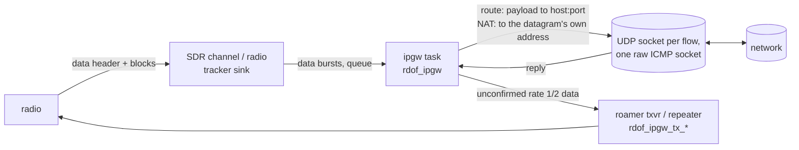

# IP gateway: DMR packet data to and from the IP network

What: the optional gateway that relays the IPv4 datagrams radios send as DMR packet data to the network over UDP
(by route or by NAT), and sends the replies back down to the radio as packet data.
Sources: `common/src/ipgw.c`, `common/src/ipgwcfg.c`, `common/src/ipgwtx.c`, `common/include/rdof/ipgw.h`,
`common/include/rdof/ipgwtx.h`, `esp_idf/main/ipgw_task.c`, `host-tests/test_ipgw.c`, `host-tests/test_ipgw_modes.c`,
`host-tests/test_ipgw_sdr.c`.
Related: [config.md](config.md) §2.13, [interfaces-http.md](interfaces-http.md) §3.4, [overview.md](overview.md),
[radio.md](radio.md), [../repeater.md](../repeater.md).
Specs: ETSI TS 102 361-1 clause 9.2 and annex B (data header, blocks, CRC-9, CRC-32, responses), TS 102 361-3
(SAP 4 carries IPv4; SAP 3, the compressed UDP/IPv4 header, table 7.14's port IDs), RFC 791 (IPv4), RFC 768 (UDP),
RFC 792 (ICMP), RFC 1071 and RFC 1624 (the checksum, and changing it in place). RadioFoundry's radio firmware's
IP carry (its docs/spec/dmr-data.md 11.1 and usb-network.md 3.1) for what its radios send and expect.

## 1. What it does

A radio with packet data on (ARS on UDP 4005, text messages on 4007, location, or any app, or a host on the
radio's USB network) sends an IPv4 datagram as a data call: a data header, then blocks. The gateway hears the
bursts on any receiver the board runs (the SDR's channels and each roamer's or repeater's radio), puts the message
back together, checks it, and relays it. Off by default; on with an `ip_gateway` key in the settings and
`CONFIG_RDOF_IPGW` in the build.

Two ways to send a datagram on, tried in this order:

1. **Routes.** The first route that matches the DMR addressing takes it. A route matches on the destination (a
   private call to an id or range, `private`; a talkgroup or range, `group`), the source radio (`from`, an id or
   range), both, or `all`. It sends the UDP payload (`payload: "udp"`, the default) or the whole IPv4 datagram
   (`payload: "ip"`) to its `to` address. `to` without a port keeps each datagram's own destination port.
2. **NAT.** With `nat` on, any UDP datagram (and ICMP echo request, §7) no route took goes to the address in its
   own IPv4 header, from the board's address (source NAT), if the destination is allowed (§4). The DMR
   destination doesn't matter: a radio that sends off-net traffic to the gateway's id (§6) and one that sends it
   to any other id are both NAT'd.

Nothing matched and NAT off: dropped (`no_route`).

## 2. Putting messages together (`rdof_ipgw_burst`)

- One assembler per (source, slot), `RDOF_IPGW_MAX_ASM` 4 at once; a fifth evicts the oldest (`rx_incomplete`).
- A data header with a good CRC-16 starts one. Unconfirmed (DPF 2) and confirmed (DPF 3) only; responses, UDT,
  short data and headers with no blocks start nothing. A proprietary header (DPF 15) after it counts as one of
  the announced blocks, as the tracker counts it.
- Blocks: rate 1/2 (12 octets; 10 confirmed), rate 3/4 (18; 16), rate 1 (24; 22). Confirmed blocks carry a 7-bit
  serial number and a CRC-9 each (checked, `rdof_split_confirmed`). Blocks are taken in the order heard; selective
  retry is not supported.
- When the announced count is in: the CRC-32 over the user data and the pad octets (little endian in the last
  four octets) is checked, the pad dropped. Any failed block, CRC-9 or CRC-32: `rx_bad`.
- A new header before the last block, or no block for `RDOF_IPGW_ASM_TIMEOUT_S` 2 s: `rx_incomplete`.
- **Chains.** RadioFoundry radios send several unconfirmed packets to one destination in one transmission: CSBK
  preambles once, then each packet's header and blocks back to back, one terminator. Each header after a packet's
  last block starts the next assembly; preambles and the terminator are ignored (none are needed). A block of one
  packet lost: the next header ends it (`rx_incomplete`) and the rest go up.
- The color code for replies comes from the receiver's channel, or the header's slot type when it doesn't know.
- **Duplicates:** a hash of (source id, destination id, the whole user data) is kept `RDOF_IPGW_DEDUP_S` 5 s
  (`RDOF_IPGW_DEDUP` 16 of them). The user data is the whole datagram (SAP 4) or the compressed header and payload
  (SAP 3), so the IPv4 identification is in it: the same packet heard again (two receivers heard it, the radio sent
  it again) is counted `rx_dup` and not relayed, while an app sending the same payload twice (a new identification
  each time) gets both through. What the gateway itself transmits goes in the same list, so a receiver here
  hearing the reply (an SDR channel on a repeater's outbound) doesn't relay it.

## 3. Datagram checks (radio to network)

| Check | Counter | Notes |
|---|---|---|
| SAP 4 (at least 20 octets, version 4) or SAP 3 | `not_ip` | other SAPs are not supported |
| SAP 3: the compressed header expands (§5) | `bad_ip`; `sap3` counts the good ones | |
| IHL ≥ 5, total length within the message, header checksum | `bad_ip` | the message's padding past the total length is dropped |
| a source in `radio_net` is the sending radio's own address | `bad_src` | any other source is a host off the radio net (behind the radio): a source like 10.0.39.21 is kept |
| not a fragment (MF clear, offset 0) | `fragment` | fragments are not put together |
| total length ≤ `max_bytes` | `too_big` | |
| UDP: length 8 or more and within the datagram; destination port not 0 | `bad_ip` | the UDP checksum isn't checked (the CRC-32 covers the message) |
| a `udp` route or NAT: the protocol is UDP (NAT: or an ICMP echo request) | `not_udp` | TCP and the rest are dropped; a `payload: "ip"` route takes any protocol |
| NAT: the destination is allowed | `denied` | §4 |
| TTL 2 or more, where the datagram is forwarded (NAT, a `payload: "ip"` route) | `ttl_expired` | §8 |
| the route's host has an address | `unresolved` | names are looked up every 30 s until they resolve |
| `up_pps` | `up_rate` | |
| a free flow and a socket | `flows_full` | |
| sent | `up_packets`, `up_bytes` / `send_failed` | |

## 4. NAT safety

- **Built in, always denied:** 0.0.0.0/8, 127.0.0.0/8, 169.254.0.0/16, 224.0.0.0/4 (multicast), 240.0.0.0/4 (and
  255.255.255.255), and `radio_net` (radio to radio traffic is not the gateway's).
- **`deny`:** default 10.0.0.0/8, 172.16.0.0/12, 192.168.0.0/16, 100.64.0.0/10 and 13.0.0.0/8 (the dispatch side
  of the 12/13 convention). NAT is for the Internet: radios can't reach the LAN behind the board unless the
  settings say so. A `deny` in the settings replaces this list (`[]` for none); the built-in list stays.
- **`allow`:** empty means any; otherwise the destination must be in one of them. Deny wins over allow.
- Routes are explicit, so neither list applies to them.
- **Rate limits:** `up_pps` (default 10) and `down_pps` (default 2) datagrams a second, each a token bucket of
  twice that (at least one). Down is the tighter one: every reply is airtime, and a RadioFoundry radio wants
  250 ms or more between separate transmissions to it, which 2 a second keeps on average (two in a burst can come
  closer; the transmitter's own call setup, §11, spaces them further).
- **Size:** `max_bytes` (default 1500, at most 1520: 127 rate 1/2 blocks) either way.
- **Flows:** `max_flows` (default 8, at most `CONFIG_RDOF_IPGW_MAX_SOCKETS`); one closes after `idle_s` (default
  120 s) with nothing either way. A full table drops new flows (`flows_full`); nothing is evicted.
- **Replies:** only from the exact address and port a flow sent to (`down_stranger` otherwise; ICMP: §7). There is
  no inbound mapping: the network can't start a conversation with a radio.
- **Never from the radio's own address:** a radio drops a packet whose source is its own or its host's address.
  A down datagram whose source is its destination, the radio's address from its datagram, or the radio's
  `radio_net` address is not sent (`down_own_source`). NAT's replies are from the peer, as it restores them.

## 5. SAP 3: the compressed UDP/IPv4 header

TS 102 361-3's UDP/IPv4 header compression: octets 0-1 the IPv4 identification, octet 2 SAID (high nibble) and DAID
(low), octets 3-4 the opcode's two bits (each octet's top bit) and the 7-bit source and destination port IDs, then
the ports a port ID of 0 leaves out (source first, 2 octets each), then the payload.

| Field | Taken | Meaning |
|---|---|---|
| SAID | 0 | the source is the radio: its id in `radio_net` (12.x.y.z) |
| DAID | 0, 2 | 0: the destination radio's id in `radio_net`; 2 (or a group data header): the talkgroup as 225.x.y.z |
| opcode | 0 | UDP |
| port ID | 1 → 5016, 2 → 5017, 98 → 4007; 0: the port follows | other IDs: `bad_ip` |

The gateway rebuilds the whole datagram (TTL 64 to a radio, 1 to a talkgroup, as the radio keeps it on the air; the identification from octets 0-1, both checksums) and handles
it as if the radio had sent it on SAP 4. Replies always go down on SAP 4, the full header.

## 6. Radio addresses (`radio_net`) and the gateway's id

Radios commonly use an address made from their id: 12.x.y.z with x.y.z the id's three octets (the Motorola
convention; id 9994567 is 12.152.129.71). `radio_net` (default 12.0.0.0/8, prefix 8 to 30) is that network:
`rdof_ipgw_radio_ip` puts an id's low bits in the host part, `rdof_ipgw_ip_radio` reads them back. It's used to
deny radio to radio traffic to NAT, to rebuild SAP 3 addresses, to send a whole reply datagram (`payload: "ip"`)
to the radio it names, and to never send a radio a packet from its own address. A source address in `radio_net`
must be the sending radio's own (else `bad_src`); a source outside it is a host behind the radio. The reply goes
to the id that sent.

A RadioFoundry radio counts an address as an id's only on an exact match: 12.x.y.z for a radio, 225.x.y.z for a
talkgroup. Any other address is off-net. Set `radio_net` to the network the fleet uses (12.0.0.0/8 unless the
radios were set up otherwise).

**Off-net traffic and `id`.** A radio sends traffic for addresses outside its own network as a private data call
to its IP gateway id (RadioFoundry's `ipGatewayId`), the real destination address in the datagram (SAP 4). Set the
radios' `ipGatewayId` to the gateway's `ip_gateway.id`, or to **9999999** (`RDOF_IPGW_ANY_GATEWAY`), the id every
gateway answers: a radio set to it reaches the Internet through whichever gateway hears it, whatever that board's
own id. NAT takes the datagram whatever the DMR destination is,
and the reply goes back to the radio's id from the id it sent to (`id`, or 9999999), with the destination its
12.x.y.z address and the source the Internet peer's. Group data is answered from `id` (or the talkgroup when `id`
is 0). With NAT on and no routes, this works with the defaults.

## 7. ICMP

NAT passes ICMP through one raw socket (lwIP's raw PCBs; no Kconfig change):

- **Echo (ping):** an echo request from a radio (as it came off the air: RadioFoundry radios pass their host's
  ICMP on unchanged) opens an ICMP flow, keyed by the radio, its address and the echo identifier, with no socket of
  its own. It goes out with the identifier `RDOF_IPGW_ICMP_ID_BASE` + the flow and the checksum again
  (`icmp_up`); the echo reply comes back from the address pinged with the radio's identifier restored
  (`icmp_down`).
- **Errors:** destination unreachable (fragmentation needed included), time exceeded and parameter problem quote
  our datagram's header and first 8 octets, for a UDP flow or an echo. The gateway finds the flow from the quote
  (the peer's address and port and our socket's local port; or the echo identifier), rewrites the quote back to
  the radio's (its address, and its port or identifier; the quoted IPv4 checksum again, the quoted UDP checksum
  fixed in place, RFC 1624), recomputes the ICMP checksum and sends it to the radio's id, from the router that sent
  it (`icmp_errors`). One that matches no flow: `icmp_unmatched`. Other ICMP types are ignored.
- Allow, deny and the rate limits apply as to UDP.

## 8. TTL

- **Up:** where the gateway forwards the datagram (NAT, a `payload: "ip"` route) it is a router: TTL 1 or 0 is
  dropped (`ttl_expired`); otherwise the datagram goes on with its TTL less one (NAT's sockets set it per send,
  ICMP's too). A `payload: "udp"` route ends the datagram at the gateway and sends a new one with the platform's
  TTL, so it takes TTL 1 too (a radio's own packets to a talkgroup have TTL 1; a host's keep the host's).
- **Down:** a reply the gateway builds (`udp`) has TTL 64. A datagram passed on whole (`payload: "ip"`) or an
  ICMP message keeps the TTL it came with less one, and is dropped at 1 or 0 (`down_ttl_expired`).

## 9. Flows and replies

A flow is the key (route or NAT, the protocol, radio id, the datagram's source address and port or echo
identifier, where it was addressed, where it goes), its own UDP socket on an ephemeral port (not for ICMP), and
where the radio was last heard (source, slot, frequency, color code). `payload: "ip"` flows key on the radio, its
address and the route (ports 0).

Replies on a flow's socket:

| Payload | What goes down |
|---|---|
| `udp` | a new IPv4 + UDP datagram: source the address and port the radio sent to (restored), destination the radio's own address and port from its datagram; TTL 64, an id counter, both checksums |
| `ip` | the datagram as received (it must be IPv4, its header checksum right, its total length within what arrived: else `down_bad_ip`), TTL less one; if its destination is in `radio_net`, it goes to that radio id, else the flow's |

The DMR packet: unconfirmed, SAP 4, rate 1/2, F set, FSN 8 (the whole message), CRC-32 in the last block, to the
radio's id, from the id the radio sent to (talkgroup data: from `id`, or the talkgroup when `id` is 0); no CSBK
preambles (a radio doesn't need them). Counted `down_packets`, `down_bytes`; `down_rate`, `down_too_big`,
`down_own_source`, `no_tx` when not sent. Each reply is a transmission of its own (§12).

## 10. Confirmed data

Confirmed messages with "response requested" are answered with an ACK (a response header: class 0, type 1, status
the message's N(S); to the sender, from the id it sent to), when `ack` is on (default), the message isn't to a
talkgroup, and a route or NAT took it (not when it's someone else's: no route, not UDP to NAT, or denied). The
same message again after `RDOF_IPGW_ACK_AGAIN_S` 0.5 s is answered again (the radio didn't hear the first) but
not relayed. No NACKs or selective ACKs: a message that fails is not answered and the radio sends it again.
RadioFoundry radios never chain confirmed packets. The ACK goes out through the same transmitter as replies (§11),
as soon as the channel lets it. Untested against radios.

## 11. Transmitting (`rdof/ipgwtx.h`, `ipgw_task.c:send_dmr`)

The radio named by `ip_gateway.tx` (a roamer or repeater in `run`), else the first that runs. The portable part,
`rdof_ipgw_tx_txvr` and `rdof_ipgw_tx_repeater`, is what the host tests drive end to end in each mode
(`test_ipgw_modes.c` on fake radios, `test_ipgw_sdr.c` through the SDR modem's modulator and the receiver).

| Mode | How the packet goes | On air |
|---|---|---|
| Roamer (`rdof_txvr`): an MMDVM_HS or OpenGD77 hotspot, or an `sdr_transceiver` half duplex | a network call of its own: a tune (a random stream id; the roamer's channel the radio was heard on, within 100 Hz, else the one it's on now, with that channel's color code; power 255), then each burst, the last marked the terminator. Refused (busy with another call, not ready, no such channel): `no_tx`. Its listen-before-talk applies: a reply to the radio just heard goes once its packet is 0.5 s over and the 0.3 s listen is done; other traffic on the channel makes it refuse | slot 2, MS data sync |
| Repeater, duplex (`rdof_repeater`), either slot; an `sdr_transceiver` full duplex | network bursts on the slot the radio was heard on, regenerated by the repeater | that slot on the outbound, BS data sync |
| Repeater, SFR | the same; the repeater sends them on its outbound slot | the outbound slot, BS data sync |
| Repeater, DCDM (two direct mode calls on one frequency) | the same, on the slot the radio was heard on | that slot, TS1 / TS2 direct mode data sync |

- **The radio's own packet** is repeated as before: a duplex repeater sends it on its outbound slot while the
  gateway takes it; an SFR's radio repeats it in its own firmware; DCDM and simplex don't repeat. Nothing the
  gateway sends goes up again: transceivers and repeaters don't hear their own transmissions, and what another
  receiver hears of it is a duplicate (§2).
- **Waiting for the slot (repeaters).** A repeater refuses a network call on a slot that's busy (an RF call there,
  another network call; SFR: the inbound heard in the last 0.3 s), and a reply, an ACK above all, comes right
  after the radio's packet. The packet waits in `rdof_ipgw_tx_t` until the slot is free, `RDOF_IPGW_TX_WAIT_S`
  2 s at most (then dropped: `tx_busy`). Meanwhile another packet is refused (`no_tx`).
- **Long packets (repeaters).** The repeater's network input holds `RDOF_RPT_IN` 64 bursts between polls, and a
  packet has up to 128. What doesn't fit goes in as the repeater takes it (`rdof_ipgw_tx_more`, every pass of the
  task's loop, 20 ms apart at most). `RDOF_RPT_IN` isn't raised (its RF input queue shares the size, and the Rust
  port's layout): the out queue (192) holds a whole packet.
- **The SDR modem** (an `sdr_transceiver`) ends a heard data call at its last block, as the header announces: no
  carrier and no DMR_LOST after it, so the transceiver's listen-before-talk lets the reply go.
- **No roamer or repeater** (an SDR-only board): replies and ACKs are counted `no_tx`.
- Through a transceiver the call is also answered to HBlink4 (DMRK) like any; its stream id is one HBlink4 never
  sent.

## 12. Not done: chaining replies

RadioFoundry radios take a chain (§2) too, and the gateway could put its replies to one radio into one
transmission (one set of preambles, the headers back to back, one terminator, up to about 40 bursts), with
`down_pps` spacing only separate transmissions. It doesn't: each reply is a call of its own. It would take a queue
per radio and slot in `rdof_ipgw_tx_t` that holds a reply briefly for the next one, and a stream that carries more
than one packet: the repeater already takes that (a network data stream may carry another packet, R7.9), but the
transceiver ends its call at the first burst marked the terminator, so the terminator would have to wait for the
chain's end.

## 13. On the board

- `ipgw_start` (before the roles) parses the settings and starts task `ipgw` (6144 B stack, priority 6, core 0).
- Each receiver's tracker gets a sink (`ipgw_sink`): data headers and blocks only go on a 64-entry queue
  (`queue_full` when full). The SDR's run on the DSP core; the sink only copies. An `sdr_transceiver`'s packets
  reach it twice (the SDR channel's sink and the radio's): the second is a duplicate.
- The task waits 20 ms on the queue when no flow is open, else drains it and waits 10 ms on the sockets
  (`select`); each pass feeds a waiting packet to the repeater; it ticks every 250 ms (idle flows, stale messages)
  and looks up unresolved route names every 30 s while Wi-Fi is up (`getaddrinfo`, once: a name that changes
  address keeps the first).
- Each flow is a socket bound to an ephemeral port, and NAT has one raw ICMP socket; lwIP's `LWIP_MAX_SOCKETS`
  (28) is shared with the web server, MQTT and HBlink4, hence `CONFIG_RDOF_IPGW_MAX_SOCKETS` (8). The raw socket
  is a raw PCB (`LWIP_MAX_RAW_PCBS`, 16).
- Memory: `rdof_ipgw_t` is about 16 KB (the assemblers, the reply buffer, one outgoing packet's 128 bursts) and
  `rdof_ipgw_tx_t` about 4.5 KB (a packet going on air), in PSRAM when there is some.
- `GET /api/status` has `ip_gateway` with the counters ([interfaces-http.md](interfaces-http.md) §3.4).

## 14. Not supported

- IPv6, IPv4 fragments, TCP/IP header compression, other SAPs (short data, UDT); SAP 3 with a SAID other than 0,
  a DAID other than 0 or 2, an opcode other than UDP, or port IDs other than 1, 2 and 98.
- Inbound port forwarding (the network starting a flow to a radio).
- ICMP from a radio other than echo requests.
- Selective retry (NACKs, resending only the failed blocks).
- Confirmed data sent down (replies are unconfirmed), rate 3/4 or rate 1 sent down; replies chained (§12).
- TX on the SDR alone without an `sdr_transceiver`.
- Name changes after a route's host resolved once.
