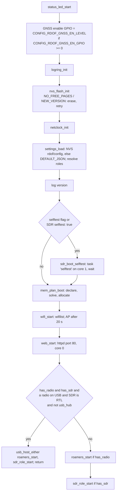
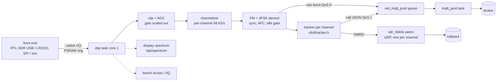
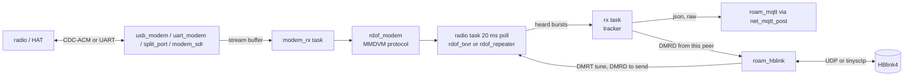
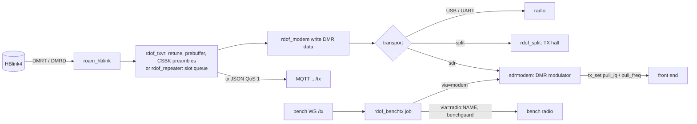

# ESP32 firmware: overview

Covers: what the firmware is, its roles, build profiles and gates, boot, tasks, data flow, module map, the port boundary, and the feature limits.
Sources: `esp_idf/main/*`, `common`, `sdr`, `rtlsdr`, `components/*`, `sdkconfig.defaults*`, `partitions-*.csv`, `Kconfig.projbuild`.
Related: [config.md](config.md), [memory.md](memory.md), [interfaces-http.md](interfaces-http.md), [mqtt.md](mqtt.md), [hblink.md](hblink.md), [sdr.md](sdr.md), [radio.md](radio.md), [device.md](device.md), [../repeater.md](../repeater.md), [../bench-api.md](../bench-api.md), [../slot-timing.md](../slot-timing.md).

## 1. What it is

One ESP-IDF v5.5 app (`esp_idf`, project `radiofoundry_gateway`) for an ESP32-S3. It takes a box config (JSON), publishes MMDVMHost-compatible MQTT (call JSON, raw bursts, status) and peers with HBlink4. One image does every role; the settings pick which run (`settings.c:resolve`, `rdof_box_roles`).

## 2. Roles

| Role | Box `type` | Runs | Limit per board | Spec |
|---|---|---|---|---|
| SDR receiver | `sdr` | front end → channelizer → per-channel 4FSK demod → tracker → MQTT / HBlink4 (one RX-only peer per channel) | 1 (`rdof_roles_t.sdr`) | [sdr.md](sdr.md) |
| Roamer | `radio_hotspot` (alias `opengd77`), `mmdvm_hs`, `mmdvm`, `auto` | an MMDVM modem (USB CDC-ACM or UART) under `rdof_txvr`; HBlink4 roaming peer; MQTT app `roaming` | `RDOF_MAX_RADIOS` = 2 (`rdof/config.h`), counted with repeaters | [radio.md](radio.md) |
| Repeater | `repeater` (`mode` duplex, sfr or dcdm) | `rdof_repeater` on a duplex modem (dcdm: a DCDM modem, both slots on one frequency); HBlink4 repeater peer; MQTT app `repeater` | as roamer | [../repeater.md](../repeater.md) |
| Split halves | `repeater` with `radio.type: split` | two radios (TX half, RX half; RadioFoundry split duplex) as one duplex modem (`split_port.c`, `rdof/split.h`) | 1 USB half, 1 SDR half max | [../repeater.md](../repeater.md), [../slot-timing.md](../slot-timing.md) |
| SDR transmitter | `sdr_transceiver` (`duplex` half → roamer, full → duplex repeater; `mode: dcdm` → DCDM gateway) | the SDR front end as the radio, through `rdof/sdr/sdrmodem.h` (an emulated MMDVM modem) | needs the SDR in `run` and a front end that can TX | [sdr.md](sdr.md), [radio.md](radio.md) |
| Hub | `usb_hub: true` (box key) | every USB role at once behind a hub; devices matched by `usb.serial` / `usb.port` | build needs `CONFIG_USB_HOST_HUBS_SUPPORTED` (`.16mb`, `.hub`, `.w12`) | [config.md](config.md) |
| Bench | `bench` key (`bench.radios`, `bench.tx`) | `/api/bench/v1`: spectrum, bursts, I/Q, sessions, radios link, TX jobs | `CONFIG_RDOF_BENCH` | [../bench-api.md](../bench-api.md) |

Rules:
- A board runs up to 2 roamers / repeaters plus 1 SDR (`rdof_box_roles`). The second radio starts only if PSRAM exists (`settings.c:resolve`) and the memory plan has room for it ([memory.md](memory.md)); unplanned ("either" mode), ≥ `EXTRA_RADIO_INTERNAL` = 20 KB internal RAM must be free (`roamer.c`).
- "Either" mode (`usb_host_either`): a radio on USB and an RTL-SDR, no `usb_hub`. The first device of either kind plugged in picks the role; the other kind plugged in later restarts the board (`usb_host.c:watch_task`, 500 ms then `esp_restart`). RTL is VID `0x0BDA`, PID `0x2838`/`0x2832` (`usb_host.c:usb_host_is_rtl`); the radio is `CONFIG_RDOF_USB_VID`/`PID`.

## 3. Profiles and overlays

Built as `sdkconfig.defaults` + one profile + optional overlays (`SDKCONFIG_DEFAULTS`, commands in [reference.md](../../reference.md)). The Rust build adds `sdkconfig.defaults.rust` (`CONFIG_RDOF_RUST=y`).

| File | Adds |
|---|---|
| `sdkconfig.defaults` | esp32s3, 240 MHz, `FREERTOS_HZ` 1000, console UART0 (GPIO43/44), custom partitions, `-Os`, `MAIN_TASK_STACK` 6144, `HTTPD_MAX_REQ_HDR_LEN` 1024, WS support, `LWIP_MAX_SOCKETS` 28, 64 B D-cache line, `MQTT_PROTOCOL_5`, `USB_HOST_HW_BUFFER_BIAS_IN` |
| `.4mb` | 4 MB QIO 80 MHz, `partitions-4mb.csv`; quad PSRAM 80 MHz (malloc, `ALWAYSINTERNAL` 4096, BSS and Wi-Fi/lwIP in PSRAM); max Wi-Fi TX power 10; LED GPIO48; no MQTT TLS / SSL / WS transports; log ring 16 KB; core dump to flash |
| `.16mb` | 16 MB QIO 80 MHz, `partitions-16mb.csv`; octal PSRAM 80 MHz, mbedTLS in PSRAM; `RDOF_SDR_INTERNAL_RESERVE_KB` 64; MQTT TLS; log ring 256 KB; core dump to flash; USB hubs (single level); LED GPIO48 |
| `.roamer` | `RDOF_SDR=n` |
| `.sdr` | `RDOF_ROAMER=n` |
| `.hub` | `USB_HOST_HUBS_SUPPORTED=y`, multi-level n |
| `.w12` (on 16mb) | LED GPIO46; GNSS enable GPIO48 level 0; netclock PPS GPIO41; GNSS NMEA on UART1 RX 39 / TX 38; `RDOF_SDR_LR2021=y` |
| `.dspfast` (on 16mb) | `RDOF_SDR_DSP_IRAM=y`, 64 KB D-cache |
| `.rust` | `RDOF_RUST=y`: the modules ported to Rust linked in place of their C ([rust/README.md](../../../rust/README.md)) |

Partitions:

| Name | 4mb offset / size | 16mb offset / size |
|---|---|---|
| nvs | 0x9000 / 0x6000 | 0x9000 / 0x6000 |
| otadata | 0xF000 / 0x2000 | 0xF000 / 0x2000 |
| phy_init | 0x11000 / 0x1000 | 0x11000 / 0x1000 |
| ota_0 | 0x20000 / 0x1E0000 | 0x20000 / 0x400000 |
| ota_1 | 0x200000 / 0x1E0000 | 0x420000 / 0x400000 |
| coredump | 0x3E0000 / 0x20000 | 0x820000 / 0x20000 |
| storage (spiffs) | — | 0x840000 / 0x7C0000 |

## 4. Feature gates

App gates (`main/Kconfig.projbuild`; full table with ranges in [config.md](config.md#4-kconfig)):

| Gate | Default | Builds |
|---|---|---|
| `RDOF_ROAMER` | y | roamer / repeater: `roamer.c`, `modem_port.c`, `usb_modem.c`, `uart_modem.c`, `split_port.c`, `radio_task.c`, `roam_hblink.c`, `rx_path.c`, `roam_mqtt.c` |
| `RDOF_SDR` | y | SDR role: `sdr.c`, `sdr_task.c`, `dsp_esp.c`, `kbench.c`, `fir_s3.S`, `sdr_mqtt.c`, `sdr_hblink.c`, `selftest*.c`, `fe_rtlsdr.c`, `fe_sim.c` |
| `RDOF_ROAMER` or `RDOF_SDR` | — | `modem_sdr.c` |
| `RDOF_BENCH` (needs SDR) / `RDOF_BENCH_TX` | y / y | `bench_api.c`, `bench_radio.c`, `bench_tx.c` |
| `RDOF_SDR_LR2021` | n | `fe_lr2021.c`, `components/lr2021` |
| `RDOF_MQTT`, `RDOF_MQTT_RAW`, `RDOF_MQTT_TLS` | y, y, n | MQTT out; raw bursts; `mqtts://` with the CA bundle |
| `RDOF_MODEM_USB`, `RDOF_MODEM_UART` | y, y | modem transports |
| `RDOF_HBLINK_SCTP` | y | `hblink.transport: sctp` (tinysctp) |
| `RDOF_SCAN`, `RDOF_OLED` | y, y | roamer scan; OLED |
| `RDOF_IPGW` (needs `RDOF_FEATURE_DATA_BLOCKS`, `_TRACKER`) | y | IP gateway: `ipgw_task.c` ([ipgw.md](ipgw.md)) |
| `RDOF_SDR_HBLINK`, `RDOF_SDR_FAST`, `RDOF_SDR_ESP_DSP`, `RDOF_SDR_TWO_CORES`, `RDOF_SDR_SELFTEST`, `RDOF_SDR_SPIKE` | all y | SDR peers, `-O2` DSP, esp-dsp kernels, 2-core demod, self-test, USB spike |
| `RDOF_WEB_FULL`, `RDOF_OTA`, `RDOF_SOFTAP` | y, y, y | full page (else `mini.html`), `/api/ota`, setup AP |

Portable-core gates (compile-time macros, defaults 1; `common/Kconfig`, `sdr/Kconfig`, `rdof/features.h`, `rdof/sdr/features.h`): `RDOF_FEATURE_TX`, `RDOF_FEATURE_DATA_BLOCKS`, `RDOF_FEATURE_TRACKER`, `RDOF_FEATURE_REPEATER` (needs TX), `RDOF_FEATURE_SDR`, `RDOF_SDR_AGC`, `RDOF_SDR_BUILTIN_FFT`, `RDOF_SDR_RECEIVER` (needs TRACKER), `RDOF_SDR_FAST_ATAN2`; `RDOF_SDR_DSP_IRAM` default 0.

## 5. Boot sequence

`main.c:app_main`:

Per role start:
- `roamers_start` → per radio k (`roamer.c:start_one`): allocate `roam_t` (k=0 internal RAM, else PSRAM), `modem_port_init`, `roam_rx_start`, `radio_start`, `roam_hb_start`, `roam_mqtt_start`, then the transport: `sdr_modem_start` | `split_modem_start` | `uart_modem_start` | `usb_modem_start` by `modem_port`.
- `app_main` calls `mem_plan_boot` (`mem.c`) right after the self-test, before Wi-Fi: every role's claims (the SDR's
  chunk buffers, hot arena and DSP stacks, the radios' state and stacks, the IP gateway's queue, the USB host's tasks,
  budgets for what others allocate), solved against the heap with `CONFIG_RDOF_MEM_MARGIN_KB` kept and allocated
  while the heap is whole; neither the SDR nor the radios when one USB port decides the role ([memory.md](memory.md)).
  The roles start on what the plan gave them; a refused role doesn't start and says why.
- `sdr_role_start` (`sdr.c`): take the `spike` flag, `dsp_setup` (allocators: the receiver's per-sample buffers from the plan's hot arena, the rest internal RAM while `CONFIG_RDOF_SDR_INTERNAL_RESERVE_KB` stays free, else PSRAM; esp-dsp install and check), `sdr_hb_start`, `sdr_mqtt_start`, `sdr_start` (front end + DSP tasks).
- A failed stored config runs `DEFAULT_JSON` instead, with `g_cfg_ok = false` and the error on the page ([config.md](config.md#6-precedence)).

## 6. FreeRTOS tasks

Stack in bytes. Planned tasks (memory.md, §7) run on the plan's stacks (`mem_task`, `xTaskCreateStaticPinnedToCore`); unplanned, on the heap as below. "PSRAM" = stack in PSRAM (`xTaskCreatePinnedToCoreWithCaps`, `MALLOC_CAP_SPIRAM`). Roamer tasks use `roamer.c:roam_task`: radio 0 internal stack, any core; radio 1 PSRAM stack, `tskNO_AFFINITY`.

| Task | Stack | Core | Prio | Source | Job |
|---|---|---|---|---|---|
| `usb_lib` | 4096 | 0 | 19 | `usb_host.c:usb_host_start` | USB host library events; free devices when no clients |
| `usb_lib` (rtl) | 4096 | `task_core` 0 | prio+1 = 19 | `rtlsdr/esp/rtl_usb.c` | only when rtl_usb installs the host itself |
| `usb_client` | 4096 | 0 | 18 (`fe_rtlsdr.c` `.task_priority`) | `rtl_usb.c` | RTL bulk transfers into the PSRAM ring |
| `usb_open` (rtl) | 6144 | 0 | 10 (prio−8) | `rtl_usb.c` | open / reopen the dongle |
| `lr2021` | 4096 | 0 | 17 | `fe_lr2021.c:468` | drain the LR2021 RX FIFO over SPI into a ring |
| `usb_watch_ev` | 3072 | 0 | 15 | `usb_host.c:watch_start` | watcher client events |
| `dsp` | 8192 | `DSP_CORE` 1 | 12 | `sdr_task.c:1310` | SDR receive loop: read, AGC, channelize, demod, track, spectrum |
| `modem_rx` | 6144 | roam | 12 | `modem_port.c:119` | feed transport bytes to `rdof_modem`, signal replies |
| `uart_rx` | 3072 | roam | 12 | `uart_modem.c:52` | UART reads into the modem port |
| `split` | 4096 | roam | 12 | `split_port.c:253` | split duplex: feed halves, 20 ms tick |
| `radio` | 8192 | roam | 11 | `radio_task.c:404` | start modem, build radio, poll txvr / repeater every 20 ms; restart 1 s doubling to 30 s |
| `dsp_helper` | `CONFIG_RDOF_SDR_HELPER_STACK` 6144 | 0 | 10 | `sdr_task.c:186` | second-core channel demods (`dsp_cores: 2`) |
| `usb_watch` | 8192 | 0 | 9 | `usb_host.c:watch_start` | identify devices, assign to radios, either-mode start |
| `usb_open` (radio) | 4096 | roam | 9 | `usb_modem.c:123` | open the radio's CDC-ACM device, reopen on return |
| `bench_usb` | 4096 PSRAM | 0 | 9 | `bench_radio.c:612` | bench radio on USB |
| `roam_hblink` | 4096 | roam | 8 | `roam_hblink.c:340` | roaming / repeater HBlink4 peer (UDP) |
| `hblink-sctp` | 6144 | any | `TINYSCTP_TASK_PRIORITY` 8 | `roam_hblink.c:225` via tinysctp | SCTP association; delivers received DMRx |
| `sdr_hblink` | 4096 | 0 | 8 | `sdr_hblink.c:186` | SDR channel peers |
| `netclock` | 6144 | 0 | 8 | `netclock.c:543` | NTP poll, clock model |
| `netclock_pps` | 4096 | 0 | 8 | `netclock.c:315` | PPS edges (when `NETCLOCK_PPS_GPIO` ≥ 0) |
| `gnss` | 3584 | 0 | 9 | `gnss.c` (`gnss_start`) | the receiver's NMEA on its UART; each second's time to netclock (when `GNSS_UART_RX_GPIO` ≥ 0) |
| `rx` | 8192 | roam | 7 | `rx_path.c:147` | radio bursts → tracker → MQTT / HBlink |
| `mqtt_post` | 6144 (PSRAM if any) | 0 | 5 | `net.c:189` | one per MQTT client: drain the publish queue |
| `wifilist` | 4096 | any | 5 | `wifilist.c:690` | station over the network list |
| `sdrmodem` | 4096 | roam | 5 | `modem_sdr.c:241` | start the SDR's emulated modem |
| `selftest` | 16384 | 1 | 5 | `sdr.c:84` | boot self-test (idle-1 WDT removed meanwhile) |
| `restart` | 2048 | any | 5 | `web.c` | delayed `esp_restart` after a web action |
| `usb_kick` | 2560 | 0 | 5 | `usb_host.c:72` | after 3 s with nothing on USB, root port off 200 ms, on |
| `bench_uart` | 3072 PSRAM | 0 | 5 | `bench_radio.c:158` | bench radio on UART |
| `sdr_status` | 4096 | 0 | 4 | `sdr_mqtt.c:140` | SDR status every `status_seconds` |
| `roam_status` | 3072 | roam | 4 | `roam_mqtt.c:179` | radio status every 10 s |
| `bench_link`, `bench_txj` | 3072, 4096 PSRAM | 0 | 4 | `bench_radio.c:616`, `bench_tx.c:348` | bench radio link; TX job tick |
| `oled` | 4096 | 0 | 3 | `oled_task.c:oled_start` | redraw every `refresh_s` |
| `bench_bursts`, `bench_iq` | 4096 PSRAM | 0 | 3 | `bench_api.c` | bench WS streams |
| `ipgw` | 6144 | 0 | 6 | `ipgw_task.c:ipgw_start` | IP gateway: data bursts in, flows' UDP sockets, replies out ([ipgw.md](ipgw.md)) |
| `led` | 2048 | any | 1 | `status_led.c` | status LED, 2 Hz |
| httpd | 8192 | 0 | IDF default | `web.c:web_start` | web server: 48 URI handlers, 8 sockets, LRU purge |

Plus ESP-IDF's own: `esp_timer`, Wi-Fi, lwIP (`tiT`), one `mqtt_task` per client (6 KB, IDF), `nc_temp` and `wifilist_ap` esp_timers.

Core rule: core 1 holds only the DSP (and the self-test). Network, USB, SPI, MQTT publish and HBlink are on core 0 or unpinned.

## 7. Data flow

### 7.1 SDR receive → MQTT / HBlink4

### 7.2 Radio (roamer / repeater) paths

### 7.3 Transmit

## 8. Module map

### `common` (portable C11, `rdof_*`)

| Layer | File | What |
|---|---|---|
| Util | `bits.c` | bit packing |
| | `json.c` | JSON writer (`rdof_json_*`) |
| | `jsonp.c` | JSONC strip + DOM parser (`rdof_jdoc`) |
| | `usbmatch.c` | USB device to radio matching, port paths |
| DMR | `fec.c`, `radiofoundry/dmrFec.c`, `radiofoundry/dmrTrellis.c`, `radiofoundry/dmrCach.c`, `radiofoundry/dmrDataCrc.c`, `radiofoundry/dmr_lc.c` | BPTC, Golay, Hamming, RS, trellis, CACH, CRCs, LC (RadioFoundry code, MIT) |
| | `layer2.c` | bursts, sync, EMB, slot type |
| | `pdu.c` | data headers / blocks |
| | `ambe.c` | AMBE frame handling |
| | `rawburst.c` | binary raw-burst MQTT record |
| Calls | `tracker.c` | call tracker → MMDVMHost JSON |
| | `netcalls.c` | network calls the radio sends, as JSON |
| | `status.c` | status JSON |
| Modem | `mmdvm.c` | MMDVM frame codec |
| | `modem.c` | `rdof_modem`: requests, replies, over `rdof_modem_port_t` |
| Radio | `txvr.c` | roamer transceiver (listen, answer, scan, transmit) |
| | `duplex.c` | duplex helpers |
| | `repeater.c` | repeater (duplex / SFR) |
| | `split.c`, `splitops.c` | split duplex transport and half ops |
| | `slotgrid.c` | UTC slot grid, `slot_timing`, slot gate |
| Net | `hblink.c` | HBlink4 packets (DMRC, DMRD, DMRT, DMRP) |
| Config | `config.c` | box config → `rdof_config_t`, roles, port checks |
| | `benchcfg.c` | `bench` settings |
| | `ipgwcfg.c` | `ip_gateway` settings, address helpers |
| IP | `ipgw.c` | IP gateway: packet data put together, routes, NAT flows, replies as packet data ([ipgw.md](ipgw.md)) |
| | `ipgwtx.c` | the IP gateway's packets on air: through a transceiver or a repeater ([ipgw.md](ipgw.md) §11) |
| Bench | `benchguard.c` | bench radio serial guard |
| | `benchtx.c` | bench transmit job rules |
| UI | `oled.c`, `oled_sdr.c` | OLED page rendering: the roamer's screen, the SDR's screen and the `oled` settings |

### `sdr` (portable, `rdof_sdr_*`)

| File | What |
|---|---|
| `config.c` | SDR config → `rdof_sdr_config_t` |
| `frontend.c` | front-end types, formats, conversion, plan-vs-caps check |
| `iq.c` | I/Q helpers |
| `agc.c` | clip-driven AGC |
| `fft.c` | built-in mixed-radix FFT |
| `channelizer.c` | polyphase channelizer, plan center / window |
| `resample.c` | rate conversion (LR2021 rates) |
| `fm.c` | FM discriminator |
| `demod.c` | 4FSK demod, sync search, flywheel, AFC |
| `receiver.c` | `rdof_sdr` receiver: channelizer + demods + trackers |
| `ppm.c`, `rate.c` | crystal-error learning; sample-clock timing |
| `spectrum.c` | display spectrum |
| `mod.c` | DMR 4FSK modulator |
| `sdrmodem.c` | emulated MMDVM modem over a front end |
| `loopback.c` | TX → RX loopback |
| `status.c` | SDR status JSON |
| `bench.c` | stage timing (`rdof_sdr_bench`) |

### `rtlsdr`

| File | What |
|---|---|
| `src/rtl2832u.c` | RTL2832U: vendor requests, baseband init, DDC IF and FIR, resampler, corrections, GPIO, the tuner's I2C (docs/spec/rtlsdr.md section 1) |
| `src/r820.c`, `include/rtlsdr/r820.h` | R820T / R820T2 / R828D tuner: init, filter calibration, RF filters, PLL, gain, inputs (docs/spec/rtlsdr.md section 2) |
| `src/gaps.c` | stream gap accounting |
| `esp/rtl_usb.c` | ESP USB host transport, transfers, ring, spike |

### `esp_idf/main` (platform)

| Layer | File | What |
|---|---|---|
| Boot | `main.c` | `app_main` |
| | `settings.c` | NVS settings, defaults, resolve, import / export |
| | `logring.c` | log ring for `/api/log` |
| | `status_led.c` | WS2812 status |
| Net | `wifi.c` | wifilist + AP setup |
| | `net.c` | MQTT clients, publish queue, MQTT 5 aliases / 3.1.1 fallback, UDP sockets |
| | `web.c` | httpd, page, `/api/*` ([interfaces-http.md](interfaces-http.md)) |
| USB | `usb_host.c` | host install, watcher, device matching, either mode |
| Radio | `roamer.c` | radio role start, status |
| | `modem_port.c` | `rdof_modem_port_t` over a transport |
| | `usb_modem.c`, `uart_modem.c` | CDC-ACM / UART transports |
| | `split_port.c` | split duplex transport |
| | `modem_sdr.c` | SDR modem transport |
| | `radio_task.c` | radio loop |
| | `rx_path.c` | radio receive → tracker |
| | `roam_hblink.c`, `roam_mqtt.c` | radio peer; radio MQTT |
| | `oled_task.c` | OLED task |
| SDR | `sdr.c` | role start, status JSON, resolved plan |
| | `sdr_task.c` | DSP loop, helper, AGC, ppm learning, spectrum |
| | `sdr_fe.h`, `fe_rtlsdr.c`, `fe_sim.c`, `fe_lr2021.c` | front ends |
| | `dsp_esp.c`, `fir_s3.S` | esp-dsp FFT / FIR hooks, checked at boot; S3 FIR |
| | `sdr_mqtt.c`, `sdr_hblink.c` | SDR MQTT; SDR peers |
| | `selftest.c`, `selftest_core.c`, `kbench.c`, `sdr_prof.h` | self-test, kernel timing, profiling |
| Bench | `bench_api.c`, `bench_radio.c`, `bench_tx.c` | [../bench-api.md](../bench-api.md) |
| IP | `ipgw_task.c` | the IP gateway's task, sockets and transmit ([ipgw.md](ipgw.md)) |

### `components` (reusable, no gateway code)

| Component | Files | What |
|---|---|---|
| `netclock` | `netclock.c`, `_core`, `_model`, `_ntp`, `_pps`, `_select`, `_settings`, `_status`, `_tempcal`, `_http` | NTP / PPS / browser-disciplined clock, rate model, temperature table, HTTP |
| `wifilist` | `wifilist.c`, `_core`, `_settings`, `_http` | prioritized Wi-Fi list, AP fallback, HTTP |
| `gnss` | `gnss.c`, `gnss_nmea.c`, `gnss_json.c` | a GNSS receiver's NMEA: fix, position, satellites, each second's time (to netclock) |
| `tinysctp` | `sctp.c`, `udp.c`, `crc32c.c`, `esp.c` | SCTP over UDP (RFC 6951), PR-SCTP |
| `lr2021` | `lr2021.c`, `lr2021_cmd.c` | LR2021 SPI driver |

Each has its own README.

## 9. Portable core and the port boundary

`common`, `sdr` and `rtlsdr/src` have no ESP-IDF dependency; `host-tests` builds them on the host against the committed golden vectors. A port (another MCU, or a backport) provides:

| Interface | Header | Members | Provided by |
|---|---|---|---|
| Modem port | `rdof/modem.h` `rdof_modem_port_t` | `write(ctx, data, len)`, `wait_reply(ctx, timeout_ms)`, `on_reply(ctx)`, `clock(ctx)` (monotonic s), `sleep_ms(ctx, ms)`, `ctx` | `modem_port.c` |
| Modem events | `rdof/modem.h` | `on_rx(ctx, slot, control, burst, rssi)`, `on_lost(ctx, slot)`, `on_nak(ctx, command, err)` | radio / repeater |
| Front end | `rdof/sdr/frontend.h` `rdof_fe_ops_t` | `init`, `wait`, `tune(rate, center, ppm, &got)`, `set_ppm`, `set_gain(db, &got)`, `gain_steps`, `start`, `stop`, `read(out, len, timeout_ms, &filled)`, `gone`, `stats`, `identity`, `error`, `sample_ppm`, `post`, `spike`, `tx_set(src, power_dbm)` | `fe_*.c` |
| Front-end caps | `rdof_fe_caps_t` | format, rate range or list, freq range, usable share, DC guard, gain, usb, duplex, tx mode / format / rate / freq / power range, turnaround | `fe_*.c` |
| TX source | `rdof_fe_tx_source_t` | `pull_iq(ctx, pos, iq, n)`, `pull_freq(ctx, pos, hz, env, n)` | `sdrmodem.c` |
| Allocator | `rdof_sdr_set_allocator(alloc, free)` | fast memory for DSP buffers | `sdr.c:fast_alloc` |
| Hot allocator | `rdof_sdr_set_hot_allocator(alloc)` | internal RAM for the per-sample buffers, whatever the reserve | `sdr.c:hot_alloc` |
| DSP kernels | `dsp_esp_install` hooks | FFT, FIR replacements (optional) | `dsp_esp.c` |
| Clock | — | UTC ns (`netclock_now_ns`), monotonic µs (`esp_timer_get_time`) | netclock, IDF |
| Storage | — | one blob of box JSON; per-component small records ([config.md](config.md#5-nvs)) | `settings.c`, components |
| Network | — | MQTT publish (QoS 0/1, retain, last will), UDP socket, SCTP over UDP | `net.c`, tinysctp |

## 10. Features and limits

| Feature | Gateway |
|---|---|
| SDR receive, MQTT json / raw, status | yes |
| SDR HBlink4 peers | UDP |
| SDR front ends | RTL-SDR, LR2021 (untested on chip), sim |
| SDR channels | 16 (`RDOF_SDR_MAX_CHANNELS`); with `center` auto, a window is picked if they don't all fit |
| Two-core demod, idle gate, ppm learning, self-test, spike | yes |
| Roamer | yes, up to 2 radios a board |
| Repeater duplex / SFR | yes |
| Dual capacity direct mode (`mode: dcdm`) | yes on the SDR modem; a radio needs DCDM firmware (none yet); the roamer stays slot 2 (HBlink4 roams on slot 2) |
| Split duplex, radio halves | yes |
| Split duplex, SDR half | refused for now (`split_port.c`) |
| `sdr_transceiver` | yes (any SDR in `radios`) |
| UTC slot timing | yes (`slotgrid.c`) |
| HBlink4 SCTP | tinysctp, SCTP in UDP |
| Modem protocol `udp`, `rigctld` / `command` tuners | refused |
| MQTT TLS | 16mb builds |
| `${VAR}` in config | empty |
| OLED | `sda` / `scl` |
| Web page, OTA, setup AP, log ring | yes |
| Bench API | yes (`/api/bench/v1`) |
| IP gateway (DMR packet data <-> UDP: routes, NAT, ping) | yes, off by default; IPv4 (SAP 4 and SAP 3) / UDP and ICMP echo, no fragments, no inbound mappings ([ipgw.md](ipgw.md)) |
