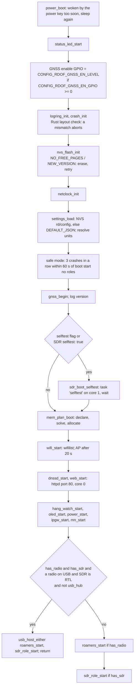
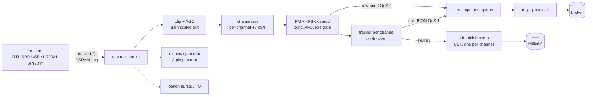
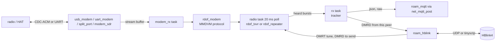
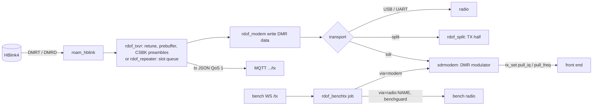

# RadioFoundry Gateway: overview

Covers: what the system is, where it runs, what it does, and which spec covers each part (section 1); then the ESP32
firmware: its roles, build profiles and gates, boot, tasks, data flow, module map, the port boundary, and the feature
limits.
Sources: `esp_idf/main/*`, `common`, `rust`, `sdr`, `rtlsdr`, `components/*`, `sdkconfig.defaults*`, `partitions-*.csv`, `Kconfig.projbuild`.
Related: [../../reference.md](../../reference.md) (build, layout, measurements, what's not done), the guides in [../../README.md](../../README.md).

## 1. What it is

A DMR gateway: it hears DMR on the air (a radio's modem or an SDR), transmits it (a radio, or the SDR as a radio),
and links what it hears and sends to networks. One portable core, `common/` and `sdr/` in C11, with the modules in
`rust/` linked in place of their C twins by default; new modules are Rust only. What a gateway runs follows from one
settings file (JSON, version 3: [config-v3.md](config-v3.md)).

### 1.1 Where it runs

| Target | Program | Devices | Guide |
|---|---|---|---|
| ESP32-S3 board | the ESP-IDF app (`esp_idf`, project `radiofoundry_gateway`), ESP-IDF v5.5; profiles `w12`, `16mb`, `4mb` (§3) | an MMDVM modem on USB or UART, an RTL-SDR on USB, the W12's LR2021 on SPI | [esp32-boards.md](../../esp32-boards.md) |
| Linux, macOS, a Pi | `rdofradio` (a full gateway), `rdofsdr` (a receiver), `fakebm` and `fakemodem` (test peers), in `sdr/cli` | SoapySDR, libiio (an AD9361 / AD9363), an MMDVM modem on a serial port, cf32 / cu8 files | [linux-macos.md](../../linux-macos.md), [raspberry-pi.md](../../raspberry-pi.md) |
| PlutoSDR | `rdofradio` on the Pluto's ARM (`--iio`), with the FPGA channelizer (`--fpga-chz`) and TX interpolator (`--fpga-duc`) when a bitstream has them | its AD9363, a radio on its USB | [plutosdr.md](../../plutosdr.md) |

A board runs up to two transmitting units and one SDR (§2). A host runs the same units, plus the trunked site, which
a board refuses.

### 1.2 What it does

| Part | What | Spec |
|---|---|---|
| Settings | devices, frequencies, apps, networks, policies and rules on talk paths; what runs is the units the plan makes | [config-v3.md](config-v3.md) |
| SDR receiver | a front end, a channelizer and a 4FSK demod and call tracker per channel | [sdr.md](sdr.md), [sdr-rx.md](sdr-rx.md), [sdr-frontends.md](sdr-frontends.md), [../rtlsdr.md](../rtlsdr.md) |
| SDR transmitter | the SDR as an emulated MMDVM modem: DMR 4FSK out of the front end | [sdr-tx.md](sdr-tx.md), [transmitters.md](transmitters.md) |
| Roamer | a transceiver on simplex frequencies (a radio's modem, or the SDR) that the network tunes per call | [radio.md](radio.md), [roamer.md](roamer.md) |
| Repeater | duplex, single frequency (SFR) and dual capacity direct mode (DCDM); on one duplex modem, on the SDR, or split over two radios | [../repeater.md](../repeater.md), [../slot-timing.md](../slot-timing.md) |
| Apps | `parrot` (sends a call back), `ipgw` (IP over DMR packet data), `tier3` (a DMR Tier III trunked site, host only) | [config-v3.md](config-v3.md) §6, [ipgw.md](ipgw.md), [tier3.md](tier3.md), [tier3-hat.md](tier3-hat.md) |
| Networks | HBlink4 (DMRC peers, roaming over DMRT / DMRK, UDP or SCTP); BrandMeister and other Homebrew masters (a login per path, a trunked site's too); MQTT reporting (call JSON, raw bursts, status); the MQTT network (calls between gateways with no master, Tier III sites included) | [hblink.md](hblink.md), [brandmeister.md](brandmeister.md), [mqtt.md](mqtt.md), [mqtt-net.md](mqtt-net.md) |
| Bench | the bench API over HTTP and WebSocket, and the line protocol on TCP 7373: bursts, captures, transmit jobs (DMR, and other signal modes: FM, AM, raw 4FSK, I/Q), a bench repeater (DMR; P25 and NXDN on a duplex MMDVM modem) | [../bench-api.md](../bench-api.md) |
| The device | Wi-Fi, the clock (NTP, GNSS PPS), the web page and JSON API, OTA, the memory plan, the OLED, the power key | [device.md](device.md), [interfaces-http.md](interfaces-http.md), [memory.md](memory.md) |

Other specs: [dmr-core.md](dmr-core.md) (burst layouts, FEC, PDUs), [rxtx-combinations.md](rxtx-combinations.md)
(which receivers and transmitters go together), [sdr-device-api.md](sdr-device-api.md) (a planned front-end API),
[radiofoundry-handoff.md](radiofoundry-handoff.md) (what the RadioFoundry radio firmware needs from the site),
[../system-tests.md](../system-tests.md) (the system tests), [../lr2021-iq.md](../lr2021-iq.md) (LR2021 findings).

The rest of this file is the ESP32 firmware. One image does every role; what runs follows from the settings
(`settings.c:resolve`, `rdof_plan_open`, `rdof_plan_roles`).

## 2. Roles

What runs is the settings' units ([config-v3.md](config-v3.md) §12); a role here is the code that runs a unit.

| Role | In the settings | Runs | Limit per board | Spec |
|---|---|---|---|---|
| SDR receiver | a device with `kind: sdr` (its receiver unit, `<device>-rx`) | front end → channelizer → per-channel 4FSK demod → tracker → MQTT / HBlink4 (one RX-only peer per channel) | 1 (`rdof_roles_t.sdr`) | [sdr.md](sdr.md) |
| Roamer | a `modem` device that `transmits` on simplex frequencies (a transceiver unit; `type` `radio_hotspot`, `mmdvm_hs`, `mmdvm`, `auto`) | an MMDVM modem (USB CDC-ACM or UART) under `rdof_txvr`; HBlink4 roaming peer; MQTT app `roaming` | `RDOF_MAX_RADIOS` = 2 (`rdof/config.h`), counted with repeaters | [radio.md](radio.md) |
| Repeater | a `repeater` app, or a frequency with `mode` `sfr` or `dcdm` | `rdof_repeater` on a duplex modem (dcdm: a DCDM modem, both slots on one frequency); HBlink4 repeater peer; MQTT app `repeater` | counted with roamers | [../repeater.md](../repeater.md) |
| Split halves | a `repeater` app whose `in` one modem hears and whose `out` another sends | two radios (TX half, RX half; RadioFoundry split duplex) as one duplex modem (`split_port.c`, `rdof/split.h`) | radio halves; an SDR half is refused on a board (§10) | [../repeater.md](../repeater.md), [../slot-timing.md](../slot-timing.md) |
| SDR transmitter | an SDR that transmits (a transceiver unit, a repeater app on it, or a DCDM frequency) | the SDR front end as the radio, through `rdof/sdr/sdrmodem.h` (an emulated MMDVM modem); a transceiver is tuned per stream ([transmitters.md](transmitters.md)) | a front end that can TX | [sdr.md](sdr.md), [radio.md](radio.md) |
| Hub | `usb_hub: true` (top-level key) | every USB role at once behind a hub; devices matched by `port.serial` / `port.usb_port` | build needs `CONFIG_USB_HOST_HUBS_SUPPORTED` (`.16mb`, `.hub`); not the W12 (no USB host) | [config-v3.md](config-v3.md) §2 |
| Trunked site | a `tier3` app ([config-v3.md](config-v3.md) §6) | the Tier III site controller (Rust, `rdof/t3.h`) with the radio layer and mqtt-net (`rdof/t3unit.h`), in rdofradio only: one SDR sending up to 4 carriers, split radio halves, a duplex MMDVM modem with an SDR beside it ([tier3-hat.md](tier3-hat.md)), or `--sim-air` with simulated MSs. A board refuses it (`rdof_plan_roles`) | none on a board; rdofradio: 1 site, 1-4 carriers | [tier3.md](tier3.md) |
| Bench | `bench` key (`bench.devices`, `bench.tx`) | `/api/bench/v1`: spectrum, bursts, I/Q, sessions, radios link, TX jobs; the line protocol on TCP `CONFIG_RDOF_BENCH_LINE_PORT` (7373) | `CONFIG_RDOF_BENCH` | [../bench-api.md](../bench-api.md) |

Rules:
- A board runs up to 2 units that transmit plus 1 SDR (`rdof_plan_roles`). The second radio starts only if PSRAM exists (`settings.c:resolve`) and the memory plan has room for it ([memory.md](memory.md)); unplanned ("either" mode), ≥ `EXTRA_RADIO_INTERNAL` = 20 KB internal RAM must be free (`roamer.c`).
- "Either" mode (`usb_host_either`): a radio on USB and an RTL-SDR, no `usb_hub`. The first device of either kind plugged in picks the role; the other kind plugged in later restarts the board (`usb_host.c:watch_task`, 500 ms then `esp_restart`). RTL is VID `0x0BDA`, PID `0x2838`/`0x2832` (`usb_host.c:usb_host_is_rtl`); the radio is `CONFIG_RDOF_USB_VID`/`PID`.

## 3. Profiles and overlays

Built as `sdkconfig.defaults` + one profile + optional overlays (`SDKCONFIG_DEFAULTS`, commands in [reference.md](../../reference.md)). The modules ported to Rust are linked in place of their C by default (`CONFIG_RDOF_RUST`; `n` keeps the C).

| File | Adds |
|---|---|
| `sdkconfig.defaults` | esp32s3, 240 MHz, `FREERTOS_HZ` 1000, console UART0 (GPIO43/44), custom partitions, `-Os`, `MAIN_TASK_STACK` 6144, `HTTPD_MAX_REQ_HDR_LEN` 1024, WS support, `LWIP_MAX_SOCKETS` 28, 64 B D-cache line, `MQTT_PROTOCOL_5`, `USB_HOST_HW_BUFFER_BIAS_IN` |
| `.4mb` | 4 MB QIO 80 MHz, `partitions-4mb.csv`; quad PSRAM 80 MHz (malloc, `ALWAYSINTERNAL` 4096, BSS and Wi-Fi/lwIP in PSRAM); max Wi-Fi TX power 10; LED GPIO48; no MQTT TLS / SSL / WS transports; log ring 16 KB; core dump to flash; `RDOF_SDR=n` (no SDR: a roamer or repeater only) |
| `.16mb` | 16 MB QIO 80 MHz, `partitions-16mb.csv`; octal PSRAM 80 MHz, mbedTLS in PSRAM; `RDOF_SDR_INTERNAL_RESERVE_KB` 64; MQTT TLS; log ring 256 KB; core dump to flash; USB hubs (single level); LED GPIO48 |
| `.roamer` | `RDOF_SDR=n` |
| `.sdr` | `RDOF_ROAMER=n` |
| `.hub` | `USB_HOST_HUBS_SUPPORTED=y`, multi-level n |
| `.w12` (on 16mb) | LED GPIO46; GNSS enable GPIO48 level 0; netclock PPS GPIO41; GNSS NMEA on UART1 RX 39 / TX 38; `RDOF_SDR_LR2021=y`; `RDOF_USB_HOST=n` (the USB port stays the console); the built-in OLED; `RDOF_SDR_RING_KB` 1024; `RDOF_MEM_MARGIN_KB` 96; Wi-Fi's IRAM options off; the power key and battery pins |
| `.dspfast` (on 16mb) | `RDOF_SDR_DSP_IRAM=y`, 64 KB D-cache |

Partitions:

| Name | 4mb offset / size | 16mb offset / size |
|---|---|---|
| nvs | 0x9000 / 0x6000 | 0x9000 / 0x6000 |
| otadata | 0xF000 / 0x2000 | 0xF000 / 0x2000 |
| phy_init | 0x11000 / 0x1000 | 0x11000 / 0x1000 |
| ota_0 | 0x20000 / 0x1E0000 | 0x20000 / 0x400000 |
| ota_1 | 0x200000 / 0x1E0000 | 0x420000 / 0x400000 |
| coredump | 0x3E0000 / 0x20000 | 0x820000 / 0x20000 |
| storage (spiffs) | — | 0x840000 / 0x7C0000 |

## 4. Feature gates

App gates (`main/Kconfig.projbuild`; every option with its range in §4.1). Always built: `main.c`, `settings.c`, `mem.c`, `site_run.c`, `wifi.c`, `dnssd.c`, `web.c`, `net.c`, `usb_host.c`, the board's own files (§8).

| Gate | Default | Builds |
|---|---|---|
| `RDOF_ROAMER` | y | roamer / repeater: `roamer.c`, `modem_port.c`, `usb_modem.c`, `uart_modem.c`, `split_port.c`, `radio_task.c`, `roam_hblink.c`, `rx_path.c`, `roam_mqtt.c`; the MQTT network, `mqttnet_task.c` |
| `RDOF_SDR` | y | SDR role: `sdr.c`, `sdr_task.c`, `dsp_esp.c`, `kbench.c`, `fir_s3.S`, `slot_timing.c`, `sdr_mqtt.c`, `sdr_hblink.c`, `selftest*.c`, `fe_rtlsdr.c`, `fe_sim.c` |
| `RDOF_ROAMER` or `RDOF_SDR` | — | `modem_sdr.c` |
| `RDOF_BENCH` (needs SDR) / `RDOF_BENCH_TX` | y / y | `bench_api.c`, `bench_radio.c`, `bench_tx.c`, `bench_line.c` |
| `RDOF_SDR_LR2021` | n | `fe_lr2021.c`, `tx_seam_core.c`, `edge_time.c`, `components/lr2021` |
| `RDOF_MQTT`, `RDOF_MQTT_RAW`, `RDOF_MQTT_TLS` | y, y, n | MQTT out; raw bursts; `mqtts://` with the CA bundle |
| `RDOF_MODEM_USB`, `RDOF_MODEM_UART` | y, y | modem transports |
| `RDOF_HBLINK_SCTP` | y | `hblink.transport: sctp` (tinysctp) |
| `RDOF_SCAN`, `RDOF_OLED` | y, y | roamer scan; OLED |
| `RDOF_IPGW` (needs `RDOF_FEATURE_DATA_BLOCKS`, `_TRACKER`) | y | IP gateway: `ipgw_task.c` ([ipgw.md](ipgw.md)) |
| `RDOF_SDR_HBLINK`, `RDOF_SDR_FAST`, `RDOF_SDR_ESP_DSP`, `RDOF_SDR_TWO_CORES`, `RDOF_SDR_SELFTEST`, `RDOF_SDR_SPIKE` | all y | SDR peers, `-O2` DSP, esp-dsp kernels, 2-core demod, self-test, USB spike |
| `RDOF_WEB_FULL`, `RDOF_OTA`, `RDOF_SOFTAP` | y, y, y | full page (else `mini.html`), `/api/ota`, setup AP |

Portable-core gates (compile-time macros, defaults 1; `common/Kconfig`, `sdr/Kconfig`, `rdof/features.h`, `rdof/sdr/features.h`): `RDOF_FEATURE_TX`, `RDOF_FEATURE_DATA_BLOCKS`, `RDOF_FEATURE_TRACKER`, `RDOF_FEATURE_REPEATER` (needs TX), `RDOF_FEATURE_SDR`, `RDOF_FEATURE_SDR_AGC`, `RDOF_FEATURE_SDR_BUILTIN_FFT`, `RDOF_FEATURE_SDR_RECEIVER` (needs TRACKER), `RDOF_SDR_FAST_ATAN2`; `RDOF_SDR_DSP_IRAM` default 0. `RDOF_RUST` (`common/Kconfig`, default y) links the Rust modules in place of their C.

### 4.1 `main/Kconfig.projbuild` ("RadioFoundry Gateway"), every option

| Option | Type | Default | Range |
|---|---|---|---|
| `RDOF_ROAMER` | bool | y | |
| `RDOF_SDR` | bool | y | |
| `RDOF_MQTT` | bool | y | |
| `RDOF_MQTT_RAW` | bool | y | |
| `RDOF_MQTT_TLS` | bool | n | selects CA bundle |
| `RDOF_WEB_FULL` | bool | y | |
| `RDOF_OTA` | bool | y | |
| `RDOF_SOFTAP` | bool | y | |
| `RDOF_STATUS_LED_GPIO` | int | −1 | −1..48 |
| `RDOF_GNSS_EN_GPIO` | int | −1 | −1..48 |
| `RDOF_GNSS_EN_LEVEL` | int | 0 | 0..1 |
| `RDOF_LOG_RING_KB` | int | 16 | 0..1024 |
| `RDOF_CRASH_TEST` | bool | n | `POST /api/crash` (debug builds only; needs `ESP_COREDUMP_ENABLE_TO_FLASH`) |
| `RDOF_MODEM_USB` | bool | y | |
| `RDOF_USB_VID` | hex | 0x1FC9 | |
| `RDOF_USB_PID` | hex | 0x0094 | |
| `RDOF_USB_INTERFACE` | int | 0 | |
| `RDOF_MODEM_UART` | bool | y | |
| `RDOF_MEM_MARGIN_KB` | int | 80 | 8..200; internal RAM the memory plan keeps free ([memory.md](memory.md#4-the-margin)) |
| `RDOF_MEM_STRICT` | bool | n | a role over the margin is refused |
| `RDOF_IPGW` | bool | y | needs `RDOF_FEATURE_DATA_BLOCKS` and `_TRACKER`; `ipgw_task.c` |
| `RDOF_IPGW_MAX_SOCKETS` | int | 8 | 1..16 |
| `RDOF_HBLINK_SCTP` | bool | y | |
| `RDOF_SCAN` | bool | y | |
| `RDOF_OLED` | bool | y | depends on `RDOF_ROAMER` or `RDOF_SDR` |
| `RDOF_OLED_BUILTIN` | bool | n | y in `w12`: on with no `oled` key |
| `RDOF_OLED_SDA` / `_SCL` | int | 8 / 9 | 17 / 18 in `w12` |
| `RDOF_OLED_POWER_GPIO` / `_LEVEL` | int | -1 / 0 | 45 / 0 in `w12` (VEXT_EN) |
| `RDOF_SDR_HBLINK` | bool | y | |
| `RDOF_SDR_FAST` | bool | y | |
| `RDOF_SDR_ESP_DSP` | bool | y | |
| `RDOF_SDR_TWO_CORES` | bool | y | |
| `RDOF_SDR_HELPER_STACK` | int | 6144 | 3072..16384 |
| `RDOF_SDR_CHUNK` | int | 4096 | 1024..32768 |
| `RDOF_SDR_RING_KB` | int | 256 | 32..1536 |
| `RDOF_SDR_INTERNAL_RESERVE_KB` | int | 40 | 0..256 |
| `RDOF_SDR_SELFTEST` | bool | y | |
| `RDOF_SDR_SPIKE` | bool | y | |
| `RDOF_BENCH` | bool | y | depends on `RDOF_SDR` |
| `RDOF_BENCH_TX` | bool | y | |
| `RDOF_SDR_LR2021` | bool | n | |
| `RDOF_LR2021_PA_ABOVE_DBM` | int | −1 | a request over this (dBm at the antenna) in the PA's band goes through the PA, else the bypass |
| `RDOF_LR2021_PA_GAIN_DB` / `_BYPASS_GAIN_DB` | int | 12 / −22 | antenna less the chip's setting on each path (R3.44, 920 MHz) |
| `RDOF_LR2021_PA_MAX_DBM` | int | 27 | the most at the antenna through the PA |
| `RDOF_USB_HOST` | bool | y | n in `w12` (no USB host port) |
| `RDOF_BENCH_LINE_PORT` | int | 7373 | the bench's line protocol TCP port; 0: off |
| `RDOF_POWER_KEY_GPIO` | int | −1 | −1..21 (an RTC GPIO, pressed low); 0 in `w12` |
| `RDOF_POWER_KEY_OFF_MS` / `_ON_MS` | int | 2000 / 1000 | 500..10000 / 0..5000 |
| `RDOF_POWER_OFF_LOW_GPIOS` | string | `""` | more GPIOs held low while off; `"3"` in `w12` |
| `RDOF_BATT_ADC_GPIO` | int | −1 | −1..10 (ADC1); 1 in `w12` |
| `RDOF_BATT_CTRL_GPIO` / `_LEVEL` | int | −1 / 1 | the divider switch; 2 in `w12` |
| `RDOF_BATT_CUTOFF_MV` | int | 3300 | 0..4000; off under this for 30 s; 0: never |
| `RDOF_BATT_RATIO_X1000` | int | 4900 | battery mV over ADC mV, × 1000 |

LR2021 submenu (`RDOF_LR2021_*`):

| Option | Default | Range |
|---|---|---|
| `SPI_HOST` | 1 | 1..2 |
| `SPI_HZ` | 16000000 | |
| `NSS` / `SCK` / `MOSI` / `MISO` | 8 / 9 / 10 / 11 | |
| `NRESET` / `BUSY` / `IRQ` | 12 / 13 / 7 | |
| `PA_EN_GPIO` | 4 | |
| `TCXO_TUNE` | −1 | −1..7 |
| `RX_BOOST` | 0 | 0..7 |
| `PA_LO_MHZ` / `PA_HI_MHZ` | 860 / 930 | |
| `DIO9_PA` / `DIO10_PA` / `DIO11_PA` | 0x04 / 0x06 / 0x06 | |
| `DIO9_BYPASS` / `DIO10_BYPASS` / `DIO11_BYPASS` | 0x04 / 0x00 / 0x06 | |
| `SEAM_AT` | 1388 | 0..1439: where in a slot a long key-up's seams fall (lr2021-iq.md R3.49) |

### 4.2 Portable-core and component Kconfig, every option

| File | Option | Default |
|---|---|---|
| `common/Kconfig` | `RDOF_FEATURE_TX`, `RDOF_FEATURE_DATA_BLOCKS`, `RDOF_FEATURE_TRACKER`, `RDOF_FEATURE_REPEATER` (needs TX), `RDOF_RUST` | y |
| `sdr/Kconfig` | `RDOF_FEATURE_SDR`, `RDOF_FEATURE_SDR_AGC`, `RDOF_FEATURE_SDR_BUILTIN_FFT`, `RDOF_FEATURE_SDR_RECEIVER` (needs TRACKER) | y |
| | `RDOF_SDR_DSP_IRAM` | n (~33 KB IRAM) |
| `rdof/sdr/features.h` | `RDOF_SDR_FAST_ATAN2` | 1 |
| netclock | `DEFAULT_SERVERS` | `"pool.ntp.org"` |
| | `POLL_S` | 300 (16..3600) |
| | `POLL_FAST_S` | 120 |
| | `START_ON_IP`, `SET_SYSTEM_TIME`, `DIE_TEMP`, `HTTP` | y |
| | `PPS_GPIO` / `PPS_FALLING` | −1 / n |
| | `GNSS_EVERY` / `GNSS_LAG_MS` | 16 / 0 |
| | `HTTP_BASE` / `NVS_NAMESPACE` | `/api` / `netclock` |
| | `TASK_PRIORITY` / `TASK_CORE` | 8 / 0 |
| gnss | `UART_RX_GPIO` / `UART_TX_GPIO` | −1 / −1 (39 / 38 in `w12`) |
| | `UART_NUM` / `BAUD` / `AUTODETECT` | 1 / 9600 / y |
| | `TASK_PRIORITY` / `TASK_CORE` | 9 / 0 |
| wifilist | `MAX_NETWORKS` | 8 (1..32) |
| | `CONNECT_TIMEOUT_S` / `RESCAN_MAX_S` | 15 / 30 |
| | `SOFTAP`, `HTTP` | y |
| | `HTTP_BASE` / `NVS_NAMESPACE` / `TASK_PRIORITY` | `/api` / `wifilist` / 5 |
| tinysctp | `MAX_STREAMS` / `RX_WINDOW` / `TASK_STACK` / `TASK_PRIORITY` | 8 / 64 / 4096 / 8 |

## 5. Boot sequence

`main.c:app_main`:

Per role start:
- `roamers_start` → per radio k (`roamer.c:start_one`): allocate `roam_t` (k=0 internal RAM, else PSRAM), `modem_port_init`, `roam_rx_start`, `radio_start`, `roam_hb_start`, `roam_mqtt_start`, then the transport: `sdr_modem_start` | `split_modem_start` | `uart_modem_start` | `usb_modem_start` by `modem_port`.
- `app_main` calls `mem_plan_boot` (`mem.c`) right after the self-test, before Wi-Fi: every role's claims (the SDR's
  chunk buffers, hot arena and DSP stacks, the radios' state and stacks, the IP gateway's queue, the USB host's tasks,
  budgets for what others allocate), solved against the heap with `CONFIG_RDOF_MEM_MARGIN_KB` kept and allocated
  while the heap is whole; neither the SDR nor the radios when one USB port decides the role ([memory.md](memory.md)).
  The roles start on what the plan gave them; a refused role doesn't start and says why.
- `sdr_role_start` (`sdr.c`): take the `spike` flag, `dsp_setup` (allocators: the receiver's per-sample buffers from the plan's hot arena, the rest internal RAM while `CONFIG_RDOF_SDR_INTERNAL_RESERVE_KB` stays free, else PSRAM; esp-dsp install and check), `sdr_hb_start`, `sdr_mqtt_start`, `sdr_start` (front end + DSP tasks).
- A failed stored config runs `DEFAULT_JSON` instead, with `g_cfg_ok = false` and the error on the page ([config-v3.md](config-v3.md) §16).

## 6. FreeRTOS tasks

Stack in bytes. Planned tasks (memory.md, §7) run on the plan's stacks (`mem_task`, `xTaskCreateStaticPinnedToCore`); unplanned, on the heap as below. "PSRAM" = stack in PSRAM (`xTaskCreatePinnedToCoreWithCaps`, `MALLOC_CAP_SPIRAM`). Roamer tasks use `roamer.c:roam_task`: radio 0 internal stack, any core; radio 1 PSRAM stack, `tskNO_AFFINITY`.

| Task | Stack | Core | Prio | Source | Job |
|---|---|---|---|---|---|
| `usb_lib` | 4096 | 0 | 19 | `usb_host.c:usb_host_start` | USB host library events; free devices when no clients |
| `usb_lib` (rtl) | 4096 | `task_core` 0 | prio+1 = 19 | `rtlsdr/esp/rtl_usb.c` | only when rtl_usb installs the host itself |
| `usb_client` | 4096 | 0 | 18 (`fe_rtlsdr.c` `.task_priority`) | `rtl_usb.c` | RTL bulk transfers into the PSRAM ring |
| `usb_open` (rtl) | 6144 | 0 | 10 (prio−8) | `rtl_usb.c` | open / reopen the dongle |
| `lr2021` | 4096 | 0 | 24 | `fe_lr2021.c` | drain the LR2021 RX FIFO over SPI into a ring |
| `usb_watch_ev` | 3072 | 0 | 15 | `usb_host.c:watch_start` | watcher client events |
| `dsp` | 8192 | `DSP_CORE` 1 | 12 | `sdr_task.c` | SDR receive loop: read, AGC, channelize, demod, track, spectrum |
| `modem_rx` | 6144 | roam | 12 | `modem_port.c` | feed transport bytes to `rdof_modem`, signal replies |
| `uart_rx` | 3072 | roam | 12 | `uart_modem.c` | UART reads into the modem port |
| `split` | 4096 | roam | 12 | `split_port.c` | split duplex: feed halves, 20 ms tick |
| `radio` | 8192 | roam | 11 | `radio_task.c` | start modem, build radio, poll txvr / repeater every 20 ms; restart 1 s doubling to 30 s |
| `dsp_helper` | `CONFIG_RDOF_SDR_HELPER_STACK` 6144 | 0 | 10 | `sdr_task.c` | second-core channel demods (`dsp_cores: 2`) |
| `usb_watch` | 8192 | 0 | 9 | `usb_host.c:watch_start` | identify devices, assign to radios, either-mode start |
| `usb_open` (radio) | 4096 | roam | 9 | `usb_modem.c` | open the radio's CDC-ACM device, reopen on return |
| `bench_usb` | 4096 PSRAM | 0 | 9 | `bench_radio.c` | bench radio on USB |
| `roam_hblink` | 4096 | roam | 8 | `roam_hblink.c` | roaming / repeater HBlink4 peer (UDP) |
| `hblink-sctp` | 6144 | any | `TINYSCTP_TASK_PRIORITY` 8 | `roam_hblink.c` via tinysctp | SCTP association; delivers received DMRx |
| `sdr_hblink` | 4096 | 0 | 8 | `sdr_hblink.c` | SDR channel peers |
| `netclock` | 6144 | 0 | 8 | `netclock.c` | NTP poll, clock model |
| `netclock_pps` | 4096 | 0 | 8 | `netclock.c` | PPS edges (when `NETCLOCK_PPS_GPIO` ≥ 0) |
| `gnss` | 3584 | 0 | 9 | `gnss.c` (`gnss_start`) | the receiver's NMEA on its UART; each second's time to netclock (when `GNSS_UART_RX_GPIO` ≥ 0) |
| `rx` | 8192 | roam | 7 | `rx_path.c` | radio bursts → tracker → MQTT / HBlink |
| `mqtt_post` | 6144 (PSRAM if any) | 0 | 5 | `net.c` | one per MQTT client: drain the publish queue |
| `wifilist` | 4096 | any | 5 | `wifilist.c` | station over the network list |
| `sdrmodem` | 4096 | roam | 5 | `modem_sdr.c` | start the SDR's emulated modem |
| `selftest` | 16384 | 1 | 5 | `sdr.c` | boot self-test (idle-1 WDT removed meanwhile) |
| `restart` | 2048 | any | 5 | `web.c` | delayed `esp_restart` after a web action |
| `usb_kick` | 2560 | 0 | 5 | `usb_host.c` | after 3 s with nothing on USB, root port off 200 ms, on |
| `bench_uart` | 3072 PSRAM | 0 | 5 | `bench_radio.c` | bench radio on UART |
| `sdr_status` | 4096 | 0 | 4 | `sdr_mqtt.c` | SDR status every `status_seconds` |
| `roam_status` | 3072 | roam | 4 | `roam_mqtt.c` | radio status every 10 s |
| `bench_link`, `bench_txj` | 3072, 4096 PSRAM | 0 | 4 | `bench_radio.c`, `bench_tx.c` | bench radio link; TX job tick |
| `oled` | 4096 | 0 | 3 | `oled_task.c:oled_start` | redraw every `refresh_s` |
| `bench_bursts`, `bench_iq` | 4096 PSRAM | 0 | 3 | `bench_api.c` | bench WS streams |
| `ipgw` | 6144 | 0 | 6 | `ipgw_task.c:ipgw_start` | IP gateway: data bursts in, flows' UDP sockets, replies out ([ipgw.md](ipgw.md)) |
| `led` | 2048 | any | 1 | `status_led.c` | status LED, 2 Hz |
| `mqtt_net` | 8192 PSRAM | 0 | 5 | `mqttnet_task.c` | the MQTT network: uplinks, downlink, subscriptions ([mqtt-net.md](mqtt-net.md)) |
| `power` | 3072 | 0 | 2 | `power.c` | the power key and the battery |
| `watch0`, `watch1` | 2048 | 0, 1 | 6, 13 | `watch.c` | task-watchdog canaries: a task that never yields starves one and the watchdog panics |
| httpd | 8192 | 0 | IDF default | `web.c:web_start` | web server: up to 64 URI handlers, 8 sockets, LRU purge |

Plus ESP-IDF's own: `esp_timer`, Wi-Fi, lwIP (`tiT`), one `mqtt_task` per client (6 KB; its stack in PSRAM, `task_ext.c`), `nc_temp` and `wifilist_ap` esp_timers.

Core rule: core 1 holds only the DSP (and the self-test and its watchdog canary). Network, USB, SPI, MQTT publish and HBlink are on core 0 or unpinned.

## 7. Data flow

### 7.1 SDR receive → MQTT / HBlink4

### 7.2 Radio (roamer / repeater) paths

### 7.3 Transmit

## 8. Module map

The portable modules (`common/`, `sdr/`, `rust/`, `sdr/cli`) are listed once, in [reference.md](../../reference.md#layout);
which ones have a Rust twin, in [rust/README.md](../../../rust/README.md). This section lists the board's own files
and the drivers.

### `rtlsdr`

| File | What |
|---|---|
| `src/rtl2832u.c` | RTL2832U: vendor requests, baseband init, DDC IF and FIR, resampler, corrections, GPIO, the tuner's I2C ([../rtlsdr.md](../rtlsdr.md) section 1) |
| `src/r820.c`, `include/rtlsdr/r820.h` | R820T / R820T2 / R828D tuner: init, filter calibration, RF filters, PLL, gain, inputs ([../rtlsdr.md](../rtlsdr.md) section 2) |
| `src/gaps.c` | stream gap accounting |
| `esp/rtl_usb.c` | ESP USB host transport, transfers, ring, spike |

### `esp_idf/main` (platform)

| Layer | File | What |
|---|---|---|
| Boot | `main.c` | `app_main`, safe mode |
| | `settings.c` | NVS settings, defaults, resolve, import / export |
| | `mem.c` | the memory plan ([memory.md](memory.md)) |
| | `logring.c`, `crash.c` | log ring for `/api/log`; the core dump in flash (`/api/coredump`) |
| | `watch.c`, `flash_watch.c`, `task_ext.c` | task-watchdog canaries; flash operations timed; esp-mqtt's task stacks in PSRAM |
| | `status_led.c`, `power.c`, `power_core.c` | WS2812 status; the power key and the battery |
| Net | `wifi.c`, `dnssd.c` | wifilist + AP setup; mDNS and DNS-SD (`NAME.local`, `_http._tcp`, `_rfgbench._tcp`) |
| | `net.c` | MQTT clients, publish queue, MQTT 5 aliases / 3.1.1 fallback, UDP sockets |
| | `web.c` | httpd, page, `/api/*` ([interfaces-http.md](interfaces-http.md)) |
| | `site_run.c`, `heard.c` | the call router (`rdof/siteroute.h`) under one lock; Last heard |
| | `mqttnet_task.c` | the MQTT network ([mqtt-net.md](mqtt-net.md)) |
| USB | `usb_host.c` | host install, watcher, device matching, either mode |
| Radio | `roamer.c` | radio role start, status |
| | `modem_port.c` | `rdof_modem_port_t` over a transport |
| | `usb_modem.c`, `uart_modem.c` | CDC-ACM / UART transports |
| | `split_port.c` | split duplex transport |
| | `modem_sdr.c` | SDR modem transport |
| | `radio_task.c` | radio loop |
| | `rx_path.c` | radio receive → tracker |
| | `roam_hblink.c`, `roam_mqtt.c` | radio peer; radio MQTT |
| | `oled_task.c` | OLED task |
| SDR | `sdr.c` | role start, status JSON, resolved plan |
| | `sdr_task.c` | DSP loop, helper, AGC, ppm learning, spectrum |
| | `sdr_fe.h`, `fe_rtlsdr.c`, `fe_sim.c`, `fe_lr2021.c` | front ends |
| | `edge_time.c`, `tx_seam_core.c` | LR2021 and PPS pin edges timed in hardware (MCPWM capture); where a long key-up's seams fall |
| | `slot_timing.c` | UTC slot timing: the sample clock against UTC, the clock gate ([../slot-timing.md](../slot-timing.md)) |
| | `dsp_esp.c`, `fir_s3.S` | esp-dsp FFT / FIR hooks, checked at boot; S3 FIR |
| | `sdr_mqtt.c`, `sdr_hblink.c` | SDR MQTT; SDR peers |
| | `selftest.c`, `selftest_core.c`, `kbench.c`, `sdr_prof.h` | self-test, kernel timing, profiling |
| Bench | `bench_api.c`, `bench_radio.c`, `bench_tx.c`, `bench_line.c` | the bench API and the line protocol ([../bench-api.md](../bench-api.md)) |
| IP | `ipgw_task.c` | the IP gateway's task, sockets and transmit ([ipgw.md](ipgw.md)) |

### `components` (reusable, no gateway code)

| Component | Files | What |
|---|---|---|
| `netclock` | `netclock.c`, `_core`, `_model`, `_ntp`, `_pps`, `_select`, `_settings`, `_status`, `_tempcal`, `_http` | NTP / PPS / browser-disciplined clock, rate model, temperature table, HTTP |
| `wifilist` | `wifilist.c`, `_core`, `_settings`, `_http` | prioritized Wi-Fi list, AP fallback, HTTP |
| `gnss` | `gnss.c`, `gnss_nmea.c`, `gnss_json.c` | a GNSS receiver's NMEA: fix, position, satellites, each second's time (to netclock) |
| `tinysctp` | `sctp.c`, `udp.c`, `crc32c.c`, `esp.c` | SCTP over UDP (RFC 6951), PR-SCTP |
| `lr2021` | `lr2021.c`, `lr2021_cmd.c` | LR2021 SPI driver |

Each has its own README.

## 9. Portable core and the port boundary

`common`, `sdr` and `rtlsdr/src` have no ESP-IDF dependency; `host-tests` builds them on the host against the committed golden vectors. A port (another MCU, or a backport) provides:

| Interface | Header | Members | Provided by |
|---|---|---|---|
| Modem port | `rdof/modem.h` `rdof_modem_port_t` | `write(ctx, data, len)`, `wait_reply(ctx, timeout_ms)`, `on_reply(ctx)`, `clock(ctx)` (monotonic s), `sleep_ms(ctx, ms)`, `ctx` | `modem_port.c` |
| Modem events | `rdof/modem.h` | `on_rx(ctx, slot, control, burst, rssi)`, `on_lost(ctx, slot)`, `on_nak(ctx, command, err)` | radio / repeater |
| Front end | `rdof/sdr/frontend.h` `rdof_fe_ops_t` | `init`, `wait`, `tune(rate, center, ppm, &got)`, `set_ppm`, `set_gain(db, &got)`, `gain_steps`, `start`, `stop`, `read(out, len, timeout_ms, &filled)`, `gone`, `stats`, `identity`, `error`, `sample_ppm`, `post`, `spike`, `tx_set(src, power_dbm)` | `fe_*.c` |
| Front-end caps | `rdof_fe_caps_t` | format, rate range or list, freq range, usable share, DC guard, gain, usb, duplex, tx mode / format / rate / freq / power range, turnaround | `fe_*.c` |
| TX source | `rdof_fe_tx_source_t` | `pull_iq(ctx, pos, iq, n)`, `pull_freq(ctx, pos, hz, env, n)` | `sdrmodem.c` |
| Allocator | `rdof_sdr_set_allocator(alloc, free)` | fast memory for DSP buffers | `sdr.c:fast_alloc` |
| Hot allocator | `rdof_sdr_set_hot_allocator(alloc)` | internal RAM for the per-sample buffers, whatever the reserve | `sdr.c:hot_alloc` |
| DSP kernels | `dsp_esp_install` hooks | FFT, FIR replacements (optional) | `dsp_esp.c` |
| Clock | — | UTC ns (`netclock_now_ns`), monotonic µs (`esp_timer_get_time`) | netclock, IDF |
| Storage | — | one blob of the settings' JSON; per-component small records ([config-v3.md](config-v3.md) §16) | `settings.c`, components |
| Network | — | MQTT publish (QoS 0/1, retain, last will), UDP socket, SCTP over UDP | `net.c`, tinysctp |

## 10. Features and limits

| Feature | Gateway |
|---|---|
| SDR receive, MQTT json / raw, status | yes |
| SDR HBlink4 peers | UDP |
| BrandMeister and Homebrew logins | yes, a login per path ([brandmeister.md](brandmeister.md)) |
| MQTT network (`format: "v3"`) | yes ([mqtt-net.md](mqtt-net.md)) |
| SDR front ends | RTL-SDR, LR2021 (the W12), sim |
| SDR channels | 16 (`RDOF_SDR_MAX_CHANNELS`); with `center` auto, a window is picked if they don't all fit |
| Two-core demod, idle gate, ppm learning, self-test, spike | yes |
| Roamer | yes, up to 2 radios a board |
| Repeater duplex / SFR | yes |
| Dual capacity direct mode (`mode: dcdm`) | yes on the SDR modem; a radio needs DCDM firmware (none yet); a roamer's plain direct mode calls take their frequency's `ts` (1 by default) |
| Split duplex, radio halves | yes |
| Split duplex, SDR half | refused (`split_port.c`); rdofradio runs one (`--split-tx`) |
| SDR transmitter | yes (a front end that can TX) |
| UTC slot timing | yes (`slotgrid.c`) |
| HBlink4 SCTP | tinysctp, SCTP in UDP |
| Modem protocol `udp`, `rigctld` / `command` tuners | refused |
| MQTT TLS | 16mb builds |
| `${VAR}` in the settings | taken as written (no environment) |
| OLED | `sda` / `scl` |
| Web page, OTA, setup AP, log ring | yes |
| Bench API | yes (`/api/bench/v1`), and the line protocol on TCP 7373 |
| Trunked site (`tier3`) | refused: host only ([tier3.md](tier3.md)) |
| IP gateway (DMR packet data <-> UDP: routes, NAT, ping) | yes, off by default; IPv4 (SAP 4 and SAP 3) / UDP and ICMP echo, no fragments, no inbound mappings ([ipgw.md](ipgw.md)) |
