# Firmware radio side: MMDVM modems, transports, radio types, the transceiver, the bench radios

Covers: the host side of the MMDVM serial protocol, the modem transports (USB CDC-ACM, UART, the SDR modem), radio type detection and profiles, tuners, the roaming transceiver's call cycle (txvr), and the bench radio guard and transmit job.
Sources: `common/src/{mmdvm,modem,txvr,duplex,usbmatch,benchguard,benchtx,benchcfg}.c`, `esp_idf/main/{radio_task,modem_port,usb_host,usb_modem,uart_modem,modem_sdr,bench_radio,bench_tx,roamer}.c`.
Related: [roamer.md](roamer.md) (scan, reporting), [dmr-core.md](dmr-core.md) (burst layouts, FEC), [device.md](device.md), [config.md](config.md), [hblink.md](hblink.md) (DMRT / DMRK), [mqtt.md](mqtt.md), [sdr.md](sdr.md), [../repeater.md](../repeater.md) and [../slot-timing.md](../slot-timing.md) (repeater, split duplex, slot timing), [../bench-api.md](../bench-api.md) (bench wire format), RadioFoundry's `docs/spec/mmdvm-protocol.md` (cited as MP).

Paths below are relative to the repository root. `path:symbol` names the constant.

## 1. MMDVM serial protocol (host side)

The reference for every byte is MP. This section lists what the firmware sends and reads, and where it differs
from what a full MMDVMHost does.

### 1.1 Framing (MP §1)

```
short:  E0 <len> <cmd> <payload...>         len = whole frame, 3..255
long:   E0 00 <len-255> <cmd> <payload...>  received only (protocol 2 FM); never sent
```

| Item | Value | Where |
|---|---|---|
| Start byte | `0xE0` | `common/include/rdof/mmdvm.h:RDOF_MMDVM_FRAME_START` |
| Largest payload sent | 252 bytes (frame 255); larger returns 0 (not sent) | `common/src/mmdvm.c:rdof_mmdvm_frame` |
| Largest frame read | 510 (255 + 255) | `common/include/rdof/mmdvm.h:RDOF_MMDVM_MAX_FRAME` (512) |
| Reader buffer | 2 × 512 bytes | `common/include/rdof/mmdvm.h:rdof_mmdvm_reader_t` |
| Checksum, escaping | none | |

Reader (`common/src/mmdvm.c:parse`), applied after every chunk fed:

1. Find the first `E0`; no `E0` in the buffer: drop it all.
2. Drop bytes before it. Need 2 bytes.
3. `len == 0`: long frame, need 3 bytes, `len = buf[2] + 255`, command at offset 3.
4. `1 <= len < 3`: drop the `E0`, resync.
5. Wait until `len` bytes are in, deliver `(cmd, payload)`, drop the frame, repeat.

The reader keeps at most one partial frame (shorter than the longest frame), so a fed chunk always fits.

### 1.2 Commands used

| Cmd | Name | Sent by the firmware | Waits for | Where |
|---|---|---|---|---|
| `00` | GET_VERSION | at start, up to 6 tries | the `00` reply | `modem.c:rdof_modem_start`, `radio_task.c:radio_task` |
| `01` | GET_STATUS | see 1.6 | the `01` reply | `modem.c:rdof_modem_status` |
| `02` | SET_CONFIG | on every tune | ACK / NAK | `modem.c:rdof_modem_configure` |
| `03` | SET_MODE | 2 (DMR) at start and after each tune; 0 (idle) around CW ID | ACK / NAK | `modem.c:rdof_modem_set_mode` |
| `04` | SET_FREQ | on every tune with the modem tuner | ACK / NAK | `modem.c:rdof_modem_set_freq` |
| `0A` | SEND_CWID | after a call, if due (§5.7) | ACK / NAK | `modem.c:rdof_modem_send_cwid` |
| `18` / `1A` | DMR_DATA1 / DMR_DATA2 | one per burst; the roamer uses `1A` only | nothing (NAK only) | `modem.c:rdof_modem_write_dmr` |
| `1C` | DMR_SHORTLC | repeater only | nothing | `modem.c:rdof_modem_dmr_short_lc` |
| `1D` | DMR_START | repeater only | nothing | `modem.c:rdof_modem_dmr_start` |
| `1E` | DMR_ABORT | repeater only | nothing | `modem.c:rdof_modem_dmr_abort` |
| `D6` | SPLIT (RadioFoundry vendor command) | split repeater only: RadioFoundry's `docs/spec/split-duplex.md` §3, [../repeater.md](../repeater.md), [../slot-timing.md](../slot-timing.md) | its `D6` reply | `common/src/split.c` |

Received: `00`, `01` replies; `70` ACK, `7F` NAK; `18`/`1A` DMR_DATA, `19`/`1B` DMR_LOST. Anything else is dropped.

Command constants: `common/include/rdof/mmdvm.h:RDOF_MMDVM_GET_VERSION` … `RDOF_MMDVM_NAK`.

"Unanswered" commands (no wait, only a NAK can come back): `18 1A 1C 1D 1E`
(`common/src/mmdvm.c:rdof_mmdvm_unanswered`). An ACK of one is dropped; a NAK goes to `on_nak(cmd, reason)`
(reason 0 when the NAK has no second byte).

### 1.3 Byte layouts

All offsets are payload offsets (after the command byte). Multi-byte frequencies are little endian; RSSI is big
endian.

**GET_VERSION reply** (MP §2.3). `p[0]` = protocol (1 if the payload is empty). Description starts at payload
offset 1 (protocol 1) or 20 (protocol ≥ 2: capabilities, CPU, 16-byte UDID before it), runs to the first `00` or
the end, non-ASCII bytes become `?`, whitespace trimmed both ends. Stored in `rdof_modem_t.version` (127 chars max).
`common/src/mmdvm.c:rdof_mmdvm_parse_version`.

**GET_STATUS reply** (MP §2.4). Shorter than 6 bytes: error "short status reply".

| Field | Protocol 1 | Protocol 2 |
|---|---|---|
| flags | `p[2]` | `p[1]` |
| slot 1 space (`space1`) | `p[4]` | `p[4]` |
| slot 2 space (`space`) | `p[5]` | `p[5]` |

Flags used: `0x01` transmitting, `0x40` carrier detect, `0x80` SFR inbound busy
(`common/include/rdof/mmdvm.h:RDOF_STATUS_INBOUND_BUSY`). `common/src/mmdvm.c:rdof_mmdvm_parse_status`.

**SET_CONFIG** (MP §2.5). Defaults from `common/src/mmdvm.c:rdof_modem_config_default`: tx_delay_ms 100,
rx/tx/cwid level 50 %, offsets 0, dmr_delay 0, no inversions. `pct(l) = clamp(int(l × 255 / 100 + 0.5), 0, 255)`
(`rdof_mmdvm_pct`). TX delay byte = `clamp(tx_delay_ms / 10, 0, 255)`.

flags byte = `0x80` simplex (clear when duplex) `| 0x01` rx_invert `| 0x02` tx_invert `| 0x04` ptt_invert
(`rdof_modem_config_flags`, `RDOF_MMDVM_SIMPLEX` = `0x80`). `0x40` (`RDOF_MMDVM_DCDM`, unused in MP) asks for
dual capacity direct mode, together with `0x80` (§1.6).

Protocol 1, 23 bytes (`rdof_mmdvm_config_v1`):

| Off | Value |
|---|---|
| 0 | flags |
| 1 | `0x02` DMR enabled (`RDOF_DMR_ENABLED`) |
| 2 | TX delay (10 ms units) |
| 3 | state: `0x02` DMR (`RDOF_MODE_DMR`) |
| 4 | pct(rx_level) |
| 5 | pct(cwid_level) |
| 6 | color code & 0x0F |
| 7 | dmr_delay |
| 8 | 128 |
| 10 | pct(tx_level) |
| 13 | tx_dc_offset + 128 |
| 14 | rx_dc_offset + 128 |
| others | 0 |

Protocol 2, 37 bytes (`rdof_mmdvm_config_v2`): 0 flags, 1 `0x02`, 3 TX delay, 4 state, 5 tx_dc_offset + 128,
6 rx_dc_offset + 128, 7 pct(rx_level), 8 pct(cwid_level), 10 pct(tx_level), 26 color code, 27 dmr_delay, 28 128,
others 0. The protocol comes from the GET_VERSION reply.

**SET_FREQ** (MP §2.7), 14 bytes (`rdof_mmdvm_set_freq_payload`):

| Off | Value |
|---|---|
| 0 | 0 |
| 1-4 | RX Hz, LE |
| 5-8 | TX Hz, LE |
| 9 | RF level 0-255 (255: the radio's own setting) |
| 10-13 | POCSAG Hz = TX Hz (MMDVM_HS refuses an out-of-band one) |

**SET_MODE**: 1 byte, `0` idle (`RDOF_MODE_IDLE`) or `2` DMR.

**SEND_CWID**: ASCII, upper-cased, non-ASCII dropped, at most 40 bytes (`modem.c:rdof_modem_send_cwid`).

**DMR_DATA (host to modem)**: 34 bytes, `control, burst[33]` (`rdof_modem_write_dmr`). Control byte
(`RDOF_SYNC_AUDIO` `0x20` voice A, `RDOF_SYNC_DATA` `0x40 | data type`, `1..5` voice B-F). The firmware always sets it
(never `0x00`).

**DMR_DATA (modem to host)**: `control, burst[33] [, rssi_hi, rssi_lo]`. Fewer than 34 bytes: dropped. 36 or more:
raw RSSI = `p[34] << 8 | p[35]`, else −1 (none). Control `0x80` (`RDOF_CONTROL_IDLE`) marks what a duplex modem's
idle receiver heard. Every DMR_DATA or DMR_LOST sets `rdof_modem_t.last_rx` to the clock.

**DMR_SHORTLC**: 9 bytes, the CACH short LC encoded and interleaved
(`common/src/duplex.c:rdof_short_lc`, `rdof_activity_lc`; ETSI TS 102 361-1 §7.1.4). Repeater only.

**DMR_START**: `01` key / `00` unkey. **DMR_ABORT**: slot `01` / `02`. Repeater only.

**ACK** `70 <cmd>`; **NAK** `7F <cmd> <reason>`. Reasons the firmware names: 2 SFR off (`RDOF_NAK_SFR_OFF`), 6 RF busy
(`RDOF_NAK_RF_BUSY`); the others are logged as numbers (MP §2.2).

### 1.4 Requests, replies and timeouts

`rdof_modem_t` (`common/include/rdof/modem.h`) allows one outstanding request (`waiting_for`). The platform port
(`rdof_modem_port_t`) supplies `write`, `wait_reply`, `on_reply`, `clock`, `sleep_ms`.

```mermaid
sequenceDiagram
    participant C as caller (radio task)
    participant M as rdof_modem
    participant R as reader task
    C->>M: request(cmd): waiting_for = cmd, reply_ready = false
    M->>M: write frame (fails: port failed, return false)
    M->>C: wait_reply(timeout_ms = 1000)
    R->>M: rdof_modem_feed(bytes)
    M->>M: frame key == waiting_for? copy reply, reply_ready = true
    M->>C: on_reply (gives the semaphore)
    C->>C: waiting_for = -1; failed? / no reply? / NAK?
```

| Rule | Value | Where |
|---|---|---|
| Reply key | ACK/NAK: `p[0]` (the command); other replies: the command byte | `modem.c:on_frame` |
| Reply that nobody waits for | dropped | `modem.c:on_frame` |
| Reply wait | 1000 ms | `modem.c:rdof_modem_init` (`timeout_ms`) |
| GET_VERSION tries at start | 6 (stops early if the port failed) | `esp_idf/main/radio_task.c:radio_task` |
| Reply buffer | 256 bytes (longer replies truncated) | `modem.h:rdof_modem_t.reply` |
| Port failure | `rdof_modem_fail(why)`: every later request fails with `why`; a waiting request is released at once | `modem.c:rdof_modem_fail` |
| Counters | `requests`, `no_reply`, `refused` (logged every 60 s by the radio task) | `modem.h:rdof_modem_t` |

Errors (`rdof_modem_t.error`): `no reply to command 0x%02x`, `modem refused command 0x%02x (error %d)`,
`short status reply`, `port write failed`, or the port's failure text.

### 1.5 Start-up and the radio task

`esp_idf/main/radio_task.c:radio_task`, one per roamer or repeater (task "radio", 8192 bytes, priority 11).

```mermaid
stateDiagram-v2
    [*] --> WaitPort
    WaitPort --> Version: transport up (polled every 200 ms)
    Version --> Build: GET_VERSION answered (≤ 6 tries × 1 s)
    Version --> Backoff: no answer
    Build --> Start: build_radio ok
    Build --> Backoff: type unknown / tuner / SFR mismatch
    Start --> Poll: roamer rdof_txvr_start / repeater rdof_repeater_start / receive-only tune
    Start --> Backoff: modem error
    Poll --> Poll: every 20 ms (vTaskDelayUntil)
    Poll --> Backoff: poll returns false (modem error, port gone)
    Backoff --> WaitPort: sleep backoff; backoff = min(2 × backoff, 30 s)
```



| Timer | Value | Where |
|---|---|---|
| Transport wait poll | 200 ms | `radio_task.c:radio_task` |
| Poll period | 20 ms | `radio_task.c:radio_task` |
| Backoff | 1 s, doubling, max 30 s; reset to 1 s when the radio becomes ready | `radio_task.c:radio_task` |
| Diagnostics log | every 60 s | `radio_task.c:radio_task` (`next_log`) |
| Receive-only build (`RDOF_FEATURE_TX` 0) | SET_MODE DMR, tune to the idle channel, GET_STATUS every 2 s; every burst heard goes to the receiver | `radio_task.c:radio_task` |

`build_radio` (`radio_task.c:build_radio`):

1. Kind: `type: auto` → `rdof_radio_detect(version)` (§3); unknown → error "can't tell what '…' is". Otherwise
   `radio_hotspot` → HOTSPOT, `mmdvm_hs` → MMDVM_HS, anything else → MMDVM (see Discrepancies, `split`).
2. Defaults by kind (`modem.c:rdof_radio_init`), then the settings: modem config, `rx_offset_hz`, `tx_offset_hz`,
   RSSI map (replaces the hotspot formula), `headers`, `terminators` (−1: keep the default), `settle_ms`.
3. Tuner (§4).
4. Repeater checks: `mode: dcdm` needs a modem whose description has the word `DCDM` (`rdof_dcdm_capable`), else
   "'…' can't do dual capacity direct mode: DCDM isn't in its description". SFR needs a HOTSPOT whose description
   has `SFR` and an inbound slot matching the settings; framing other than `TS` is a warning. A HOTSPOT without SFR
   or DCDM can't be a repeater.

### 1.6 Dual capacity direct mode (DCDM): the modem contract

Our extension to MMDVM for two simplex calls at once on one frequency, one a slot ([../repeater.md](../repeater.md)
section 13). Stock MMDVM, MMDVM_HS and OpenGD77 firmware don't do it; a modem that does follows this contract:

| Item | Rule |
|---|---|
| Description | contains the word `DCDM` (`common/src/mmdvm.c:rdof_dcdm_capable`) |
| SET_FREQ | RX = TX |
| SET_CONFIG | flags `0x80` (simplex) and `0x40` (`RDOF_MMDVM_DCDM`); without `0x40` the modem is a plain simplex one |
| DMR_DATA1 / DMR_DATA2 | TS1 / TS2. The host frames each burst with its slot's direct mode sync (TS1 or TS2, voice or data); the modem sends it as given |
| Timing | the modem keys burst by burst in each slot's window, TS2 30 ms after TS1, each slot every 60 ms; it takes the slot timing from TS1 / TS2 bursts it hears, else keeps its own |
| Up | a heard TS1 burst is DMR_DATA1; TS2 or MS-sourced, DMR_DATA2; DMR_LOST1 / DMR_LOST2 per slot |
| GET_STATUS | real space for both slots (`p[4]`, `p[5]`); DMR_ABORT per slot |
| Its own bursts | not sent up |

The host side: `modem.c:rdof_radio_tune_dcdm` (tuner, settle, SET_CONFIG `0x80 | 0x40`, SET_MODE DMR), used by the
repeater in `mode: dcdm`. The SDR modem implements it (§2.4).

### 1.7 Flow control

The modem's free space (GET_STATUS slot 2 byte) is the only flow control; there is no hardware flow control on the
modem UART (`uart_modem.c:uart_modem_start`, `UART_HW_FLOWCTRL_DISABLE`).

| Rule | Value | Where |
|---|---|---|
| Never use the last free place: write only while `space > 1` | | `txvr.c:play` (R10.2) |
| Local copy decremented per burst written | | `txvr.c:write_burst` |
| Status while a call has bursts queued, or `space <= 1` | every 60 ms | `txvr.h:RDOF_TXVR_STATUS_EVERY_S` |
| Status misses ridden out while on air | 2.0 s, then a modem error | `txvr.h:RDOF_TXVR_STATUS_GIVE_UP_S` |
| Air time model: `air_until = max(air_until, now) + 60 ms` per burst | 60 ms | `txvr.h:RDOF_TXVR_BURST_S` |
| Idle status (keeps a radio in hotspot mode, which drops out after about 20 s) | every 2.0 s | `txvr.h:RDOF_TXVR_IDLE_STATUS_EVERY_S` |

## 2. Transports

Each roamer or repeater (`roam_t`) has one transport (`modem_transport_t {name, write, ctx}`) chosen by its
`modem_port` setting (`esp_idf/main/roamer.c`): `usb` (default for `auto` and `radio_hotspot`), `uart`
(default otherwise), `sdr` (an `sdr_transceiver`), `split` ([../repeater.md](../repeater.md)). The settings are in
[config.md](config.md).

### 2.1 The port under rdof_modem

`esp_idf/main/modem_port.c`:

| Item | Value | Where |
|---|---|---|
| Bytes in → stream buffer → reader task → `rdof_modem_feed` | 4096-byte buffer, trigger 1 | `modem_port.c:modem_port_init` |
| Reader task | "modem_rx", 6144 bytes, priority 12, 256-byte reads | `modem_port.c:reader_task` |
| Buffer full | bytes dropped, warning "receive buffer full" | `modem_port.c:modem_on_bytes` |
| Reply wait | binary semaphore given by `on_reply` | `modem_port.c:port_wait` |
| Clock | `esp_timer_get_time() / 1e6` (monotonic s) | `modem_port.c:now_mono` |
| Transport up | stream buffer reset, `rdof_modem` re-initialized (callbacks kept), `modem_open = true` | `modem_port.c:modem_transport_up` |
| Transport down | `rdof_modem_fail("the radio went away")`, `modem_open = radio_ready = false` | `modem_port.c:modem_transport_down` |

A split repeater's halves are diverted first (`split_half_up/down/bytes`).

### 2.2 USB CDC-ACM

`esp_idf/main/usb_modem.c`, `usb_host.c`, `common/src/usbmatch.c`. Build switch `CONFIG_RDOF_MODEM_USB` (y).

| Item | Value | Where |
|---|---|---|
| VID / PID / interface | `0x1FC9` / `0x0094` / 0 (OpenGD77 and RadioFoundry in hotspot mode); one pair per build | `Kconfig.projbuild:RDOF_USB_VID`, `RDOF_USB_PID`, `RDOF_USB_INTERFACE` |
| Open | `connection_timeout_ms` 1000, in / out buffers 512 | `usb_modem.c:open_task` |
| Line coding | 115200 8N1, DTR on, RTS off (errors ignored; the radios ignore both) | `usb_modem.c:open_task` |
| Write | `cdc_acm_host_data_tx_blocking`, 200 ms timeout | `usb_modem.c:usb_write` |
| Open failure on a known address | release, retry after 1000 ms | `usb_modem.c:open_task` |
| Host library task | "usb_lib", priority 19, core 0 | `usb_host.c:usb_host_start` |
| Port kick | 3000 ms after start, nothing enumerated: root port power off 200 ms, on (VBUS stays on) | `usb_host.c:port_kick` |
| RTL-SDR (not a radio) | VID `0x0BDA`, PID `0x2838` or `0x2832` | `usb_host.c:usb_host_is_rtl` |

The S3 doesn't supply VBUS; the radio's 5 V comes from outside.

**Matching** (when more than one radio uses USB, one names `usb.serial` or `usb.port`, or `usb_hub` is set;
`usb_host.c:matching`). Otherwise the radio opens the first device with the VID / PID (`CDC_HOST_ANY_DEV_ADDR`).

- A watcher client gets each new device address (queue of 16), reads VID, PID, serial string (ASCII, `?` for
  non-ASCII, 31 chars) and its port path: hub port numbers from the board down, joined with `.` (`"1.3"`; `""` on
  the root port, at most 7 levels). `usb_host.c:describe`, `usbmatch.c:rdof_usb_port_path`.
- `rdof_usb_match`: of the radios that are waiting and not taken, with equal VID / PID, and equal serial / port where
  the radio sets them, the one with the highest score (serial 2 + port 1); first among equals.
  `common/src/usbmatch.c:rdof_usb_match`.
- The radio's open task then opens that address only, so a replug lands on the same radio. On unplug it releases
  its claim and waits again; every claim change rescans all addresses.

**Either role on one port** (`usb_host.c:usb_host_either`, both the roamer and the SDR on USB, no `usb_hub`): the
first device that is the radio or an RTL-SDR starts its role; the other kind arriving later restarts the board
(`esp_restart` after 500 ms) so it runs that one.

**Hot-plug**: `CDC_ACM_HOST_DEVICE_DISCONNECTED` → `modem_transport_down`, then the open task loops back to waiting.
The radio task sees the failed modem, backs off and restarts at GET_VERSION.

### 2.3 UART

`esp_idf/main/uart_modem.c`, `CONFIG_RDOF_MODEM_UART` (y). An MMDVM_HS HAT, or a RadioFoundry radio's hotspot on its
programming cable (3.3 V).

| Item | Value | Where |
|---|---|---|
| Port | UART1 (`uart.num` 1), UART2 (`uart.num` 2); UART0 is the console | `uart_modem.c:port_of` |
| Pins | TX GPIO5, RX GPIO6 by default | `common/src/config.c` (`uart.tx`, `uart.rx`) |
| Line | 8N1, `speed` (default 115200), no flow control | `uart_modem.c:uart_modem_start` |
| Driver buffers | RX 4096, TX 2048 | `uart_modem.c:uart_modem_start` |
| Reader | "uart_rx", 3072 bytes, priority 12, 256-byte reads, 5 ms timeout | `uart_modem.c:reader_task` |

The UART is always "up": no hot-plug. A board that resets when the line opens is covered by the 6 GET_VERSION tries.

### 2.4 The SDR modem (sdr_transceiver)

`esp_idf/main/modem_sdr.c` over `sdr/src/sdrmodem.c` (internals in [sdr.md](sdr.md)). The SDR's front end
is the radio; the roamer or repeater talks MMDVM to an emulated modem, so `txvr.c` and `repeater.c` run unchanged.

| Item | Value | Where |
|---|---|---|
| Description | `RadioFoundry Gateway SDR modem (MMDVM_HS compatible) DCDM` (+ ` SPLIT1` with `RDOF_FEATURE_REPEATER`); detected as `mmdvm_hs` | `sdr/include/rdof/sdr/sdrmodem.h:RDOF_SDRMODEM_DESC` |
| Protocol | 1; status payload 10 bytes | `sdrmodem.c:status` |
| Queue | 8 bursts a slot; slot 1 space 10 in simplex | `sdrmodem.h:RDOF_SDRMODEM_QUEUE` |
| Carrier flag | a call in progress (a data packet's ends at its last block), or a burst heard in the last 4800 samples (0.1 s at 48 kS/s) | `sdrmodem.c:status`, `data_over` |
| DMR_LOST | 0.5 s after a call stops without a terminator (not after a data packet's last block) | `sdrmodem.h:RDOF_SDRMODEM_LOST_S` |
| SET_FREQ | NAK 4 if no receiver channel hears RX, or the front end can't put TX in its passband | `sdrmodem.c:on_frame`, `modem_sdr.c:io_tx_tune` |
| SET_CONFIG duplex on a half duplex front end | NAK 4 | `sdrmodem.c:on_frame` |
| SEND_CWID | ACKed, not sent | `sdrmodem.c:on_frame` |
| DCDM (SET_CONFIG `0x80 \| 0x40`) | both slots in direct mode (§1.6): DMR_DATA1 taken, both slots' space, heard bursts labeled by their sync; slot timing from heard TS1 / TS2 bursts (stale after 1 s) unless it sent in the 60 ms before; its own bursts muted | `sdrmodem.c:queue_dcdm`, `dc_heard` |
| Start | waits (200 ms polls) for the SDR to be receiving and no bench job; one owner per board | `modem_sdr.c:start_task`, `sdr_modem_start` |
| Power | `tx_power_dbm` (default 10) | `common/src/config.c` |

Writes go straight into the modem under a mutex; replies come back through `modem_on_bytes`.

### 2.5 Not supported

MMDVM over UDP (`radio.protocol: udp`) is refused by the settings:
"radio.protocol udp: not on this board" (`common/src/config.c`).

## 3. Radio types and detection

`common/src/mmdvm.c:rdof_radio_detect`, upper-case substring match on the GET_VERSION description, first match wins:

| Order | Description contains | Kind | Name |
|---|---|---|---|
| 1 | `SPLIT DUPLEX MODEM` | `RDOF_RADIO_SPLIT` | `split` |
| 2 | `OPENDIGITALRADIO` or `OPENGD77` | `RDOF_RADIO_HOTSPOT` | `radio_hotspot` |
| 3 | `MMDVM_HS`, `ZUMSPOT`, `NANO_HOTSPOT`, `NANODV`, `SKYBRIDGE`, `D2RG`, `LONESTAR`, `ADF7021` | `RDOF_RADIO_MMDVM_HS` | `mmdvm_hs` |
| 4 | `MMDVM` | `RDOF_RADIO_MMDVM` | `mmdvm` |
| — | none | `RDOF_RADIO_UNKNOWN` | `unknown` (error: set the type) |

The config type `opengd77` is an alias of `radio_hotspot`; `sdr_transceiver` becomes `auto`
(`common/src/config.c:canonical_type`).

Profiles and defaults (`common/src/modem.c:rdof_radio_init`):

| Kind | Headers | Terminators | Tuner | RSSI without a map |
|---|---|---|---|---|
| radio_hotspot | 1 | 1 | modem | AT1846S formula |
| mmdvm_hs | 8 | 3 | modem | none |
| mmdvm | 8 | 3 | fixed (must be set) | none |
| split | 8 | 3 | modem | AT1846S formula |

**RSSI** (`rdof_radio_rssi`): raw −1 → none. A configured map (`radio.rssi: [[raw, dBm], …]`, up to 16 points,
`modem.h:RDOF_RSSI_POINTS`) is sorted and interpolated linearly, rounded, clamped to the end points
(`rdof_rssi_map_dbm`). Otherwise for HOTSPOT and SPLIT (`rdof_radio_hotspot_dbm`, MP §5.4):

```
freq >= 300 MHz:  dBm = raw - 151
freq <  300 MHz:  dBm = -164 + floor(raw * 32 / 27)
```

**SFR** (single frequency repeater, MP §6). `rdof_sfr_slots`: a HOTSPOT description with the word `SFR` can be
one; its slots come from the first `TS<a> > TS<b>` (word bounded, spaces allowed around `>`), else (1, 2).
`rdof_sfr_framing`: the upper-case word after `SFR TSa>TSb` (`TS`, `BS`, `MS`), or "" if absent. Used only by the
repeater ([../repeater.md](../repeater.md)).

## 4. Tuners

| Tuner | Firmware | What it does | Where |
|---|---|---|---|
| `modem` | yes | SET_FREQ(RX + `rx_offset_hz`, TX + `tx_offset_hz`, power) | `modem.c:tune_split` |
| `fixed` | yes | no command; fails unless \|TX − fixed\| ≤ 100 Hz: "this radio is fixed on %.5f MHz" | `modem.c:tune_split` |
| `rigctld` | no (refused by the settings) | (a Hamlib rigctld tuner) | `common/src/config.c` |
| `command` | no (refused) | (a shell command per tune) | `common/src/config.c` |

Tuner choice (`radio_task.c:build_radio`): `modem` if set, or unset and the kind isn't MMDVM. `fixed` if set, or
the radio is a repeater (fixed at `tuner.freq`, else its `tx_freq`); fixed without a frequency is an error. An
MMDVM roamer without a tuner: error "an MMDVM board needs radio.tuner: fixed".

A tune (`rdof_radio_tune`, simplex RX = TX; `rdof_radio_tune_duplex` for a repeater; `rdof_radio_tune_dcdm` for a
DCDM gateway, RX = TX with flags `0x80 | 0x40`): tuner, then `settle_ms` sleep
(`tuner.settle_ms`, default 0), then SET_CONFIG (simplex or duplex flag) and SET_MODE DMR. MMDVM_HS applies a new
frequency only at the next SET_CONFIG, hence the order.

## 5. The roaming transceiver (txvr)

`common/src/txvr.c`. One simplex radio, always slot 2 framing
(simplex flag set, MS sync), tuned per call to wherever HBlink4's DMRT says ([hblink.md](hblink.md)); a receiver
on its idle channel, or scanning, between calls. Scanning and what it reports are in [roamer.md](roamer.md).
It stays single slot: HBlink4 routes roaming calls on slot 2 only. Two calls at once on one frequency need the
repeater in `mode: dcdm` (§1.6).

### 5.1 Constants

| Name | Value | Meaning | Where |
|---|---|---|---|
| `RDOF_TXVR_FREQ_TOLERANCE_HZ` | 100 | frequencies this close are the same | `common/include/rdof/txvr.h` |
| `RDOF_TXVR_ORPHAN_S` | 0.5 s | bursts held for a DMRT still to come | `txvr.h` |
| `RDOF_TXVR_STREAM_TIMEOUT_S` | 1.5 s | no bursts this long: the stream is over | `txvr.h` |
| `RDOF_TXVR_STATUS_EVERY_S` | 0.06 s | status while on air / listening | `txvr.h` |
| `RDOF_TXVR_BURST_S` | 0.06 s | one burst | `txvr.h` |
| `RDOF_TXVR_IDLE_STATUS_EVERY_S` | 2.0 s | status while idle | `txvr.h` |
| `RDOF_TXVR_STATUS_GIVE_UP_S` | 2.0 s | status misses before a fault | `txvr.h` |
| `RDOF_TXVR_TX_TAIL_S` | 0.5 s | wait after "not transmitting" (terminators may still be going out) | `txvr.h` |
| `RDOF_TXVR_RX_HOLD_S` | 1.0 s | heard something this recently: don't tune away | `txvr.h` |
| `RDOF_TXVR_CALL_TAIL_S` | 0.5 s | after a heard call ends, its repeated terminators don't count as busy | `txvr.h` |
| `RDOF_TXVR_QUEUE` | 256 | bursts queued a call (more dropped, counted) | `txvr.h` |
| `RDOF_TXVR_ORPHANS` / `_ORPHAN_BURSTS` | 4 / 16 | early streams held | `txvr.h` |
| `RDOF_TXVR_REFUSED` | 64 | refused stream ids remembered | `txvr.h` |
| `RDOF_TXVR_MAX_CHANNELS` / `_MAX_COVERED` | 32 / 32 | | `txvr.h` |
| `RDOF_TXVR_IDS` | 16 | frequencies with a CW ID time | `txvr.h` |

Settings defaults (`txvr.c:rdof_txvr_init`): `listen_s` 0.3, `clear_s` 2.0, `prebuffer` 6 (fixed; the box config's default is the auto jitter buffer, below), `csbk_preambles` 2,
`answer_s` 0.75, `answer_max_s` 5.0, `cwid_every_s` 900. Scan defaults (`rdof_scan_defaults`): `dwell_s` 0.45,
`hang_s` 3.0.

### 5.2 Call state machine

```mermaid
stateDiagram-v2
    [*] --> Idle
    Idle --> Pending: DMRT accepted (rdof_txvr_on_tune)
    Pending --> Listening: tuned (start_call); listen_until = now + listen_s
    Pending --> Idle: tune failed → DMRK radio_error
    Listening --> Idle: channel busy → DMRK channel_busy
    Listening --> OnAir: listen_until passed, quiet → DMRK on_air, tx "start"
    OnAir --> OnAir: play (bursts to the modem, space > 1)
    OnAir --> AnswerWindow: stream ended, radio quiet, wants a reply, channel not covered
    OnAir --> Idle: stream ended, radio quiet (CW ID if due), tx "end"
    AnswerWindow --> Idle: window over
    OnAir --> Idle: modem error
```



**DMRT accepted** (`rdof_txvr_on_tune`), answered with DMRK at once if not (status codes
`common/include/rdof/hblink.h:RDOF_DMRK_*`: 0 on_air, 1 channel_busy, 2 not_allowed, 3 radio_error, 4 txvr_busy):

| Check, in order | Result |
|---|---|
| Same stream id as the current call | ignored (a repeat) |
| A call already | txvr_busy |
| Radio not ready | radio_error |
| Heard within 1.0 s (`RDOF_TXVR_RX_HOLD_S`) on another frequency, and not `preempt` | txvr_busy |
| (freq ±100 Hz, cc) not in `channels` | not_allowed |
| Else | a call, Pending; power 255 replaced by the channel's own power if it has one |

A refused stream id is remembered (64), and its bursts are ignored. Bursts that arrive before their DMRT are held
(4 streams × 16 bursts, 0.5 s) and added when it comes (`rdof_txvr_on_burst`, `rdof_txvr_poll`).

**Listen before talk** (`txvr.c:listen`). `quiet_since` = the tune time if this call retuned, else
`max(now − clear_s, tuned_at)`. If the last call heard here ended (tracker `end` / `lost`) and was this call's
target talking to its source (a reply), `quiet_since` moves to that call's end + 0.5 s. Busy when
`last_rx > quiet_since`, or (not busy and 60 ms since the last status) the status carrier flag is set. Busy at any
point → channel_busy; quiet until `listen_until` → on_air.

### 5.3 What goes to the radio for a call

`txvr.c:add`, per network burst (all regenerated with the call's color code, simplex framing:
`common/src/mmdvm.c:rdof_regenerate`):

| Burst | Rule |
|---|---|
| Data sync | slot type rebuilt for the cc, MS data sync |
| Voice A | MS voice sync |
| Voice B-F | EMB rebuilt for the cc; PI and LCSS kept, or by position B 1, C 3, D 3, E 2, F 0 if the EMB can't be read |
| A CSBK that is the whole stream (terminator flag, nothing queued) | `csbk_preambles` (≤ 16) preamble CSBKs first (§5.6) |
| Voice LC header | queued up to the profile's header count a call (`radio.headers`); extra copies before the first burst raise the prebuffer |
| Terminator with LC | queued up to `radio.terminators` a call |
| Voice | placed by position from the first voice A (R6.5): bursts before it dropped; a gap filled with silence bursts (R6.2); a position already sent as silence dropped (R6.4) |

The first voice header's LC (BPTC(196,96) decoded, 9 bytes) is kept. A stream silent for 1.5 s ends; a voice
stream without a terminator gets `terminators` terminators built from that LC (or a group LC from src / dst)
(`txvr.c:timed_out`, R7.8).

**Playout** (`txvr.c:play`, every 20 ms poll):

1. Hold until `prebuffer + extra` bursts are queued, or the stream ended (first burst only). With the auto jitter
   buffer, `prebuffer` is the stream's start target ([roamer.md](roamer.md), "Jitter buffer").
2. Status every 60 ms (or when `space <= 1`) refreshes `space`; misses tolerated 2 s.
3. Write queued bursts while `space > 1`.
4. Underrun mid voice call (nothing queued, not ended, the radio holds ≤ one burst): one silence burst at the next
   position (R6.3). Auto, under its maximum: the stream moves back a burst instead (the buffer grows).
5. Stream ended and all handed over: poll status every 60 ms until not transmitting; then a voice call waits 0.5 s
   more (`RDOF_TXVR_TX_TAIL_S`); a lone CSBK or a call that wants a reply doesn't.

**Silence burst** (`rdof_silence_burst`): three copies of the AMBE+2 silence frame
`b9 e8 81 52 61 73 00 2a 6b` (`common/src/mmdvm.c:AMBE_SILENCE`); position A gets MS voice sync, B-F an EMB with
LCSS by position and the last embedded fragment heard for that position (else zeros).

### 5.4 Answer window

A call "wants a reply" (`txvr.c:asks_reply`) when it has: a CSBK with good CRC, FID 0x00 or 0x10, opcode 0x1F, or
opcode 0x24 with byte 3 = 0x80; a confirmed data header with response requested; or an unconfirmed IP (SAP 4)
packet whose UDP destination port is 4007 (TMS) and whose first TMS byte has 0x40 (ack requested) set and 0x10
(control) clear (`tms_wants_ack`, first 48 bytes). Then, if `answer_s > 0` and the frequency isn't in `covered`, the
radio stays on that channel for `answer_s`, extended by `answer_s` on each burst heard, capped at `answer_max_s`
from the call's end. No CW ID in this case.

### 5.5 Receiving

`rdof_txvr_heard` (the modem's `on_rx`): slot 2 only. Dropped while tuning, while on air, or when not listening
(listening = on the idle channel, on a scan channel, or in an answer window). Passes `(slot 2, control, burst,
dBm or NaN, tuned cc, tuned freq)` to the receiver ([dmr-core.md](dmr-core.md) tracker).

### 5.6 CSBK preambles

`common/src/mmdvm.c:rdof_csbk_preambles`, n bursts, burst i:

| Byte | Value |
|---|---|
| 0 | `0x80 \| 0x3D` (LB, opcode preamble, `common/include/rdof/pdu.h:RDOF_CSBK_PREAMBLE`) |
| 1 | FID 0 |
| 2 | `0x40` group, `0x00` individual |
| 3 | blocks to follow: n − i |
| 4-6 | destination, BE |
| 7-9 | source, BE |
| 10-11 | CRC-16-CCITT(0..9) XOR `0xA5A5` (`fec.h:RDOF_MASK_CSBK`) |

BPTC(196,96) coded, data type CSBK, MS data sync.

### 5.7 CW ID

After a call (`txvr.c:after_call`), if `cwid` is set and this frequency's last ID is `cwid_every_s` (900 s) old or
never: wait until not transmitting (status every 100 ms, at most 150 polls = 15 s), SET_MODE idle, SEND_CWID,
wait again, SET_MODE DMR. Last ID times are kept for 16 frequencies (the oldest slot reused).

### 5.8 Idle

`txvr.c:idle`: an ended answer window resets `idle_since`. Then: scanning ([roamer.md](roamer.md)) after
`idle_after_s`; or back to the idle channel after `idle_after_s`; and a status every 2 s. `rdof_txvr_poll` returning
false (any modem error) clears `ready` and the tuning, answers a pending or listening call with radio_error, and
ends the call; the radio task restarts the modem.

### 5.9 Duplex boards

A duplex MMDVM_HS or MMDVM board runs simplex as a roamer (simplex flag, RX = TX, slot 2). Duplex operation
(DMR_DATA1 / 2, DMR_START, DMR_SHORTLC, BS framing, idle bursts, `common/src/duplex.c`) is the repeater's:
[../repeater.md](../repeater.md).

## 6. The bench radios

Radios wired to the board for the bench API ([../bench-api.md](../bench-api.md) §7 and §8 have the wire side).
Build switches `CONFIG_RDOF_BENCH` (y), `CONFIG_RDOF_BENCH_TX` (y).

### 6.1 Settings

`common/src/benchcfg.c` (`bench.radios`, `bench.tx`):

| Key | Rule | Where |
|---|---|---|
| `radios` | up to 4 (`RDOF_BENCH_MAX_RADIOS`) | `common/include/rdof/benchcfg.h` |
| `name` | 1-23 chars of `[A-Za-z0-9_-]`, unique | `benchcfg.c:radio` |
| `proto` | `odr-debug` (default) or `mmdvm` | |
| `port.uart` | 1 or 2, `tx` / `rx` GPIO 0-48 (different), optional `rts` / `cts`; not a roamer's UART | `benchcfg.c:radio`, `bench_radio.c:uart_start` |
| `port.usb` | `cdc-acm` (vid and pid required) or `uart` (a USB-serial bridge; vid / pid optional) | |
| `baud` | 1200-6000000, default 115200 | |
| `serial`, `usb_port` | parsed, not used: the first matching device opens | `bench_radio.c:usb_task` |
| Bridges | FTDI `0403:*`; CP210x `10C4:EA60/EA70/EA71`; CH34x `1A86:7523/7522/5523`; VID `0BDA` refused | `benchcfg.c:rdof_bench_usb_bridge` |
| `tx.freqs_hz` | up to 8, whole Hz, 30 MHz-3 GHz; none: no TX | `benchcfg.c:rdof_bench_tx_parse` |
| `tx.max_key_s` | 0-60, default 10 | |
| `tx.rf_level` | 0-255, default 0 (lowest) | |
| `tx.arm_gpio` | −1 (none) or 0-48: a jumper to ground that must be in | |

UART flow control is RTS/CTS only when both pins are set. USB radios retry the open every 1000 ms; line coding is the
configured baud, DTR on.

### 6.2 The link and its guard

`WS /api/bench/v1/radios/{name}/link?session=ID&proto=odr-debug|mmdvm` (`bench_radio.c:ws_link`): one link a radio;
refused while linked, tuning or transmitting. Binary frames are the radio's serial bytes both ways through the guard;
text frames from the board are guard events `{"type":"guard","event":K,"detail":D}`. The lease's TX frequencies
are re-read every 1 s; a change calls `rdof_guard_set_tx` and sends a `lease` event. A socket gone for more than 2 s
after opening ends the link (`rdof_guard_end`). Radio bytes are queued (4096-byte stream buffer) and fed to the guard by
a link task every ≤ 20 ms, which also ticks it.

The guard (`common/src/benchguard.c`, after the authors' bench daemon's station guard, MIT) keeps the radio at its lowest
power and keyed only on declared frequencies (at most 4, `RDOF_GUARD_MAX_TX`; "declared" = within 100 Hz).

**RadioFoundry debug link** (RadioFoundry's `docs/spec/debuglink.md`): frame `A5 5A cmd seq len_lo len_hi payload crc_lo
crc_hi`, CRC-16/CCITT-FALSE (poly 0x1021, init 0xFFFF) over `cmd..payload`, payload ≤ 1024 (`RDOF_GUARD_MAX_FRAME`).
Commands used: `07` PTT, `09` GET_VIEW (section 0 core, 14 APRS settings), `0A` RADIO (ops 4 VFO, 5 VFO set,
7 power, 14 hotspot exit, 15 DMR target, 31 DMR fields), `11` APRS (op 5 set, field 24 power), `FF` error
(status 7 refused).

| Tool sends | Guard does |
|---|---|
| RADIO power step up (op 7, signed arg > 0) | refuses (error 7) |
| APRS set power > 1 | refuses |
| PTT on, no declared TX | refuses |
| PTT on | holds it; checks the radio; passes it only if the view's `tx_hz` is declared |
| anything else | passes |

Check (`start_check`): GET_VIEW core → parse `key=value` lines (`power`, `power_count` default 9, `state` (1 or
`tx` = transmitting), `tx_hz`, `rx_hz`) → while power ≠ 0: one RADIO power step down (`7, 0xFF`), pause 80 ms,
view again (fail after `power_count` tries) → GET_VIEW APRS: power > 1 → set to 1 → if transmitting on an undeclared
frequency: violation, PTT release (`07 00 00 00`). The guard's requests use `seq = last tool seq + 128` (`0x80` if
that is 0); their answers never reach the tool. Tool bytes during a check are held (2048, `RDOF_GUARD_HELD`; overflow
dropped and counted) and replayed after.

| Timer | Value | Where |
|---|---|---|
| Periodic check while the tool uses the link | every 2.0 s | `benchguard.h:RDOF_GUARD_CHECK_S` |
| Tool counts as using the link | a debug link frame within 5.0 s | `RDOF_GUARD_LINK_IDLE_S` |
| Answer to a guard request | 1.0 s (APRS steps: skipped on timeout; release: done) | `RDOF_GUARD_ANSWER_S` |
| Tool request outstanding | 3.0 s | `benchguard.c:OUTSTANDING_S` |
| Pause after a power step | 0.08 s | `benchguard.c:POWER_PAUSE_S` |
| Tune: gap between RADIO requests / busy retry / settle | 0.03 / 0.06 s (20 tries) / 0.25 s | `TUNE_GAP_S`, `TUNE_BUSY_S`, `TUNE_BUSY_TRIES`, `TUNE_SETTLE_S` |

Events: `refused`, `tx_violation`, `power_step`, `aprs_power_lowered`, `check_failed`. Stats: checks, power_steps,
refused, violations, held_dropped.

**MMDVM** (`proto=mmdvm`):

| Tool sends | Guard does |
|---|---|
| SET_FREQ, TX undeclared (with a lease) | NAK `7F 04 04` (reason 4), TX blocked |
| SET_FREQ | passed with RF level byte forced to 0; TX allowed if TX is declared |
| TX data (`0A`, `18`, `1A`, `1D` on, `10-17`, `20-6F`) before an accepted SET_FREQ | NAK reason 4 |
| link ends | `E0 04 03 00` (SET_MODE idle) |

**Tune** (`POST /radios/{name}/tune`, RadioFoundry radios only, `rdof_guard_tune`): RADIO requests hotspot exit (status 4 =
not in hotspot mode is fine), VFO on, VFO set (Hz LE), DMR fields `{dmr 1 / fm 0, cc or 0xFF, slot}`, and for DMR
with a talkgroup the target (`tg & 0xFFFFFF | private << 24`, LE); status 3 (busy) retried; then a full check. OK when
the view's `rx_hz` is within 100 Hz of the request. The HTTP handler polls for 5 s (250 × 20 ms).
`bench_radio.c:bench_radio_tune` returns 404 / 409 / 501 / 503 as listed there.

### 6.3 The transmit job

`WS /tx?via=modem|radio:NAME` ([../bench-api.md](../bench-api.md) §7), one job at a time
(`esp_idf/main/bench_tx.c`); the state machine is `common/src/benchtx.c`, ticked every 20 ms.

Gates (`rdof_benchtx_gates`), first failure wins: built with TX; the path can transmit; `bench.tx` has frequencies
and `max_key_s > 0`; the frequency is in `bench.tx.freqs_hz`; the session's lease has it; the arm jumper is in
(`arm_gpio` reads 0). `via=modem` is the SDR modem (refused while a roamer owns it); `via=radio:NAME` an
`mmdvm` bench radio through its guard, declared on the one frequency.

| Constant | Value | Where |
|---|---|---|
| `RDOF_BENCHTX_QUEUE` | 64 bursts | `common/include/rdof/benchtx.h` |
| `RDOF_BENCHTX_BURST_S` | 0.060 s | |
| `RDOF_BENCHTX_LEAD` | 3 bursts handed over ahead of air time | |
| `RDOF_BENCHTX_DEADMAN_S` | 2.0 s without a tool frame or ping: stop | |
| `RDOF_BENCHTX_REPLY_S` | 1.0 s per setup request | |
| `RDOF_BENCHTX_TRIES` | 3 | |
| `RDOF_BENCHTX_NODES` | 400 JSON nodes a frame | |

Setup: GET_VERSION → SET_CONFIG (defaults, simplex, the job's cc) → SET_FREQ (RX = TX, `rf_level`) → SET_MODE
DMR, each retried 3 times on timeout; a NAK stops the job (`refused` for SET_FREQ, else `unavailable`). Then
`{"type":"ready",…}`. Bursts are sent as DMR_DATA2 with a control byte from the burst (`rdof_benchtx_control`:
voice sync → `0x20` and the voice count restarts; data sync → `0x40 | dt` from the slot type; no sync → item `n`
or the next position after the last voice sync, else refused). A `bursts` frame that would exceed `max_key_s` (on
air + queued + new) is refused. Keying ends on `end` (non-voice last), `underrun` (voice last, queue empty),
`unkey`, `max_key`, `deadman`, `stopped`; all but `end` and `underrun` send SET_MODE idle (and DMR again before the
next burst). A NAK of a burst stops the job. Acks always say `"timed": false` (a modem can't place a burst on the
sample clock).

## 7. Limits

| Area | Firmware |
|---|---|
| Transports | USB CDC-ACM, UART, SDR modem; no UDP |
| Tuners | modem, fixed |
| Reader | one callback with the slot; `rdof_txvr_heard` drops slot 1 |
| Queues | bounded (256 / 4 × 16 / 64), overflow counted |
| MMDVM kind without a tuner, roamer | error "an MMDVM board needs radio.tuner: fixed" |
| Restart | 1 s doubling to 30 s |

## 8. Discrepancies found

1. Fixed: `type: split` built an MMDVM board (`radio_task.c:build_radio` mapped every type but `radio_hotspot`
   and `mmdvm_hs` to `RDOF_RADIO_MMDVM`): no hotspot RSSI and, as a repeater, the fixed tuner. It now maps the type
   with `rdof_radio_kind_of` (`common/src/mmdvm.c`, host-tested), so a split gets the modem tuner and the hotspot
   RSSI.
2. Fixed: `common/include/rdof/benchtx.h` now lists the `ready` frame `benchtx.c:setup_tick` sends after setup.
3. `common/include/rdof/benchcfg.h` and `bench_radio.c` accept `serial` / `usb_port` for bench radios but don't use
   them (logged as a warning); the roamer's USB radios do use theirs (`usb_host.c`).
4. The USB modem matches one VID / PID per build (`CONFIG_RDOF_USB_VID/PID`, OpenGD77's `1FC9:0094`), so an MMDVM_HS
   that enumerates as CDC-ACM with another ID (for example STM32 `0483:5740`) needs a rebuild
   (`CONFIG_RDOF_USB_VID`, `CONFIG_RDOF_USB_PID`).
5. Besides an OpenGD77 on USB and an MMDVM_HS on UART1, the code takes a RadioFoundry radio's hotspot on a UART
   and an MMDVM_HS on UART2 (`uart.num` 2).
