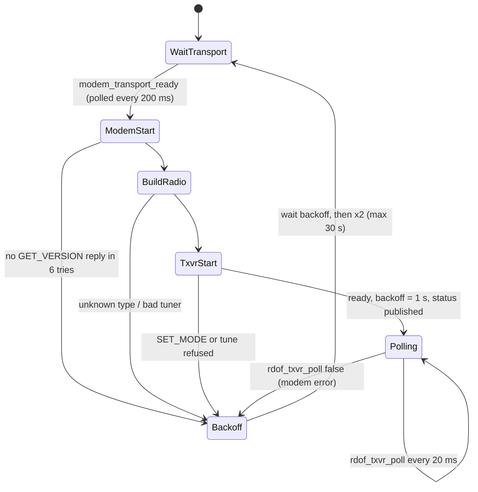
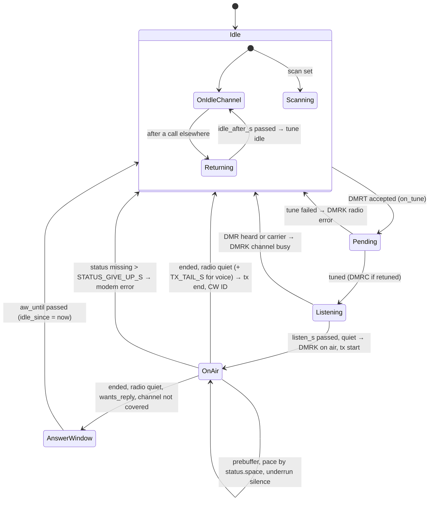

# Roaming transceiver (firmware)

Covers: the roamer role: the radio task's life cycle, the transceiver call cycle (DMRT → listen → on air → after the call), the idle channel, the answer window, scanning, and how it reports over HBlink4 and MQTT.
Sources: `common/src/txvr.c`, `common/include/rdof/txvr.h`, `esp_idf/main/{roamer.c,radio_task.c,roam_hblink.c,roam_mqtt.c,rx_path.c}`, `common/src/config.c` (`roamer`).
Related: [radio.md](radio.md) (MMDVM protocol, modem, radio types, tuners), [dmr-core.md](dmr-core.md) (bursts, regeneration, tracker), [hblink.md](hblink.md) (DMRC / DMRT / DMRK / DMRD bytes), [mqtt.md](mqtt.md) (topics and JSON), [config.md](config.md), [../repeater.md](../repeater.md) (simplex framing rules R5–R11, the repeater role).

A roamer is one simplex radio on an MMDVM modem (USB, UART or the board's SDR modem; [radio.md](radio.md)). Between calls it is
a receiver on its idle channel (or scanning). HBlink4 retunes it per call with DMRT; it answers DMRK and plays the call out
on slot 2.

## 1. Instances and tasks

| Item | Value | Where |
|---|---|---|
| Radios a board runs (roamers + repeaters) | 2 | `common/include/rdof/config.h:RDOF_MAX_RADIOS` |
| Memory | each radio's `roam_t` and stacks from the boot memory plan (role `radio1`, `radio2`); refused: `radio_error` = "not started: memory plan: …"; unplanned ("either" mode), a second radio needs 20 KB internal free | `roamer.c:roamer_mem_claims`, `EXTRA_RADIO_INTERNAL`; [memory.md](memory.md) |
| Start order per radio | `modem_port_init`, `roam_rx_start`, `radio_start`, `roam_hb_start`, `roam_mqtt_start`, then the modem transport (`sdr`, `split`, `uart`, else `usb`) | `roamer.c:start_one` |

| Task | Stack | Priority | Period | Where |
|---|---|---|---|---|
| `radio` (modem start, transceiver poll) | 8192 | 11 | 20 ms (`vTaskDelayUntil`) | `radio_task.c:radio_start` |
| `roam_hblink` (peer link) | 4096 | 8 | recv timeout 500 ms | `roam_hblink.c:roam_hb_start` |
| `rx` (tracker, receive outputs) | 8192 | 7 | queue wait 100 ms; queue 64 bursts | `rx_path.c:roam_rx_start` |
| `roam_status` (MQTT heartbeat) | 3072 | 4 | 10 s | `roam_mqtt.c:heartbeat_task` |

Radio 1 (the second) puts its tasks' stacks and buffers in PSRAM (`roam_t.psram_stacks`).

Locking: `rdof_txvr_t.lock/unlock` is one FreeRTOS mutex per radio (`radio_task.c:lock_fn`). It guards the call, its
queue, orphans and refused list against the HBlink4 task. Modem I/O runs outside it.

## 2. Radio task life cycle

| Step | Rule | Where |
|---|---|---|
| Modem start | `rdof_modem_start(&modem, 6)`: GET_VERSION up to 6 times | `radio_task.c:radio_task` |
| Radio type | `auto`: `rdof_radio_detect(version)`; unknown: error "can't tell what '…' is". Else `radio_hotspot`, `mmdvm_hs`, `mmdvm` | `radio_task.c:build_radio` |
| Tuner | modem tuner unless the type is `mmdvm`; `mmdvm` needs `tuner: fixed` (rigctld / command refused) | `build_radio` |
| Backoff | 1 s, doubling, max 30 s; reset to 1 s after a good start | `radio_task.c:radio_task` (`backoff_ms`) |
| Progress log | every 60 s while polling: requests, no-reply, refused, bursts heard, state | `radio_task` (`next_log`) |
| Receive-only build (`RDOF_FEATURE_TX` off) | SET_MODE DMR, tune idle, then status every 2 s; everything heard is passed on; every DMRT answered `radio error` | `radio_task.c`, `roam_hblink.c:dispatch` |

`rdof_txvr_start` (`txvr.c`): clear `has_tuned`, SET_MODE DMR, tune to the idle channel (a retune: DMRC + status), `ready = true`.

## 3. Transceiver state

### 3.1 Call states

`rdof_txcall_state_t`: `PENDING`, `LISTENING`, `ON_AIR`, `DONE`. Reported names (`rdof_txvr_state_name`): `idle` (no call),
`pending`, `listening`, `on_air`, `done`.

### 3.2 DMRT handling (`rdof_txvr_on_tune`, HBlink4 task, locked)

Checked in this order:

| # | Condition | Answer |
|---|---|---|
| 1 | A call with the same stream id exists | nothing (a repeat) |
| 2 | Any other call exists | `TXVR_BUSY` (4) |
| 3 | `!ready` | `RADIO_ERROR` (3) |
| 4 | `now - modem.last_rx < RX_HOLD_S` and tuned and tune freq not within 100 Hz of the tuned freq, and not `preempt` | `TXVR_BUSY` (4) |
| 5 | (freq ±100 Hz, cc) not in `channels` | `NOT_ALLOWED` (2) |
| 6 | Accepted: new call, `PENDING`; power 255 replaced by the channel's power if that isn't 255; orphan bursts of the stream replayed into it | (DMRK later) |

DMRK status codes: `common/include/rdof/hblink.h` enum `RDOF_DMRK_ON_AIR` 0, `CHANNEL_BUSY` 1, `NOT_ALLOWED` 2, `RADIO_ERROR` 3,
`TXVR_BUSY` 4. A refusal records the stream id in a ring of 64 (`RDOF_TXVR_REFUSED`) and drops its orphans; later DMRD of
that stream are ignored. Packet layout: [hblink.md](hblink.md).

`modem.last_rx` is set on every DMR_DATA / DMR_LOST frame on either slot (`common/src/modem.c:on_frame`), whether or
not the transceiver is listening.

### 3.3 DMRD handling (`rdof_txvr_on_burst`)

| Case | Action |
|---|---|
| Stream is the current call's, state not `DONE` | `add` to the call |
| Stream refused | dropped |
| Otherwise (DMRD before its DMRT) | held as an orphan: up to 4 streams (`RDOF_TXVR_ORPHANS`) of 16 bursts (`RDOF_TXVR_ORPHAN_BURSTS`); a 5th stream replaces the oldest; extra bursts dropped; expired after `RDOF_TXVR_ORPHAN_S` (0.5 s) in `rdof_txvr_poll` |

`add` (queueing as the modem needs it; rules in [../repeater.md](../repeater.md) and [dmr-core.md](dmr-core.md)):

- First burst with a source sets the call's src, dst, group.
- `asks_reply` (below) sets `wants_reply`.
- Every burst is regenerated for the channel's color code, simplex sync (`rdof_regenerate`).
- A CSBK with the terminator flag as the first burst (a CSBK on its own): `has_csbk`, and `min(csbk_preambles, 16)`
  preamble CSBKs queued first (`rdof_csbk_preambles`).
- First voice LC header that decodes (BPTC(196,96)): its 9-byte LC kept for synthetic terminators.
- Headers: `max(1, radio.headers) - headers_so_far` copies (R11.4); `extra` += copies − 1 before the call started
  (raises the prebuffer). Terminators likewise with `radio.terminators`.
- Voice (no data sync): superframe positions kept whole: start at the first A, gaps filled with silence, a burst whose
  position went out as silence dropped (`voice`, R6.2–R6.5). Embedded fields B–E are remembered for silence.
- Queue: a ring of `RDOF_TXVR_QUEUE` (256) bursts; over that, dropped and counted (`call.dropped`, `queue_dropped` in `/api/status`).
- `last_burst = now`; terminator flag → `ended`.

`asks_reply` (`txvr.c:asks_reply`), true for:

| Burst | Rule |
|---|---|
| CSBK | CRC good, FID 0x00 or 0x10, and opcode 0x24 with byte 3 = 0x80 (radio check) or opcode 0x1F (call alert) |
| Data header | CRC good, confirmed DPF, response requested |
| Rate 1/2 data | after an unconfirmed header with SAP 4 (IP): the first 48 bytes collected; IPv4, UDP, destination port 4007 (`TMS_PORT`), TMS byte 2 of the payload has 0x40 (`TMS_ACK_REQUESTED`) and not 0x10 (`TMS_CONTROL`) |

### 3.4 Pending → listening (`start_call`)

Clear any answer window. Tune (freq, cc, power); if (freq, cc, power) equal the tuned values no command is sent and
`retuned` is false. `listen_until = now + listen_s`. `quiet_since = tuned_at` if retuned, else
`max(now - clear_s, tuned_at)`.

### 3.5 Listening (`listen`)

- Effective `quiet_since`: if the last heard call has ended, the call has a src, and the heard call is the reverse
  (heard src = our dst, heard dst = our src), `max(quiet_since, heard_end + CALL_TAIL_S)`. The last heard call comes from
  the receive tracker's `on_call` (`rx_path.c:on_call` → `rdof_txvr_heard_call`: `start`/`late_entry` set it, `end`/`lost`
  stamp its end).
- Busy if `modem.last_rx > quiet_since`. If not, and `STATUS_EVERY_S` passed since the last status, GET_STATUS:
  busy if `carrier` ≠ 0. A failed status read is ignored.
- Busy: DMRK `CHANNEL_BUSY`, call finished.
- `now ≥ listen_until`: DMRK `ON_AIR`, state `ON_AIR`, `on_air_at = now`, `on_tx("start")`.

### 3.6 On air (`play`)

1. Locked: if not ended and `now - last_burst > STREAM_TIMEOUT_S` (1.5 s): ended. For a voice call (vpos set) with no
   terminator queued, `max(1, radio.terminators)` synthetic Terminator-with-LC bursts are queued, from the header's LC or
   a group/private LC built from src/dst (R7.8, R11.5).
2. Not started, fewer than `prebuffer + extra` bursts queued, not ended: wait. `prebuffer` is the setting when fixed,
   the stream's start target when auto (3.9).
3. Underrun: nothing queued, not ended, started, voice, and `air_until - now ≤ BURST_S`.
4. Queued or underrun: GET_STATUS when `STATUS_EVERY_S` passed or `space ≤ 1`. A missing reply sets `space = 0`, counts
   `status_misses`, and is ridden out for `STATUS_GIVE_UP_S`; past that, modem error. Then:
   - underrun: one silence burst at the next position if `space > 1`; auto, under its maximum, the stream moves back a
     burst instead (3.9);
   - else write bursts while `space > 1` (the last free place is never used, R10.2). Each write: `space--`,
     `air_until = max(air_until, now) + BURST_S`, `on_sent`.
5. Ended and all handed over: every `STATUS_EVERY_S`, GET_STATUS (failure: modem error). While `transmitting`, wait.
   First quiet poll stamps `quiet_at`. A voice call (no lone CSBK, no reply wanted) waits `TX_TAIL_S` more. Then the
   call finishes (`on_tx("end", duration = now - on_air_at)`), and:
   - `wants_reply`, `answer_s > 0`, and the frequency not within 100 Hz of a `covered` one: answer window
     (`aw_until = now + answer_s`, `aw_cap = now + answer_max_s`) on the call's channel; no CW ID;
   - else `after_call`: CW ID.

### 3.7 CW ID (`after_call`)

Only with `cwid` set and tuned. At most once per `cwid_every_s` per frequency (exact Hz), in a table of 16 frequencies
(`RDOF_TXVR_IDS`; when full, slot 0 is overwritten). Sequence: wait until not transmitting, SET_MODE idle, SEND_CWID,
wait until not transmitting, SET_MODE DMR. Wait: GET_STATUS, then 100 ms sleep, up to 150 times (about 15 s). Any
failure: modem error.

### 3.8 Idle (`idle`)

Each poll with no call:

1. Answer window open but expired (time, or no longer tuned to its channel): close it, `idle_since = now`.
2. Answer window open: stay.
3. Else scanning: `scan_step` once `now - idle_since ≥ idle_after_s`.
4. Else not on the idle channel and `now - idle_since ≥ idle_after_s`: tune to idle (a retune).
5. GET_STATUS every `IDLE_STATUS_EVERY_S` (keeps the OpenGD77 in hotspot mode; failure: modem error).

### 3.9 Jitter buffer (`common/src/jitter.c`)

Network voice comes one burst per 60 ms, each late by however long the network held it. The prebuffer is what absorbs
that: a burst that is late by less than the cushion is still in hand when its turn on the air comes. Late by more, its
position goes out as silence (R6.3) and the burst is dropped when it comes (R6.4). The roamer's transceiver and the
repeater (network calls only) share this code; each keeps one `rdof_jb_t`, and each call one `rdof_jb_stream_t`.

**Modes.** `jitter_buffer: "auto"` (the default) sizes the prebuffer from what the network did. A number of ms is a
fixed size, rounded up to whole 60 ms bursts (`300` → 5, `310` → 6). The older `prebuffer` (bursts) is also fixed.
Fixed behaves exactly as before; the buffer still measures, for the status. The library's own default
(`rdof_jb_init`) is fixed, so the scenario tests that pin the reference behavior run unchanged; the box config turns
auto on.

Auto is the config default because a fixed 360 ms is both too much and too little: on a LAN or a good uplink it adds
about 200 ms of delay to every call for nothing, and on LTE or satellite a stall of more than about 250 ms cuts words
out of every call. Auto learns the first and starts the second call lower; for the second it grows during the call and
starts the next one higher. Nothing pinned by the tests had to change for it: the only test changes are the
config description strings (`jitter=auto:180-480;` / `jitter=fixed;`).

**Measure.** Each arrival's transit is `arrival − t0 − idx × 60 ms`, where t0 is the stream's first arrival and idx
its burst number, from the DMRD sequence byte (a jump counts lost bursts, a step back is an out of order one, an
unchanged byte is one on). Over the last 64 arrivals (3.84 s), the lateness `late_ms` is the second worst transit less
the earliest, so one straggler doesn't set the size. `jitter_ms` is RFC 3550's running estimate
(J += (|ΔD| − J) / 16), reported only. A call's `peak_ms` is its largest `late_ms`.

**Target.** `target = clamp(2 + ceil((late_ms + 10) / 60))` bursts: 2 for the radio's own lead (it underruns when it
holds one burst or less, R10.2), the lateness rounded up to bursts with a 10 ms margin, between `jitter_min_ms` and
`jitter_max_ms` (180 and 480 ms: 3 and 8 bursts). A steady link: 3 bursts. 100 ms of lateness: 4. 300 ms: 8.

**Memory.** At a call's end (with at least 6 arrivals), its peak is remembered for its (destination, group,
slot), 8 of them, least recently used replaced, and for the link as a whole. A remembered value rises at once and
falls by half a call: `new = peak ≥ old ? peak : (old + peak) / 2`. A new call starts at the target for its key's
value, else the link's, else 6 bursts (360 ms, the old fixed size) before anything is known. Mid-call, after 16
arrivals, the stream's own estimate sets the target.

**Grow.** An underrun mid voice call fills one silence (R6.3). Auto, while the stream's start plus what it has grown
is under the maximum, that silence moves the stream's superframe positions back one (`vshift`) instead of taking the
next burst's place: the burst is still sent when it comes, and the stream now runs a burst further behind. Over the
maximum, and when fixed, R6.4 applies as before.

**Shrink.** Only at safe points, and slowly:

- a gap of lost bursts (R6.2) is filled with silence only up to the target; the rest of the gap is skipped;
- a burst whose three AMBE frames are all the silence frame is dropped while the bursts in hand (queued plus the
  radio's) are at least one over the target;
- a voice burst is dropped only to give back what the stream grew, after it has been over the target for 2 s
  (`RDOF_JB_SHRINK_S`), one per 2 s.

Headers, terminators, data and CSBKs are never moved or dropped. A voice burst that moves to another superframe
position keeps its AMBE and gets the sync (A) or the EMB (color code, PI, the position's LCSS) and embedded field of
its new position: the roamer uses the embedded LC fragments it has seen for that position, the repeater the call's
LC (R7.3). So header, terminator and embedded LC continuity hold, and every burst stays on the 60 ms slot grid; only
when TX starts and how deep the queue runs change.

**Numbers.**

| Name | Value | Where |
|---|---|---|
| Burst | 60 ms | `jitter.h:RDOF_JB_BURST_MS` |
| Arrival window | 64 (3.84 s) | `RDOF_JB_WINDOW` |
| Keys remembered | 8 | `RDOF_JB_KEYS` |
| Radio lead | 2 bursts | `RDOF_JB_LEAD` |
| Margin | 10 ms | `RDOF_JB_MARGIN_MS` |
| Start, link unknown | 6 bursts (360 ms) | `RDOF_JB_UNKNOWN` |
| Arrivals before the stream's own target | 16 | `RDOF_JB_SAMPLES` |
| Arrivals to be remembered | 6 | `RDOF_JB_REMEMBER` |
| Voice drop spacing | 2 s | `RDOF_JB_SHRINK_S` |
| Bounds (auto default) | 180 – 480 ms | `RDOF_JB_MIN_MS`, `RDOF_JB_MAX_DEFAULT_MS` |
| Largest setting | 3000 ms | `RDOF_JB_MAX_MS` |

**Status.** `/api/status` `roamer.jitter` (and the repeater's): `mode`, `target_ms` (the current or last stream's
target; fixed: the setting), `jitter_ms`, `late_ms` (the current or last stream's), `min_ms` and `max_ms` (auto), and
since boot `streams`, `underruns`, `grown`, `shrunk`.

What it can't do: lateness past the maximum still costs words (R6.4), and a larger maximum adds that much delay
whenever a link needs it. The repeater's 2 extra headers count as cushion, so it can shrink a burst or two below the
roamer's numbers.

## 4. Receiving

`rdof_txvr_heard` (modem reader context) passes a burst on only when all hold:

| Rule | |
|---|---|
| slot 2 | a simplex modem's bursts |
| not `tuning` | between the first tune command and its last ACK, the channel is unknown: dropped |
| a receiver is set | |
| `listening`: on the idle channel, or on a scan channel, or in the answer window on its channel | elsewhere it is only visiting to transmit |
| not `ON_AIR` | |

In the answer window each burst heard moves `aw_until` to `min(now + answer_s, aw_cap)`. RSSI → dBm by
`rdof_radio_rssi` (NaN if none; [radio.md](radio.md)). The burst goes to the `rx` task queue (64; full: dropped with a
warning) with the tuned frequency and color code; the tracker sets `freq_hz` from it and feeds the call tracker
([dmr-core.md](dmr-core.md)), whose outputs go to MQTT `json` / `raw` and, with `receiver_hblink`, DMRD to HBlink4 as
this peer.

On a roamer the HBlink sink's `before_stream` sends DMRC (only if it changed) before each new stream's first DMRD, so
HBlink4 credits the stream to the channel it was heard on (`rx_path.c:hb_before`).

## 5. Scanning (`CONFIG_RDOF_SCAN`, default y)

Set by the roamer's `scan`. Without `CONFIG_RDOF_SCAN` the setting is logged and ignored: it stays on the idle channel.

`scan_step` (`txvr.c`), once per poll while idle and not in an answer window:

| Situation (tuned to scan channel `here`) | Action |
|---|---|
| Heard since tuning (`last_rx > tuned_at`) and `now - last_rx < hang_s` | hold; first time: `stopped = true`, `on_scan(true)` |
| Was holding, hang over | `stopped = false`, `on_scan(false)`, hop to `here + 1` |
| Nothing heard, `carrier_s > 0`, not yet checked, dwell ≥ `carrier_s` | GET_STATUS once (failure: modem error); no carrier → dwell counts as complete |
| Nothing heard, dwell < `dwell_s` | stay |
| Nothing heard, dwell ≥ `dwell_s` | hop to `here + 1` |
| Not on a scan channel (after a call, after the idle tune at start) | hop to `scan_next` |

A hop is a tune with `hop = true`: no `on_retune` (no DMRC, no status, no log). DMRC still goes out before a stream heard
there (section 4). `scanning` = scan set, no call, not holding. After a call (and `idle_after_s`): if the call's channel
is a scan channel, it counts as the current dwell (from the call's tune) and the scan goes on from the next one;
otherwise it hops to `scan_next`, the channel after the one it was on when the call came.

`on_scan` (`radio_task.c:scan`): INFO log `scan: holding|resuming`, DMRC if changed, MQTT status.

## 6. Timers and thresholds

| Name | Value | Where |
|---|---|---|
| Frequency match tolerance | 100 Hz | `common/include/rdof/txvr.h:RDOF_TXVR_FREQ_TOLERANCE_HZ` |
| Orphan hold | 0.5 s | `txvr.h:RDOF_TXVR_ORPHAN_S` |
| Stream timeout (no DMRD) | 1.5 s | `txvr.h:RDOF_TXVR_STREAM_TIMEOUT_S` |
| Status while listening / on air | 0.06 s | `txvr.h:RDOF_TXVR_STATUS_EVERY_S` |
| Burst air time | 0.06 s | `txvr.h:RDOF_TXVR_BURST_S` |
| Status while idle | 2.0 s | `txvr.h:RDOF_TXVR_IDLE_STATUS_EVERY_S` |
| Missed status ridden out | 2.0 s | `txvr.h:RDOF_TXVR_STATUS_GIVE_UP_S` |
| Transmit tail after not-transmitting | 0.5 s | `txvr.h:RDOF_TXVR_TX_TAIL_S` |
| Heard recently: don't tune away | 1.0 s | `txvr.h:RDOF_TXVR_RX_HOLD_S` |
| Heard call's tail (reply rule) | 0.5 s | `txvr.h:RDOF_TXVR_CALL_TAIL_S` |
| Call queue | 256 bursts | `txvr.h:RDOF_TXVR_QUEUE` |
| Orphan streams × bursts | 4 × 16 | `txvr.h:RDOF_TXVR_ORPHANS`, `RDOF_TXVR_ORPHAN_BURSTS` |
| Refused stream ids | 64 | `txvr.h:RDOF_TXVR_REFUSED` |
| Channels, covered | 32 each | `txvr.h:RDOF_TXVR_MAX_CHANNELS`, `RDOF_TXVR_MAX_COVERED`; `config.h:RDOF_CFG_CHANNELS` |
| CW ID frequency table | 16 | `txvr.h:RDOF_TXVR_IDS` |
| CSBK preambles cap | 16 | `txvr.c:add` |
| CW ID quiet wait | 150 × (status + 100 ms) | `txvr.c:wait_until_quiet` |
| Poll period | 20 ms | `radio_task.c:radio_task` |
| Modem restart backoff | 1 s → ×2 → 30 s | `radio_task.c:radio_task` |
| DMRC keepalive (roamer) | 5.0 s | `common/include/rdof/hblink.h:RDOF_HB_ROAMING_KEEPALIVE_SECONDS` |
| Master lost | no DMRP for 3 keepalives (15 s) | `roam_hblink.c:keepalive` |
| HBlink4 reconnect backoff | 1 s → ×2 → 30 s | `roam_hblink.c:peer_task` |
| MQTT status heartbeat | 10 s | `roam_mqtt.c:heartbeat_task` |

Settings (defaults; `common/src/config.c:roamer`, `rdof_txvr_init`; details in [config.md](config.md)):

| Key | Default | Meaning |
|---|---|---|
| `listen_s` | 0.3 | listen before talk after tuning |
| `clear_s` | 2.0 | already on the channel: how far back traffic counts |
| `jitter_buffer` | `"auto"` | `"auto"` or a fixed size in ms, rounded up to whole 60 ms bursts (3.9) |
| `jitter_min_ms` / `jitter_max_ms` | 180 / 480 | auto's bounds, rounded up to whole bursts |
| `prebuffer` | 6 | the older fixed size in bursts; set, it turns auto off (not with `jitter_buffer`) |
| `csbk_preambles` | 2 | preambles before a CSBK on its own |
| `answer_s` / `answer_max_s` | 0.75 / 5.0 | answer window, restart / cap |
| `idle_after_s` | 0 | delay before going back to idle / scanning |
| `cwid`, `cwid_every_s` | "" / 900 | CW ID after a call, per frequency |
| `channels` | all plan channels if absent | allowed (freq, cc, power); the idle channel is added if missing |
| `idle` | required | plan channel or `{freq, cc}`; power 255 |
| `covered` | derived | the box's `sdr` radios' channel frequencies, sorted, deduplicated |
| `scan` | off | `true`, or `{channels: "all" or plan refs, dwell_s 0.45, hang_s 3.0, carrier_s 0}`; scan channels' power 255 (`all`: the channels' own); require `dwell_s > 0`, `hang_s ≥ 0`, `0 ≤ carrier_s < dwell_s` |

## 7. Reporting

### 7.1 HBlink4 ([hblink.md](hblink.md))

| Packet | When | Content (roamer) |
|---|---|---|
| DMRC | every 5 s (forced); on retune and on scan hold / resume (if changed); before a received stream's first DMRD (if changed) | rx = tx = the tuned frequency (0 untuned), cc, slots `'4'`, power 0, version "RadioFoundry Gateway roaming", software "radiofoundry_gateway simplex", location tail (0/0 if none) and idle channel tail |
| DMRK | per DMRT: refusal at once; `CHANNEL_BUSY` or `ON_AIR` after listening; `RADIO_ERROR` on a modem error while pending / listening | peer, stream id, status, freq, cc |
| DMRD | what the receiver hears (tracker → HBlink sink) | as an SDR receiver's |
| in: DMRP | marks the peer registered (`hblink_up`, status published on the change) | |
| in: MSTN / MSTC | peer refused: `hblink_up = false` | |
| in: DMRT, DMRD | to the transceiver | |

Transport: UDP, or SCTP in UDP with `hblink.transport: sctp` (`CONFIG_RDOF_HBLINK_SCTP`; DMRD given `sctp_ttl_ms`
lifetime, DMRC / DMRK reliable).

### 7.2 MQTT ([mqtt.md](mqtt.md))

Topics `{root}/{name}/roaming/{json,raw,tx}` and retained `{root}/_sdr/{name}/status`; client id
`rdof-roaming-<name>`; last will `{"state": "offline"}`.

| Message | When |
|---|---|
| Retained `Receiver` (`source: roaming`, idle frequency and cc, `device` = callsign, location) | each MQTT connect |
| Status `{state, at, frequency, colorCode, listening, scanning, radio, hblink, onAir}` | connect; every 10 s; retune; scan hold / resume; tx start / end; HBlink4 up / down; radio ready / failed |
| `tx` start / end (end with duration) | `on_tx` |
| Network call start / end on `json`, each burst sent on `raw` (`source: network`; a lone CSBK as `action: csbk`) | `on_tx` / `on_sent` (`rdof_netcalls_*`) |
| Calls heard (tracker JSON, raw bursts) | receive path |

`/api/status` `roamer` (and `roamers` with two radios) adds `state`, `listening`, `scanning`, `status_misses`,
`queue_dropped`, frequency and color code now, and `jitter` (3.9) (`roamer.c:one_json`).

## 8. Behavior notes

| Topic | Behavior |
|---|---|
| Queues | call queue 256, 4 × 16 orphans, 32 channels, 16 CW ID frequencies, ≤ 16 CSBK preambles; overflow dropped / counted |
| Orphan overflow | a 5th early stream replaces the oldest |
| Tuners | modem and `fixed` only; rigctld / command refused |
| Modem over UDP | not supported |
| HBlink4 transport | UDP or SCTP over UDP |
| DMRC / status on scan hold / resume | always |
| Status publishes | retune, scan, tx, the 10 s heartbeat, HBlink4 up / down, radio ready / failed, and each MQTT connect |
| Receiver tick | the `rx` task ticks the tracker (≤ 100 ms) |
| Receive path | queued to the `rx` task (64; full: dropped) |
| CW ID wait | 150 status polls with 100 ms sleeps |
| Retune log | `tuned to F MHz CCn` (no power) |
| Receive-only build | `RDOF_FEATURE_TX` off: refuses all DMRT with `RADIO_ERROR` |
| Settings layout | box config only (no `${VAR}`) |

- The OLED shows the transceiver's state name plus ` scanning` or ` on idle` (`oled_task.c`).
- It won't tune away mid-call: a DMRT for another channel within a second of hearing something is answered
  busy (`TXVR_BUSY`) unless it preempts. The check compares frequency only (not color code), and "hearing
  something" is any DMR_DATA or DMR_LOST frame on either slot (`modem.last_rx`), including on a channel it is only
  visiting.
- Scan channels are tuned at power 255 unless `scan.channels` is `all` (then the channels' own power).
- An `mmdvm` type with no `tuner` passes the settings and fails at radio build time instead (`build_radio`: "an MMDVM
  board needs radio.tuner: fixed"); with `auto` that is only known once the modem has answered.
- A DMRC goes out every 5 s from a roamer, every 10 s from a repeater.
