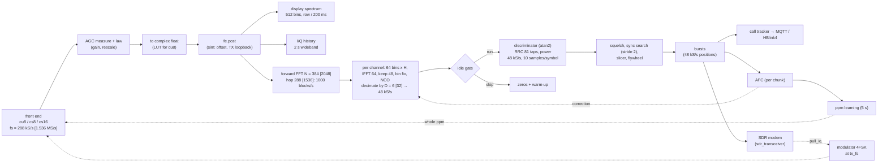

# SDR signal path (firmware)

What: the ESP32 firmware's SDR path as built: the pipeline and its rates, the DSP task and cores, the settings, the CPU budget, the vectors and tests, and the tolerances each stage is held to. Per-stage detail is in the three files below.
Sources: `sdr/` (portable C, library `rdof_sdr`), `esp_idf/main/{sdr_task,dsp_esp,fe_*,modem_sdr,bench_*}.c`, `rtlsdr/`.
Related: [sdr-rx.md](sdr-rx.md) (receive stages, AFC, ppm, sample clock), [sdr-frontends.md](sdr-frontends.md) (front ends, resampler, spectrum, I/Q history), [sdr-tx.md](sdr-tx.md) (modulator, SDR modem, loopback, bench TX), [../bench-api.md](../bench-api.md), [../lr2021-iq.md](../lr2021-iq.md), [../repeater.md](../repeater.md).

## 1. Pipeline

`D = fs/48000`, `N = 64·D`, hop = 3N/4. Rates are shown for the S3's 288 kS/s (D = 6, N = 384, hop 288), with
1.536 MS/s (D = 32, N = 2048) in brackets.

The channelizer is the only decimation: by D in a single overlap-save step (an M = 64-point IFFT per block, 48 of
the 64 outputs kept). Everything after it runs at 48 kS/s.

## 2. The DSP task (`sdr_task.c`)

| Item | Value |
|---|---|
| chunk | `CONFIG_RDOF_SDR_CHUNK` 4096 samples (14.2 ms at 288 kS/s) |
| DSP task | core 1 (`DSP_CORE`), priority 12, 8192-byte stack |
| helper (two cores) | core 0, priority 10, `CONFIG_RDOF_SDR_HELPER_STACK` 6144 |
| stall restart | no samples for `STALL_US` 3 s: stop, retune, start |
| time | `t0` re-anchors to the clock when the lag (at the chunk's start) exceeds 1 s, and, once netclock is synced, when the least lag over 2 s exceeds 100 ms (netclock slews in its first reference's offset, and the crystal drifts); `vTaskDelay(1)` if the task hasn't blocked for 100 ms |

**Per chunk** (`chunk()`): read (with filler), AGC measure (cu8 fast path) and law, convert, `fe.post`, rescale by
the gain taken off, display spectrum, `rdof_sdr_rx_process`, I/Q history (`bench_on_chunk`), and `ppm_tick` every 5 s.

**Plan** (`plan()`): the center comes from a bench retune, else the settings' center, else `rdof_plan_center_band`, else
`rdof_plan_window_band` (drops channels that don't fit, logging each), both with the front end's `usable` and DC guard. A bench tap with no channel adds one at
`center + rate/8`. The ppm is set on the chip; the receiver's software ppm is 0.

**Gain** (`tune()`): a bench retune's fixed gain (AGC off), else the AGC law, else the fixed gain, else the tuner's
own AGC.

**Two cores** (`"dsp_cores": 2`, `CONFIG_RDOF_SDR_TWO_CORES`): core 1 runs the forward FFTs (`rdof_chz_forward`). Then
each core takes a range of channels end to end: channelizer share (`rdof_chz_channels`) and demod. Trackers and AFC
run on core 1 afterwards. The split starts at `clamp(lrint(C/2 − 0.6), 1, C)` channels on core 1. The balancer works
over windows of 64 chunks: it moves one channel toward the less busy core, keeps the move if the next window was 2%
faster, else reverts and waits 8 windows. Core 1 keeps at least one channel. The output is the same as on one core
(`sdr_selftest_tests`).

**esp-dsp** (`CONFIG_RDOF_SDR_ESP_DSP`, `dsp_esp.c`), each part checked against the built-in code at boot:

| Part | Used for | Check |
|---|---|---|
| `dsps_fft4r_fc32` (radix 4, ≤ 256) through one permutation | 64-point IFFT, power-of-4 forward FFTs | 1e-4 of the largest bin |
| `dsps_fft2r_fc32` (≤ 512) | other powers of two (spectrum 512) | same; sign flipped if the library's is the other way |
| 6 × 64 | 384-point forward FFT (288 kS/s) | same |
| P × Q (P ∈ {5, 3, 6, 2}, Q a power of 4 ≤ 256) | 768, 1280, 1536 (576, 960, 1152 kS/s) | its own check (`fft_pq_ok`) |
| int16 SIMD FIR / `dsps_fir_f32` | matched filter | 2 Hz / 0.05 Hz ([sdr-rx.md](sdr-rx.md) §4) |

## 3. Settings (`sdr/src/config.c`)

A plain SDR config, or a box's SDR section, resolved to the same settings ([config.md](config.md)).

| Key | Default | Note |
|---|---|---|
| `device.sample_rate` | 1.536e6 (the board's default settings, `settings.c`, set 288000) | must be a multiple of 48000 |
| `device.center` | auto (0) | MHz if < 1e5, else Hz |
| `device.gain` | auto | dB |
| `device.agc` | off | `{min, clip, headroom_db, hold_s, relax_s, settle_s}`; needs `gain` |
| `device.ppm` | 0 | whole ppm on the chip; the start value for learning |
| `device.type` | rtlsdr | rtlsdr, lr2021, sim, sx1255 |
| `rssi_offset` | `−gain − 25` (gain 30 if auto) | |
| `afc` | true | |
| `status_seconds` | 30 | |
| `usb {transfers, transfer_kb}` | 8, 8 | |
| `dsp_cores` | 1 | 2 needs `CONFIG_RDOF_SDR_TWO_CORES` |
| `idle_gate` | true | |
| `learn_ppm` | true | |
| `sim`, `sim_ppm` | false, 0 | |
| `spike`, `selftest` | false | |
| `slot_timing` | the box's | [../slot-timing.md](../slot-timing.md) |

Compile-time switches (`sdr/include/rdof/sdr/features.h`, Kconfig "RadioFoundry Gateway SDR (sdr)"):
`RDOF_FEATURE_SDR`, `_SDR_AGC`, `_SDR_BUILTIN_FFT`, `_SDR_RECEIVER` (needs `RDOF_FEATURE_TRACKER`), `RDOF_SDR_FAST_ATAN2`,
and `CONFIG_RDOF_SDR_DSP_IRAM` (off; hot code in IRAM).

## 4. CPU budget

Measured figures are in [reference.md](../../reference.md) ("CPU budget" for the host, "CPU budget on the S3 (measured)"). The S3 stage
table (2026-10-09, five busy channels at 288 kS/s, Mcycles per second of IQ):

| Stage | Mcycles/s |
|---|---|
| cu8 to float | 7.1 |
| forward FFT (384, 6 × 64) | 28.4 |
| per channel: bins, IFFT 64, NCO | 41.4 |
| discriminator | 37.8 |
| matched filter (int16 SIMD) + power | 36.4 |
| squelch, search, slicing, flywheel | 33.9 |
| trackers | 4.9 |
| **total** (of 480 for both cores) | **190** |

As of 2026-10-21, eight busy channels at 288 kS/s take 116% of one core, or 93% of the wall clock on two; at 960 kS/s,
176% and 168%. An idle channel's FM stage and search are nearly free behind the idle gate; its channelizer share
(about 0.07 of a core) remains. The modulator costs about 100 cycles a sample (30 Mcycles/s at 288 kS/s).

| Knob | Effect |
|---|---|
| channel count | the main lever: per-channel work doesn't depend on fs |
| `sample_rate` | only the wideband part (input + forward FFT, about 15% at 288 kS/s) |
| `dsp_cores: 2` | channels split over both cores (the balancer) |
| `idle_gate` | skips the FM stage and search on idle channels |
| `CONFIG_RDOF_SDR_CHUNK` | per-chunk overhead against latency and RAM |
| `CONFIG_RDOF_SDR_ESP_DSP`, `CONFIG_RDOF_SDR_FAST` (-O2), `CONFIG_RDOF_SDR_DSP_IRAM` | kernels and code placement |

The self-test (`"selftest": true`) prints the stage table, `prof` lines per core, and the `selftest_load` runs.

## 5. Vectors and tests

The golden vectors are committed fixtures: a reference receiver's output for the same inputs. No generator runs
at build time.

| Fixture | Holds | Checked by |
|---|---|---|
| `host-tests/fixtures/sdr-vectors/` | `sdr_vectors.h`, `sdr-data/` | `rdof_sdr_tests`, `rdof_sdr_tests_min` (`test_sdr.c`) |
| `host-tests/fixtures/mod-vectors/` | `mod_vectors.h`, `mod-data/` | `rdof_mod_tests` (`test_mod.c`) |
| `esp_idf/main/selftest/clip.{cu8,h}` | the self-test's recording; the fault variants are made from it | `sdr_selftest_tests`, the board's self-test |
| `host-tests/vectors.h`, `scenarios.h` | `common` vectors (the DMR layer the demod uses, the tracker, the roamer) | `rdof_tests` |

`test_sdr.c` functions and what they pin: `test_iq` (conversion, exact), `test_fft` (2e-6), `test_filters`,
`test_plan`, `test_channelizer`, `test_fm`, `test_demod` (bursts exact), `test_e2e` (tracker messages byte for
byte), `test_agc` (decisions exact), `test_allocator`, `test_window`, `test_config`, `test_frontend` (caps, check,
convert), `test_resample`, `test_spectrum`, `test_atan2`, `test_ppm`, `test_rate`, `test_settle`,
`test_chz_split`. Also `rtlsdr_tests` (`test_rtl.c`: the driver against a fake dongle), `rtlsdr_gaps_tests` (`test_rtlsdr_gaps.c`) and
`sdrmodem_tests` (`test_sdrmodem.c`).

## 6. Tolerances

What each stage is held to against the golden vectors.

| Stage | C | Held to |
|---|---|---|
| input | `iq.c`, `rdof_fe_convert` | exact; cu8, cs8 and cs16 front ends; no cf32 |
| AGC | `agc.c` | decisions exact; a 256-entry peak queue (it can only delay a step up); stats round in binary |
| channelizer | `channelizer.c` | 5e-5 of RMS; H carries /M; the NCO advances per block |
| planning | `rdof_plan_center`, `rdof_plan_window` | `rdof_plan_center` exact; when the channels don't fit, `rdof_plan_window` takes the best window |
| FM | `fm.c` + S3 backends | 2 Hz (the polynomial atan2; the int16 FIR) |
| demod | `demod.c` | bursts exact; the 0.79 prefilter only skips positions the exact score would reject; sums in float, not double |
| receiver | `receiver.c` | tracker output byte for byte, with the idle gate, the muted-span AFC exclusion and a two-step channelizer |
| AFC | `receiver.c` | 1 Hz |
| ppm | `ppm.c`, `rate.c`, `sdr_task.c` | [sdr-rx.md](sdr-rx.md) |
| spectrum, history | `spectrum.c`, `bench_api.c` | |
| modulator | `mod.c` | I/Q 4e-6, frequency 0.002 Hz |
| SDR modem, loopback | `sdrmodem.c`, `loopback.c` | `sdrmodem_tests`, `rdof_loopback_edge_tests` |

Sign: `device.ppm` follows the RTL convention, positive for a fast crystal ([reference.md](../../reference.md), "The
tuner's ppm, learned").
